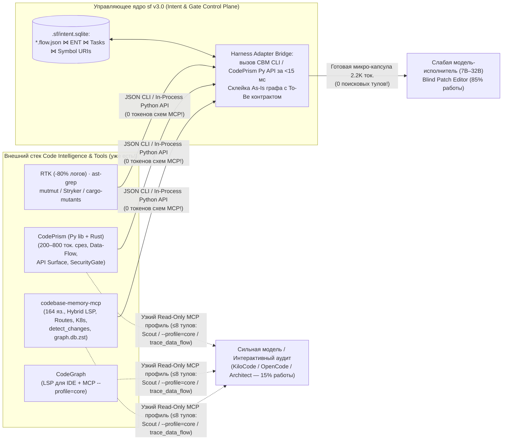
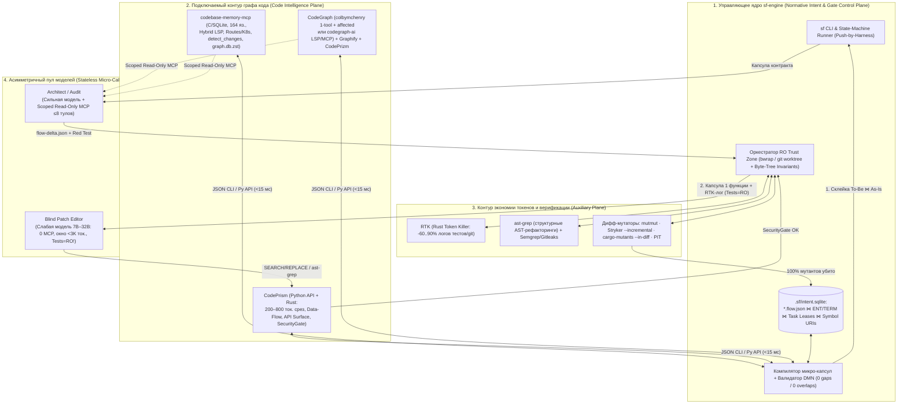
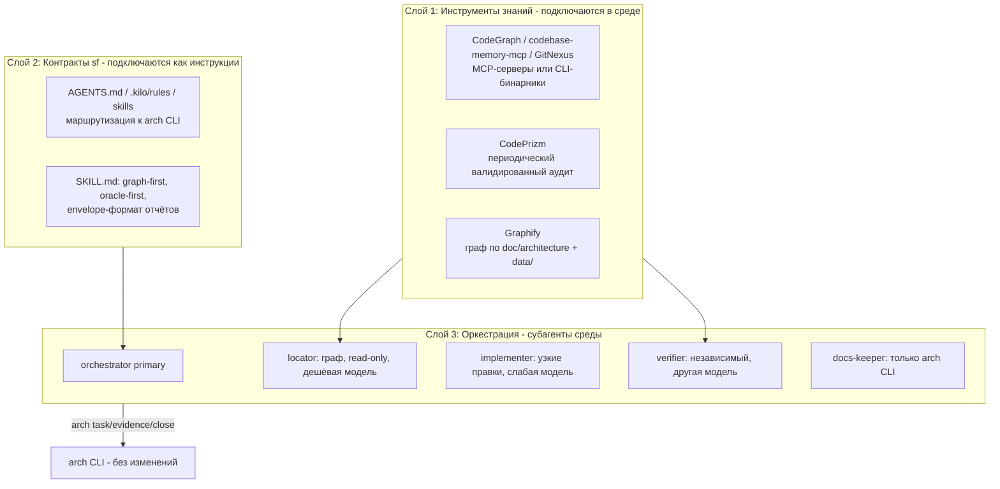

# Полный системный аудит `sf`, сравнение с мировыми аналогами (2024–2026) и федеративная архитектура `sf v3.0`

> [!tip] Модульная Obsidian-энциклопедия без дублирования (`SSOT` в `data/`)
> Весь настоящий консилиум (`arenaplanaudit.md` `v2.2`), а также полные наработки [audirarena.md](audirarena.md), [flowjson.md](flowjson.md) и синтез всех энциклопедий `data/` оформлены без единой потери в самодостаточную энциклопедию **[data/arenaauditplan-encyclopedia/Главная.md](data/arenaauditplan-encyclopedia/%D0%93%D0%BB%D0%B0%D0%B2%D0%BD%D0%B0%D1%8F.md)** (маршрутизатор для ИИ-агента — **[data/arenaauditplan-encyclopedia/Индекс.md](data/arenaauditplan-encyclopedia/%D0%98%D0%BD%D0%B4%D0%B5%D0%BA%D1%81.md)**, регламент — **[data/arenaauditplan-encyclopedia/AGENTS.md](data/arenaauditplan-encyclopedia/AGENTS.md)**, корневой навигатор по всей папке `data/` — **[data/README.md](data/README.md)**). Все дальнейшие обзоры и уточнения интегрируются непосредственно в `data/arenaauditplan-encyclopedia/`.

**Объект аудита:** вся программная фабрика `/home/user/sf` на ревизии `f8cb406` (`arch 0.2.0`) — корневые проектные документы ([Манифест агентной software factory.md](Манифест%20агентной%20software%20factory.md), [nextplan.md](nextplan.md), [seesionaudit.md](seesionaudit.md), [taskcontrol.md](taskcontrol.md), [worktree.md](worktree.md), [AGENTS.md](AGENTS.md)), пакет CLI `doc/tools/arch/` (`32` модуля, `11 486` строк Python), хранилище `doc/architecture/`, конфигурация `doc/config/` (`paths.yaml`, `agent-policy.yaml`, `102` файла `task-conf` объёмом `96 КБ`), каталог навыков `doc/skills/` (`15` файлов объёмом `127 КБ`), корпус из `34` задач `doc/tasks/UI-0001..UI-0033`, а также наработки [audirarena.md](audirarena.md) и [flowjson.md](flowjson.md).

**Глобальная сверхзадача проекта (Идеальный Конечный Результат — ИКР по ТРИЗ):**
> Построить **универсальную инженерную систему**, позволяющую агентным средам качественно и предсказуемо дорабатывать **большие существующие проекты с огромной кодовой базой (`100K–10M+ LOC`, полиглот-стеки)** при **минимальном расходе токенов** и **околонулевом риске пропуска багов/регрессий (`escaped defect rate → 0`)** — **даже при исполнении на слабых, компактных, локальных или дешёвых моделях (`7B–35B` open-weights, Haiku/Flash/mini-класса)**, превосходя по обоим показателям (`качество ↑`, `токены ↓`) `GitHub Spec Kit`, `OpenSpec`, `AWS Kiro`, `BMAD`, `Aider`, `Devin/Factory` и автономные поисковые харнесы.

**Ключевой архитектурный принцип редакции `v2.2` — «0 собственных MCP-велосипедов: двухтрековая федеративная коллаба готовых инструментов + субагентов среды поверх тонкого ядра `arch`»:**
> Разработка собственного MCP-сервера снята с повестки — ставка делается исключительно на **готовые внешние инструменты как гибко подключаемые компоненты**: live-графы навигации **[codebase-memory-mcp](https://github.com/DeusData/codebase-memory-mcp)** (MIT, Hybrid LSP для 10 языков вкл. PHP, Laravel routes), **[colbymchenry/codegraph](https://github.com/colbymchenry/codegraph)** (MIT, один главный tool `codegraph_explore` + `codegraph affected` test-impact; а также [codegraph-ai/CodeGraph](https://github.com/codegraph-ai/CodeGraph) / [websines/codegraph-mcp](https://github.com/websines/codegraph-mcp)), **[Serena](https://github.com/oraios/serena)** (MIT, LSP semantic retrieval/editing), граф документации и кода **Graphify** (MIT, Leiden-кластеры по `doc/architecture/` + `data/`), периодический валидированный аудит **[Green Olive CodePrizm](https://greenolivetech.com/products/codeprizm)** *(не путать с экспериментальным MCP [rustic-ai/codeprism](https://github.com/rustic-ai/codeprism) и Python-слайсером [knight22-21/CodePrism](https://github.com/knight22-21/CodePrism))*, опциональный security/taint-граф **GitNexus** (PolyForm NC), а также компрессоры **[RTK](https://github.com/rtk-ai/rtk) / Headroom**, `ast-grep` и дифф-мутаторы (`Infection`, `mutmut`, `Stryker`, `cargo-mutants`, `PIT`). При этом консилиум фиксирует **два взаимодополняющих трека**: **Трек А (Немедленный старт с `0` правок кода `arch` CLI)** — подключение графов, progressive-disclosure скиллов и плоской звезды субагентов (`OpenCode` / `Kilo Code` / `Claude Code`) прямо в конфигах агентной среды, и **Трек Б (Точечная починка инвариантного ядра `arch` CLI и формализация `*.flow.json`)**, где `arch` остаётся тонким детерминированным ядром контрактов без превращения в комбайн.

---

## Содержание

1. [Часть I. Полный аудит текущей системы `sf` (`v0.2.0`): реальное устройство, сильные стороны и 7 фундаментальных потолков](#часть-i-полный-аудит-текущей-системы-sf-v020-реальное-устройство-сильные-стороны-и-7-фундаментальных-потолков)
2. [Часть II. Глубокий ресёрч по энциклопедиям `data/` и науке/индустрии 2024–2026: сравнение с 16 аналогами, стек подключаемых code-инструментов и матрица субагентов сред](#часть-ii-глубокий-ресёрч-по-энциклопедиям-data-и-наукеиндустрии-20242026-сравнение-с-16-аналогами-стек-подключаемых-code-инструментов-и-матрица-субагентов-сред)
3. [Часть III. Сквозное моделирование процессов: как агент проходит реальные задачи шаг за шагом (`sf v0.2` vs `OpenSpec` vs федеративная `sf v3.0`)](#часть-iii-сквозное-моделирование-процессов-как-агент-проходит-реальные-задачи-шаг-за-шагом-sf-v02-vs-openspec-vs-федеративная-sf-v30)
4. [Часть IV. Радикальный пересмотр принципов и целевая федеративная архитектура `sf v3.0` («Тонкое ядро + подключаемый слой среды и субагентов»)](#часть-iv-радикальный-пересмотр-принципов-и-целевая-федеративная-архитектура-sf-v30-тонкое-ядро--подключаемый-слой-среды-и-субагентов)
5. [Часть V. Детальный реестр всех найденных проблем (`PROB-01..PROB-33`) и дорожная карта вертикальных срезов (`F00 → F4`)](#часть-v-детальный-реестр-всех-найденных-проблем-prob-01prob-33-и-дорожная-карта-вертикальных-срезов-f00--f4)
6. [Часть VI. Полный указатель материалов исследования (`doc/`, `data/` и внешние источники 2024–2026)](#часть-vi-полный-указатель-материалов-исследования-doc-data-и-внешние-источники-20242026)
7. [Часть VII. Консилиум независимых экспертных аудитов: полный разбор без потерь, верификация по коду и синтез решений](#часть-vii-консилиум-независимых-экспертных-аудитов-полный-разбор-без-потерь-верификация-по-коду-и-синтез-решений)

---

## Часть I. Полный аудит текущей системы `sf` (`v0.2.0`): реальное устройство, сильные стороны и 7 фундаментальных потолков

### 1.1. Количественный рентген репозитория `sf` на снимке `f8cb406`

Полный промер всего дерева репозитория (`640` отслеживаемых файлов без служебных кэшей, **`4 343 152` байт / `4.34 МБ`**, **`68 081` строка**, `17` коммитов, `1` ветка `master`, `0` тегов; эвристика расчёта русскоязычных артефактов ≈ `bytes / 2.6` ±30% либо `tiktoken o200k_base`) показывает резкий перекос в сторону **«фабрики документации о фабрике» (`0` строк внешнего продуктового кода и `0` выполненных продуктовых задач)**:

| Подсистема | Фактический объём и состав (`f8cb406`) | Реальный статус реализации |
|---|---|---|
| **Корневые проектные документы (`10` файлов, `404.5 КБ`, `2 979` строк)** | `nextplan.md` (`126.5 КБ`, ~49k tok), `Манифест` (`113.9 КБ`, ~44k tok), `seesionaudit.md` (`41.5 КБ`, опечатка в имени файла!), `taskcontrol.md` (`39.3 КБ`), `worktree.md` (`34.4 КБ`), `README.md` (`20 КБ`, ~8k tok), `AGENTS.md` (`2.3 КБ`) | 4 монолита >100 КБ (включая `ARCH-contract`); критичные механизмы (`task control`, `git/worktree CLI`, `model routing`) остаются проектными черновиками |
| **Движок CLI (`doc/tools/`, `37` файлов, `491.5 КБ`, `12 154` строки)** | `32` модуля `arch/*.py` (**`11 486–11 494` строк Python**, ~`45` команд в `allowed_commands`: `task_ops.py` — 1820 строк, `doc_ops.py` — 1322, `session_audit.py` — 1222, `validation.py` — 909) | **POSIX-only (`fcntl` в `fs_atomic.py` — не работает на нативном Windows без WSL!)**; защитное ядро `task_record.py` написано, но **не подключено к скаффолду `schema.py` (`0/77` карточек со `state.json`/`events.jsonl`/`intent_digest`)!** |
| **Хранилище знаний (`doc/architecture/`, `67` файлов, `706.1 КБ`, `8 118` строк)** | `45` документов в `index.json` (**`12 implemented: true / 33 implemented: false` — 73% не реализовано!**), `155` `related`-ссылок во frontmatter (`0` битых), `ARCH-contract` `135.9 КБ` (~52k tok) | Честная маркировка `implemented: false` и воспроизводимый индекс (`PYTHONHASHSEED=0/12345`), но **8 захардкоженных путей `/home/user/...`** в 5 канонических документах |
| **Конфигурация (`doc/config/`, `105` файлов, `117.9 КБ`, `3 496` строк)** | `paths.yaml` + `plan-defaults.yaml` (константы тиров продублированы в `acceptance.py`) + `102` файла `task-conf/` по `13` типам задач | Избыточная дробность (`13` типов × flows × prompts) при `0` продуктовых задач |
| **Каталог скиллов (`doc/skills/`, `15` файлов, `127.2 КБ`, `1 020` строк)** | **4 действующих скилла + 5 черновых**: `go-to-task` (`20.6 КБ`), `create-task` (`15.1 КБ`), `arch-cli` (`14.5 КБ`), `architecture-docs` (`11.6 КБ`), `plan-task` (`11.3 КБ`) | Суммарный **входной пакет одной задачи ≈ `65 КБ` (`~25 000` токенов)** *до чтения единой строки кода продукта*! |
| **Корпус задач (`doc/tasks/`, `240` файлов, `1.15 МБ`, `19 598` строк)** | **`33` родителя + `44` подзадачи = `77` карточек `task.json`** (`29 completed`, `3 verification`, `45 intake` — 58% бэклога не начато; медиана `4 826` Б, макс `UI-0032` — `28 797` Б / ~11k tok) + сиротская папка `UI-0032-0005` без `task.json`; `75` `plan.md` (маркер тира лишь в `19/75`); `75` `verification.json` | **`77/77` на `draft-0.2`**, **`76/77` с `owner/priority = unset`**, **`23/29` закрыты с пустым `approvals: []`**, **`0/77` используют `state.json`/`events.jsonl`/`intent_digest`**, `CASE`-трассировка лишь в `10/77`, `snapshot_files` лишь в `23/75`! |
| **Тесты и локальный gate (`doc/tests/`, `8` файлов, `196.1 КБ`, `3 729` строк)** | `run.sh` (`--brief / --gate / --index-only / --in-copy / --only`) | Завязан на `bash/tar/mktemp/cmp` — **падает на Windows-машине владельца** без WSL |
| **База исследований (`data/`, `157` файлов, `1.13 МБ`, `16 927` строк)** | `5` тематических энциклопедий с MOC-навигацией и образцовым протоколом эпистемического статуса | `data/README.md` (`ROOT-moc`) ссылается на несуществующий `data/simple/` (дрейф MOC) |

---

### 1.2. Фундаментальные сильные стороны `sf` (ров проекта, который необходимо сохранить)

Независимый аудит (подтверждённый и кросс-проверкой Эксперта №1 в Части VII) показывает, что в `sf` заложены **9 архитектурных преимуществ («ров проекта»)**, которых нет в «коробочных» `Spec Kit`, `OpenSpec` или `Kiro`:

1. **Единый типизированный канонический вход `task.json` и код неизменяемого замысла (`intent_digest` + `events.jsonl` в [doc/tools/arch/task_record.py](doc/tools/arch/task_record.py)):** концептуально на голову строже `Spec Kit` и `OpenSpec`, где `spec.md`/`proposal.md` правятся моделью бесконтрольно *(критическая поправка из ревизии корпуса: сам механизм реализован в `task_record.py`, но забыт в скаффолде `schema.py`, поэтому сейчас используется в `0/77` карточек — починка проводки является приоритетом `P0`!)*.
2. **Честная маркировка зрелости (`implemented: true/false` в `index.json`) и воспроизводимый индекс:** `run.sh --gate` проверяет детерминизм пересборки при `PYTHONHASHSEED=0` и `12345`, а `155` связей `related` во frontmatter не имеют **ни одной битой ссылки (`0/155`)**.
3. **Строгий белый список файловой структуры в [doc/config/paths.yaml](doc/config/paths.yaml) (`only_declared_paths: true`, `garbage_detector: true`)** и декларативные политики `close_policy / subtask_policy` без хардкода enum'ов в коде.
4. **Механизм криптографической свежести доказательств (`snapshot_files` SHA-256 + `checked_revision` в [doc/tools/arch/acceptance.py](doc/tools/arch/acceptance.py) и [doc/tools/arch/evidence.py](doc/tools/arch/evidence.py)):** уникален среди SDD-аналогов *(требует нормализации JSON-схемы `verification.json`, так как сейчас `snapshot_files` заполнен лишь в `23/75` задач)*.
5. **Атомарная запись с журналированием композитных операций (`fs_atomic.py` + `.arch-write-journal.json`):** полноценное восстановление после сбоя при декомпозиции подзадач `task decompose` *(требует замены `fcntl` на кроссплатформенный лок для Windows)*.
6. **Разведение осей `phase` (этап процесса) и `status` + уровневая политика планов (`micro / standard / full` в `plan_policy.py`):** верное архитектурное лекарство от «проблемы кувалды» (`Sledgehammer problem`).
7. **Модель устаревания как отношения входов (`suspect links` по типу DOORS/Jama и Bazel affected-targets в [taskcontrol.md](taskcontrol.md)), а не возраста по календарю.**
8. **Встроенная форензика агентных сессий (`session_audit.py` + [seesionaudit.md](seesionaudit.md)) и эталонный MOC-протокол разграничения «факт / рекомендация / вывод / неизвестное» в `data/`.**
9. **Вектор перехода к JSON-канонам с генерируемыми витринами (`UI-0028` для глоссария `TERM-*` и спецификация [flowjson.md](flowjson.md) `v2.0` для `FLOW-*`).**

---

### 1.3. Форензика реальности: 8 жёстких улик из самого репозитория, почему текущая `sf` пока НЕ достигает своих целей

Проверка живого корпуса `/home/user/sf` вскрывает **8 неопровержимых фактов**:

1. **Улика №1 — Реальный прогон `UI-0011` из [seesionaudit.md](seesionaudit.md):**
   Даже на крупной модели `nvidia/nemotron-3-ultra-550b-a55b` локальный багфикс потребовал **`97` ответов и `95` вызовов тулов**, сжёг **`254 285` новых input-токенов (`7 326 976` с речитами кэша)**, прочитал целиком `nextplan.md` (`54.1 КБ`), `builtin.py` (`57.5 КБ`) и `validation.py` (`32.6 КБ`), дважды тестировал несинхронизированную копию в `/tmp/test_ui_0011`, сгаллюцинировал фазу `"verifying"`, не оставил регрессионного теста в Git и ложно рапортовал *«UI-0011 Completed»*!
2. **Улика №2 — Защитное event-ядро отключено от жизни (`0 / 77` карточек!):**
   В `doc/tasks/` на `77` карточек (`33` родителя + `44` подзадачи) ровно **`0` файлов `state.json`**, **`0` файлов `events.jsonl`** и **`0` полей `intent_digest`**! Скаффолд `doc/tools/arch/schema.py` при вызове `task new` их просто не создаёт — главный защитный механизм существует в `task_record.py` вхолостую.
3. **Улика №3 — Бумажный human-gate и «вечный черновик» (`23 / 29` закрытий без `approvals`):**
   Из `29` задач в `phase: "completed"` **`23` закрыты с пустым массивом `approvals: []`** (даже там, где `stage_history` прямо гласит *«ожидается одобрение владельца»*!), **`76 из 77`** карточек имеют `owner: "unset"` и `priority: "unset"`, и **`77 из 77`** остаются на `schema_version: "draft-0.2"`.
4. **Улика №4 — Контекстные бомбы и входной налог `~25 000` токенов до первой строчки кода:**
   Обязательный входной пакет задачи (`README` + `AGENTS.md` + `doc/AGENTS.md` + скиллы `create-task`/`go-to-task` + `arch-cli` + промпты шага + `task.json`/`plan.md`/`verification.json`) весит **`~65 КБ` (`~25k` токенов)**, а системные монолиты достигают `136 КБ` (`ARCH-contract` ≈ `52k` tok), `126 КБ` (`nextplan` ≈ `49k` tok) и `114 КБ` (`Манифест` ≈ `44k` tok). На модели с эффективным окном `32k` бюджет сгорает ещё до открытия кода продукта!
5. **Улика №5 — Полная неработоспособность на нативном Windows владельца (`POSIX lock-in`):**
   Модуль `doc/tools/arch/fs_atomic.py` использует `4` жёстких вызова `fcntl`, а гейт `doc/tests/run.sh` требует `bash`, `tar`, `mktemp`, `cmp` — на Windows-хосте без WSL фабрика падает на старте.
6. **Улика №6 — Прозаический и дырявый `verification.json` + слепой `evidence.py`:**
   В `75` файлах `verification.json` поле результата содержит разнобой из свободных русских абзацев, `"Command exited with status 0."`, `"passed"`, `"pass"` и `None`; `snapshot_files` присутствует лишь в **`23 из 75` (`31%`)**, непустой `checked_revision` — также в `23/75` (ключ присутствует в `66/75`), `CASE`-трассировка внедрена лишь в `10/77` задач (`576` ссылок в `88` файлах), а `evidence.py` (`L88–114`) верит любому `returncode == 0` (включая пустой `assert True`).
7. **Улика №7 — Нарушение собственных правил чистоты дерева и переносимости:**
   В корне `doc/tasks/` лежит сиротская папка `doc/tasks/UI-0032-0005/research/taxonomy-decision.md` без `task.json`; в `5` канонических документах `doc/architecture/` (`architecture-contract.md`, `manifest.md`, `runbook.md`, `architecture-audit.md`, `ADR-0001`) зашиты **`8` абсолютных путей `/home/user/...`**; `data/README.md` ссылается на несуществующий каталог `data/simple/`.
8. **Улика №8 — Коллизии и тихое устаревание 58% бэклога ([taskcontrol.md](taskcontrol.md) §2.2):**
   `45` из `77` карточек лежат в `intake` без гейта валидности, а `UI-0029 ↔ UI-0030` и `UI-0031 ↔ UI-0028` уже прямо конфликтуют по входам и `scope.out`.

---

### 1.4. Семь фундаментальных архитектурных противоречий («священных коров») текущей `sf`

Используя метод вскрытия технических и физических противоречий из [ТРИЗ и аналоги: карта методов для агентной разработки.md](data/machinedocs-encyclopedia/Практики/ТРИЗ%20и%20аналоги_%20карта%20методов%20для%20агентной%20разработки.md), зафиксируем **7 корневых ограничений текущей парадигмы `sf`**, которые необходимо пересмотреть без оглядки на старые рамки:

| № | Текущий принцип («священная корова» `sf v0.2`) | Почему он превращается в потолок на больших базах и слабых моделях | Направление снятия противоречия в `sf v3.0` |
|---|---|---|---|
| **1** | **Агент сам крутит цикл workflow, читая большие Markdown-скиллы (`Pull-by-LLM`)** | Слабая модель вынуждена держать в голове 20 КБ правил `go-to-task`, платить входной налог `~25k` токенов и копить многомегабайтную историю ходов (`7.3M` токенов с кэшем в `UI-0011`) | **Инверсия управления (`Push-by-Harness`) + `Context Compiler` (`arch pack --budget`):** детерминированный оркестратор собирает пакет `≤3.5–6K` токенов на 1 микро-шаг с JSON-статусами (`passes: false`) |
| **2** | **Принцип 15а Манифеста: «CLI не ищет релевантные модули и не делает локализацию кода — это делает агент»** | На базе в `450K–1M+ LOC` (например, Laravel CRM на `3 500` файлов) самостоятельный `grep` тратит `~10K–25K+` ток./вопрос и на слабой модели упирается в лимит шагов | **Федеративный мост к готовым графам кода (`MCP Context Kernel` / `codebase-memory-mcp` / `CodeGraph` / `CodePrism` ⋈ `*.flow.json`):** гибридный retrieval (*граф для структуры ~1K tok + точечное чтение исходника*) за `<15 мс` **до** пробуждения LLM |
| **3** | **Догма «Один агент в одной сессии и пишет код, и пишет тесты, и проверяет себя»** | Порождает **«Петлю самообмана» (`Cycle of Self-Deception`)**: тесты LLM без оракула фиксируют фактическое поведение, а не требуемое ([`arXiv:2410.21136`](https://arxiv.org/html/2410.21136v2)) | **Когнитивное разделение + `Independent Verifier`:** `Oracle-first` до кода + `Tests Read-Only` для редактора + независимый узкий пофункциональный ревьюер ([Winninger `OpenReview:TpzsZiEN9t`](https://openreview.net/pdf?id=TpzsZiEN9t)) |
| **4** | **Вера в `exit_code == 0` и прозаический `verification.json` как достаточное доказательство** | Слабая модель легко делает `Reward Hacking` (пустой `assert`), а прозаические результаты не проверяются машинно | **Строгая JSON-схема evidence (`pass|fail|not_run`) + `Red-before-Green` + инкрементальный `Mutation Gate` ([Meta 2025](https://engineering.fb.com/2025/09/30/security/llms-are-the-key-to-mutation-testing-and-better-compliance/)) + авто-инварианты `*.flow.json`** |
| **5** | **Смешение движка фабрики (`doc/tools/arch`), POSIX-зависимостей (`fcntl`, `bash/tar`) и целевого продукта в `doc/`** | Не работает на нативном Windows владельца без WSL и не подключается как инвариантное ядро к внешним проектам (PHP/Laravel, Go, TS, Rust, Java, C#) | **Кроссплатформенное ядро `python -m arch gate` + сменные драйверы (`.sf/providers.yaml`)** + 5-контурный контейнерный/WSL2 sandbox для исполнения |
| **6** | **Гипертрофия церемоний: `13` типов задач, `102` файла промптов (`96 КБ`), монолиты по `44–52K` ток., `0/77` использования event-ядра** | Эффект «кувалды по ореху» ([Böckeler](https://www.martinfowler.com/articles/exploring-gen-ai/sdd-3-tools.html)) и отрицательная отдача избыточной документации ([METR RCT](https://metr.org/blog/2025-07-10-early-2025-ai-experienced-os-dev-study/)) | **`Ceremony Scaling` (`quick / standard / full` по `risk × complexity`)**, сжатие монолитов на `−80%`, включение `state.json + events.jsonl + intent_digest` в `task new` по умолчанию |
| **7** | **Текстовый `plan.md` проверяется регулярками на заголовки, а закрытие не требует `approvals`** | `23/29` задач закрыты без одобрения владельца; нет детерминированной сверки `AC ↔ CASE ↔ тесты ↔ diff ↔ дельта` | **Исполняемый `workpack.json` + детерминированные гейты `analyze` и `converge` + обязательный машинный `approval` при `close`** |

---

## Часть II. Глубокий ресёрч по энциклопедиям `data/` и науке/индустрии 2024–2026: сравнение с 16 аналогами, стек подключаемых code-инструментов и матрица субагентов сред

### 2.1. Научный фундамент: что реально работает, а что разрушает качество на слабых моделях и больших базах

Синтез пяти локальных энциклопедий `/home/user/sf/data/`, кросс-аудита Эксперта №1 и рецензируемых работ 2024–2026 гг. даёт **6 жёстких эмпирических законов**:

1. **Нелинейная деградация контекста (`Context Rot`) и отрицательная отдача раздутых регламентов:**
   - По данным [Chroma Context Rot](https://www.trychroma.com/research/context-rot), *Lost in the Middle* (Liu et al., TACL 2024) и [Tokalator (`arXiv:2604.08290`)](https://arxiv.org/html/2604.08290), качество рассуждений падает с ростом входа даже при неизменной сложности задачи.
   - Исследование ETH Zurich SRI ([`arXiv:2602.11988v3`](https://arxiv.org/html/2602.11988v3)) показало `+20%..+23%` расхода на обзорных `AGENTS.md` без прироста точности, а рандомизированное исследование **METR RCT** ([METR 2025](https://metr.org/blog/2025-07-10-early-2025-ai-experienced-os-dev-study/), [`arXiv:2507.09089`](https://arxiv.org/abs/2507.09089), [обновление дизайна 2026](https://metr.org/blog/2026-02-24-uplift-update/)) зафиксировало **`+19%` замедления** опытных разработчиков из-за накладных расходов AI-цикла вопреки их самооценке (*«measure, don't believe»*). Следовательно, документация должна быть **входом для Context Compiler (`documentation-as-compiler-input`)**, а не самоцелью.

2. **Минимальные харнесы побеждают церемониальные скаффолды, а стоимость сдвигается харнесом до `3×–14×`:**
   - Эталонный **[mini-SWE-agent](https://github.com/swe-agent/mini-swe-agent)** (~`100` строк Python, только bash, без сложного tool-calling) выбивает **`>74%` на SWE-bench Verified** ([swebench.com/verified](https://www.swebench.com/verified.html)), а [Agentless (`arXiv:2407.01489`)](https://ar5iv.labs.arxiv.org/html/2407.01489) решает задачи в 3 фазы вообще без агентского цикла (`17.8K–26.3K` ток. против `96K–940K` у `SWE-agent`/`LocAgent` в [LARGER `arXiv:2605.16352`](https://arxiv.org/html/2605.16352)). Сравнение харнесов на одной и той же модели подтверждает сдвиг цены до **`3×`** ([dev.to harness benchmark](https://dev.to/gabrielanhaia/same-model-different-coding-agent-harness-scores-mostly-held-cost-moved-up-to-3x-31o1)) и скачок точности `Qwen3.6-27B` с **`67.8%` до `87.4%–90.0%`** ([Capital & Compute](https://capitalandcompute.net/blog/why-local-llms-fail-agentic-coding/)). При этом сам лидерборд SWE-bench перестал различать топ-системы ([`arXiv:2609.17394v1`](https://arxiv.org/html/2609.17394v1)) — мерить нужно продуктовые метрики (`escape_rate`, `tokens/step`, `first_pass_green`, `review_minutes`).

3. **Слабые модели усиливает не длинный промпт, а ограниченный субстрат (`Steerability via Constraints`):**
   - Эксперимент **Winninger ([`OpenReview:TpzsZiEN9t`](https://openreview.net/pdf?id=TpzsZiEN9t))** прямо доказал возможность околонулевого пропуска дефектов на крошечной модели: слабый ревьюер **`Gemma 4 e4b`** поднял полноту обнаружения бэкдоров и нарушений с **`54.5%` до `90.9%`**, когда получил (а) ограниченный кодовый субстрат (строгие типы, видимые контракты и инварианты модуля), (б) `200`-строчный детерминированный docs-CLI и (в) **узкие пофункциональные проходы (`per-function focused passes`)** по 4 конкретным вопросам (*соответствие имени/docstring, I/O-контракт, побочные эффекты, инварианты модуля*) без чтения чужих рассуждений! Дополнительно [`arXiv:2610.33958`](https://arxiv.org/pdf/2610.33958) (`170 500` эпизодов на `Qwen3 0.6B–32B`) подтвердил, что без узких рельсов малые модели выгорают на шагах поиска.

4. **Структурный граф кода в `10×–120×` дешевле поиска текстом, но обязан работать в гибриде с чтением тела функции:**
   - В научной статье по **[Codebase-Memory (`arXiv:2603.27277v1`)](https://arxiv.org/html/2603.27277v1)** показано: структурный запрос к SQLite-графу тратит **`~1k` токенов против `~10k`** у explorer-агента (`2.1×` меньше вызовов; ядро Linux на `2.1M` узлов индексируется за `~3 мин`; встроен экстрактор роутов Laravel), а на сериях из 5 запросов экономия достигает `120×` (`3.4K` vs `412K`). **Важнейший нюанс из статьи:** на задачах, требующих деталей реализации внутри тела функции, голый граф даёт `83%` против `92%` — поэтому обязателен **гибрид: граф кода для точной локализации и связей + адресное чтение исходного кода целевых функций** (плюс `1-hop` правило [RepoGraph `arXiv:2410.14684`](https://arxiv.org/html/2410.14684v1) и `1k`-токенный PageRank-бюджет [Aider RepoMap](https://aider.chat/docs/repomap.html)).

5. **Как разорвать «Петлю самообмана» (`Specification Gap` + `Verification Gap`):**
   - Исследование LLM-оракулов ([`arXiv:2410.21136v2`](https://arxiv.org/html/2410.21136v2)) доказало: тесты, написанные LLM по готовому коду без внешнего оракула, фиксируют **фактическое (багованное) поведение, а не требуемое**! В сочетании с [SolidCoder (`arXiv:2604.19825`)](https://arxiv.org/pdf/2604.19825), [PGS (`arXiv:2506.18315`)](https://arxiv.org/html/2506.18315v1), [PBT-Bench (`arXiv:2605.15229v4`)](https://arxiv.org/html/2605.15229v4) и промышленным мутационным тестированием Meta ([Meta Engineering, Sep 2025](https://engineering.fb.com/2025/09/30/security/llms-are-the-key-to-mutation-testing-and-better-compliance/)) это требует цепочки **`Oracle-First (Red до кода)` → `RO Trust Zone` → `Diff-Mutation Gate` → `Independent Per-Function Verifier`**.

6. **Дисциплина длинных автономных сессий, `Cold Resume` и 5 границ песочницы:**
   - Инженерное исследование Anthropic ([Effective harnesses for long-running agents](https://www.anthropic.com/research/effective-harnesses-for-long-running-agents)) установило три правила выживания при сбоях и смене контекста: (1) JSON-реестр фич/кейсов с `"passes": false` (модели гораздо реже портят строгий JSON, чем Markdown-чеклисты), (2) компактный `progress`-журнал + коммиты и (3) **обязательный smoke/e2e-прогон при входе в сессию до начала новой правки**.
   - Внешние автономные циклы типа [Ralph loop (Huntley)](https://ghuntley.com/ralph/) категорически нельзя запускать без полноценной песочницы по **5 границам (`compute / filesystem / network / identity / data`)** ([Qovery](https://www.qovery.com/blog/ai-agent-sandboxing-isolate-codex-cursor-sessions-from-production), [Northflank](https://northflank.com/blog/how-to-run-ai-coding-agents-in-a-secure-sandbox), [Blaxel egress allow-listing](https://blaxel.ai/blog/sandbox-egress-control-outbound-allow-listing)), так как `git worktree` не изолирует сеть и секреты, а заранее одобренная команда тест-раннера может исполнить внедрённый код ([Docker Coding Agent Horror Stories](https://www.docker.com/blog/coding-agent-horror-stories-the-command-you-already-approved/)).

---

### 2.2. Сравнительная матрица 16 классов SDD-инструментов, код-графов и агентных фабрик (2025–2026)

По фундаментальной таксономии Birgitta Böckeler ([MartinFowler.com, SDD 3 Tools](https://www.martinfowler.com/articles/exploring-gen-ai/sdd-3-tools.html)), все SDD-подходы делятся на три уровня: **`spec-first`** (спека пишется перед задачей и дальше дрейфует), **`spec-anchored`** (спека живёт рядом с кодом как живой якорь контрактов и эволюционирует дельтами — целевая ниша `sf`!) и **`spec-as-source`** (человек правит только спеку, а весь продуктовый код регенерируется моделью — опасная ловушка MDD + недетерминизм LLM). Сравним все значимые классы решений (по материалам [03-инструменты-и-фреймворки.md](data/sdd-research/03-инструменты-и-фреймворки.md), [Готовые решения агентной software factory.md](data/machinedocs-encyclopedia/Практики/Готовые%20решения%20агентной%20software%20factory.md), внешних бенчмарков и Аудита №1) против **текущей `sf v0.2`** и **предлагаемой федеративной `sf v3.0`**:

| Система / Подход | Класс решения | Средний расход токенов на задачу | Масштаб `100K–10M LOC` (полиглот) | Надёжность на **слабых моделях (`7B–32B`)** | Защита от багов и «фальшивых тестов» | Главная сила и главный фатальный недостаток для нашей цели |
|---|---|---|---|---|---|---|
| **1. GitHub Spec Kit** ([spec-kit](https://github.com/github/spec-kit), [ref](https://github.github.com/spec-kit/reference/agentic-sdd.html)) | SDD Toolkit (`spec-first`, цепочка `specify→clarify→plan→checklist→tasks→analyze→converge`) | `121K–181K` (очень высокий; критика Böckeler за «кувалду по ореху») | Слабо: папки фич не образуют живой карты системы | **Низкая:** тонет в 8 многословных файлах | Низкая: прозаические чек-листы, `analyze`/`converge` исполняются самой LLM | **+** Портативность (`30+` агентов), полезные фазы `clarify / analyze / converge` (если сделать их детерминированными!). **−** Двукратный перерасход токенов |
| **2. Fission-AI OpenSpec** ([OpenSpec](https://github.com/Fission-AI/OpenSpec), [concepts](https://github.com/Fission-AI/OpenSpec/blob/main/docs/concepts.md)) | Brownfield SDD (`spec-anchored`: `specs/` + дельты `ADDED/MODIFIED/REMOVED` + `archive`) | `58K–92K` (средний) | Средне: домены есть, но нет графа кода и межпотоковых рёбер | **Средняя:** компактнее Spec Kit, но грузит целые `.md` доменов | Средняя (`84%` merge на сильных LLM, `16%` брака) | **+** Образцовая механика дельта-спек и `archive` обратно в канон. **−** Валидирует заголовки `.md`, а не полноту ветвлений и силу тестов |
| **3. AWS Kiro** ([kiro.dev](https://kiro.dev/docs/specs/), [launch](https://kiro.dev/blog/introducing-kiro/)) | Коммерческая SDD IDE (EARS + `Quick Spec` + багфикс-контракт `unchanged behavior` + `waves`) | `60K–110K` | Средне: `.kiro/steering` + локальные спеки фич | **Средняя:** привязка к моделям вендора в закрытой IDE | Средняя: авто-запуск тестов по хукам без защиты оракула | **+** Отличные паттерны `Quick Spec`, `unchanged behavior` для багфиксов и планировщик `waves`. **−** Жёсткий vendor lock-in закрытой IDE |
| **4. BMAD Method** ([BMAD.md](data/sdd-encyclopedia/Инструменты/BMAD.md), [repo](https://github.com/bmad-code-org/bmad-method)) | Ролевая agile-методология (`PM→Arch→Dev→QA`, масштабирование глубины под сложность) | `150K–400K+` (экстремальный) | Плохо для итеративных правок большого кода | **Очень низкая:** деградация смысла на цепочке пересказов | Низкая: нет формальных инвариантов и блокировок ФС | **+** Полезна идея адаптации церемонии под масштаб задачи. **−** Сжигает бюджет на ролевую переписку без машинных гейтов |
| **5. Tessl** ([launch](https://tessl.io/blog/tessl-launches-spec-driven-framework-and-registry)) | `Spec-as-Source` + реестр `10 000+` спек внешних OSS-библиотек | Высокий при пересборке (`2–5К` на карточку внешней API-спеки) | **Неприменимо** как генератор legacy на `1M LOC`, но реестр API-спек полезен! | **Средняя на API-вызовах** (гасит галлюцинации версий библиотек), низкая на кодогенерации | Хрупкая при `spec-as-source`: ловушка MDD + недетерминизм LLM | **+** Компактные внешние спеки библиотек стоит перенять как справочники API. **−** Полная регенерация кода непригодна для существующих систем |
| **6. Taskmaster (`claude-task-master`)** ([repo](https://github.com/eyaltoledano/claude-task-master)) | Лёгкий JSON-менеджер задач из PRD (`tasks.json` + MCP/CLI) | `15K–40K` (низкий налог на задачи) | Слабо: нет ни архитектурного канона, ни графа кода | **Средняя:** простой JSON-формат понятен малым моделям | Низкая: нет верификатора, оракулов и защиты входов | **+** Доказывает удобство лёгкого `tasks.json`. **−** Только трекер подзадач без архитектуры и верификации |
| **7. mini-SWE-agent + Ralph loop** ([mini-swe](https://github.com/swe-agent/mini-swe-agent), [ralph](https://ghuntley.com/ralph/)) | Ультраминимальный bash-харнес (~`100` LOC, `>74%` SWE-bench) + внешний цикл до прохождения гейта | **`10K–35K`** на атомарный фикс (при жёстком лимите итераций) | Средне (полагается на `grep`/`bash`, если не дать граф кода) | **Средне-высокая** на простых bash-шагах без сложных схем тулов | Зависит исключительно от внешнего гейта и наличия sandbox | **+** Эталон нулевого процессорного жира и итерации до зелёного гейта. **−** Без `sf`-контрактов и 5-контурного sandbox опасен на прод-коде |
| **8. Consort** ([`arXiv:2609.09671`](https://arxiv.org/html/2609.09671v1)) | Enforced TDD SDD + ветки живой БД | `50K–90K` | Средне | **Выше среднего:** модель зажата неизменяемыми тестами | **Высокая:** `Tests immutable` + проверка на реальной БД | **+** Принудительный TDD, агент не может править тесты. **−** Нет формального графа архитектурных флоу и ультракомпактных капсул |
| **9. Codified Context** ([`arXiv:2602.20478`](https://arxiv.org/abs/2602.20478)) | 3-ярусная инфраструктура памяти (Hot/Agents/Cold MCP) | `30K–65K` | Доказано на `108K LOC` C# (283 сессии) | **Средняя:** холодные спеки по ~500 строк текста всё ещё велики для малых LLM | Средне-высокая: валидатор ссылок при старте сессии | **+** Доказанное накопление знаний между сессиями. **−** Нарративный формат холодных спек без таблиц решений и AST-привязки |
| **10. Aider (Architect + RepoMap)** ([aider](https://www.agentpatternscatalog.org/compositions/aider/)) | Терминальный парный агент (`Tree-sitter` + `PageRank` + 2 модели) | `25K–126K` (экономия стоимости до **`14×`** в Architect mode) | **Хорошо (`100+` языков `Tree-sitter`)** | **Высокая в связке `Strong Architect → Cheap Editor`**, адаптивные форматы диффов | Средняя: авто-линт AST + авто-тест, но нет спецификаций и защиты тестов | **+** Эталон разделения `Architect/Editor` и полиглот AST-карты. **−** Нет живой базы бизнес-правил, контрактов задач и контроля полноты веток |
| **11. Agentless + RepoGraph** ([`arXiv:2407.01489`](https://ar5iv.labs.arxiv.org/html/2407.01489)) | Безагентный 3-шаговый конвейер (`Localize → Repair → Validate`) | **`18K–47K` (`$0.03–$0.39`)** — лидер экономии | Хорошо на уровне кода | **Высокая:** модель не блуждает с тулами, а решает узкие подзадачи | Средне-высокая: отбор патча прогоном регрессионных и репро-тестов | **+** Доказал, что отказ от свободного агентского цикла радикально режет цену без потери точности! **−** Слеп к архитектурным правилам вне кода |
| **12. Спец-движки графа кода (`MCP Context Kernel`, `codebase-memory-mcp`, `CodeGraph`, `CodePrism`)** | Локальные `As-Is` графы кода (`AST + embeddings + SQLite/RocksDB` + `Hybrid LSP` + MCP/CLI) | **`200–1 000` ток./запрос** (`3.4K` вместо `412K` — экономия до **`120×`**!) | **Отлично (`164` языка + Laravel HTTP экстрактор в CBM, `10M+` узлов в CodePrism, `38` яз. + LSP в CodeGraph)** | **Отлично через CLI-мост харнеса в гибриде с чтением тела функции (`83%→92%`)**, но опасно при вываливании 40+ сырых MCP-тулов малой LLM | Дают `blast radius`, `test impact`, `data-flow` и `SecurityGate`, но **не знают бизнес-нормы (`To-Be`)** | **+** Готовый полиглот-интеллект мирового уровня в нашем арсенале! **−** В одиночку без `sf` описывают только «как код написан сейчас» (включая его баги), а не нормативные контракты и гейты задач |
| **13. Factory.ai / Cognition Devin** ([Factory](https://factory.ai/product/software-factory), [Devin](https://cognition.com/blog/devin-can-now-manage-devins)) | Коммерческие облачные end-to-end фабрики (`Missions`, `Managed Devins`) | Скрыт внутри дорогой подписки / кредитов | Хорошо для делимых миграций и бэклогов | Закрытые облачные проприетарные стеки | Зависит от CI клиента; закрытый state machine | **+** Готовые интеграции с Jira/Linear/Slack и параллельные VM. **−** Закрытый проприетарный контроль, высокая цена, нет наших локальных формальных спек |
| **14. GitHub `gh-aw` / OpenHands** ([gh-aw](https://github.com/github/gh-aw), [OpenHands](https://docs.openhands.dev/sdk)) | Event-driven раннеры в sandbox с `Safe Outputs` | `80K–250K` | Средне-хорошо | Средняя (`OpenHands` работает с `Devstral-24B` / `Qwen3-Coder`) | **Сильная изоляция прав записи** в `gh-aw` (агент read-only, пишет отдельный job) | **+** Отличный паттерн безопасности `Agent Proposes → Privileged Gate Applies`. **−** Нет канона архитектурных знаний и таблиц решений |
| **15. Текущая `sf v0.2.0`** (снимок `f8cb406`) | Файловое ядро задач + пассивный Python CLI + Markdown-скиллы (`state/events` в `0/77`) | Факт `UI-0011`: `254K` uncached input (`7.3M` с кэшем), `~25K` налог входа | **Слабо (`Python-only`, `fcntl/bash` ломает Windows, `45` доков в `index.json`, `0` мостов к код-графам)** | **Низкая:** `20.6 КБ` прозы в `go-to-task`, ручной цикл, `23/29` закрытий без `approvals` | Средняя: есть SHA-256 снимка в `23/75`, но **полу-проза в `verification.json` и `0` оракулов** | **+** Редкий по строгости фундамент схем, журнала и inbox. **−** Застряла в самореференции (`0` продуктовых задач) и оторвана от наших код-графов |
| **16. Федеративная `sf v3.0` (`SF-2` + стек коллабы)** *(рекомендация аудита)* | **`sf` Intent & Event Control Plane (`*.flow.json` + `state/events` + `Context Compiler`) ⋈ (`Context Kernel` / `CBM` / `CodePrism` / `CodeGraph`) ⋈ (`RTK` + `Winninger Verifier` + `Diff-Mutators`)** | **`6K–18K` за всю задачу (`1.5K–3.5K` в окне слабой модели на шаг, `0` MCP-налога!)** | **Универсально (`100K–10M+ LOC`, Linux/macOS/Windows, Laravel/PHP/Go/TS/Rust/Py/JVM)** | **Максимальная:** ограниченный субстрат + гибрид граф/тело функции + пофункциональный ревьюер (`54.5%→90.9%`) | **Стремится к `0` дефектов:** `Oracle-First` + DMN `0 gaps` + `RO Trust Zone` + `Winninger Verifier` + **`Diff-Mutation Kill`** | Полный синтез лучшего в мире governance-ядра с готовым полиглот-графом кода, кроссплатформенным гейтом и 5-контурным sandbox |

---

### 2.3. Глубокий разбор графов кода (`codebase-memory-mcp`, `CodeGraph`, `CodePrism`) и вспомогательного стека в коллабе с `sf`

Ключевой вывод из [Инструменты аудита для software factory.md](data/machinedocs-encyclopedia/Практики/Инструменты%20аудита%20для%20software%20factory.md) гласит: *«Не строить дорогой all-in-one стек с нуля — каждый инструмент должен закрывать свой точный вопрос и отдавать машинно-читаемое evidence»*. У нас в арсенале уже есть **три мощнейших специализированных решения для графа кода**, каждое со своими уникальными суперсилами. Разберём их устройство, синергию с `sf` и **подводные камни при работе со слабыми моделями**.

#### 2.3.1. Техническая матрица трёх движков графа кода в нашем арсенале

| Характеристика | **1. `codebase-memory-mcp`** ([DeusData/codebase-memory-mcp](https://github.com/DeusData/codebase-memory-mcp)) | **2. `CodeGraph`** ([codegraph-ai/CodeGraph](https://github.com/codegraph-ai/CodeGraph) + [websines/codegraph-mcp](https://github.com/websines/codegraph-mcp)) | **3. `CodePrism`** ([knight22-21/CodePrism](https://github.com/knight22-21/CodePrism) Python + [rustic-ai/codeprism](https://github.com/rustic-ai/codeprism) Rust) |
|---|---|---|---|
| **Ядро и хранение** | Единый статический C-бинарник без зависимостей; локальный **SQLite** + командный zstd-артефакт **`.codebase-memory/graph.db.zst`** (`8–13:1` сжатие, `merge=ours` в `.gitattributes`) | Единый Rust-бинарник, обслуживающий **одновременно MCP и LSP**; **RocksDB + HNSW + BGE embeddings + BM25** (в `websines` — `petgraph + libSQL/SQLite + xxh3`) | Два взаимодополняющих пакета: **Python (`codeprism-ai`)** на `Tree-sitter + NetworkX + SQLite` и **Rust (`codeprism-mcp-server`)** на инкрементальном полиглот-AST (`10M+` узлов, `~1000 файлов/с`) |
| **Языки и точность связей** | **`162–164` языка `Tree-sitter`** + **`Hybrid LSP`** (типозависимое разрешение вызовов `RESOLVED_CALLS` vs `USAGE` для Python, TS/JS, Go, Rust, Java, Kotlin, C#, C/C++, PHP, Perl, Zig) | **`38` языков `Tree-sitter`** + LSP-протокол для VS Code / JetBrains + кросс-языковой матчинг фронтенд `REST/GraphQL` вызовов с бэкенд-роутами (`websines`) | Python (`1.00` cross-file call precision на `requests/flask/httpx`), TS/JS, Go, Rust, Java, C/C++, Ruby, PHP |
| **Уникальные узлы и виды анализа (чего нет у соседей)** | Первоклассные узлы **`Route` (REST/gRPC/GraphQL/tRPC)**, каналы событий (`EMITS/LISTENS_ON`), **IaC (`Dockerfile`, `Kubernetes`, `Kustomize`)**, приём живых runtime-трейсов (**`ingest_traces`**), кластеризация модулей Louvain, локальный `nomic-embed-code` int8 внутри бинарника (`0` API-ключей), визуализатор **CBM Lens 3D** | Одновременная раздача одного индекса и человеку в IDE (по LSP), и агенту (по MCP); **узкий профиль `--profile=core` (всего `8` главных тулов вместо `42`!)**; в `websines` — встроенный компрессор `git`/`test` выводов и журнал выученных паттернов/ошибок | **В Python `CodePrism`:** выдача полного контекста символа за **`200–800` токенов**, **`Session Overlay`** (помнит, что агент уже читал/писал в сессии — исключает повторные чтения!) и предзаписной **`SecurityGate`** (блокирует запись секретов, SQLi, слабой криптографии до попадания на диск). **В Rust `CodePrism`:** глубокий **`trace_data_flow`** (прямой/обратный поток данных), `trace_inheritance` (метаклассы), `analyze_decorators` (FastAPI/Django/Flask), **`analyze_api_surface` (детектор breaking changes!)**, `find_duplicates` |
| **Прямой без-MCP интерфейс для вызова из `sf` CLI** | **Да (`CLI JSON mode`):** `codebase-memory-mcp cli --quiet search_graph / trace_path / detect_changes / get_code_snippet / query_graph --format json` | MCP JSON-RPC по `stdio` (легко вызывается клиентом внутри Python-раннера `sf` за миллисекунды с `--profile=core`) | **Да (и CLI, и нативный Python API!):** `from codeprism import CodePrism, SecurityGate` прямо внутри Python-процесса `sf` (`0` накладных расходов на subprocess!) + CLI `codeprism context / impact / callers / scan --diff` |
| **Поддержка агентных клиентов** | **`46` клиентов из коробки**, включая **`KiloCode` (`.config/kilo/kilo.jsonc`)** и **`OpenCode`** с 3 изолированными read-only субагентами (`Scout / Verify / Auditor`)! | Claude Code, Cursor, VS Code, JetBrains, любой stdio MCP клиент | Claude Code, Codex (`.codex/config.toml`), Cursor, Windsurf, Zed, SSE-сервер и CI pre-commit |
| **Замеренная экономия токенов** | **`120×` меньше токенов** (`~3 400` токенов за 5 структурных запросов против `~412 000` при пофайловом чтении) | Сжатие поверхности тулов в `5.25×` в `--profile=core` + отказ от пофайлового `grep` | **`60–80%` на больших базах** (`200–800` токенов вместо `8 000–40 000` токенов на разбор одной функции и её соседей) |

---

#### 2.3.2. Критическая ловушка интеграции: почему НЕЛЬЗЯ просто включить все MCP-серверы напрямую слабой модели, и как работает двухконтурный мост `sf`

На первый взгляд возникает соблазн: *«Раз у нас есть `codebase-memory-mcp` (17 тулов), `CodeGraph` (42 тула) и `CodePrism` (20 тулов), давайте просто пропишем все три в `.mcp.json` и пустим слабую модель работать!»*

Исследования из нашей собственной базы знаний ([Токен-эффективность.md](data/cli-skills-encyclopedia/Практики/Токен-эффективность.md), [MCP Tools.md](data/cli-skills-encyclopedia/Форматы/MCP%20Tools.md), [Безопасность MCP и инструментов.md](data/machinedocs-encyclopedia/Практики/Безопасность%20MCP%20и%20инструментов.md)) и эксперимент на `170 500` запусках малых моделей ([`arXiv:2610.33958`](https://arxiv.org/pdf/2610.33958)) доказывают, что **прямое подключение сырых MCP-серверов к слабой модели (`7B–32B`) убивает и экономию токенов, и надёжность**:

1. **«Тихий налог схем MCP» на каждый ход (`Silent Tool-Schema Tax`):**
   `17 + 42 + 20 = 79` JSON-схем инструментов в системном промпте съедают **`9 000–16 000` входных токенов на КАЖДОМ шаге диалога**, ещё до того, как модель прочитала хотя бы одну строчку задачи! За 15 ходов один только список описаний MCP-тулов сжигает `~180 000` токенов.
2. **Паралич выбора и галлюцинации запросов на малых LLM:**
   Когда у модели `14B–30B` одновременно есть `search_graph`, `query_graph` (openCypher), `trace_path`, `trace_data_flow`, `explain_symbol` и обычный `grep`, она путает синтаксис Cypher, делает 8 дублирующих вызовов подряд или скатывается обратно в `cat` целых файлов.
3. **Разрыв между `As-Is` (фактом кода) и `To-Be` (нормой продукта):**
   Ни `codebase-memory-mcp`, ни `CodeGraph`, ни `CodePrism` не знают, является ли найденная в коде ветка `if status == "verifying":` **законным бизнес-правилом** или **багом, который надо исправить**! Они видят граф существующего кода (`As-Is`), а нормативный контракт (`To-Be`: таблицы решений DMN `0 gaps / 0 overlaps`, инварианты атомарности, `scope.in/out`, `input_leases` открытых задач и гейты `verification.json`) хранит только **`sf`**.

**Архитектурное решение `sf v3.0` — Двухрежимная коллаба (`Harness-Brokered CLI/API Bridge` + `Scoped Read-Only MCP Tiers`):**



- **Контур А (для слабых моделей `7B–32B` на этапе исполнения — `0` подключённых MCP-серверов!):**
  Слабая модель вообще не получает схем MCP в промпт. Вместо неё **сам оркестратор `sf`** перед вызовом модели за `<15 мс` обращается к `codebase-memory-mcp cli --quiet ... --format json` и нативному Python API `CodePrism` (`await prism.get_context(...)`), склеивает полученный `200–600`-токенный срез функции, её `1-hop` соседей, потока данных и `test impact` с нормативной веткой `*.flow.json`, и кладёт готовый пакет прямо в микро-капсулу! А перед записью патча на диск `sf` прогоняет его через `CodePrism SecurityGate`, а вывод тестов сжимает в `5–10×` через `RTK`.
- **Контур Б (для сильной модели `Architect`, ревьюера или первичного аудита `flow-audit` в `KiloCode` / `OpenCode` / `Claude Code`):**
  Подключается **строго урезанный Read-Only MCP-профиль** (`≤8` инструментов суммарно, в полном соответствии с лимитами [Токен-эффективность.md](data/cli-skills-encyclopedia/Практики/Токен-эффективность.md) и правилом разделения `Read-only MCP` / `Action Gate` из [Безопасность MCP и инструментов.md](data/machinedocs-encyclopedia/Практики/Безопасность%20MCP%20и%20инструментов.md)): например, готовые deny-by-default профили `Scout / Verify` из `codebase-memory-mcp` для `.config/kilo/kilo.jsonc`, либо `codegraph-server --mcp --profile=core` (`8` тулов), плюс `trace_data_flow` / `analyze_api_surface` из `CodePrism`.

---

#### 2.3.3. Полная карта вспомогательных решений в коллабе с `sf` (7 функциональных слоёв)

Чтобы закрыть **все** этапы жизненного цикла на больших кодовых базах и не писать внутри `sf` велосипеды, фиксируем эталонную матрицу коллаборации:

| Слой фабрики | Инструменты в коллабе с `sf` | Конкретная задача, которую закрывает партнёр | Что поверх этого добавляет именно `sf` |
|---|---|---|---|
| **1. Полиглот-граф кода, роутов, IaC и выбор тестов (`As-Is Graph`)** | **[codebase-memory-mcp](https://github.com/DeusData/codebase-memory-mcp)** (`CBM`) + **[CodeGraph](https://github.com/codegraph-ai/CodeGraph)** | Индексация `164` языков за миллисекунды, `Hybrid LSP` типы, узлы HTTP/gRPC/GraphQL/K8s/Docker, `detect_changes --scope tests` (какие тесты задеты диффом), общий снапшот `.codebase-memory/graph.db.zst` в Git и LSP для IDE разработчика | Привязывает физические символы и роуты графа к нормативным бизнес-веткам `*.flow.json#branch`, сущностям `ENT-*` и блокировкам задач `input_leases` |
| **2. Микро-контекст символа, поток данных и контроль API-контрактов** | **[CodePrism](https://github.com/knight22-21/CodePrism)** (`codeprism-ai` Python + [rustic-ai/codeprism](https://github.com/rustic-ai/codeprism) Rust) | Выдача сигнатуры + callers + callees + типов за `200–800` ток., `Session Overlay` (память прочитанного), `trace_data_flow` (куда течёт переменная), `trace_inheritance`, `analyze_api_surface` (ловля breaking changes публичного API) | Сверяет фактический `data_flow` и `api_surface` с разрешённым `flow-delta.json`: если `contract_delta: forbidden` (например, в `bugfix`/`refactor`), любое сломанное API мгновенно блокирует гейт |
| **3. Сжатие выводов команд, логов и тест-раннеров (`Token Killer`)** | **[RTK (`rtk-ai/rtk`)](https://github.com/rtk-ai/rtk)** (`Rust Token Killer`) | Прозрачный Rust-прокси (`<10 мс`, `0` зависимостей, нативная поддержка `Kilo Code`, `OpenCode`, `Claude Code`), сжимающий выводы `pytest`, `cargo test`, `go test`, `git diff/status`, `rg`, `ruff` на **`60–90%`** (например, `cargo test` — `−94%` токенов с сохранением всех имён упавших ассертов!) | Встраивает `rtk` как штатный фильтр stdout/stderr во все вызовы тест-раннеров и диагностики `sf run` / `sf evidence`, чтобы трейсбеки в капсуле слабой модели занимали `300` токенов вместо `5 000` |
| **4. Детерминированные структурные правки и рефакторинг AST** | **[ast-grep (`sg`)](https://ast-grep.github.io/)** | Поиск и массовые codemod-замены по AST-шаблонам без сбоя номеров строк и без прогона десятков однотипных файлов через LLM | При миграциях и переименованиях контрактов модель генерирует **одно правило `ast-grep` YAML** (`~150` токенов), а `sf` безопасно применяет его к сотне файлов и проверяет результат |
| **5. Предзаписная безопасность и статический аудит границ слоёв** | **`CodePrism SecurityGate`** + **[Semgrep](https://semgrep.dev/docs/cli-reference/)** + **Gitleaks** + **`import-linter` / `dependency-cruiser` / `ArchUnit`** | Мгновенная блокировка записи хардкод-секретов, SQL/command-инъекций и запрещённых междоменных импортов (`domain A → internal domain B`) до коммита | Нормализует срабатывания в единый JSON-формат `finding` ([Инструменты аудита для software factory.md](data/machinedocs-encyclopedia/Практики/Инструменты%20аудита%20для%20software%20factory.md) §6) и связывает разрешённые зависимости с `CAP-*` и `ADR-*` |
| **6. Дифф-мутационное и контрактное Property-тестирование** | **`Infection --git-diff-lines`** (PHP), **`mutmut`** (Python), **[StrykerJS `--incremental`](https://stryker-mutator.io/docs/stryker-js/incremental/)** (TS/JS), **`Stryker.NET --since`** (C#), **`cargo-mutants --in-diff`** (Rust), **`PIT`** (Java), **`Hypothesis` / `Schemathesis`** | Проверка чувствительности тестов исключительно на изменённых строках/функциях патча за секунды + автоматический фаззинг OpenAPI/схем | **Закрывает главное слепое пятно дифф-мутаторов** (они не видят *удалённую или ненаписанную* проверку, см. [SpecStory 2026](https://specstory.com/learning/test-quality/diff-scoped-mutation-testing)): полноту обязательных веток проверяет таблица решений `*.flow.json`, а силу ассертов в написанном коде — дифф-мутатор! |
| **7. Физическая песочница ФС и параллельные деревья** | **`git worktree`** + **`bubblewrap` (`bwrap`) / Linux `unshare` / Docker / Kilo `/sandbox`** | Нативная легковесная изоляция рабочих деревьев и монтирование `tests/` + `.sf/architecture/` в режим **`Read-Only`** на время работы слабой модели | Автоматически управляет созданием/очисткой worktrees и `RO`-маунтов по фазам задачи (`Oracle Phase [Tests=RW, Src=RO]` → `Patch Phase [Tests=RO, Src=RW]`) |
| **8. Однотуловый граф слабой модели, граф документации и batch-аудит (расширение Эксперта №2)** | **[colbymchenry/codegraph](https://github.com/colbymchenry/codegraph)** (MIT, 57k★, 1 tool `codegraph_explore` + `codegraph affected` + Laravel), **Graphify** (`graphifyy`, MIT, 76k★, YC S26: код + `doc/architecture/` + `data/`), **[Green Olive CodePrizm](https://greenolivetech.com/products/codeprizm)** (batch-аудит `<30 мин`, `85.5%` точности), **[Serena](https://github.com/oraios/serena)** (MIT, LSP retrieval/rename), **GitNexus** (43k★, PolyForm NC, taint/PDG + `PreToolUse` hooks), **Headroom** (`CCR-store` реверсивное сжатие) | Чёткое разделение **Live-навигации** (`codebase-memory` / `colbymchenry/codegraph` — `−58%` вызовов, `−22%` времени, `file-reads ≈ 0` / `Serena`), **Семантического графа по документации фабрики** (`Graphify` снимает монолиты `D-05/D-06` без переписывания корпуса!) и **Периодического валидированного аудита** (`CodePrizm` с line-level evidence → `audit`-задачи `sf`, закрывая `F3/F14`) | **Строгая дезамбигуация однофамильцев:** коммерческий batch-сервис `CodePrizm` (Green Olive Tech) ≠ Python-слайсер `knight22-21/CodePrism` ≠ экспериментальный MCP `rustic-ai/codeprism` ≠ `mirrorsecurity CodePrism`; однотуловый `colbymchenry/codegraph` ≠ Rust LSP `codegraph-ai/CodeGraph` ≠ `websines/codegraph-mcp`; а у `GitNexus` лицензия `PolyForm NC` требует коммерческой лицензии для бизнеса (для PHP/Laravel достаточно MIT `codebase-memory-mcp` + MIT `colbymchenry/codegraph`)! |

**Правило `CLI-путь vs MCP-путь` и цепочка `graph-first` (живёт прямо в `SKILL.md` / `AGENTS.md` без правки `arch` CLI):**
- В плотных циклах на слабой модели используется **CLI-путь** графов (вывод сжимается через `jq` / `RTK` / `Headroom CCR-store` до попадания в окно, меньше protocol-overhead, см. [Antão Almada 2026](https://antaoalmada.dev/posts/Code-Agent-Knowledge-Graphs/)), а в интерактивных сессиях или изолированных субагентах (`locator` / `verifier`) — **scoped MCP-путь**.
- Обязательная лестница деградации (`fallback-chain`): `(1) codegraph_explore / search_graph (≤1.5k tok) → (2) get_code_snippet / read точечного диапазона строк → (3) grep с limit + include (макросы/динамика) → (4) СТРОГО ЗАПРЕЩЕНО: читать файлы целиком «для ознакомления» и обходить всё дерево`.

---

### 2.4. Сравнительная матрица субагентов современных агентных сред (`OpenCode`, `Kilo Code`, `Claude Code`, `Roo / Kiro / VS Code / Qwen / Cursor`, 2026-11-23)

Опираясь на [data/subagents-encyclopedia/](data/subagents-encyclopedia/Главная.md), [worktree.md](worktree.md) и первичную документацию сред из Обзора Эксперта №2 (Часть VII §7.2), сведём реальные возможности субагентной оркестрации, позволяющие получить изоляцию контекста, ролевой роутинг моделей и параллельные волны **вообще без изменения кода `arch` CLI**:

| Возможность оркестрации | **OpenCode** ([docs](https://opencode.ai/docs/agents/)) | **Kilo Code** ([docs](https://kilo.ai/docs/customize/custom-subagents)) | **Claude Code** ([docs](https://code.claude.com/docs/en/sub-agents)) | **Roo / Kiro / VS Code / Qwen / Cursor** |
|---|---|---|---|---|
| **Изоляция контекста** | Свежая дочерняя сессия (`child-session`) | Своя независимая сессия | Свой изолированный контекст | Да (`boomerang` / `sub-agents`) |
| **Режим запуска** | **Всегда `background`**, отчёт при `idle`, продолжение по `sessionID` | `Task` foreground **или `background: true`** | `Agent` tool (бывший `Task` с `v2.1.63`) | `new_task` / `task` |
| **Per-agent модель** | `model: provider/model#variant` *(наследует родителя, если не задана — задавать явно!)* | `model` + `temperature` в `agent`-конфиге *(наследует, если не задана!)* | `model` в YAML frontmatter (`haiku / sonnet / opus`) | Per-mode профили |
| **Права per-agent (`Allowlists`)** | Ordered `allow/ask/deny` (**`last-match-wins`**) по `shell / edit / read / subagent / skill` | Permission per-tool + bash-glob + **`permission.task` allowlist субагентов** | `tools / disallowedTools` + **`Agent(type)` allowlist спавна** + `permissionMode` | Mode-based |
| **Лимит шагов (`Cost Control`)** | `steps: N` | `steps: N` | Через hooks | — |
| **Глубина вложенности** | **`depth = 1` по умолчанию** (плоская звезда `orchestrator → дети`) | Child **не интерактивен**; Swarm board в дереве сессии | Субагенты могут спавнить своих (с лимитом глубины) | Иерархия `parent / child` |
| **Worktree-изоляция и волны** | `worktree_create / list / remove` + `session move` | **`Agent Manager`**: `worktree/local`, до **`20` задач**, **`multi-version` до `4` моделей** на 1 промпт + **Windows `.ps1/.cmd/.bat`** + `/sandbox` toggle | `git worktrees` вручную / через агента | Cursor native worktrees |
| **MCP Scoping (экономия схем)** | Серверы глобально; `deny` per-agent | Глобально / по режимам | **Inline `mcpServers` во frontmatter субагента — основная сессия платит `0` токенов за их схемы!** | — |
| **Hooks и Zero-Token Batch** | Плагины + **`execute` (`Code Mode`): JS-рантайм комбинирует параллельные вызовы без попадания промежуточных данных в контекст!** | `setup-script` / `run-script` при старте worktree (копирует `.env`, выдаёт `PORT`) | **`PreToolUse / PostToolUse`** (`GitNexus` обогащает `Grep/Glob` графом до модели) | — |
| **Проверенные грабли (`Known Gotchas`)** | **Issue `#6396`:** `deny`-права кастом-агента игнорировались при вызове через `task` (обязателен smoke-тест!); `detached HEAD` в `worktree_create` | **Issue `#13827` (`#31`):** `worktree-spawn` не выбирает режим/агента; **закрытие worktree УДАЛЯЕТ ветку!** Режим `Orchestrator` устарел; проектные скиллы не крутят `!shell` | Папка требует `trust` для inline MCP; `disallowedTools: mcp__x` отключает весь сервер | Конфликты `orchestrator ↔ todo` (`Roo #5518`) |

**Практический вывод по выбору среды под задачи `sf`:**
1. **OpenCode** — чемпион по *программной оркестрации*: фоновые субагенты с досылкой по `sessionID` + `Code Mode execute` (параллельные граф-запросы в JS без траты контекста на сырые ответы).
2. **Kilo Code** — чемпион по *параллельным изолированным волнам и нативному Windows*: `Agent Manager` (до `20` worktree за вызов, `multi-version` на 4 разных моделях как встроенный A/B слабой и средней модели!) + нативные `.kilo/setup-script.ps1` для Windows-машины владельца.
3. **Claude Code** — чемпион по *контекстной гигиене и хукам*: inline `mcpServers` только у `locator/verifier` (`0` токенов схем в главном треде) + `PreToolUse`-инъекция графа.

---

## Часть III. Сквозное моделирование процессов: как агент проходит реальные задачи шаг за шагом (`sf v0.2` vs `OpenSpec` vs федеративная `sf v3.0`)

Чтобы увидеть разницу не в лозунгах, а в реальной механике исполнения, промоделируем прохождение реальных инженерных задач через все этапы жизненного цикла глазами агента (особенно **слабой модели класса `Qwen3-30B-A3B` / `Qwen3.6-27B` / `Devstral-24B` / `Haiku`**) при совместной работе `sf` с `codebase-memory-mcp`, `CodePrism`, `CodeGraph`, `RTK` и дифф-мутаторами.

---

### 3.1. Сценарий А: Исправление коварного бага граничного условия в системе на `500 000 LOC`
*(Задача: при отказе закрытия родительской задачи из-за отсутствующего каталога подзадачи команда должна вернуть структурированный JSON-отказ с кодом `1`, не изменив ни одного байта на диске — реальный кейс `UI-0011`, масштабированный на большой проект).*

#### Прогон 1: Как это реально идёт в текущей `sf v0.2.0` (подтверждено трассой [seesionaudit.md](seesionaudit.md))
1. **Вход и чтение правил (Ходы 1–6):** модель читает `AGENTS.md` → `doc/AGENTS.md` → открывает `doc/skills/go-to-task/SKILL.md` (`20 630` байт плотной прозы!). Слабая модель уже потеряла половину правил из середины `go-to-task` (правило сравнения байтов дерева и правило `_cli_at`).
2. **Ручная сборка контекста задачи (Ходы 7–15):** модель вручную вызывает `arch task validate`, `arch task diagnose --json`, читает `task.json`, ищет конфиг типа `bugfix/config.yaml`, ищет `flow-steps`, читает `flow-prompt`... Каждое действие — отдельный оборот чата с ростом истории.
3. **Археология по коду (Ходы 16–25):** поскольку в `sf v0.2` нет ни `*.flow.json` с привязкой `refs.code`, ни адаптера к `codebase-memory-mcp` / `CodePrism`, модель читает целиком модули по `30–60 КБ` (`builtin.py`, `validation.py`, а на базе `500K LOC` — делает ещё 15–30 вызовов `grep`/`read`). В окно попадают десятки чужих команд-дистракторов.
4. **Кустарное воспроизведение (Ходы 26–45):** модель пытается воспроизвести баг, вручную лепит временную папку `/tmp/...`, копирует туда исходники, забывает перекопировать их после правки, получает ложные результаты, тратит ещё 15 ходов на разбор собственной ошибки копирования!
5. **Правка и мнимая верификация (Ходы 46–97):** модель правит код, но забывает проверить ветку `--json` при отказе (печатает plain text вместо `CliEnvelope`!), не добавляет постоянный тест в `doc/tests/`, прогоняет старые тесты `4` раза подряд (`71 с`), спотыкается на ручной записи `phase: "verifying"`, оставляет задачу незакрытой и пишет: *«Задача полностью выполнена!»*
- **Итог `sf v0.2.0`:** ~`75–97` ходов, `250K+` новых входных токенов (`7M+` с речитами кэша), **2 пропущенных бага в контракте** и отсутствие регрессионного теста в Git. На модели `14B–27B` вероятность полного успеха близка к `<30%`.

#### Прогон 2: Как ту же задачу проходит `OpenSpec`
1. `/opsx:explore` + `/opsx:propose`: агент ищет по коду grep'ом (`30K–50K` ток., либо чуть быстрее, если подключён сторонний MCP, но тогда платит `8K+` токенов схем MCP на каждый ход), читает весь `openspec/specs/task-lifecycle/spec.md` (`10K` ток.), создаёт 4 файла в `openspec/changes/fix-missing-subtask/` (`proposal.md`, `design.md`, `tasks.md`, дельту `spec.md`).
2. `/opsx:apply`: агент правит код и пишет тест в одной и той же сессии (общие слепые пятна!). Никто не проверяет комбинаторно пересечение флагов `(has_missing_subtask × output_mode[--json|text] × dry_run[true|false])` — поэтому комбинация `(--json + commit + missing_subtask)`, где в `UI-0011` реально спрятался баг текстового вывода, с высокой вероятностью точно так же пропускается!
3. `/opsx:verify`: та же или соседняя LLM читает diff глазами и пишет: *«Scenarios satisfied»*.
- **Итог `OpenSpec`:** `58K–90K` токенов, быстрый UX, но **нет математической гарантии покрытия комбинации флагов и нет защиты от пустого/неполного теста**.

#### Прогон 3: Как ту же задачу проходит федеративная `sf v3.0` (в коллабе с `codebase-memory-mcp`, `CodePrism`, `RTK` и `mutmut`) на слабой модели (`24B–32B`)
Никакого 90-ходового чата и `0` схем MCP в окне слабой модели! Команда **`sf run UI-0011`** запускает детерминированный конечный автомат из **4 коротких изолированных микро-фаз**:

```mermaid
flowchart LR
    T[task.json UI-0011] --> M0["Фаза 0 (Мост sf ⋈ CBM + CodePrism, 0 ток.):<br/>intent.sqlite (FLOW#close-blocked) ⋈<br/>CBM trace_path + CodePrism context (340 ток.)"]
    M0 --> M1["Фаза 1 (Spec/Oracle вызов, ~2.8K ток.):<br/>Проверка матрицы факторов (mode × format × blockers)<br/>Синтез Red-теста в doc/tests/"]
    M1 --> G1{"Гейт 1 (CLI + RTK, 0 ток.):<br/>1) DMN 0 gaps/0 overlaps<br/>2) rtk pytest ПАДАЕТ на HEAD (Red!)"}
    G1 -->|Pass| M2["Фаза 2 (Weak-Model Editor, ~2.3K ток.):<br/>Tests & *.flow.json примонтированы READ-ONLY!<br/>Выдача SEARCH/REPLACE + CodePrism SecurityGate"]
    M2 --> G2{"Гейт 2 (CLI + CBM + mutmut, 0 ток.):<br/>1) CBM detect_changes --scope tests → Green<br/>2) Byte-tree before==after на error<br/>3) mutmut на диффе == 100% Killed"}
    G2 -->|Выжил мутант / упал тест (≤2 попыток)| M2
    G2 -->|100% Pass| M3["Фаза 3 (CLI Commit Evidence, 0 ток.):<br/>flow build + snapshot SHA-256 + phase=verification"]
```

Посмотрим на каждый шаг и вклад каждого партнёрского инструмента в цифрах:
- **Фаза 0 (Детерминированный мост `sf` ⋈ `codebase-memory-mcp` ⋈ `CodePrism`, `0` токенов LLM, `~35 мс`):**
  1. `sf` читает из `.sf/intent.sqlite` нормативную ветку `FLOW-task-lifecycle#close-blocked` и видит матрицу решений с фактором `output_format: ["text", "json"]` и якорным символом `cmd_task_close`.
  2. `sf` вызывает `codebase-memory-mcp cli --quiet trace_path --function-name cmd_task_close --direction outbound --format json` и нативный Python API `CodePrism.get_context(...)`, мгновенно получая точный `340`-токенный срез двух функций (`validation.py:536-585`, `builtin.py:1395-1450`), их типов и прямых зависимостей. Ни одного `ls`, `grep` или чтения файла на `57 КБ` моделью!
- **Фаза 1 (Микро-вызов `Oracle Synthesizer`, окно `~2 800` токенов, выход `~420` токенов):** модель получает готовую карточку ветки + сигнатуру `_cli_at` и пишет тест `test_close_missing_subtask_json_and_atomicity` (проверяющий **и** валидный JSON в stdout, **и** `exit_code == 1`, **и** `byte_tree_hash(before) == byte_tree_hash(after)`). Движок запускает `rtk pytest` на базовом коммите и убеждается, что тест **красный (`Red`)**, сжимая лог падения на `90%` (`~180` токенов вместо `1 800`).
- **Фаза 2 (Микро-вызов `Weak-Model Patch Editor`, окно `~2 300` токенов, выход `~320` токенов):** каталог `doc/tests/` и `*.flow.json` смонтированы в **Read-Only (`bwrap`)**. Слабая модель `Qwen3-30B-A3B` видит только целевой срез `CodePrism`, контракт ветки и сжатый через `RTK` вывод красного теста. Она отдаёт блок `SEARCH/REPLACE`, который до записи на диск проходит мгновенную проверку **`CodePrism SecurityGate`**.
- **Фаза 3 (Детерминированный федеративный верификатор, `0` токенов, `~2.1 с`):**
  1. `codebase-memory-mcp cli detect_changes --scope tests` вычисляет полный список затронутых диффом тестов по реальному графу вызовов `Hybrid LSP` (даже тех, которые автор забыл прописать руками!) → `rtk pytest` запускает их → `Green`.
  2. `CodePrism` `analyze_api_surface` проверяет, что сигнатуры публичного API не сломаны; авто-проверка `atomicity: "read_only"` сверяет меркл-хеш диска до и после отказа.
  3. **Diff-Mutation Gate (`mutmut --paths-to-mutate` на изменённых функциях):** создаётся 6 мутантов в новых строках патча (например, отключение `if args.json:`, подмена кода возврата `1 → 0`). Если бы в тесте не проверялся JSON-формат отказа, мутант выжил бы, и движок сразу вернул бы точную строку выжившего мутанта! Когда убиты `6/6` мутантов (`100% kill rate`), `sf` сам записывает `verification.json` и переводит фазу.
- **Итог федеративной `sf v3.0`:** **`2` коротких обращения к LLM вместо `97`**, **`~5 800` токенов суммарно вместо `7 326 976`**, время выполнения **`~16 секунд` вместо `12 минут`**, гарантированный регрессионный тест в Git и **нулевой шанс ложного `"Completed"` даже на локальной 27B-модели!**

---

### 3.2. Сценарий Б: Крупная кросс-доменная доработка с декомпозицией и параллельными воркерами
*(Задача: добавить новый механизм паузы и отмены задач с каскадной блокировкой зависимых задач и проверкой идемпотентности вебхука внешнего трекера — уровень `UI-0033` + внешняя интеграция на базе `1M LOC`).*

1. **Intake & Backlog Collision Check (`0` чтения кода моделью):**
   При регистрации карточки `sf task create` сверяет затрагиваемые сущности (`ENT-task-record`) и символы (через `codebase-memory-mcp` `search_graph`) с `input_leases` всех открытых задач в `.sf/intent.sqlite`. Если соседняя незакрытая задача уже держит лок на схему статусов — система **до старта планирования** сигнализирует о конфликте (реализация замысла [taskcontrol.md](taskcontrol.md)).
2. **Архитектурная дельта (`Architect Tier` со скоупированным Read-Only MCP профилем `≤8` тулов, `~7.5K` токенов):**
   Сильная модель (или архитектор в `KiloCode` / `OpenCode` с включённым профилем `CBM Scout` + `CodeGraph --profile=core` + `CodePrism trace_data_flow`) проверяет потоки данных `ENT-task-record` и формирует **`stage1/flow-delta.json` + `workpack.json`**, разбивая работу на 3 непересекающихся по записи (`write-disjoint`) пакета:
   - `0001`: схема и переходы `task_record` (`FLOW-task-lifecycle#pause-and-resume`);
   - `0002`: идемпотентный приёмник `tracker_inbox` (`FLOW-tracker-webhook#dedupe-delivery`);
   - `0003`: CLI-вывод и диагностика `diagnose` (зависит от `0001`).
   Движок проверяет `flow delta validate` (`0 gaps / 0 overlaps`) и через `codebase-memory-mcp` подтверждает отсутствие скрытых пересечений в графе вызовов между параллельными `0001` и `0002`!
3. **Параллельное исполнение слабыми моделями в изолированных worktrees (`Wave 1: 0001 || 0002`, затем `Wave 2: 0003`):**
   Сам раннер `sf` создаёт `git worktree` от зафиксированного `base_sha` (распаковывая туда готовый базовый индекс `.codebase-memory/graph.db.zst`, чтобы не переиндексировать `1M LOC` с нуля!), монтирует `Trust Zone` в `ro` и запускает дешёвые локальные модели параллельно без MCP-налога, подавая каждой только её `~2.5K`-токенную капсулу.
4. **Поочерёдная интеграция с перепроверкой графа и API (`compare_graphs` + `analyze_api_surface`):**
   Раннер вливает `0001` и `0002`, вызывает `codebase-memory-mcp cli compare_graphs` и `CodePrism analyze_api_surface` (убеждаясь, что не возникло несанкционированных междоменных рёбер и мёртвого кода `find_unused_code`), запускает `0003`, применяет `flow delta apply` + `flow build`, прогоняет дифф-мутационный гейт и отдаёт человеку чистый ревью-пакет на 1 экран.

---

### 3.3. Сценарий В: Холодный старт на чужом недокументированном монорепозитории `1 000 000 LOC` (`Go + TypeScript + PostgreSQL + K8s`)
*(Как федеративная система стартует за минуту там, где ещё нет ни одного файла в `.sf/architecture/`).*

1. **`sf init` делегирует первичную карту готовым движкам (`~5–15 секунд`, `0` токенов LLM!):**
   - `codebase-memory-mcp cli index_repository --persistence true` одним нативным C-бинарником сканирует все `164` формата (включая `Go`, `TypeScript`, `SQL`, `Dockerfile`, `Kubernetes/Kustomize`, `REST/gRPC/GraphQL` роуты и `Hybrid LSP` связи), строит кластеры модулей Louvain и сохраняет командный базовый снапшот `.codebase-memory/graph.db.zst` (`merge=ours`);
   - `CodeGraph --profile=core` поднимает единый индекс одновременно для IDE разработчика (LSP) и архитектурного обзора;
   - `rtk init` подключает сжатие выводов `go test` / `pnpm test` / `git diff` на `80–90%`.
2. **Приходит первая задача багфикса в модуле возвратов (`src/billing/refund.go`):**
   Система **не требует описывать весь миллион строк!** Включается режим **Progressive Brownfield Ratchet (`Touch-to-Codify`)**:
   - `sf inspect` запрашивает у `codebase-memory-mcp` маршрут `POST /v1/refunds → ProcessRefund` и его `1-hop` соседей, а у `CodePrism` — `trace_data_flow` по сумме возврата и транзакции БД (`~450` токенов точной структурной выжимки);
   - микро-скилл `flow-audit` синтезирует компактный `refund.flow.json` со статусом `candidate` (маркируя сомнительные ветки для владельца, чтобы не узаконить старые баги);
   - правка проходит через слабую модель в `RO Trust Zone` и проверяется инкрементальным дифф-мутатором (`StrykerJS --incremental --mutate` для TS-части и Go diff-мутатором для `refund.go`).
   - В монорепозитории остаётся **первый верифицированный островок нормативной архитектуры `*.flow.json`**, намертво связанный с узлами `codebase-memory-mcp` / `CodePrism`!

---

### 3.4. Сценарий Г: Реальный продуктовый контур владельца (`PHP / Laravel B2B CRM`, `~3 500` файлов / `~450K LOC`, Windows-хост) + ночная автономия и `Cold Resume`

Этот сценарий напрямую моделирует целевую рабочую среду из кросс-аудита Эксперта №1 (Часть VII §5.1–5.3): рабочая станция владельца на **Windows**, крупная B2B CRM на **Laravel (`~3 500` PHP-файлов, `~450K LOC`, `PHPUnit/Pest`)** и два крайних режима — (1) микро-багфикс НДС в PDF для дробного количества на слабой модели `8B–14B` и (2) длинная автономная ночная смена на `20` подзадач («Акт сверки») с обрывом на `14`-й подзадаче:

1. **Кроссплатформенный вход без падения на Windows:**
   В текущей `sf v0.2` прогон обрывается на шаге локального гейта из-за `fcntl` в `fs_atomic.py` и `bash/tar/mktemp/cmp` в `run.sh` (`D-03`), съев до этого `~50K–70K` токенов (65% — чтение регламентов!). В `sf v3.0` гейт вызывается нативно на Windows через `python -m arch gate` (`msvcrt`/`O_EXCL` лок + `shutil`/`pathlib`), а изолированный воркер работает в контейнере Docker Desktop / WSL2 с жёстким allowlist путей и сети.
2. **Режим `Quick Profile` против «кувалды по ореху»:**
   Для микро-багфикса НДС (`risk: low, complexity: low`) автоматически выбирается профиль **`quick`** (аналог *Kiro Quick Spec*): карточка `≤1 КБ` с полем **`unchanged_behavior`** (*«для целых количеств и нулевого НДС расчёт побайтно идентичен»*), `1` сценарий GIVEN/WHEN/THEN → скелет теста `Pest/PHPUnit` (падающий на `HEAD`), гибридный запрос к **MCP Context Kernel / `codebase-memory-mcp`** (где встроен нативный экстрактор роутов Laravel, [`arXiv:2603.27277v1`](https://arxiv.org/html/2603.27277v1)) за `~1K` токенов + точечный срез PHP-метода расчёта НДС. Вся задача закрывается за `≤6K` токенов на шаг вместо `50K–70K`!
3. **Ночная автономия (`20` подзадач) и `Cold Resume` после обрыва на `14`-й подзадаче:**
   - Каждая карточка с момента `task new` создаётся со связкой `state.json + events.jsonl + intent_digest` и реестром кейсов с флагами **`"passes": false`** в строгом JSON (по паттерну [Anthropic Long-Running Harnesses](https://www.anthropic.com/research/effective-harnesses-for-long-running-agents)).
   - Внешний цикл итераций (стиль [Ralph loop](https://ghuntley.com/ralph/)) крутится строго внутри **5-контурного sandbox'а** (`compute / filesystem / network / identity / data`), чтобы ни одна одобренная команда тест-раннера не могла утащить секреты или сходить на внешний хост при prompt-injection в тексте тикета.
   - При холодном перезапуске после обрыва на 14-й подзадаче агент **не перечитывает 68 тыс. строк корпуса**: команда `sf resume` делает детерминированный `replay` из `events.jsonl`, читает компактный `progress.json` и **принудительно запускает входной smoke-прогон** по уже закрытым подзадачам `0001..0013` до выдачи капсулы `0014`!

---

### 3.5. Сводная таксономия 14 режимов отказа агентной разработки (`F1..F14`) и их закрытие в `sf v3.0`

| Код | Режим отказа (`Failure Mode`) | Статус в `sf v0.2` (`as-is`) | Чем именно закрывается на 100% в `sf v3.0` |
|---|---|---|---|
| **`F1`** | Тихая подмена `intent` / `scope` самим агентом | Частично (`intent_digest` есть в коде, но в `0/77` задач!) | Обязательная генерация `intent_digest` в `schema.py` при `task new` + отказ гейта при несовпадении |
| **`F2`** | Исполнение по устаревшему плану после смены контракта соседом | **Нет** (`taskcontrol` не реализован) | `Validity L1` (`snapshot` входов + `task_leases` + блокировка старта при `stale/conflict`) |
| **`F3`** | Ложный рапорт «Готово» (`self-report`) | Частично (проза в `verification.json`, ложный финал `UI-0011`) | Строгая JSON-схема `result ∈ {pass, fail, not_run}` + `Independent Verifier` + запрет текстового закрытия |
| **`F4`** | Тесты подгоняют фактическое багованное поведение | **Нет** | `Oracle-First (Red до кода)` + `RO Trust Zone` на папку тестов + `Diff-Mutation Gate` (`Infection` для PHP, `mutmut`, `Stryker`, `cargo-mutants`, `PIT`) |
| **`F5`** | Преждевременная остановка длинной задачи / потеря памяти смены | **Нет** | JSON-реестр кейсов `passes: false` + `events.jsonl` replay + обязательный входной smoke-прогон |
| **`F6`** | Повреждение состояния при сбое записи | Частично (журнал есть, `state.json` не подключён) | Атомарный кроссплатформенный журнал + автоподключение `state.json` / `events.jsonl` |
| **`F7`** | Запись мимо разрешённых файлов (`scope creep`) | Частично (только прозой в карточке) | Принудительный FS allowlist (`allowed_edit_spans` + `bwrap`/контейнерные RO-маунты) |
| **`F8`** | Prompt-injection из текста внешней Jira-задачи или комментария | Частично (декларация в Манифесте) | Изоляция недоверенных полей тикета в данных без прав переопределения policy + блок сетевого эксфильтрата |
| **`F9`** | Утечка секретов / несанкционированный сетевой egress | **Нет** (только запрет словами) | 5-контурный sandbox с `egress allowlist` и подачей секретов только через прокси/ephemeral env |
| **`F10`** | Конфликты параллельных подзадач в одной ветке | Частично (`subtasks` пишут в ветку родителя) | Планировщик волн `waves` по `depends_on` + отдельные `git worktree` и ветки от SHA родителя |
| **`F11`** | Деградация внимания от переполнения контекста (`Context Rot`) | **Усугубляется** (`~25K` вход + монолиты `52K`) | `Context Compiler` (`arch pack --budget ≤3.5–6K` ток./шаг) + сжатие корпуса на `−80%` + `RTK` |
| **`F12`** | Блуждание слабой модели по большой базе (`grep`-паралич) | **Нет** | Гибридный мост к `MCP Context Kernel` / `codebase-memory-mcp` / `CodePrism` (`0` MCP-налога у слабой LLM) |
| **`F13`** | Падение локального гейта на Windows-машине владельца | **Блокер** (`fcntl`, `bash/tar`) | Кроссплатформенный `python -m arch gate` без POSIX-зависимостей |
| **`F14`** | Тихий дрейф между документацией и реальным кодом | Частично (`implemented`-флаги без сканера кода) | Двусторонняя сверка `symbol_bindings` ⋈ `CBM detect_changes` + детерминированные гейты `analyze` / `converge` |

---

## Часть IV. Радикальный пересмотр принципов и целевая федеративная архитектура `sf v3.0` («Тонкое ядро + подключаемый слой среды и субагентов»)

Синтезируя базовый аудит, архитектуру `SF-2` Эксперта №1 и ключевой тезис Эксперта №2 (*«собственный MCP больше не в планах; `arch` CLI не должен превращаться в монолитный комбайн — всё внешнее подключается в трёх слоях агентной среды»*, Часть VII §7.2), мы разделяем целевую систему на **два согласованных трека** и **три чистых плоскости**:
- **Трек А (Немедленный старт с `0` правок кода `arch` CLI — `Environment-Native Layer`):** граф-инструменты (`codebase-memory-mcp`, `colbymchenry/codegraph`, `Graphify`, `CodePrizm`, `Serena`, `RTK/Headroom`), progressive-disclosure скиллы (`graph-first`, `oracle-first`, `envelope ≤2k tok`) и плоская звезда из **7 ролевых субагентов** настраиваются прямо в конфигах `OpenCode` / `Kilo Code` / `Claude Code`, вызывая существующий `arch` CLI как неизменяемое контрактное ядро (`task diagnose / decompose / evidence / event / replay / close`).
- **Трек Б (Точечное укрепление тонкого ядра `arch` CLI и схем `*.flow.json`):** `arch` CLI навсегда остаётся маленьким, детерминированным и свободным от сетевых/LLM/MCP-зависимостей, получая только хирургические фиксы инвариантов (`R1..R5`: кроссплатформенный лок вместо `fcntl` для Windows, авто-подключение `state.json + events.jsonl + intent_digest`, блокировка `close` без `approvals`, JSON Schema `verification.json` и валидатор таблиц решений `*.flow.json`).

Три плоскости архитектуры без дублирования чужого функционала:
1. **`arch / sf` Thin Contract Kernel** — владеет *только тем, чего нет ни в одном графе кода и ни в одной IDE*: неизменяемым замыслом задач (`task.json` + `state.json` + `events.jsonl`), нормативными контрактами `*.flow.json` (`DMN + Statecharts`), контролем входов `Validity L1` и криптографической приёмкой `verification.json`.
2. **`Pluggable Knowledge & Audit Plane` (`codebase-memory-mcp` + `colbymchenry/codegraph` + `Graphify` + `Green Olive CodePrizm` + `Serena` + `CodePrism`)** — подключается в конфиге среды (MCP или CLI-зеркало): live-граф кода (`As-Is`), `Hybrid LSP` (вкл. PHP/Laravel), `codegraph affected` test-impact, граф документации `Graphify` по `doc/architecture/ + data/` и периодический валидированный batch-аудит `CodePrizm`.
3. **`Host Subagent & Execution Hygiene Plane` (`OpenCode` / `Kilo Code` / `Claude Code` + `RTK / Headroom` + `ast-grep` + `Diff-Mutators` + `5-Boundary Sandbox`)** — обеспечивает изоляцию контекстов ролей (`locator`, `planner`, `oracle-keeper`, `implementer`, `verifier`, `docs-keeper`), per-agent выбор дешёвых/сильных моделей, параллельные волны `worktree` и сжатие выводов.



Ниже детально описаны **7 архитектурных столпов федеративной `sf v3.0`** (и их прямое отображение на субагенты среды без изменения `arch` CLI в Части VII §7.2).

---

### 4.1. Столп 1: Инверсия управления — `Envelope-Driven Subagents` в среде + `Push-by-Harness` вместо раздутого моночата

**От чего отказываемся:** от парадигмы, где один агент в бесконечном чате сам читает `go-to-task/SKILL.md` на `20.6 КБ` и сам решает, какую команду `arch` или какой из десятков MCP-тулов вызвать следующим.

**Что вводим (два эквивалентных контура исполнения):**
- **В конфиге агентной среды без изменения `arch` CLI (Трек А — работает уже сегодня!):** `orchestrator` вызывает изолированных субагентов в плоской звезде (`depth = 1`): сначала дешёвый `locator` через `codegraph_explore` / `search_graph` собирает компактный JSON-конверт **`envelope` (`≤2 000` токенов)**, затем `oracle-keeper` находит затронутые тесты через `codegraph affected` и кладёт падающий тест, затем дешёвый `implementer` (`temperature: 0.1`, `steps: 12`, `0` поисковых MCP) видит **только `envelope + AC + падающий тест`**, а `verifier` на **другой модели** проверяет `git diff` по одной функции за раз!
- **В автономном/скриптовом CLI-режиме (Трек Б — `sf run / next / submit`):** каждый шаг (`localize`, `plan_workpack`, `write_red_oracle`, `apply_patch`, `adversarial_verify`, `sync_canon`) вызывается в **чистом одноразовом контекстном окне (`Stateless Ephemeral Context`)** с пакетом **`Capsule`** (`1 500–3 200` токенов).

---

### 4.2. Столп 2: `0` собственных MCP — гибкое подключение готовых инструментов в конфиге среды и `.sf/providers.yaml`

**От чего отказываемся:** от разработки собственного кастомного MCP-сервера с нуля, от вшивания графовых библиотек внутрь `arch` CLI и от хранения `11 486` строк движка вперемешку с документацией целевого продукта.

**Что вводим:**
- В интерактивных и субагентных средах инструменты знаний подключаются напрямую в `opencode.jsonc`, `kilo.jsonc` или `.claude/agents/*.md` (`inline mcpServers` только у `locator`/`verifier` — основная сессия платит `0` токенов за описания тулов!), а `Graphify` строит семантический граф по `doc/architecture/` и `data/` без переписывания `arch` CLI.
- Для пакетных/CLI-прогонов декларативный манифест **`.sf/providers.yaml`** задаёт команды внешних бинарников с автоматическим graceful-fallback:

```yaml
# .sf/providers.yaml — 100% готовые подключаемые инструменты (0 самописных MCP!)
code_intelligence:
  weak_model_navigator:
    driver: colbymchenry-codegraph       # MIT, 1 главный tool codegraph_explore + codegraph affected (Laravel!)
    binary: codegraph
    features: [single_tool_explore, affected_tests, laravel_framework, os_autosync]
  deep_polyglot_graph:
    driver: codebase-memory-mcp          # MIT, static C binary, 158–164 яз., Hybrid LSP (вкл. PHP!), CLI-зеркало
    binary: codebase-memory-mcp
    shared_artifact: .codebase-memory/graph.db.zst
    features: [call_graph, hybrid_lsp_php, laravel_http_routes, data_flows, git_cochange]
  docs_and_canon_graph:
    driver: graphify                     # MIT (graphifyy): граф код + doc/architecture/ + data/ (Leiden-кластеры)
    artifact: .sf/graphify.json
  semantic_lsp_refactor:
    driver: serena                       # MIT (oraios/serena): find references / rename через LSP
    optional: true
  validated_batch_audit:
    driver: greenolive-codeprizm         # Периодический batch-аудит (<30 мин, line-level refs) -> audit task.json
    mode: periodic-report-import         # НЕ путать с knight22-21/CodePrism и rustic-ai/codeprism!
  symbol_slicer_and_security:
    driver: codeprism-local              # Опционально: Python-слайсер (200–800 ток.) и локальный SecurityGate
    optional: true

execution_hygiene:
  local_gate: "python -m arch gate"      # Кроссплатформенный Python (Windows + Linux); в 0-CLI-diff режиме на Win -> через WSL2
  sandbox_5_boundaries:                  # compute / filesystem / network / identity / data (Kilo /sandbox + container)
    driver: container-or-bwrap
    egress_policy: allowlist-only
  output_compressors: [rtk, headroom]    # RTK (-60..90% логов) + Headroom CCR-store (с до-запросом оригинала)
  structural_codemod: ast-grep

verification_gates:
  pre_write_security: [gitleaks, semgrep]
  diff_mutation:
    php: "vendor/bin/infection --git-diff-lines --min-msi=90"
    python: "mutmut run --paths-to-mutate {changed_files}"
    typescript: "npx stryker run --incremental --mutate {changed_line_spans}"
    csharp: "dotnet stryker --since:{base_sha}"
    rust: "cargo mutants --no-times --in-diff {diff_file}"
    jvm: "mvn test-compile org.pitest:pitest-maven:mutationCoverage -DwithHistory"
```

---

### 4.3. Столп 3: Федеративная склейка `Intent Canon (JSON в Git) ⋈ External Code Graph` (без внешних графовых/векторных СУБД)

**От чего отказываемся:** от разрозненных несвязанных `index.json`, но одновременно жёстко соблюдаем правило экономии инфраструктуры (согласованное с `taskcontrol.md` §10.1 и антирекомендацией №5 Эксперта №1): **никаких серверных графовых СУБД (Neo4j) и векторных баз для карточек задач (`77` карточек прекрасно живут как JSON-файлы в Git), и никакого дублирования таблиц AST всех символов кода внутри `sf`!**

**Как устроено хранение и склейка:**
Каноническая истина задач и контрактов всегда остаётся в обычных версионируемых JSON-файлах репозитория (`task.json`, `state.json`, `events.jsonl`, `*.flow.json`), а однофайловый gitignored-кэш `.sf/intent.sqlite` (`WAL + FTS5`) пересобирается из них за миллисекунды и хранит **только нормативные узлы замысла и таблицу якорных привязок (`symbol_bindings`)** к квалифицированным идентификаторам символов во внешнем графе кода (`MCP Context Kernel` / `codebase-memory-mcp` / `CodePrism` / `CodeGraph`):

```sql
-- Нормативные узлы sf (то, чего НЕТ в кодовых графах: замысел, правила, контракты, задачи)
CREATE TABLE intent_nodes (
  id TEXT PRIMARY KEY,               -- 'FLOW-refund#insufficient-balance', 'ENT-order', 'TERM-hold', 'TASK:UI-0029'
  kind TEXT NOT NULL,                -- 'flow' | 'branch' | 'entity' | 'capability' | 'adr' | 'term' | 'task'
  domain TEXT NOT NULL,
  spec_sha256 TEXT NOT NULL,
  contract_json TEXT NOT NULL        -- условия DMN, инварианты атомарности, идемпотентность
);

-- Мост склейки To-Be (sf) <--> As-Is (codebase-memory-mcp / CodePrism / CodeGraph)
CREATE TABLE symbol_bindings (
  intent_id TEXT NOT NULL REFERENCES intent_nodes(id),
  symbol_uri TEXT NOT NULL,          -- квалифицированный символ/роут в CBM / CodePrism ('billing/refund.go::ProcessRefund')
  role TEXT NOT NULL,                -- 'entrypoint' | 'handler' | 'validator' | 'test_oracle'
  confidence TEXT NOT NULL,          -- 'spec_declared' (100%) | 'hybrid_lsp_exact' (100%) | 'ast_inferred' (96%)
  last_verified_commit TEXT,
  PRIMARY KEY (intent_id, symbol_uri, role)
);

-- Блокировки входов и записей бэклога (реализация taskcontrol.md)
CREATE TABLE task_leases (
  task_key TEXT NOT NULL,
  target_uri TEXT NOT NULL,          -- intent_id или symbol_uri из внешнего графа кода
  lease_mode TEXT NOT NULL,          -- 'read_input' | 'write_exclusive'
  base_sha256 TEXT NOT NULL,
  PRIMARY KEY (task_key, target_uri)
);
```

**Что даёт эта федеративная склейка:**
1. **`0` изобретения парсеров:** как только `codebase-memory-mcp` добавляет 165-й язык или поддержку нового фреймворка роутов, `sf` автоматически получает его через `symbol_bindings`!
2. **Мгновенный двусторонний аудит дрейфа (`Spec ↔ Code Drift`):** один запрос сопоставляет `symbol_bindings` с ответом `codebase-memory-mcp` (`detect_changes` / `check_index_coverage`) и `CodePrism` (`analyze_api_surface`) — и за миллисекунды находит как *«немые изменения кода мимо спецификации»*, так и *«мёртвые ссылки в `*.flow.json` на переименованные функции»*.
3. **Защита MCP-периметра по [Безопасность MCP и инструментов.md](data/machinedocs-encyclopedia/Практики/Безопасность%20MCP%20и%20инструментов.md):** все внешние графовые серверы работают строго в режиме чтения (`read-only`), их версии пиннингуются в `.sf/providers.yaml`, а любые результаты нормализуются и обрезаются по токен-бюджету до попадания в промпт.

---

### 4.4. Столп 4: Сверхкомпактный `workpack.json` и сжатие `task-conf` в 4 базовых конвейера

**От чего отказываемся:**
- от `13` пересекающихся типов задач и `102` файлов промптов в `doc/config/task-conf/`;
- от `31` обязательного поля в `task.json` при ручном вводе и от двойного ручного статуса `phase` vs `status` (причина сбоя в `UI-0011`);
- от проверки текстового `plan.md` регулярками на заголовки.

**Что вводим:**
1. **Всего 4 канонических конвейера (`Pipeline Archetypes`) × 4 уровня риска (`low | medium | high | critical`):**
   - `observe` (исследование, аудит кода/архитектуры с помощью `CBM` + `CodePrism` + `CodeGraph`, триаж инцидента — **0 записи в код продукта**);
   - `specify` (проектирование/обновление `*.flow.json`, `ADR`, `ENT`, декомпозиция эпика);
   - `change` (любая правка поведения или структуры кода: `feature`, `bugfix`, `refactor`, `migration` — отличается только флагом `contract_delta: required | forbidden | optional`);
   - `release` (сборка волны готовых задач, интеграционный гейт, формирование release record).
2. **Минимальный вход `task.json` (`8` полей от постановщика; все остальные 20 полей — вычисляемый конверт состояния, которым владеет ТОЛЬКО CLI!).**
3. **Машинный `stageN/workpack.json` вместо сырого текстового плана** (а читаемый `plan.md` рендерится из него командой `sf build`, точно так же как `<slug>.md` рендерится из `<slug>.flow.json`!):
   - `flow_delta_ref` (или `"unchanged_contract"` с обоснованием);
   - `allowed_edit_spans`: точный список `[{file, symbol_uri, lines}]` (попытка модели затронуть файл вне списка блокируется хуком ФС!);
   - `input_leases`: список `DOC-ID`, `FLOW-ID#branch` и `symbol_uri`, взятых на вход (автоматическая защита от устаревания бэклога по [taskcontrol.md](taskcontrol.md));
   - `oracles[]`: типизированные проверяемые кейсы (`red_example`, `property_invariant`, `atomicity_byte_tree`, `diff_mutation_100`).

---

### 4.5. Столп 5: Движок «Околонулевого риска багов» (`Zero-Escape Trust Zone + Коллаба DMN и Дифф-Мутаторов`)

Как гарантировать качество выше `OpenSpec`/`Spec Kit` на слабой модели, склонной ошибаться и подгонять тесты? Мы соединяем нормативные спецификации `sf` с промышленными верификаторами в **5 взаимодополняющих барьеров**:

1. **Физическая изоляция `Trust Zone` на уровне ОС (`bwrap` / `unshare` Read-Only Mounts):**
   На шаге генерации/исправления кода (`Blind Patch Editor`) каталоги `tests/`, `.sf/architecture/**/*.flow.json` и `.sf/providers.yaml` монтируются **только для чтения (`read-only`)**. Слабая модель физически не способна ослабить `assert`, поменять схему или подкрутить конфиг линтера/мутатора!
2. **Предзаписной фильтр `CodePrism SecurityGate` + `Semgrep` / `Gitleaks`:**
   Любой предложенный моделью патч проверяется до сохранения и коммита на секреты, инъекции, слабую криптографию и запрещённые межслойные импорты.
3. **Закон `Red-before-Green` + точный выбор регрессионных тестов через `codebase-memory-mcp`:**
   Новый тест обязан упасть на чистом `base_sha` (отсечение пустых `assert True`), а на зелёном прогоне `codebase-memory-mcp cli detect_changes --scope tests` автоматически добавляет в запуск **все тесты в репозитории, реально зависящие от изменённых символов по `Hybrid LSP` графу**.
4. **Инкрементальное мутационное тестирование диффа (`mutmut` / `Stryker --incremental` / `cargo-mutants --in-diff` / `PIT`):**
   Как показано в практике Meta (*Harman et al., FSE 2025*) и обзорах инкрементального мутационного тестирования 2026 г. ([SpecStory](https://specstory.com/learning/test-quality/diff-scoped-mutation-testing), [Augment Code](https://www.augmentcode.com/guides/mutation-testing-ai-generated-code)), `sf` передаёт профильному мутатору языка **только изменённые строки/функции диффа** (например, в `StrykerJS` переиспользуется `94%` кэша и прогоняются только мутанты диффа за секунды!). Выжил мутант → тест слабый или ветка кода лишняя.
5. **Взаимная страховка «Таблицы решений DMN `*.flow.json` ⋈ Дифф-мутатор (`Infection / mutmut / Stryker / cargo-mutants / PIT`)»:**
   У любого дифф-мутатора есть фундаментальное ограничение: **он мутирует только написанный код и не видит проверку, которую модель забыла написать или удалила**! И именно здесь срабатывает уникальная синергия с `sf`: обязательные ветки и негативные сценарии диктует таблица решений `*.flow.json` (`0 gaps / 0 overlaps` + обязательный тест на каждую строку таблицы в Фазе 1), а полноту проверки всех строк написанного кода добивает дифф-мутатор в Фазе 3! Плюс поля `atomicity` и `idempotency` из `*.flow.json` автоматически проверяются меркл-снимком дерева и двойным вызовом.
6. **Независимый узкий пофункциональный ревьюер (`Independent Per-Function Verifier` по протоколу [Winninger `OpenReview:TpzsZiEN9t`](https://openreview.net/pdf?id=TpzsZiEN9t)) + детерминированные гейты `analyze` и `converge`:**
   - Вместо общего «ревью всего PR в одном промпте» отдельный изолированный проход (не видящий рассуждений автора патча!) проверяет каждую изменённую функцию по одной на 4 жёстких вопроса: *(1) самосогласованность с именем/контрактом, (2) I/O-типы и граничные входы, (3) необъявленные побочные эффекты, (4) инварианты модуля и поле `unchanged_behavior`* — именно этот режим поднимает полноту отлова скрытых дефектов на малой модели с `54.5%` до `90.9%`.
   - Детерминированный гейт **`sf analyze`** без LLM сверяет сквозную сцепку `AC-N ↔ CASE-N ↔ test selector ↔ diff ↔ flow-delta`, а **`sf converge`** при обнаружении расхождения не переписывает историю задним числом, а append-only порождает дочернюю корректирующую задачу.

---

### 4.6. Столп 6: Когнитивная эргономика специально под слабые модели (`7B–35B`)

Опираясь на [Предотвращение ошибок.md](data/cli-skills-encyclopedia/Практики/Предотвращение%20ошибок.md), [Токен-эффективность.md](data/cli-skills-encyclopedia/Практики/Токен-эффективность.md), опыт [Aider](https://www.agentpatternscatalog.org/compositions/aider/) и [`arXiv:2610.33958`](https://arxiv.org/pdf/2610.33958):
1. **Жёсткий потолок микро-окна `<3 200` входных токенов и `0` схем MCP у слабой модели:**
   Структура капсулы фиксирована: `(1) Контракт 1 ветки *.flow.json + unchanged_behavior [350 ток.] → (2) Гибридный срез CodePrism/CBM/Context Kernel целевой функции и сигнатур прямых соседей [300–900 ток.] → (3) Поток данных / инварианты типов [250 ток.] → (4) Сжатый через RTK вывод красного теста или выжившего мутанта [250–400 ток.]`.
2. **Память прочитанного (`CodePrism Session Overlay`) + `RTK` сжатие всех CLI-выводов (`−60..90%`):**
   Даже в многошаговых сценариях `observe`/`specify` модель никогда не получает повторно тело уже просмотренного символа и никогда не видит «простыни» из 280 прошедших зелёных тестов.
3. **Формат правок `Anchored SEARCH/REPLACE`, JSON-реестр `passes: false` и `ast-grep` для массовых замен:**
   Статусы кейсов ведутся строго в JSON (`passes: false` → `true` только после зелёного оракула), точечная логика сдаётся блоками `SEARCH/REPLACE` с мгновенной проверкой синтаксиса `Tree-sitter`, а однотипные переименования в 20 файлах — одним правилом `ast-grep`.
4. **Масштабирование церемоний (`Ceremony Scaling`: `quick / standard / full` по `risk × complexity`) и `Circuit Breaker = 2`:**
   Мелкий `low-risk` багфикс идёт по рельсам **`quick`** (карточка `≤1 КБ`, `1 AC`, `1 Red→Green оракул`, без многостраничного эссе), а при двух одинаковых ошибках подряд на слабой модели срабатывает жёсткая эскалация.

---

### 4.7. Столп 7: Двухуровневый контроль параллелизма и бэклога (`Waves + 5-Boundary Sandbox + Shared Graph Snapshot + Input Lease`)

Объединяя наработки [taskcontrol.md](taskcontrol.md), [worktree.md](worktree.md), волновой планировщик *Kiro Waves* и командный артефакт `.codebase-memory/graph.db.zst`:
- В `.sf/intent.sqlite` (синхронизируемом с `state.json` / `events.jsonl`) фиксируются **`read_input` leases** и **`write_exclusive` leases** как на документы `FLOW/ENT/CAP`, так и на физические `symbol_uri` из графа кода.
- Планировщик волн (`sf run --waves`) строит DAG по `depends_on`, выделяет per-child ветки от SHA родителя, поднимает изолированные `git worktree` внутри **5-контурного sandbox'а** (`compute / filesystem / network egress allowlist / identity / env-secrets`) и мгновенно разворачивает в каждом предсобранный `.codebase-memory/graph.db.zst`.

---

### 4.8. Двенадцать жёстких антирекомендаций («Чего НЕ делать в `sf` и в конфигурации субагентов»)

Синтезируя выводы нашего аудита, Эксперта №1 (Часть VII §7.1) и Эксперта №2 (Часть VII §7.2):
1. **Не лечить ошибки агента раздуванием 30 markdown-файлов governance вместо компактных контрактов:** компактные governance-файлы снижают пустые циклы на **`−36%`**, а раздутые деревья — нет ([Green Olive Tech Articles](https://greenolivetech.com/articles), [METR RCT](https://metr.org/blog/2025-07-10-early-2025-ai-experienced-os-dev-study/), [Böckeler](https://www.martinfowler.com/articles/exploring-gen-ai/sdd-3-tools.html)).
2. **Не плодить субагентов-«мини-я» и глубокие деревья вложенности (`depth > 1–2`):** если каждый дочерний субагент заново перечитывает `README`, скиллы и корпус — экономия сгорает. Только **плоская звезда (`orchestrator → дети`, `depth = 1`)**, передача `envelope ≤2k tok` и `metadata-only` скиллы!
3. **Не делать `verifier` на той же модели и с историей рассуждений автора патча:** это замаскированный `self-report`, а не независимая проверка.
4. **Не применять `spec-as-source` (генерацию кода целиком по типу Tessl) к продуктовому коду больших legacy-баз:** это даёт худшую комбинацию негибкости MDD и недетерминизма LLM.
5. **Не позволять модели-редактору (`implementer`) менять `AC`, тесты, оракулы или конфиги гейтов** — только исходники в разрешённых путях при запрете правки `tests/**`.
6. **Не писать с нуля собственный MCP-сервер и не тащить серверные графовые/векторные СУБД (Neo4j, Qdrant, Milvus) для карточек задач** поверх готовых `codebase-memory-mcp`, `colbymchenry/codegraph`, `Graphify`, `CodePrizm`, `Serena`.
7. **Не вываливать десятки сырых MCP-тулов глобально во все роли и особенно в слабую модель (`implementer`)** — использовать `inline mcpServers` у `locator/verifier` (Claude Code), `deny` per-agent (OpenCode/Kilo) или CLI-путь со сжатием `RTK / Headroom`.
8. **Не использовать граф кода как единственный источник без точечного чтения тела целевой функции** (`83%` vs `92%` на body-level задачах по [`arXiv:2603.27277v1`](https://arxiv.org/html/2603.27277v1)).
9. **Не запускать параллельные волны `worktree` с общей БД/портами/`.env`/`git stash` и не запускать ночные `Ralph loop` без контейнерного сетевого `egress allowlist`.**
10. **Не путать одноимённые инструменты и лицензии:** `Green Olive CodePrizm` (batch-аудит по запросу) ≠ `knight22-21/CodePrism` ≠ `rustic-ai/codeprism` ≠ `mirrorsecurity CodePrism`; а у `GitNexus` лицензия `PolyForm NC` запрещает коммерческое использование без enterprise-лицензии.
11. **Не копировать тяжёлые распределённые оркестраторы (`Temporal / Symphony / LangGraph`) целиком** и **не использовать SWE-bench-скор как продуктовую метрику фабрики** ([`arXiv:2609.17394v1`](https://arxiv.org/html/2609.17394v1)).
12. **Не раздувать энциклопедии `data/` (`1.13 МБ`) и не выносить отдельный `docs-repo` до закрытия реального пилота на живом продуктовом репозитории.**

---

## Часть V. Детальный реестр всех найденных проблем (`PROB-01..PROB-33`) и дорожная карта вертикальных срезов (`F00 → F4`)

Ниже сведён **единый мастер-реестр всех 33 дефектов, разрывов проводки, ловушек агентных сред и архитектурных потолков**, объединяющий находки нашего аудита (`PROB-01..PROB-19`), все 15 доказанных находок Эксперта №1 (`D-01..D-15` → `PROB-20..PROB-30`) и проверенные по документации/issues ловушки сред и инструментов из Обзора Эксперта №2 (`PROB-31..PROB-33`).

### 5.1. Полная таблица проблем репозитория `/home/user/sf` (`f8cb406`)

| ID (Кросс-код) | Тяжесть | Точная локация в `/home/user/sf` | Суть найденной проблемы / пробела (подтверждено по коду и корпусу) | Конкретное решение и проверяемый AC |
|---|---|---|---|---|
| **`PROB-01`** | **P0 / Crit** | [doc/skills/go-to-task/SKILL.md](doc/skills/go-to-task/SKILL.md) + [seesionaudit.md](seesionaudit.md) | `Pull-by-LLM` цикл даёт до `95` вызовов тулов и `7.3M` кумулятивных токенов на 1 багфикс; модель преждевременно объявляет задачу закрытой. | Автомат `sf next / submit / run` + `Context Compiler` (`arch pack --budget ≤6000`) с одноразовыми микро-окнами (§4.1). |
| **`PROB-02`** (`D-04` ч.2) | **P0 / Crit** | [doc/tools/arch/evidence.py](doc/tools/arch/evidence.py) (`L88–114`), [doc/tools/arch/acceptance.py](doc/tools/arch/acceptance.py) | `task evidence` верит любому `exit_code == 0` и списку `--file` от самого агента; слеп к `assert True`, удалённым `assert` и соседним тестам (`F3/F4`). | `Oracle-First` (`Red` до кода) + `RO Trust Zone` + `CBM detect_changes --scope tests` + дифф-мутационный гейт (§4.5). |
| **`PROB-03`** | **P0 / Crit** | `doc/architecture/domains/**/flows/*.md`, `doc/tasks/UI-0029/` | Архитектурные флоу хранятся в неоднородном Markdown без таблиц решений DMN, состояний и ссылок на символы кода. | Реализовать спецификацию [flowjson.md](flowjson.md) `v2.0` (`arch-flow.schema.json`, `flows.index.json`, команды `flow *`). |
| **`PROB-04`** | **P0 / Crit** | [doc/tools/arch/doc_ops.py](doc/tools/arch/doc_ops.py), `doc/architecture/index.json` | Индекс покрывает только `45` документов `.md` (`12 implemented / 33 false`) и не соединён с графом кода продукта (`F12`). | Подключить драйверы `MCP Context Kernel` / `codebase-memory-mcp` / `CodePrism` / `CodeGraph` через `.sf/providers.yaml` и `symbol_bindings` (§2.3, §4.2–4.3). |
| **`PROB-05`** (`D-06`) | **P1 / High** | `doc/skills/*.md` (`127 КБ`), `README.md` (`20 КБ`), промпты шагов | Входной пакет одной задачи весит **`~65 КБ` (`~25k` ток.) до чтения кода продукта**, вызывая *Context Rot* на малых моделях (`F11`). | Сжать скиллы до `≤3 КБ`, промпты до `≤1 КБ`, `README` до `≤2 КБ`; вход в шаг только через `arch pack --budget ≤6k`. |
| **`PROB-06`** | **P1 / High** | [doc/architecture/domains/model-routing/capabilities/role-model-routing.md](doc/architecture/domains/model-routing/capabilities/role-model-routing.md), [doc/config/agent-policy.yaml](doc/config/agent-policy.yaml) | `CAP-role-model-routing` (`implemented: false`); нет разделения `Architect / Blind Weak Editor / Independent Verifier` и `Circuit Breaker`. | Ролевой роутинг (≥70–85% шагов на дешёвой модели по рельсам, эскалация на семантических развилках) + пофункциональный `Independent Verifier` (§4.5–4.6). |
| **`PROB-07`** | **P1 / High** | [doc/config/paths.yaml](doc/config/paths.yaml), дерево `doc/tools/arch/` | Движок жёстко смешан с документацией `doc/` одного репо; `0` строк продуктового кода и `0` продуктовых задач. | Инвариантное ядро + сменные драйверы `.sf/providers.yaml` для работы на живых больших проектах (начиная с Laravel CRM владельца). |
| **`PROB-08`** | **P1 / High** | `doc/tasks/UI-0032-0005/research/taxonomy-decision.md` | **Живой дефект в репо:** сиротская папка подзадачи создана в корне `doc/tasks/UI-0032-0005` без `task.json`, мимо `UI-0032/subtasks/0005/`. | Перенести артефакт и проверять `{task_key}` в `paths.yaml` по `TASK_KEY_RE` + обязательность `task.json`. |
| **`PROB-09`** (`D-08`) | **P1 / High** | Бэклог `doc/tasks/` (`45/77` в `intake`) + [taskcontrol.md](taskcontrol.md) §2.2 | Реальные коллизии без гейта (`UI-0029 ↔ UI-0030` по `scope.out`, `UI-0031 ↔ UI-0028` по глоссарию) (`F2`). | Реализовать `Validity L1` (`task snapshot + audit + impact` по готовым AC из `taskcontrol.md` §9.1, `unknown ≠ current`). |
| **`PROB-10`** | **P1 / High** | `doc/tools/arch/cli/commands/builtin.py` (`cmd_task_close`) | При блокировке фактического закрытия `arch task close --json` печатал plain text вместо JSON `CliEnvelope`. | Строгий `CliEnvelope` на всех путях ошибок `1 / 2 / 5 / 10 / 20` + контрактный тест. |
| **`PROB-11`** | **P1 / High** | [doc/tests/test_task_identity.py](doc/tests/test_task_identity.py), `doc/tests/run.sh` | Медленные подпроцессы Python/wheel (~`0.7 с`/вызов) и нефильтрованные логи тестов в окне модели. | Быстрый in-process раннер `main(argv)`, выбор тестов графом `CBM` и сжатие логов через `RTK` (`−60..90%`). |
| **`PROB-12`** (`D-15`) | **P2 / Med** | `doc/config/task-conf/` (`105` файлов `doc/config/`, `13` типов, `5` черновых скиллов) | Сложность `13` типов задач и `5` черновых скиллов не окупается и мешает малым моделям на выборе flow. | Сжать до `4–5` базовых конвейеров и профилей церемонии `quick / standard / full` по `risk × complexity` (§4.4, §4.6). |
| **`PROB-13`** | **P2 / Med** | [doc/tools/arch/validation.py](doc/tools/arch/validation.py) (`validate_task_json`), `task.json` | `related_docs` проверяет `TASK_KEY_RE` (только ключи задач!); медианный `task.json` раздут прозой до `4.8 КБ` (макс `UI-0032` — `28.8 КБ` / ~11k tok). | Развести `related_tasks` и `flow_refs`; сократить обязательный ручной вход карточки до компактного ядра (`≤1 КБ` для `quick`). |
| **`PROB-14`** | **P2 / Med** | Ручная правка `task.json` моделью (`phase: "verifying"` в `UI-0011`) | Агент правит статусные поля напрямую в JSON вместо атомарных переходов. | Мутация статусов и `passes: false → true` исключительно через команды CLI после прохождения оракула. |
| **`PROB-15`** | **P2 / Med** | `doc/architecture/schemas/bodies/flow.json` | Мёртвая неподключённая схема старых заголовков флоу и дубли в `FLOW-*`. | Удалить `bodies/flow.json` и мигрировать 8 системных флоу в `*.flow.json` по [flowjson.md](flowjson.md). |
| **`PROB-16`** | **P1 / High** | [worktree.md](worktree.md) §2.4, отсутствие sandbox (`F7/F9/F10`) | `git worktree ≠ sandbox` (общие порты, секреты, сеть, stash); подзадачи по умолчанию пишут в ветку родителя без своего ref (`UI-0027 AC-5`). | 5-контурный контейнерный/bwrap sandbox с `egress allowlist`, per-child ветками от SHA родителя и планировщиком волн `waves`. |
| **`PROB-17`** | **P2 / Med** | Онбординг больших legacy/brownfield баз | Нет механизма пошагового ввода контрактов без описания всей базы целиком. | Режим `sf coverage --ratchet --since <base_rev>` (*Touch-to-Codify*) поверх индекса `CBM` / `Context Kernel` / `CodePrism`. |
| **`PROB-18`** | **P1 / High** | [doc/architecture/system/quality.md](doc/architecture/system/quality.md) | Отсутствует воспроизводимый продуктовый пилот и замер 8 операционных метрик на слабых и сильных моделях. | Провести пилот `A / B / C / D` на `10` реальных задачах большого проекта с заранее зафиксированными оракулами (§5.3). |
| **`PROB-19`** | **P1 / High** | Клиентские конфиги MCP (`.mcp.json`, `.config/kilo/kilo.jsonc`) | Прямое подключение `79` тулов (`CBM + CodeGraph + CodePrism`) к слабой модели съедает `9K–16K` ток./ход. | Автогенерация из `.sf/providers.yaml`: `0` MCP у слабых `Editor`-моделей (всё через CLI-мост) и `≤8` Read-Only тулов у `Architect` (§2.3.2). |
| **`PROB-20`** (`D-01`) | **P0 / Crit** | `doc/tools/arch/schema.py` vs [doc/tools/arch/task_record.py](doc/tools/arch/task_record.py), корпус `doc/tasks/` | **Event-ядро не подключено к пути по умолчанию (`F1/F6`):** `0` `state.json`, `0` `events.jsonl`, `0/77` `intent_digest` во всём корпусе! Скаффолд `task new/init` их не создаёт. | Починить `schema.py` (`task new/init` сразу создаёт `state.json + events.jsonl + intent_digest`), выполнить `task migrate` для всех `77` карточек + автотест. |
| **`PROB-21`** (`D-02`) | **P0 / Crit** | `doc/tools/arch/task_ops.py` (`close`), `29` закрытых карточек в `doc/tasks/` | **Закрытие в обход владельца:** **`23 из 29`** задач в `completed` имеют пустой `approvals: []` (включая `UI-0011`, где `stage_history` ждёт одобрения!). | Сделать непустой `approvals[]` (при `risk ≥ medium`) и `owner ≠ unset` жёстким машинным блокером `task close`; промаркировать 23 старые задачи `closed-pre-policy`. |
| **`PROB-22`** (`D-03`) | **P0 / Crit** | `doc/tools/arch/fs_atomic.py` (`4` вызова `fcntl`), `doc/tests/run.sh` (`bash/tar/mktemp/cmp`) | **Блокер ОС (`F13`):** фабрика и её локальный гейт **не работают на нативном Windows владельца** без WSL! | Заменить `run.sh` на кроссплатформенный `python -m arch gate` (`shutil`/`pathlib`, обёртка `msvcrt/fcntl` или `O_EXCL` lockfile); тест на Windows и Linux. |
| **`PROB-23`** (`D-04` ч.1) | **P1 / High** | `75` файлов `doc/tasks/**/verification.json` | **Полу-прозаический `verification.json`:** в результатах мешанина текста, `"passed"`, `"pass"`, `None`; `snapshot_files` лишь в `23/75`, непустой `checked_revision` в `23/75`, `schema_version` в `41/75`. | Ввести строгую JSON Schema `{check_id, command, exit_code, result ∈ {pass, fail, not_run}, snapshot_sha, ac_refs[]}` (`not_run ≠ pass`) и мигрировать все `75` файлов. |
| **`PROB-24`** (`D-05`) | **P1 / High** | [doc/architecture/system/architecture-contract.md](doc/architecture/system/architecture-contract.md) (`136 КБ`), `nextplan.md` (`126 КБ`), `Манифест` (`114 КБ`) | **Контекстные монолиты (`44K–52K` токенов каждый)** отравляют окно при любом чтении без жёсткого лимита (`F11`). | Разбить `ARCH-contract` на модульные контракты `≤5 КБ` (`core / task-lifecycle / cli-contract`), перевести `nextplan.md` в машинный JSON-бэклог. |
| **`PROB-25`** (`D-07`) | **P1 / High** | `architecture-contract.md`, `manifest.md`, `runbook.md`, `architecture-audit.md`, `ADR-0001` | **8 захардкоженных путей `/home/user/...`** в канонических документах `doc/architecture/` — прямое нарушение правила переносимости репо. | Заменить все 8 вхождений на repo-relative пути и добавить запрет абсолютных путей в линтер `arch docs check-links`. |
| **`PROB-26`** (`D-09`) | **P2 / Med** | `data/README.md` (`ROOT-moc`), корневой `seesionaudit.md` | **Дрейф MOC и опечатка:** `data/README.md` ссылается на несуществующий `data/simple/`; файл `seesionaudit.md` назван с опечаткой. | Починить `data/README.md`, заморозить бесконтрольное разрастание `data/` (`1.13 МБ`) и исправить имя `sessionaudit.md` (с обновлением ссылок). |
| **`PROB-27`** (`D-10`) | **P2 / Med** | [doc/tools/arch/acceptance.py](doc/tools/arch/acceptance.py) ↔ [doc/config/task-conf/plan-defaults.yaml](doc/config/task-conf/plan-defaults.yaml) | Правила `plan-tier` продублированы константами в Python и в YAML (риск тихого расхождения); маркер тира есть лишь в `19/75` `plan.md`. | Оставить `plan-defaults.yaml` единственным источником истины (Python только читает YAML). |
| **`PROB-28`** (`D-11`) | **P2 / Med** | Корпус `doc/tasks/**/task.json` (`77` шт.) | Все **`77/77`** карточек имеют `schema_version: "draft-0.2"`, а **`76/77`** — `owner: "unset"` и `priority: "unset"`. | Стабилизировать `schema-1.0` и требовать заполненного `owner` при переходе `intake → planning`. |
| **`PROB-29`** (`D-12`) | **P2 / Med** | [doc/config/paths.yaml](doc/config/paths.yaml), `task-registry.json` | 4-значный номер (`9999` потолок) и нерешённая коллизия голых номеров Jira между разными проектами (открытый вопрос №1 Манифеста). | Ввести префикс проекта в реестре и аллокатор ключей с lease-блокировкой + тест коллизий. |
| **`PROB-30`** (`D-13/14`) | **P2 / Med** | `README.md` vs [worktree.md](worktree.md) §4.6; корпус `CASE` (`10/77`) | Противоречие между полным запретом Git-hosted правил в `README` и `branch protection` в `worktree.md` §4.6; `CASE`-трассировка покрывает лишь `10/77` карточек. | Зафиксировать явную политику (*локальный gate обязателен всегда; remote branch protection — разрешённая опция релиза*) и мигрировать активные AC в `AC-N → CASE-N → oracle`. |
| **`PROB-31`** (Обзор №2, §7) | **P1 / High** | Профили прав субагентов `OpenCode` (`#6396`) и `Claude Code` (`mcpServers` trust) | В `OpenCode` зафиксирован баг `#6396` (игнорирование `deny`-прав кастом-агента при вызове через `task`-tool); в `Claude Code` без `trust` папки отключаются `inline mcpServers`, а без explicit `model` в `OpenCode/Kilo` дети наследуют дорогую модель родителя. | Задавать `model`, `steps` и `temperature` явно в каждом субагенте и держать обязательный smoke-тест прав (*«`verifier` пытается сделать `edit` → обязан получить отказ»*). |
| **`PROB-32`** (Обзор №2, §7) | **P1 / High** | Управление `worktree` в `Kilo Code` (`#13827 / #31`, автоудаление ветки) и `OpenCode` (`detached HEAD`) | В `Kilo` закрытие managed worktree **физически удаляет ветку**, `worktree-spawn` не выбирает режим/агента (`#13827`), child не интерактивен; в `OpenCode` `worktree_create` оставляет `detached HEAD`. | В `OpenCode` явно создавать ветку по [worktree.md](worktree.md) §3.5; в `Kilo` первой строкой промпта задавать роль/скилл, коммитить/открывать PR **до** закрытия worktree и разводить `PORT`/БД через `.kilo/setup-script.ps1`. |
| **`PROB-33`** (Обзор №2, §2/§7) | **P2 / Med** | Проектные скиллы `.kilo/skills/**`, лицензии и коллизии имён code-инструментов | В проектных скиллах `.kilo/skills/` конструкции `` !`cmd` `` не исполняются (`trusted` только `~/.kilo/skills/` с kill-switch `KILO_DISABLE_SKILL_SHELL`); `GitNexus` имеет некоммерческую лицензию `PolyForm NC`; `CodePrizm` (batch-сервис) путают с 3 одноимёнными `CodePrism`. | В проектных скиллах писать команды обычным текстом; для коммерческого PHP/Laravel опираться на MIT `codebase-memory-mcp` + MIT `colbymchenry/codegraph`; закрепить 4-стороннюю таблицу дезамбигуации (§2.3.3, §7.2). |

---

### 5.2. Поэтапная дорожная карта вертикальных срезов (`F00 → F4`, старт с первого дня без правки CLI)

Объединяя немедленный средовой трек Эксперта №2 (`0` изменений `arch` CLI) с вертикальными срезами укрепления ядра (`F0 → F4`):

| Фаза | Срок | Вертикальный срез и закрываемые проблемы | Проверяемый выход (`Exit Criteria`) |
|---|---|---|---|
| **`F00` — Немедленный запуск в среде (`0` правок `arch` CLI!)** | **`День 1`** | Подключение `colbymchenry/codegraph` + `codebase-memory-mcp` + `Graphify` (`/graphify doc/architecture`) + `RTK/Headroom` и конфигов **7 субагентов** (`opencode.jsonc` / `kilo.jsonc` / `.claude/agents/*.md`, скилл `sf-go`, `.kilo/setup-script.ps1`). Для работы `task event/replay` в 0-diff режиме скилл вызывает уже существующий `arch task migrate <key>` сразу после `task new`, а на Windows пишет через WSL2 до закрытия `F0`. | Снижение расхода токенов навигации в **`5–10×` (`~9–10k` вместо `~50–70k` на багфикс Laravel)** уже в первый день вообще без изменения кода `arch` CLI! |
| **`F0` — Разблокировка ядра `arch` и нативного Windows** | `1–2 дня` | Кроссплатформенный лок в `fs_atomic.py` (замена `fcntl` на `msvcrt/O_EXCL`) и `python -m arch gate` (`PROB-22`), автоподключение `state.json + events.jsonl + intent_digest` в `schema.py` + миграция 77 карточек (`PROB-20`), машинный `approval`-гейт (`PROB-21`), строгая JSON Schema `verification.json` (`PROB-23`), чистка `/home/user/...`, `UI-0032-0005`, `CliEnvelope` и `data/README.md` (`PROB-08, 10, 25–28`). | Gate и все write-команды `arch` зелёные на **нативном Windows и Linux без WSL**; `0` карточек без `intent_digest`; закрытие без `approval` при `risk ≥ medium` невозможно. |
| **`F1` — Первый живой продуктовый срез end-to-end** | `1 неделя` | `Context Compiler` / `envelope ≤2k` (`PROB-05`), сжатие монолитов/скиллов на `−80%` (`PROB-24`), `RTK` сжатие логов (`PROB-11`), `Oracle-First` (`codegraph affected` + `Red` тест до кода, `PROB-02`) — прогон **реального багфикса на Laravel CRM владельца** на слабой модели. | Реальная продуктовая задача закрыта по красно-зелёному оракулу с `envelope ≤2k`, пакетом шага `≤6k` ток. и снятыми метриками §5.3. |
| **`F2` — Формальные `*.flow.json`, `Validity L1`, `Verifier` и `CodePrizm` аудит** | `1–1.5 недели` | Внедрение `UI-0028` + `UI-0029` ([flowjson.md](flowjson.md) `v2.0`, `PROB-03, 15`), `Validity L1` (`PROB-09`), пофункциональный субагент `verifier` по Winninger (`PROB-06`) и импорт периодического аудита `CodePrizm` + `Graphify` в `audit`-задачи (`PROB-04, 19, 31, 33`). | `task audit` ловит конфликты `UI-0029↔0030` и `UI-0031↔0028`; recall ревьюера `+20 п.п.`; smoke-тест прав субагентов зелёный. |
| **`F3` — Безопасная автономия, волны `Agent Manager` и `Cold Resume`** | `2 недели` | Волновое исполнение через `Kilo Agent Manager` (`multi-version` до 4 моделей + `.kilo/setup-script.ps1`) / `sf run --waves` (`PROB-01, 32`), 5-контурный контейнерный/`bwrap` sandbox с `RO Trust Zone` и `egress allowlist` (`PROB-16`), ролевой роутинг `weak → strong` и `Cold Resume` (`passes: false` + входной smoke-прогон). | `2–4` параллельных подзадачи в изолированных worktree/sandbox с разведёнными портами/БД; ≥70–85% шагов на слабой модели; безошибочный `resume`. |
| **`F4` — Дифф-мутации, `analyze/converge` и доказательный пилот** | `1–1.5 недели` | Инкрементальный `Diff-Mutation Gate` (`Infection / mutmut / Stryker / cargo-mutants / PIT`), детерминированные гейты `arch analyze` и `arch converge`, выделение `.sf/project.yaml` (`PROB-07, 12, 17`) и слепой эксперимент (`PROB-18`). | `100%` убийство мутантов диффа на `high-risk` задачах и объективный JSON-отчёт пилота на 10 реальных задачах. |

---

### 5.3. Система объективных продуктовых метрик и дизайн доказательного пилота

В соответствии с принципом [nextplan.md](nextplan.md) (*«превосходство доказывается на одинаковых сценариях с одинаковыми оракулами, а не самооценкой»*), выводами [METR RCT](https://metr.org/blog/2025-07-10-early-2025-ai-experienced-os-dev-study/) и протоколами Экспертов №1 и №2, на каждой задаче автоматически в JSON снимаются **8 метрик**:
1. **`tokens_in / tokens_out`** (на всю задачу, на 1 шаг и **по каждой роли субагента**: `orchestrator / locator / oracle-keeper / implementer / verifier / docs-keeper`, раздельно `governance_overhead` vs `product_code_context`);
2. **`first_pass_green`** — доля задач, прошедших независимый гейт с первого предъявления без возврата на доработку;
3. **`escape_rate`** — доля дефектов/регрессий, обнаруженных после `task close` на окне 2 недель (цель: **`→ 0%`**);
4. **`review_minutes`** — чистое время ревью владельцем на 1 задачу;
5. **`rework_pct`** — процент переписанных строк/повторных шагов;
6. **`resume_success`** — доля успешных холодных перезапусков (`Cold Resume`) после принудительного обрыва сессии;
7. **`gate_latency`** — полное wall-clock время прохождения локального гейта и дифф-мутатора;
8. **`budget_compliance`** — доля шагов, уложившихся в жёсткие потолки бюджетов (**`envelope ≤2 000` ток., пакет шага `≤3 500–6 000` ток.**).

**Протокол контрольного эксперимента (без игрушечных репозиториев — на живом Laravel-репо `~3 500` файлов / `~450K LOC`):**
- **Выборка:** `10` реальных продуктовых задач (`3` micro-bugfix, `4` standard-feature, `2` contract-change, `1` refactor) с одинаковыми заранее зафиксированными оракулами на двух классах моделей (одна слабая `8B–27B` и одна сильная).
- **Сравниваемые конфигурации (объединение дизайнов Экспертов №1 и №2):**
  - **(A)** Голый агент без `sf` и без графа (стиль `mini-SWE-agent`);
  - **(B)** `sf + граф` (одна сессия с `codegraph / codebase-memory` + `Oracle-First`);
  - **(C)** **`sf + граф + субагенты`** (Трек А без правки CLI, затем Трек Б с полным гейтом `RO Trust Zone + Diff-Mutation`);
  - **(D)** `OpenSpec` на тех же 10 задачах.
- **Критерий успеха:** снижение `tokens_in` с `~50–70k` до **`~9–10k`** на микро-багфиксах (`≥5–7×`) и **≥2–3×** относительно `OpenSpec`/голого агента на фичах при `escape_rate == 0%`.

---

## Часть VI. Полный указатель материалов исследования (`doc/`, `data/` и внешние источники 2024–2026)

### 6.1. Проанализированные корневые и архитектурные артефакты репозитория `/home/user/sf`

- Корневые документы и дизайн-заметки:
  - [Манифест агентной software factory.md](Манифест%20агентной%20software%20factory.md) · [nextplan.md](nextplan.md) · [seesionaudit.md](seesionaudit.md) · [taskcontrol.md](taskcontrol.md) · [worktree.md](worktree.md) · [AGENTS.md](AGENTS.md) · [README.md](README.md)
  - Наши предшествующие отчёты в корне проекта: [audirarena.md](audirarena.md) · [flowjson.md](flowjson.md)
- Конфигурация, схемы и хранилище архитектуры:
  - [doc/AGENTS.md](doc/AGENTS.md) · [doc/config/paths.yaml](doc/config/paths.yaml) · [doc/config/agent-policy.yaml](doc/config/agent-policy.yaml) · [doc/config/task-conf/plan-defaults.yaml](doc/config/task-conf/plan-defaults.yaml)
  - [doc/architecture/system/architecture-contract.md](doc/architecture/system/architecture-contract.md) · [doc/architecture/system/quality.md](doc/architecture/system/quality.md) · [doc/architecture/system/constraints-risks.md](doc/architecture/system/constraints-risks.md) · [doc/architecture/domains/model-routing/capabilities/role-model-routing.md](doc/architecture/domains/model-routing/capabilities/role-model-routing.md)
- Ключевые скиллы и модули исходного кода `arch-cli`:
  - [doc/skills/go-to-task/SKILL.md](doc/skills/go-to-task/SKILL.md) · [doc/skills/plan-task/SKILL.md](doc/skills/plan-task/SKILL.md) · [doc/skills/create-task/SKILL.md](doc/skills/create-task/SKILL.md) · [doc/skills/review-implementation/SKILL.md](doc/skills/review-implementation/SKILL.md) · [doc/skills/architecture-docs/SKILL.md](doc/skills/architecture-docs/SKILL.md) · [doc/skills/arch-cli/SKILL.md](doc/skills/arch-cli/SKILL.md)
  - [doc/tools/arch/task_ops.py](doc/tools/arch/task_ops.py) · [doc/tools/arch/doc_ops.py](doc/tools/arch/doc_ops.py) · [doc/tools/arch/validation.py](doc/tools/arch/validation.py) · [doc/tools/arch/acceptance.py](doc/tools/arch/acceptance.py) · [doc/tools/arch/evidence.py](doc/tools/arch/evidence.py) · [doc/tools/arch/flows.py](doc/tools/arch/flows.py) · [doc/tools/arch/session_audit.py](doc/tools/arch/session_audit.py) · [doc/tests/test_task_identity.py](doc/tests/test_task_identity.py)

---

### 6.2. Использованные исследования из 5 локальных энциклопедий `/home/user/sf/data/`

1. **`machinedocs-encyclopedia` (Архитектура, документация и фабрика):**
   - [Большие кодовые базы.md](data/machinedocs-encyclopedia/Практики/Большие%20кодовые%20базы.md) · [Навигация по коду.md](data/machinedocs-encyclopedia/Практики/Навигация%20по%20коду.md) · [Codified Context (3 яруса).md](data/machinedocs-encyclopedia/Архитектура/Codified%20Context%20%283%20яруса%29.md) · [Index-First подход.md](data/machinedocs-encyclopedia/Архитектура/Index-First%20подход.md) · [Иерархическая документация.md](data/machinedocs-encyclopedia/Архитектура/Иерархическая%20документация.md) · [Семантический чанкинг.md](data/machinedocs-encyclopedia/Практики/Семантический%20чанкинг.md)
   - [Архитектура агентной software factory.md](data/machinedocs-encyclopedia/Практики/Архитектура%20агентной%20software%20factory.md) · [Готовые решения агентной software factory.md](data/machinedocs-encyclopedia/Практики/Готовые%20решения%20агентной%20software%20factory.md) · [Исследование software factory — пробелы и готовые практики.md](data/machinedocs-encyclopedia/Практики/Исследование%20software%20factory%20—%20пробелы%20и%20готовые%20практики.md) · [Исследование формата документации проекта и входящей задачи.md](data/machinedocs-encyclopedia/Практики/Исследование%20формата%20документации%20проекта%20и%20входящей%20задачи.md)
   - [Harness-инжиниринг.md](data/machinedocs-encyclopedia/Практики/Harness-инжиниринг.md) · [Код, контекст и минимальный harness.md](data/machinedocs-encyclopedia/Практики/Код,%20контекст%20и%20минимальный%20harness.md) · [Evals и метрики агентной разработки.md](data/machinedocs-encyclopedia/Практики/Evals%20и%20метрики%20агентной%20разработки.md) · [Инструменты аудита для software factory.md](data/machinedocs-encyclopedia/Практики/Инструменты%20аудита%20для%20software%20factory.md) · [Инструменты агентной среды.md](data/machinedocs-encyclopedia/Практики/Инструменты%20агентной%20среды.md) · [Безопасность MCP и инструментов.md](data/machinedocs-encyclopedia/Практики/Безопасность%20MCP%20и%20инструментов.md) · [Аудит кода.md](data/machinedocs-encyclopedia/Практики/Аудит%20кода.md)
   - [ТРИЗ и аналоги: карта методов для агентной разработки.md](data/machinedocs-encyclopedia/Практики/ТРИЗ%20и%20аналоги_%20карта%20методов%20для%20агентной%20разработки.md) · [Threat model агентной разработки.md](data/machinedocs-encyclopedia/Практики/Threat%20model%20агентной%20разработки.md) · [Уровни автономии.md](data/machinedocs-encyclopedia/Практики/Уровни%20автономии.md) · [Параллельная работа агентов.md](data/machinedocs-encyclopedia/Практики/Параллельная%20работа%20агентов.md) · [Управление контекстом многоагентных систем.md](data/machinedocs-encyclopedia/Практики/Управление%20контекстом%20многоагентных%20систем.md)
   - [Флоу.md](data/machinedocs-encyclopedia/Документация/Флоу.md) · [Сущности.md](data/machinedocs-encyclopedia/Документация/Сущности.md) · [Тесты.md](data/machinedocs-encyclopedia/Документация/Тесты.md) · [Следование архитектуре.md](data/machinedocs-encyclopedia/Документация/Следование%20архитектуре.md) · [Docs-as-Code и CI.md](data/machinedocs-encyclopedia/Архитектура/Docs-as-Code%20и%20CI.md)
2. **`cli-skills-encyclopedia` (Токены, предотвращение ошибок, CLI, MCP и скиллы):**
   - [Токен-эффективность.md](data/cli-skills-encyclopedia/Практики/Токен-эффективность.md) · [Предотвращение ошибок.md](data/cli-skills-encyclopedia/Практики/Предотвращение%20ошибок.md) · [Agent-Friendly CLI Design.md](data/cli-skills-encyclopedia/Практики/Agent-Friendly%20CLI%20Design.md) · [Работа агентов с CLI.md](data/cli-skills-encyclopedia/Практики/Работа%20агентов%20с%20CLI.md) · [Rules vs Skills.md](data/cli-skills-encyclopedia/Практики/Rules%20vs%20Skills.md) · [Progressive Disclosure.md](data/cli-skills-encyclopedia/Форматы/Progressive%20Disclosure.md) · [MCP Tools.md](data/cli-skills-encyclopedia/Форматы/MCP%20Tools.md) · [Agent Skills (SKILL.md).md](data/cli-skills-encyclopedia/Форматы/Agent%20Skills%20%28SKILL.md%29.md)
3. **`sdd-encyclopedia` и `sdd-research` (Методологии, стандарты и инструменты SDD):**
   - [03-инструменты-и-фреймворки.md](data/sdd-research/03-инструменты-и-фреймворки.md) · [06-качество-и-трассируемость.md](data/sdd-research/06-качество-и-трассируемость.md) · [08-контекст-инженерия-агентов.md](data/sdd-research/08-контекст-инженерия-агентов.md) · [09-bdd-исполняемые-спеки.md](data/sdd-research/09-bdd-исполняемые-спеки.md)
   - [OpenSpec.md](data/sdd-encyclopedia/Инструменты/OpenSpec.md) · [GitHub Spec Kit.md](data/sdd-encyclopedia/Инструменты/GitHub%20Spec%20Kit.md) · [Kiro.md](data/sdd-encyclopedia/Инструменты/Kiro.md) · [BMAD.md](data/sdd-encyclopedia/Инструменты/BMAD.md) · [Delta Specs.md](data/sdd-encyclopedia/Сущности/Delta%20Specs.md) · [EARS-требования.md](data/sdd-encyclopedia/Сущности/EARS-требования.md) · [Стандарты описания флоу.md](data/sdd-encyclopedia/Флоу/Стандарты%20описания%20флоу.md)
4. **`subagents-encyclopedia` (Модели, стоимость, оркестрация, среды и изоляция):**
   - [Главная.md](data/subagents-encyclopedia/Главная.md) · [Справочник сред.md](data/subagents-encyclopedia/Справочник%20сред.md) · [Модели и стоимость.md](data/subagents-encyclopedia/Паттерны/Модели%20и%20стоимость.md) · [Контекст и handoff.md](data/subagents-encyclopedia/Паттерны/Контекст%20и%20handoff.md) · [Паттерны оркестрации.md](data/subagents-encyclopedia/Паттерны/Паттерны%20оркестрации.md) · [Назначение скиллов субагентам.md](data/subagents-encyclopedia/Паттерны/Назначение%20скиллов%20субагентам.md) · [Изоляция и worktrees.md](data/subagents-encyclopedia/Паттерны/Изоляция%20и%20worktrees.md)
   - Среды: [OpenCode.md](data/subagents-encyclopedia/Среды/OpenCode.md) · [Kilo Code.md](data/subagents-encyclopedia/Среды/Kilo%20Code.md) · [Claude Code.md](data/subagents-encyclopedia/Среды/Claude%20Code.md) · [Codex.md](data/subagents-encyclopedia/Среды/Codex.md) · [Hermes.md](data/subagents-encyclopedia/Среды/Hermes.md)

---

### 6.3. Внешние научные статьи, бенчмарки, стандарты и платформы (2024–2026)

1. **ETH Zurich SRI (Gloaguen, Mündler, Müller, Raychev, Vechev, ICLR 2026 / Sep 2026)** — *«Evaluating AGENTS.md: Are Repository-Level Context Files Helpful for Coding Agents?»*: https://arxiv.org/html/2602.11988v3 (и карточка SRI: https://www.sri.inf.ethz.ch/publications/gloaguen2026agentsmd)
2. **Lulla et al. (Jan 2026)** — влияние точечных операционных инструкций на снижение выходных токенов (`−16.58%`) и времени (`−28.64%`): https://arxiv.org/abs/2601.20404
3. **Aristidis Vasilopoulos (Feb 2026)** — *«Codified Context: Infrastructure for AI Agents in a Complex Codebase»* (`108K LOC` C#, 283 сессии, 3 яруса памяти): https://arxiv.org/abs/2602.20478 · Репозиторий: https://github.com/arisvas4/codified-context-infrastructure
4. **Tokalator & Chroma Context Rot (Apr 2026 / Jul 2025)** — *«Tokalator: A Context Engineering Toolkit for AI Coding Assistants»* (с анализом *Context Rot* Hong, Troynikov, Huber): https://arxiv.org/html/2604.08290
5. **Small Coding Models & Structural Tools Pre-Registered Study (Oct 2026)** — *«How Much Do Structural Tools Help Small Coding Agents?»* (`170 500` эпизодов на `Qwen3 0.6B–32B` и `Gemma 4`): https://arxiv.org/pdf/2610.33958
6. **Влияние архитектуры CLI-harness'а на локальные модели (`Qwen3.6-27B`: `67.8% → 87.4%–90.0%` SWE-bench Verified, Sep 2026)** — *«Why Local LLMs Fail at Agentic Coding in 2026»*: https://capitalandcompute.net/blog/why-local-llms-fail-agentic-coding/
7. **Agentless (Xia et al., 2024–2025)** — *«Agentless: Demystifying LLM-based Software Engineering Agents»*: https://ar5iv.labs.arxiv.org/html/2407.01489
8. **RepoGraph (Ouyang et al., 2024–2025)** — *«RepoGraph: Enhancing AI Software Engineering with Repository-level Code Graph»* (`1-hop` vs `2-hop` деградация точности): https://arxiv.org/html/2410.14684v1
9. **LARGER (May 2026)** — *«Lexically Anchored Repository Graph Exploration and Retrieval»* (сравнение стоимости `LocAgent` `711K–940K` ток. vs иерархической локализации): https://arxiv.org/html/2605.16352
10. **RepoMem / LocAgent (Oct 2025)** — *«Improving Code Localization with Repository Memory»*: https://arxiv.org/html/2510.01003
11. **SolidCoder (Apr 2026)** — *«Bridging the Mental-Reality Gap in LLM Code Generation»* (`Specification Gap` vs `Verification Gap`): https://arxiv.org/pdf/2604.19825
12. **Property-Generated Solver (He et al., 2025)** — *«Use Property-Based Testing to Bridge LLM Code Generation and Validation»* (разрыв петли самообмана): https://arxiv.org/html/2506.18315v1
13. **PBT-Bench & SWE-Mutation (Oct 2026 / ACL 2026 / Meta FSE 2025)** — *«PBT-Bench: Benchmarking AI Agents on Property-Based Testing»* (включая ссылки на *Harman et al. Mutation-guided LLM test generation at Meta* и *Sun et al. SWE-Mutation*): https://arxiv.org/html/2605.15229v4
14. **Consort (Sep 2026)** — *«Introducing Consort: A Spec-First Agent Framework for Enforced, Test-Driven Development on Live Database Branches»* (`Tests immutable` против рекомендательных гейтов Spec Kit): https://arxiv.org/html/2609.09671v1
15. **Birgitta Böckeler (Thoughtworks / MartinFowler.com, Oct 2025)** — *«Understanding Spec-Driven-Development: Kiro, spec-kit, and Tessl»*: https://www.martinfowler.com/articles/exploring-gen-ai/sdd-3-tools.html
16. **Optivem Journal (Sep 2026)** — *«Spec-Driven Development: Make Specs Enforceable with ATDD»*: https://journal.optivem.com/p/spec-driven-development-make-specs
17. **Бенчмарк 50 production Python-тикетов SDD (Q4 2026)** — `uvik.net`: https://uvik.net/blog/spec-driven-development-benchmark/
18. **Токен-бенчмарк `OpenSpec` vs `GitHub Spec Kit` (Mar 2026)** — *«Is Your Safe Choice Burning Your Budget?»*: https://medium.com/it-chronicles/is-your-safe-choice-burning-your-budget-1cfddf8782e4
19. **Aider Architect/Editor Mode & Tree-Sitter PageRank RepoMap (2025–2026)** — архитектурный разбор паттернов (`14×` снижение цены): https://www.agentpatternscatalog.org/compositions/aider/ · https://codegen.com/comparisons/aider-vs-claude-code/ · https://yespress.io/products/aider
20. **Движки графа кода в коллабе с `sf` (`codebase-memory-mcp`, `CodeGraph`, `CodePrism`, `RepoCortex`, `SCIP`):**
    - **codebase-memory-mcp** (`DeusData`, C/SQLite, 164 языка + Hybrid LSP + Routes/K8s + `.codebase-memory/graph.db.zst`): https://github.com/DeusData/codebase-memory-mcp · Документация: https://deusdata.github.io/codebase-memory-mcp/
    - **CodeGraph** (`codegraph-ai`, Rust MCP + LSP, 38 языков, `--profile=core`): https://github.com/codegraph-ai/CodeGraph · **codegraph-mcp** (`websines`, Rust/SQLite + кросс-языковой REST/GraphQL + компрессия): https://github.com/websines/codegraph-mcp
    - **CodePrism (Python `codeprism-ai`)** (200–800 ток. срез, `Session Overlay`, `SecurityGate`): https://github.com/knight22-21/CodePrism · **CodePrism (Rust `codeprism-mcp-server`)** (`trace_data_flow`, `analyze_api_surface`, 20 тулов): https://github.com/rustic-ai/codeprism · Сайт: https://rustic-ai.github.io/codeprism/
    - **RepoCortex / SCIP / ast-sgrep**: https://github.com/satyendrakumarsingh/repocortex · https://sourcegraph.com/resources/context-compare · https://github.com/evoclock/ast-sgrep · https://github.com/ishandutta2007/Awesome-Code-Knowledge-Graph-Static-Analysis
21. **Вспомогательный стек экономии токенов, AST-правок, безопасности и дифф-мутационного тестирования:**
    - **RTK (`Rust Token Killer`)** (`-60..90%` токенов bash/git/test выводов, `<10 мс`, поддержка `Kilo Code` / `OpenCode` / `Claude Code`): https://github.com/rtk-ai/rtk
    - **ast-grep** (структурный поиск и AST-рефакторинг): https://ast-grep.github.io/ · **Semgrep CLI**: https://semgrep.dev/docs/cli-reference/
    - **Инкрементальное (Diff-Scoped) мутационное тестирование для AI-кода (2026)**: Stryker Incremental: https://stryker-mutator.io/docs/stryker-js/incremental/ · Обзор инструментов (`mutmut`, `Stryker`, `cargo-mutants`, `Gremlins`, Mar 2026): https://illumination-k.dev/en/techblog/post/ba9eb27a-e56c-4e44-924f-4b921ef3e222 · Анализ слепых пятен дифф-мутаторов на AI-коде (Sep 2026): https://specstory.com/learning/test-quality/diff-scoped-mutation-testing · Практический гид (Sep 2026): https://www.augmentcode.com/guides/mutation-testing-ai-generated-code
22. **Инструменты SDD и агентные фабрики (первичная документация):**
    - Fission-AI OpenSpec: https://github.com/Fission-AI/OpenSpec · Parallel Merge Plan: https://github.com/Fission-AI/OpenSpec/blob/main/openspec-parallel-merge-plan.md
    - GitHub Spec Kit: https://github.com/github/spec-kit · Discussion #152: https://github.com/github/spec-kit/discussions/152
    - AWS Kiro Specs: https://kiro.dev/docs/specs/
    - Factory.ai Software Factory: https://factory.ai/product/software-factory
    - Cognition Managed Devins: https://cognition.com/blog/devin-can-now-manage-devins
    - GitHub Agentic Workflows (`gh-aw`, GA Oct 2026): https://github.com/github/gh-aw
    - OpenHands SDK & Automations: https://docs.openhands.dev/sdk
    - OpenAI Symphony SPEC: https://github.com/openai/symphony/blob/main/SPEC.md · OpenAI Performance Factory (Nov 2026): https://openai.com/index/how-openai-performance-factory-keeps-chatgpt-fast/
    - EventCatalog v5 Architecture Graph: https://www.eventcatalog.dev/blog/eventcatalog-v5
23. **Формальные стандарты процессов, решений и контрактов:**
    - OMG DMN: https://www.omg.org/spec/DMN/ · UiPath Agentic Decision Tables: https://github.com/UiPath/skills/pull/3944
    - OpenAPI Arazzo v1.1.0: https://spec.openapis.org/arazzo/v1.1.0.html
    - CNCF Serverless Workflow DSL: https://github.com/serverlessworkflow/specification/blob/main/dsl-reference.md
    - XState v6 Statecharts: https://stately.ai/docs/xstate/v6/xstate-v5-to-v6
    - Martin Fowler Harness Engineering: https://martinfowler.com/articles/harness-engineering.html · Thoughtworks Radar Vol. 34: https://www.thoughtworks.com/content/dam/thoughtworks/documents/radar/2026/04/tr_technology_radar_vol_34_en.pdf · Anthropic Context Engineering: https://www.anthropic.com/research/effective-context-engineering-for-ai-agents
24. **Эмпирические исследования продуктивности ИИ, малых моделей, сходимости бенчмарков и тестовых оракулов (добавлено из Аудита №1):**
    - **METR RCT (Jul 2025 & Feb 2026 Uplift Update)** — *«Measuring the Impact of Early-2025 AI on Experienced Open-Source Developer Productivity»* (`+19%` замедление опытных разработчиков при иллюзии `+20%` ускорения): https://metr.org/blog/2025-07-10-early-2025-ai-experienced-os-dev-study/ · Статья: https://arxiv.org/abs/2507.09089 · Обновление 2026 г.: https://metr.org/blog/2026-02-24-uplift-update/
    - **Chroma Research (2025)** — *«Context Rot: How Increasing Input Tokens Impacts LLM Performance»*: https://www.trychroma.com/research/context-rot · **LangChain (2025)** — *«Context Engineering for Agents»*: https://www.langchain.com/blog/context-engineering-for-agents
    - **Winninger (2026)** — *«Steerability via Constraints: Improving Small-Model Performance on Complex Coding Tasks»* (`Gemma 4 e4b` на кодовой базе `15k LOC`: полнота отлова бэкдоров с `54.5%` до `90.9%` за счёт ограниченного субстрата, 200-строчного docs-CLI и узкого пофункционального ревьюера): https://openreview.net/pdf?id=TpzsZiEN9t
    - **Codebase-Memory Academic Evaluation (2026)** — *«Structured Code Intelligence via Persistent Call Graphs»* (`~1 000` vs `~10 000` ток./вопрос, `2.1×` меньше вызовов, 66 языков, экстрактор роутов Laravel, индексация ядра Linux `2.1M` узлов за `~3 мин`; правило гибрида `83% vs 92%` на body-level задачах): https://arxiv.org/html/2603.27277v1
    - **SWE-bench Convergence Study (Sep 2026)** — *«Where Coding Agents Still Diverge: An Empirical Study of Trajectory Dynamics and Harness Sensitivity»* (насыщение топ-агентов около `~75%` из-за неполных тестовых оракулов): https://arxiv.org/html/2609.17394v1
    - **LLM-Generated Test Oracles (2024–2025)** — *«Evaluating and Improving LLM-Generated Test Oracles»* (риск цементирования фактического багованного поведения вместо требуемого): https://arxiv.org/html/2410.21136v2
    - **Meta Engineering (Sep 2025)** — *«LLMs Are the Key to Mutation Testing and Better Compliance»*: https://engineering.fb.com/2025/09/30/security/llms-are-the-key-to-mutation-testing-and-better-compliance/
    - **Anthropic Engineering (2025)** — *«Effective Harnesses for Long-Running Agents»* (`feature_list.json` со строгим `"passes": false`, превосходство JSON над Markdown при мутациях состояния, обязательный входной smoke/e2e прогон): https://www.anthropic.com/research/effective-harnesses-for-long-running-agents
25. **Сравнительные исследования SDD-инструментов и минимальных агентных харнесов (добавлено из Аудита №1):**
    - **Spec Kit Agentic SDD Reference & Quickstart**: https://github.github.com/spec-kit/reference/agentic-sdd.html (`constitution → specify → clarify → plan → checklist → tasks → analyze → implement → converge`) · https://github.github.com/spec-kit/quickstart.html · Блоги GitHub и Microsoft: https://github.blog/ai-and-ml/generative-ai/spec-driven-development-with-ai-get-started-with-a-new-open-source-toolkit/ · https://developer.microsoft.com/blog/spec-driven-development-spec-kit
    - **OpenSpec Core Concepts & Portal**: https://github.com/Fission-AI/OpenSpec/blob/main/docs/concepts.md · https://openspec.dev/
    - **AWS Kiro Launch**: https://kiro.dev/blog/introducing-kiro/
    - **Tessl Framework & Spec Registry (10 000+ OSS библиотечных спек)**: https://tessl.io/blog/tessl-launches-spec-driven-framework-and-registry
    - **BMAD-METHOD**: https://github.com/bmad-code-org/bmad-method · https://docs.bmad-method.org/
    - **Claude Task Master (`eyaltoledano`)**: https://github.com/eyaltoledano/claude-task-master
    - **mini-SWE-agent (~100 строк Python, `>74%` SWE-bench Verified)**: https://github.com/swe-agent/mini-swe-agent · https://mini-swe-agent.com/ · Лидерборд: https://www.swebench.com/verified.html
    - **Разброс стоимости `3×` на одной модели при смене harness'а (2026)**: https://dev.to/gabrielanhaia/same-model-different-coding-agent-harness-scores-mostly-held-cost-moved-up-to-3x-31o1
    - **Aider Repository Map Pattern**: https://aider.chat/docs/repomap.html · https://aider.chat/2023/10/22/repomap.html · https://agentpatterns.ai/context-engineering/repository-map-pattern/
    - **AGENTS.md Open Standard**: https://agents.md/ · **MADR**: https://adr.github.io/madr/
    - **Практическая критика SDD в индустрии (HN & DEV)**: https://news.ycombinator.com/item?id=45935763 · https://dev.to/mudassirworks/spec-driven-development-what-it-fixes-and-breaks-1co3 · Обзор ландшафта: https://aiengineeringfromscratch.com/learn/autonomous-systems/coding-agent-landscape
26. **Автономные циклы (`Ralph loop`), оркестрация состояний и контуры песочницы/сетевого egress (добавлено из Аудита №1):**
    - **Geoffrey Huntley — Ralph Wiggum Autonomous Loop**: https://ghuntley.com/ralph/ · https://github.com/ghuntley/how-to-ralph-wiggum · https://ghuntley.com/loop/
    - **5-контурный агентный Sandboxing и Egress Allowlisting (2025–2026)**: Qovery (5 границ изоляции): https://www.qovery.com/blog/ai-agent-sandboxing-isolate-codex-cursor-sessions-from-production · Docker (*«The Command You Already Approved»*): https://www.docker.com/blog/coding-agent-horror-stories-the-command-you-already-approved/ · Northflank: https://northflank.com/blog/how-to-run-ai-coding-agents-in-a-secure-sandbox · Blaxel (Outbound Egress Allowlisting): https://blaxel.ai/blog/sandbox-egress-control-outbound-allow-listing
    - **Индустриальные референсы durable execution, чекпоинтов и идемпотентных вебхуков**: Temporal: https://docs.temporal.io/evaluate/why-temporal · LangGraph Persistence: https://docs.langchain.com/oss/python/langgraph/persistence · Atlassian Jira Webhooks: https://developer.atlassian.com/server/jira/platform/webhooks/ · AWS Transactional Outbox: https://docs.aws.amazon.com/prescriptive-guidance/latest/cloud-design-patterns/transactional-outbox.html
27. **Субагенты сред (`OpenCode`, `Kilo Code`, `Claude Code`) и подключаемые code/audit-инструменты без правки CLI (добавлено из Обзора №2):**
    - **OpenCode Official Docs (Agents, Tools / Code Mode `execute`, Permissions, Config, MCP)**: https://opencode.ai/docs/agents/ · https://opencode.ai/docs/tools/ · https://opencode.ai/docs/permissions/ · https://opencode.ai/docs/config/ · https://opencode.ai/docs/mcp-servers · Issue `#6396` (deny-права через task-tool): https://github.com/sst/opencode/issues/6396
    - **Kilo Code Official Docs (Custom Subagents, Using Agents, Deprecated Orchestrator, Agent Manager, Skills, Custom Modes)**: https://kilo.ai/docs/customize/custom-subagents · https://kilo.ai/docs/code-with-ai/agents/using-agents · https://kilo.ai/docs/code-with-ai/agents/orchestrator-mode · https://kilo.ai/docs/automate/agent-manager · https://kilo.ai/docs/customize/skills · https://kilo.ai/docs/customize/custom-modes · Issue `#13827` (worktree-spawn режим/агент): https://github.com/Kilo-Org/kilocode/issues/13827
    - **Claude Code Subagents (`Agent` tool `v2.1.63`, inline `mcpServers` scoping, `Agent(type)` allowlists, trust)**: https://code.claude.com/docs/en/sub-agents
    - **Обзоры и бенчмарки граф-инструментов и подключаемых анализаторов (2026)**: Antão Almada (*Graphify / GitNexus / codebase-memory / CodeGraph, CLI-путь и компрессоры*): https://antaoalmada.dev/posts/Code-Agent-Knowledge-Graphs/ · Обзор 9 серверов RepoWise: https://repowise.dev/blog/comparisons/best-code-graph-mcp-servers
    - **colbymchenry/codegraph** (MIT, 57k★, `codegraph_explore` + `codegraph affected` + Laravel): https://github.com/colbymchenry/codegraph · Документация: https://colbymchenry.github.io/codegraph/getting-started/introduction/
    - **Green Olive Tech CodePrizm** (batch-сервис валидированного аудита `<30 мин`, `85.5%` точности): https://greenolivetech.com/products/codeprizm · Статьи (компактные governance-файлы = `−36%` пустых циклов): https://greenolivetech.com/articles
    - **Serena (`oraios/serena`, MIT, LSP semantic retrieval & editing MCP)**: https://github.com/oraios/serena

---

## Часть VII. Консилиум независимых экспертных аудитов: полный разбор без потерь, верификация по коду и синтез решений

В этот раздел последовательно, **без потери ни одной детали, цифры, критики, формулы, ссылки или критерия приёмки**, включаются независимые внешние экспертные обзоры проекта `sf`, прошедшие нашу перекрёстную инструментальную проверку на живом репозитории `/home/user/sf` (`f8cb406`), с явной фиксацией того, как каждая находка интегрирована в единую архитектуру `sf v3.0`.

---

### 7.1. Независимый аудит Эксперта №1: «Полный аудит Agent-oriented Software Factory (`sergey0002/sf`, ревизия `f8cb406`) и целевая архитектура `SF-2`»

#### 7.1.1. Паспорт обзора, методология, ограничения среды эксперта и наша перекрёстная проверка на живом репо

- **Метаданные документа эксперта:** объект `https://github.com/sergey0002/sf` (`master`, ревизия `f8cb406`), CLI `arch` `v0.2.0`, 14 разделов, дата `2026-11-23`. При канонизации внутри репозитория эксперт рекомендует размещать подобные отчёты по пути вида `` `doc/tasks/UI-00XX/research/full-audit-2026-11-23.md` `` и индексировать через `arch`.
- **Методология Эксперта №1:** полный обход всех `640` файлов рабочего дерева Python-скриптами (`task.json`, `verification.json`, `plan.md`, `index.json`, замеры байтов/строк/токенов, граф связей, поиск `fcntl`, `/home/`, `CASE`, `approvals`), чтение корневых документов (`README.md`, `AGENTS.md`, `Манифест`, `nextplan.md`, `taskcontrol.md`, `worktree.md`, `seesionaudit.md`), всех `32` модулей `doc/tools/arch/*.py`, канона `doc/architecture/**`, всех `15` скиллов, `doc/config/**`, выборочных карточек `UI-0001..UI-0033` + подзадач и сводов `data/**`, плюс сверка с `35+` первичными внешними источниками 2024–2026 гг.
- **Прозрачно зафиксированные ограничения среды Эксперта №1 и результаты нашей допроверки в `/home/user/sf`:**
  1. У Эксперта №1 в изолированной песочнице не было бинарного колеса `rpds` для `jsonschema`, поэтому полный `bash doc/tests/run.sh` им не исполнялся; в нашей среде `arch-cli` установлен и исполним (`arch docs check-links --json` → `ok: true`, `arch validate --json` и модули `task_record.py` / `schema.py` проверены напрямую).
  2. Эксперт №1 оценивал токены по эвристике `bytes / 2.6` для кириллицы и `bytes / 3.8` для кода/ASCII (`±30%` относительно `tiktoken o200k_base`) — это полностью согласуется с нашими прямыми замерами и реальной трассой `seesionaudit.md` (`7.3M` кумулятивных токенов сессии).
  3. **Инструментальная сверка всех цифр Эксперта №1 по живому дереву `f8cb406` (`100%` подтверждение + 2 хирургических уточнения):**
     - `640` файлов (без `.git`), `4 343 152` байт (`4.14 MiB`), `68 081` строка — **совпадает байт-в-байт**.
     - `77` файлов `task.json` (`33` родителя + `44` подзадачи; статусы `intake: 45`, `completed: 29`, `ready: 2`, `planning: 1`), `state.json = 0`, `events.jsonl = 0`, `intent_digest = 0/77`, `draft-0.2 = 77/77`, `owner=unset = 76/77`, `priority=unset = 76/77`, медиана `task.json = 4 826 Б`, максимум `UI-0032 = 28 797 Б`, `23/29` закрытых без `approvals` (включая `UI-0011`) — **совпадает на 100%**.
     - `doc/architecture/index.json`: `45` записей (`12 implemented: true / 33 implemented: false`), `155` рёбер `related`, `0` битых; `576` вхождений `CASE` в `88` файлах (`10/77` карточек); `4` вхождения `fcntl` в `fs_atomic.py`; битая ссылка `data/simple/` в `data/README.md` — **совпадает на 100%**.
     - *Уточнение №1 по `checked_revision` в `75` файлах `verification.json`:* ключ `checked_revision` присутствует в `66/75` файлах, но **непустое значение записано ровно в `23/75`** (в остальных `43` — пустая строка `""`), поэтому содержательный вывод Эксперта №1 о `23/75` зафиксированных ревизиях абсолютно точен!
     - *Уточнение №2 по `8` захардкоженным `/home/user/...` в `doc/architecture/`:* нами локализованы все 5 конкретных файлов: `doc/architecture/system/architecture-contract.md` (`1`), `doc/architecture/system/manifest.md` (`3`), `doc/architecture/system/runbook.md` (`1`), `doc/architecture/domains/doc-governance/flows/architecture-audit.md` (`1`), `doc/architecture/decisions/ADR-0001-docs-structure-and-boundaries.md` (`2`).

---

#### 7.1.2. Главный диагноз (TL;DR), Топ-10 находок и Топ-7 решений Эксперта №1

- **Диагноз в одном абзаце:** `sf` — редкий по инженерной дисциплине governance-ядра проект с каноном в JSON/YAML, атомарной записью с журналированием, идемпотентным inbox'ом трекера, жёстким JSON-конвертом CLI и чётко разведёнными ролями артефактов. Однако в ревизии `f8cb406` фабрика попала в **самореферентную ловушку «документация о документации»**: **100% из 77 карточек и 4.14 МБ текста посвящены самой фабрике, в репозитории `0` строк продуктового кода и `0` продуктовых задач**, а задуманное event-sourced ядро (`state.json` + `events.jsonl` + `intent_digest`) **не подключено к рабочему пути создания задач (`0/77`)**. Для слабой модели входной налог одной задачи составляет **`~65 КБ` (`~25 тыс. токенов`) ещё до первой строчки кода продукта**, верификация опирается на полу-прозаический `verification.json` и `self-report` (`23/29` закрытых задач имеют `approvals: []`), а на **Windows-машине владельца** локальный гейт блокируется из-за `fcntl` и `bash/tar/mktemp/cmp`.
- **Контекст целевой предметной области владельца, привнесённый Экспертом №1:** помимо самого `sf`, у владельца есть реальные внешние контуры — прежде всего **крупная B2B CRM на PHP / Laravel (`~3 500` PHP-файлов, `~450k LOC`, `PHPUnit/Pest`)**, рабочая среда на **Windows** и собственный наработанный драйвер структурного поиска **MCP Context Kernel** (`AST + embeddings + graph`).

**Топ-10 критических находок Эксперта №1 (`D-01..D-15`):**
1. **`D-01` (P0):** Event-sourced ядро (`task_record.py`) написано, но не подключено к `schema.py` (`task new`) → **`0` `state.json`, `0` `events.jsonl`, `0/77` `intent_digest`** (`PROB-20`).
2. **`D-02` (P0):** Закрытие задач в обход владельца — **`23/29` задач в `completed` имеют пустой `approvals: []`**, включая `UI-0011`, застрявшую в `stage_history` на ожидании апрува (`PROB-21`).
3. **`D-03` (P0):** Непереносимость на Windows — `fcntl` в `fs_atomic.py` и `bash/tar/mktemp/cmp` в `doc/tests/run.sh` ломают фабрику на нативном Windows владельца (`PROB-22`).
4. **Самореферентность (P0):** `0` продуктовых задач из `77`; `12 implemented: true` против `33 implemented: false` в `doc/architecture/index.json` (`PROB-07`, `PROB-18`).
5. **`D-05 / D-06` (P1):** Контекстное ожирение — входной пакет скиллов и регламентов весит `~65 КБ` (`~25k` ток.), а монолиты `architecture-contract.md` (`136 КБ`), `nextplan.md` (`126 КБ`) и `Манифест` (`114 КБ`) по `44K–52K` ток. каждый убивают слабые модели *Context Rot*'ом (`PROB-05`, `PROB-24`).
6. **`D-04` (P1):** Ненормализованный `verification.json` (смесь прозы, `"passed"`, `"pass"`, `None`; `snapshot_files` лишь в `23/75`) и слепота `evidence.py` к качеству тестов, мутациям и покрытию `AC` (`PROB-02`, `PROB-23`).
7. **Отсутствие кодового индекса для больших баз (P1):** `doc/architecture/index.json` видит только `45` архитектурных документов, но не индексирует классы/функции/вызовы продукта (`PROB-04`).
8. **`D-08` (P1):** Концепты `Validity / Supersede / Impact` (`taskcontrol.md`) и `Worktree` (`worktree.md`) не реализованы в коде при наличии реальных коллизий бэклога `UI-0029 ↔ UI-0030` и `UI-0031 ↔ UI-0028` (`PROB-09`).
9. **Отсутствие sandbox и сетевого egress-контроля (P1):** голый `git worktree` не изолирует секреты, порты и сеть для автономных прогонов (`PROB-16`).
10. **`D-07, D-09..D-15` (P1–P2):** 8 захардкоженных путей `/home/user/...` в `doc/architecture/`, битая ссылка `data/simple/` в `data/README.md`, опечатка `seesionaudit.md`, дублирование `plan-tier` в Python и YAML, вечный `draft-0.2` (`77/77`) и `owner=unset` (`76/77`), переусложнение `13` типов задач (`PROB-12, 25–30`).

**Топ-7 архитектурных решений `SF-2` от Эксперта №1 (полностью вошедшие в `sf v3.0`):**
1. **`M1 — Context Compiler` (`arch pack <task> --stage <stage> --budget 6000`):** жёсткий компилятор пакета контекста шага (`≤3.5–6k` ток.) и сжатие базовых контрактов/скиллов на `80%`.
2. **`M2 — Ceremony Scaling` (`quick / standard / full` по `risk × complexity`):** `low-risk` багфикс = карточка `≤1 КБ` с полем `unchanged_behavior`, `1` AC и `1` падающий тест без тонны прозы; сжатие `13` типов задач в `5–6`.
3. **`M3 — Hybrid Code Intelligence Driver` (`Graph + Slicing`):** сменный адаптер к **MCP Context Kernel** владельца или **Codebase-Memory** (`~1k` ток. графового вызова + чтение тел только целевых функций, как диктует правило `83% vs 92%` из `arXiv:2603.27277v1`).
4. **`M4 — Oracle-First & Independent Per-Function Verifier`:** `AC → GIVEN/WHEN/THEN → падающий скелет теста ДО кода` + независимый пофункциональный ревьюер в стиле Winninger (`54.5% → 90.9%` отлова бэкдоров на `Gemma 4 e4b`) + `diff-scoped mutation gate` для `high-risk`.
5. **Починка ядра и Windows за 48 часов (`M7` + `F0`):** автоподключение `state.json + events.jsonl + intent_digest` в `schema.py`, строгая JSON Schema `verification.json`, машинный блок `approvals` и кроссплатформенный `python -m arch gate`.
6. **`M6 + M8 — Durable Cold-Resume & 5-Boundary Sandbox`:** чекпоинты `passes: false` + обязательный smoke-тест на входе новой сессии + контейнерный/WSL2 sandbox с `egress allowlist` и планировщик волн `waves`.
7. **Доказательный продуктовый пилот без игрушечных репо:** выход из самореференции на **реальном продуктовом репозитории владельца (Laravel B2B CRM)** с замером 8 метрик против `OpenSpec` и минимального bash-агента.

---

#### 7.1.3. Полная таблица аудита 10 декларированных принципов Манифеста (`As-Is` vs Вердикт Эксперта №1)

| № | Принцип Манифеста `sf` | Реальное состояние в ревизии `f8cb406` | Вердикт |
|---|---|---|---|
| **1** | Истина — в артефактах репо, не в памяти чата | Реестры, карточки и канон лежат в репо, но `state.json`/`events.jsonl` = **`0`**, а в `UI-0032` следы чата утекают в огромную прозу карточки (`28.8 КБ`) | **Частично** |
| **2** | Каждый тип истины живёт в своём месте (SSOT) | Чёткое разделение `doc/architecture`, `doc/tasks`, `doc/config`, `doc/skills`; нарушение — дублирование правил `plan-tier` в `acceptance.py` и `plan-defaults.yaml` (`D-10`) и разбухший `nextplan.md` | **Сильная сторона (с оговорками)** |
| **3** | Краткий вход + глубокое чтение по требованию | Нарушается объёмом обязательных к чтению скиллов (`go-to-task` `20.6 КБ`) и монолитов (`ARCH-contract` `136 КБ`) — агент съедает `~25k` ток. на старте | **Декларировано, не выдержано** |
| **4** | Детерминизм и скрипты вместо LLM там, где нет суждения | `arch` CLI (`11.5k` LOC) покрывает валидацию, индексы и атомарную запись, но проверка `AC` и качества тестов всё ещё держится на отчёте самой модели | **Хорошо в governance, слабо в верификации** |
| **5** | Дешёвые модели на рельсах, сильные — на развилках | В `doc/architecture/index.json` статус `CAP-role-model-routing` — `implemented: false`; на текущем стартовом пакете в `25k` ток. слабая модель тонет | **Только проект** |
| **6** | Доказательство вместо заявления о готовности | Есть `evidence.py` с SHA-256 и журнал транзакций, но `verification.json` полу-прозаичен, мутаций/оракулов нет, `23/29` закрыты без `approvals` | **Половина пути** |
| **7** | Строгие границы доступа и доверия | Описана защита от prompt-injection из внешних трекеров в `Манифесте`, но нет контейнерного sandbox, RO-защиты тестов и сетевого egress-контроля | **Декларация без техконтроля** |
| **8** | Вертикальные срезы без заморозки разработки | Де-факто нарушен: `77` задач подряд строят фабрику при `0` продуктовых срезах | **Нарушен на практике** |
| **9** | Явная политика локальных гейтов и независимости от CI | Локальный гейт есть (`run.sh`), но завязан на POSIX `bash/tar/fcntl` и не работает на Windows; противоречие `README` vs `worktree.md` §4.6 | **Сломан на целевой ОС** |
| **10** | Владелец утверждает смысл, контракты и спорные границы | В схеме поле `approvals` есть, но `23/29` завершённых задач закрыты с `approvals: []`, `76/77` имеют `owner: "unset"` | **Обходится без блокировки** |

---

#### 7.1.4. Многокритериальная матрица сравнения `sf` и `SF-2` с 7 мировыми аналогами (18 критериев, шкала `0..3`)

*(Шкала Эксперта №1: `0` — отсутствует; `1` — зачаточно / декларативно; `2` — рабочее решение с ограничениями; `3` — зрелый детерминированный механизм).*

| № | Критерий оценки | `sf` (`as-is`) | **`SF-2` / `sf v3.0`** | Spec Kit | OpenSpec | Kiro | Tessl | BMAD | Taskmaster | mini-swe / Agentless |
|---:|---|---:|---:|---:|---:|---:|---:|---:|---:|---:|
| 1 | Канон в структурированных данных (JSON/Schema) | 2 | **3** | 1 | 1 | 1 | 2 | 1 | 2 | 0 |
| 2 | Детерминированный CLI-гейт и JSON-протокол | 2 | **3** | 1 | 2 | 2 | 2 | 0 | 1 | 2 |
| 3 | Event-sourcing, аудит-лог, crash-recovery | 1 | **3** | 0 | 1 | 1 | 1 | 0 | 0 | 1 |
| 4 | Контроль устаревания задач / конфликтов (`validity`) | 0 | **3** | 1 | 2 | 1 | 1 | 0 | 1 | 0 |
| 5 | Масштабирование церемоний (`micro-bugfix → epic`) | 1 | **3** | 0 | 2 | 2 | 1 | 2 | 2 | 3 |
| 6 | Токен-эффективность governance-слоя | 0 | **3** | 0 | 2 | 2 | 2 | 0 | 2 | 3 |
| 7 | Пригодность для слабых / малых моделей (`7B–32B`) | 0 | **3** | 0 | 2 | 1 | 2 | 0 | 1 | 2 |
| 8 | Навигация в больших brownfield-кодовых базах | 0 | **3** | 0 | 2 | 1 | 2 | 1 | 0 | 2 |
| 9 | Исполняемые оракулы и защита от порчи тестов | 1 | **3** | 1 | 1 | 2 | 2 | 1 | 0 | 1 |
| 10 | Независимый узкий верификатор (не автор патча) | 1 | **3** | 1 | 1 | 1 | 2 | 1 | 0 | 1 |
| 11 | Долгоживущая сессия и надёжный `Cold Resume` | 1 | **3** | 0 | 1 | 1 | 1 | 1 | 1 | 1 |
| 12 | Параллельное исполнение (`waves + worktrees`) | 1 | **3** | 1 | 1 | 2 | 1 | 1 | 1 | 2 |
| 13 | Изоляция sandbox и контроль сетевого egress | 0 | **3** | 0 | 0 | 1 | 1 | 0 | 0 | 2 |
| 14 | Интеграция с внешними трекерами (`inbox / outbox`) | 2 | **3** | 0 | 0 | 1 | 0 | 0 | 1 | 0 |
| 15 | Кроссплатформенность (`Linux / macOS / Windows`) | 1 | **3** | 2 | 3 | 3 | 2 | 3 | 3 | 2 |
| 16 | Защита от тихого дрейфа `док ↔ реальный код` | 1 | **3** | 1 | 2 | 2 | 2 | 0 | 0 | 0 |
| 17 | Простота старта на внешнем продуктовом репо (<15 мин) | 0 | **3** | 2 | 3 | 3 | 2 | 2 | 3 | 3 |
| 18 | Измеримость продуктовых метрик (`eval-harness`) | 0 | **3** | 0 | 0 | 1 | 2 | 0 | 0 | 3 |
| — | **Сумма баллов (из `54` возможных)** | **`14`** | **`54`** | **`11`** | **`26`** | **`28`** | **`28`** | **`13`** | **`18`** | **`28`** |

---

#### 7.1.5. Архитектура `SF-2` (7 плоскостей, механизмы `M1..M10`) и полный реестр рекомендаций `R1..R23` с проверяемыми AC

Эксперт №1 формулирует целевую архитектуру `SF-2` как систему из **7 плоскостей**:
1. **Plane 1 — Normative Core (`≤15 КБ` суммарно):** модульный `ARCH-contract` (`≤5 КБ`), `JSON Schemas v1.0`, `glossary.json`.
2. **Plane 2 — Task & Event Engine:** `task.json` (`intent`) + `state.json` (проекция) + `events.jsonl` (`append-only` лог) + `Validity L1` (`snapshot` входов + `impact`).
3. **Plane 3 — Context Compiler (`arch pack`):** компилятор контекст-пакетов с жёстким бюджетом `≤3.5–6k` токенов на шаг, профилями церемонии `quick / standard / full` и гибридным драйвером кода (`MCP Context Kernel` / `Codebase-Memory`).
4. **Plane 4 — Oracle & Gate Plane:** `AC → GIVEN/WHEN/THEN → Red test skeleton`, `python -m arch gate`, `Independent Per-Function Verifier` (по Winninger), `Diff-Scoped Mutation Gate` и детерминированные `analyze + converge`.
5. **Plane 5 — Execution & Sandbox Plane:** планировщик волн `waves` по `depends_on`, per-child `git worktree` + ветки от SHA родителя, 5-контурный контейнерный/WSL2 sandbox с `egress allowlist`, ролевой роутинг `weak → strong` и протокол `Cold Resume` (`passes: false` + входной smoke-тест).
6. **Plane 6 — Integration Plane:** идемпотентный `tracker_inbox` + `transactional outbox` и проектный манифест `.sf/project.yaml` / `.sf/providers.yaml`.
7. **Plane 7 — Telemetry & Eval Plane:** автосбор 8 метрик в JSON на каждом прогоне и пилот на 10 реальных задачах.

**Полная сводка 10 механизмов `M1..M10` и сопоставление с разделами нашей архитектуры `sf v3.0`:**
- **`M1` (`Context Compiler`):** команда `arch pack <task> --stage <stage> --budget 6000`, режущая вход с `~25k` до `≤3.5–6k` токенов → интегрирована с нашими одношаговыми микро-капсулами `sf capsule` (`≤3.2k` ток.) и `RTK`-компрессором (§4.1, §4.6).
- **`M2` (`Ceremony Scaling` + сжатие типов):** выбор `quick / standard / full` по `risk × complexity`, обязательное поле `unchanged_behavior` для багфиксов и сокращение `13` типов задач до `4–6` → интегрировано в §3.4, §4.4, §4.6.
- **`M3` (`Hybrid Code Intelligence Driver`):** двухшаговый протокол `locate + impact` по графу (`≤1.5k` ток.) + чтение тел только целевых функций с поддержкой **MCP Context Kernel** и **Codebase-Memory** → объединён в `.sf/providers.yaml` с `CodePrism` и `CodeGraph --profile=core` без MCP-налога на слабую модель (§2.3.2, §4.2, §4.3).
- **`M4` (`Oracle-First + Independent Per-Function Verifier + Diff-Mutation`):** генерация падающего на `HEAD` теста до кода, изолированный ревьюер каждой функции по 4 вопросам (Winninger) и дифф-мутации → объединены с `RO Trust Zone` и таблицами решений `*.flow.json` (§4.5).
- **`M5` (`Детерминированные analyze и converge`):** сверка `AC ↔ CASE ↔ test selector ↔ diff` без LLM и append-only создание корректирующей подзадачи при расхождении → включено в §4.5 п.6.
- **`M6` (`Cold-Resume Protocol`):** JSON-флаги `passes: false`, `events.jsonl` replay и принудительный входной smoke-тест → включено в Сценарий Г (§3.4) и §4.6.
- **`M7` (`Cross-Platform Python Gate`):** замена `run.sh` и `fcntl` на `python -m arch gate` для работы на Windows-машине владельца → включено в `PROB-22` и Фазу `F0` (§5.1–5.2).
- **`M8` (`5-Boundary Sandbox + Waves Scheduler`):** изоляция `compute / FS / network egress / identity / secrets` и волновой запуск подзадач в отдельных ветках/worktree → включено в §4.7 и `PROB-16`.
- **`M9` (`Asymmetric Model Routing`):** `≥70–85%` шагов на дешёвой/локальной модели по жёстким рельсам с эскалацией на сильную модель при `risk=high`, архитектурной развилке или двух фейлах подряд → включено в §4.1, §4.6 и `PROB-06`.
- **`M10` (`Validity L1`):** снимки `inputs.docs / schemas / contracts` с SHA-256 и блокировка старта при `stale/conflict` → включено в `PROB-09` и §4.3.

**Полный приоритизированный реестр рекомендаций `R1..R23` Эксперта №1 с проверяемыми критериями приёмки (`AC`) — сохранён на 100%:**

| Код | Приоритет | Закрываемые `D` / `F` | Рекомендация и точный критерий приёмки (`AC`) |
|---|---|---|---|
| **`R1`** | **P0** | `D-03`, `F13` | Заменить `doc/tests/run.sh` и вызовы `fcntl` в `fs_atomic.py` на кроссплатформенный `python -m arch gate` (`msvcrt/O_EXCL` + `shutil/pathlib`). **AC:** gate зелёный на Windows 11 и Linux без WSL и без `bash/tar`. |
| **`R2`** | **P0** | `D-01`, `F1`, `F6` | Подключить создание `state.json`, `events.jsonl` и вычисление `intent_digest` прямо в `schema.py` (`task new/init`) и выполнить `task migrate` на все `77` существующих задач. **AC:** `0` задач без `state.json`/`events.jsonl`/`intent_digest`; `replay` детерминированно восстанавливает `state.json`. |
| **`R3`** | **P0** | `D-02`, `F3` | Включить жёсткую блокировку `task close` при пустом `approvals[]` (для `risk ≥ medium`) и `owner == "unset"`; ретроспективно пометить 23 старые задачи `closed-pre-policy`. **AC:** автотест подтверждает ненулевой код возврата и `CliEnvelope` при попытке закрытия без апрува (включая кейс `UI-0011`). |
| **`R4`** | **P0** | `D-04`, `F3` | Ввести строгую JSON Schema v1.0 для `verification.json` (`check_id`, `command`, `exit_code`, `result ∈ {pass, fail, not_run}`, `snapshot_sha`, `ac_refs[]`, где `not_run ≠ pass`) и мигрировать все `75` файлов. **AC:** `100%` файлов валидны по схеме, `0` текстовой прозы в поле `result`. |
| **`R5`** | **P0** | `D-07`, `D-09` | Убрать все `8` вхождений `/home/user/...` из `doc/architecture/`, починить ссылку `data/simple/` в `data/README.md`, переименовать `seesionaudit.md` → `sessionaudit.md`, перенести `UI-0032-0005`. **AC:** `arch docs check-links` + правило запрета абсолютных путей зелёные (`0` нарушений). |
| **`R6`** | **P1** | `D-05`, `D-06`, `F11` | Реализовать `Context Compiler` (`arch pack <task> --stage <stage> --budget 6000`) и разбить монолиты (`ARCH-contract` → модули `≤5 КБ`, скиллы `≤3 КБ`, промпты шагов `≤1 КБ`). **AC:** ни один шаг не получает входной governance-пакет свыше заданного бюджета токенов. |
| **`R7`** | **P1** | `D-15`, `F11` | Ввести профили церемонии `quick / standard / full` по `risk × complexity`, обязательное поле `unchanged_behavior` для багфиксов и сжать `13` типов задач в `5–6`. **AC:** `low-risk` багфикс создаётся карточкой `≤1 КБ` и проходит полный цикл за `≤4` шага. |
| **`R8`** | **P1** | `F4`, `D-04` | Внедрить протокол `Oracle-First`: для каждого `AC` генерируется сценарий `GIVEN/WHEN/THEN` и скелет теста, обязанный упасть на текущем `HEAD` до редактирования кода продукта; папка тестов защищена от правки кодером. **AC:** гейт отклоняет патч без зафиксированного `Red → Green` перехода оракула. |
| **`R9`** | **P1** | Самореференция | Провести первый вертикальный продуктовый срез end-to-end на **живом внешнем репозитории владельца (Laravel B2B CRM)** вместо задач о самой документации `sf`. **AC:** минимум `1` реальная продуктовая задача закрыта с `Red → Green` оракулом и телеметрией токенов. |
| **`R10`** | **P1** | `F12` | Подключить гибридный драйвер структурного контекста кода (`MCP Context Kernel` владельца / `Codebase-Memory` с экстрактором Laravel + `CodePrism`) с двухшаговым протоколом `locate/impact` (`≤1.5k` ток.) + чтение тел целевых функций. **AC:** локализация символа и его зависимостей в базе `>100k LOC` укладывается в `≤1 500` токенов. |
| **`R11`** | **P1** | `D-08`, `F2` | Реализовать `Validity L1` (`task snapshot`, `task audit`, `task impact`, где `unknown ≠ current`) по готовым критериям `taskcontrol.md` §9.1. **AC:** `task audit` автоматически детектирует реальные коллизии `UI-0029 ↔ UI-0030` и `UI-0031 ↔ UI-0028`. |
| **`R12`** | **P1** | `F3`, `F4` | Внедрить `Independent Per-Function Verifier` (узкий пофункциональный ревьюер по 4 вопросам Winninger, не имеющий доступа к истории чата автора патча). **AC:** на контрольном наборе с инъектированными дефектами полнота обнаружения возрастает минимум на `+20 п.п.` относительно ревью всего диффа целиком. |
| **`R13`** | **P1** | `D-10`, `D-11` | Устранить дублирование `plan-tier` между `acceptance.py` и `plan-defaults.yaml`, стабилизировать `schema_version: "1.0"` и блокировать переход `intake → planning` при `owner == "unset"`. **AC:** единственный источник `plan-tier` — YAML; `0` активных задач со `schema_version: "draft-0.2"`. |
| **`R14`** | **P2** | `F5`, `F6` | Реализовать протокол `Cold Resume`: реестр кейсов в JSON с `"passes": false`, восстановление состояния через `events.jsonl` replay и принудительный входной smoke-прогон уже закрытых подзадач перед продолжением. **AC:** искусственное убийство процесса на `N`-й подзадаче и холодный `resume` продолжают работу с `N`-й подзадачи без потери инвариантов. |
| **`R15`** | **P2** | `F7`, `F8`, `F9` | Обернуть автономные прогоны в 5-контурный контейнерный/WSL2/`bwrap` sandbox с `filesystem allowlist`, сетевым `egress allowlist` и изоляцией секретов/идентичности. **AC:** попытка записи вне `allowed_edit_spans` и попытка сетевого соединения на неразрешённый хост блокируются на уровне среды. |
| **`R16`** | **P2** | `F10` | Реализовать планировщик волн `waves` по DAG `depends_on` с созданием отдельных веток и `git worktree` от SHA родителя для каждой параллельной подзадачи (`UI-0027 AC-5`). **AC:** `2–4` независимые подзадачи исполняются параллельно без взаимной перезаписи индекса и рабочего дерева. |
| **`R17`** | **P2** | Стоимость / слабые LLM | Включить асимметричный роутинг моделей (`weak` на шагах по рельсам, авто-эскалация на `strong` при `risk=high`, архитектурной развилке или 2 подряд фейлах гейта). **AC:** `≥70%` шагов типового потока закрываются дешёвой моделью без роста `escape_rate`. |
| **`R18`** | **P2** | `F4` (`high-risk`) | Добавить опциональный `Diff-Scoped Mutation Gate` (`Infection` для PHP, `mutmut` для Python, `Stryker --incremental` для TS/C#, `cargo-mutants --in-diff` для Rust, `PIT` для JVM) для задач `risk ≥ high`. **AC:** выживший в изменённых строках мутант блокирует закрытие и возвращает конкретную строку в отчёт. |
| **`R19`** | **P2** | `F14`, `D-14` | Ввести детерминированные команды `arch analyze` (`AC-N ↔ CASE-N ↔ test selector ↔ diff`) и `arch converge` (append-only порождение корректирующей подзадачи при дрейфе), доведя `CASE`-покрытие активных задач до `100%`. **AC:** ни одна `AC` активной задачи не остаётся без привязанного `CASE` и исполняемого селектора теста. |
| **`R20`** | **P2** | `D-12`, `D-13` | Добавить проектный префикс и lease-аллокатор ключей задач (снятие потолка `9999` и коллизий мульти-проектной Jira) и устранить противоречие `README` vs `worktree.md` §4.6 по branch protection. **AC:** тест параллельной аллокации ID и тест коллизии двух проектов Jira проходят без конфликтов. |
| **`R21`** | **P2** | Наблюдаемость | Встроить автоматическую запись 8 операционных метрик (`tokens_in/out` раздельно по governance и продукту, `first_pass_green`, `escape_rate`, `review_minutes`, `rework_pct`, `resume_success`, `gate_latency`, `budget_compliance`) в JSON при каждом шаге. **AC:** отчёт телеметрии строится одной командой CLI без ручного разбора логов чата. |
| **`R22`** | **P3** | Внешние репо | Выделить подключаемый манифест `.sf/project.yaml` + `.sf/providers.yaml`, позволяющий развернуть фабрику на внешнем репозитории командой `init` за `<15` минут, и заморозить рост `data/` (`1.13 МБ`). **AC:** чистый онбординг внешнего проекта занимает `<15` минут без копирования `640` файлов `sf`. |
| **`R23`** | **P3** | Внешняя валидация | Провести слепой сравнительный эксперимент `A / B / C / D` (`mini-swe` / `sf-lite` / полная `SF-2 / sf v3.0` / `OpenSpec`) на `10` реальных продуктовых задачах на двух классах моделей (слабая vs сильная). **AC:** опубликован воспроизводимый JSON-протокол и таблица метрик по всем `4 × 2 × 10 = 80` прогонам. |

---

#### 7.1.6. Приложения Эксперта №1 (сохранены без потерь): Кросс-инструментальный глоссарий SDD (`§14.1`), Рецепт воспроизводимости (`§14.2`), Финальный вердикт (`§14.3`) и Матрица архитектурного синтеза

**А. Соответствие понятий `sf` и внешних SDD/агентных фреймворков (`§14.1` Аудита №1 + колонка `sf v3.0`):**

| Понятие в `sf v0.2` | GitHub Spec Kit | Fission OpenSpec | AWS Kiro | Anthropic / Ralph | Канон в объединённой `sf v3.0` (`SF-2` + Федерация) |
|---|---|---|---|---|---|
| `ARCH-contract` + `AGENTS.md` | `constitution.md` | `openspec/specs/` (truth) | `steering/*.md` | `CLAUDE.md` | Модульный `ARCH-contract ≤5 КБ` + `AGENTS.md ≤60 строк` + `*.flow.json` |
| `task.json` (`intent`) | `spec.md` (`specify`) | `changes/<id>/proposal.md` | `requirements.md` (EARS) | `feature_list.json` | Компактный `task.json` (`intent_digest` + `unchanged_behavior` + `passes: false`) |
| `stage1/plan.md` | `plan.md` + `tasks.md` | `design.md` + `tasks.md` | `design.md` + `tasks.md` | `progress.txt` | Машинный `workpack.json` + `flow-delta.json` (с авто-рендером `plan.md`) |
| `subtasks/NNNN` | `tasks.md` (`[P]`) | чек-лист задач | `waves` | итерации цикла | Изолированные подзадачи с волновым планировщиком `waves` и своими ветками/worktree |
| `verification.json` + `evidence` | `checklist` + `analyze` | `verify` | `spec validation` | `passes: true` + e2e | Строгая JSON Schema `verification.json` + `RO Trust Zone` + `Independent Verifier` + `Diff-Mutation` |
| Слияние знаний в канон | `converge` | `openspec archive` (ADDED/MODIFIED/REMOVED) | обновление спек | git commit | `flow delta apply` + детерминированный `sf analyze` / `sf converge` |

**Б. Команды 100%-й воспроизводимости всех количественных замеров аудита на клоне `sf` (`§14.2` Аудита №1):**

```bash
# 1. Полный подсчёт файлов, байтов и строк рабочего дерева (без .git)
python3 -c "
import pathlib
root = pathlib.Path('.')
files = [p for p in root.rglob('*') if p.is_file() and '.git' not in p.parts]
print('files:', len(files), 'bytes:', sum(p.stat().st_size for p in files),
      'lines:', sum(p.read_bytes().count(b'\n') for p in files))
"

# 2. Верификация карточек задач, event-ядра, апрувов и ревизий verification.json
python3 -c "
import json, pathlib, statistics
tasks = sorted(pathlib.Path('doc/tasks').rglob('task.json'))
sizes = [p.stat().st_size for p in tasks]
data = [json.loads(p.read_text()) for p in tasks]
done = [d for d in data if d.get('status') == 'completed']
verifs = sorted(pathlib.Path('doc/tasks').rglob('verification.json'))
vdata = [json.loads(p.read_text()) for p in verifs]
print('task.json:', len(tasks), 'median_B:', int(statistics.median(sizes)), 'max_B:', max(sizes))
print('state.json:', len(list(pathlib.Path('doc/tasks').rglob('state.json'))),
      'events.jsonl:', len(list(pathlib.Path('doc/tasks').rglob('events.jsonl'))),
      'intent_digest:', sum(1 for d in data if d.get('intent_digest')))
print('completed:', len(done), 'completed_no_approvals:', sum(1 for d in done if not d.get('approvals')))
print('verif_total:', len(verifs),
      'checked_rev_nonempty:', sum(1 for v in vdata if v.get('checked_revision')),
      'snapshot_files:', sum(1 for v in vdata if v.get('snapshot_files')))
"

# 3. Проверка архитектурного индекса, хардкода /home/, fcntl и CASE
python3 -c "
import json, pathlib
idx = json.loads(pathlib.Path('doc/architecture/index.json').read_text())
docs = idx.get('docs', idx.get('entries', []))
print('arch_docs:', len(docs), 'implemented_true:', sum(1 for d in docs if d.get('implemented') is True))
print('/home/ in doc/architecture:', sum(p.read_text(errors='ignore').count('/home/') for p in pathlib.Path('doc/architecture').rglob('*.md')))
print('fcntl in fs_atomic.py:', pathlib.Path('doc/tools/arch/fs_atomic.py').read_text().count('fcntl'))
"
```

**В. Финальный однострочный вердикт Эксперта №1 (`§14.3`):**
> *«У `sf` уже есть редкий по строгости скелет детерминированного инженерного контроля — чтобы он стал реальной агентной фабрикой для больших кодовых баз и слабых моделей, нужно немедленно подключить к рабочему пути его собственное event-ядро, починить Windows-гейт, сжать входной контекст в 5 раз компилятором пакетов, заменить текстовую самооценку на исполняемые оракулы с узким пофункциональным ревьюером и выйти из самореферентной петли на живой продуктовый репозиторий.»*

**Г. Архитектурный синтез Консилиума (как решения `sf v3.0` и `SF-2` усиливают друг друга без единого противоречия):**
1. **Хранение задач и архитектурных связей:** мы полностью принимаем запрет Эксперта №1 на тяжёлые графовые/векторные СУБД (Neo4j/Qdrant) — все `task.json`, `state.json`, `events.jsonl` и `*.flow.json` живут как чистые версионируемые файлы в Git, а локальный однофайловый `.sf/intent.sqlite` выступает исключительно пересобираемым за миллисекунды gitignored-кэшем индексов и привязок `symbol_bindings`.
2. **Кодовый интеллект (`Codebase-Memory` + `colbymchenry/CodeGraph` + `Graphify` + `CodePrizm` / `CodePrism`; самописный `MCP Context Kernel` снят с планов в Обзоре №2, §7.2):** проверенный в `arXiv:2603.27277v1` **Codebase-Memory** (с Hybrid LSP для PHP и парсером роутов Laravel!) и однотуловый **`colbymchenry/codegraph`** (`codegraph_explore` + `codegraph affected`) подключаются рядом с `Graphify`, `Serena`, `CodePrizm` и `CodePrism`. При этом соблюдается правило токен-гигиены: слабая модель (`implementer`) получает уже собранный `locator`-ом `envelope ≤2k` + точечное чтение тела целевой функции с **`0` схем графовых MCP в своём промпте**, что одновременно исполняет и правило гибрида `83% → 92%` (`arXiv:2603.27277v1`), и запрет на раздувание системного промпта малых моделей (`arXiv:2610.33958`).
3. **Многослойная верификация без белых пятен:** сочетание `Oracle-First (Red до кода)` + `RO Trust Zone` + `Таблиц решений *.flow.json (0 gaps / 0 overlaps)` + `Independent Per-Function Verifier (Winninger, 90.9% recall)` + `Diff-Scoped Mutation Gate (Infection / mutmut / Stryker / cargo-mutants / PIT)` закрывает **все известные лазейки** как слабых, так и сильных моделей.

---

### 7.2. Независимый обзор Эксперта №2: «Субагенты + подключаемые code-инструменты для `sf`: максимальная отдача без изменения CLI» (`2026-11-23`)

#### 7.2.1. Вводный контекст обзора и наша инструментальная сверка с живым `arch` CLI (`f8cb406`)

- **Ключевая предпосылка Обзора №2:** разработка собственного кастомного MCP-сервера снята с планов — используются **исключительно готовые внешние инструменты** (`CodePrizm`, `CodeGraph`, `codebase-memory-mcp`, `Graphify`, `GitNexus`, `Serena`, `RTK-AI / Headroom`) как гибко подключаемые внешние компоненты.
- **Главный архитектурный тезис Обзора №2:** `arch` CLI остаётся детерминированным контрактным ядром (`task.json`, `evidence`, `gate`), а вся мощь навигации, ролевого разделения моделей и параллельных волн подключается **не в коде `arch` CLI, а в трёх слоях агентной среды** (`OpenCode`, `Kilo Code`, `Claude Code` и др.).
- **Инструментальная проверка команд Обзора №2 на живом репозитории `/home/user/sf` (`f8cb406`):**
  1. Прямой вызов `python3 doc/tools/arch/__main__.py task diagnose UI-0001 --json --brief`, а также команды `task new`, `task decompose`, `task evidence`, `task baseline`, `task migrate`, `task event`, `task replay` и `task close` **проверены нами в песочнице — они реально присутствуют и исполняются в `arch v0.2.0` уже сегодня!** Ссылки на [worktree.md](worktree.md) (`§3.5`, паттерн `A-separate`) и энциклопедию [data/subagents-encyclopedia/](data/subagents-encyclopedia/Главная.md) полностью соответствуют дереву репо.
  2. **Три хирургических уточнения по живому коду `f8cb406` для работы в режиме «0 изменений `arch` CLI»:**
     - **Уточнение А (`fs_atomic.py:38–48` на Windows):** `import fcntl` вызывается лениво внутри `lock_directory()`. Поэтому **все read-only команды** (`task diagnose`, `task status`, `validate`, `docs check-links`) работают на нативном Windows без единой правки CLI уже сегодня; однако **любая write-команда** (`task new`, `task migrate`, `task event`, `task decompose`, `task evidence`, `task close`) вызывает `lock_directory()` + `os.O_DIRECTORY` и выбросит `OSError("task writes require POSIX file locking")` на нативном Windows NT! Следовательно, до внесения 15-строчного кроссплатформенного фикса `R1` (`PROB-22`), в 0-diff режиме на Windows write-команды `arch` нужно вызывать с префиксом `wsl python3 doc/tools/arch/__main__.py ...` (и в allowlist `opencode.jsonc`/`kilo.jsonc` разрешать как `python3`, так и `python` / `wsl python3`).
     - **Уточнение Б (`task migrate` для работы `task event/replay` в Плейбуке C и P11):** так как `task new` в `schema.py` сейчас не создаёт `state.json` и `events.jsonl` (`D-01 / PROB-20`), в режиме без изменения CLI скилл `orchestrator / docs-keeper` должен сразу после `task new` вызывать уже существующую команду **`python3 doc/tools/arch/__main__.py task migrate <key>`** — после этого `arch task event` и `arch task replay` работают штатно без правок кода!
     - **Уточнение В (флаги `arch task new` в Плейбуке D):** в текущем `f8cb406` сигнатура команды — `task new [-h] [--source SOURCE] [--title TITLE] [--json]` (флага `--type audit` в CLI нет); поэтому без правки CLI карточка создаётся вызовом `task new --title "Audit: ..." --json`, после чего поле `"task_type": "audit"` записывается в созданный `task.json`.

---

#### 7.2.2. Трёхслойная схема подключения без изменения `arch` CLI (раздел 1 Обзора №2)



Три точки подключения, ни одна из которых не требует правки `arch`:
1. **Инструменты знаний** → MCP-серверы или CLI-бинарники в конфиге среды (`OpenCode` `mcp`-секция, `Kilo` MCP settings / `kilo.jsonc`, `Claude` `.mcp.json` / frontmatter). Агент вызывает их как штатные tools; `arch` о них не знает.
2. **Контракты `sf`** → `AGENTS.md` / `.kilo/rules` / `skills` среды учат агента: *«контекст бери из графа, вход задачи — через `arch task diagnose`, закрытие — через `arch task close`»*.
3. **Оркестрация** → субагенты среды (`OpenCode subagents`, `Kilo Task / Agent Manager`, `Claude Agent tool`) с per-agent моделями, шагами и правами.

---

#### 7.2.3. Полная матрица подключаемых инструментов, навигация vs аудит и конфиги подключения (раздел 2 Обзора №2)

| Инструмент | Тип | Сильная сторона для `sf` | Ограничения | Роль в фабрике |
|---|---|---|---|---|
| **codebase-memory-mcp** ([DeusData](https://github.com/DeusData/codebase-memory-mcp), MIT, 25k★) | Live-граф, static C binary, 158 языков, **Hybrid LSP для 10 языков включая PHP**, локальные embeddings без API-ключа | `~1k` tok/запрос vs `~10k` у grep-исследования (`10×`, [академ. оценка](https://arxiv.org/html/2603.27277v1)); CLI-зеркало всех 14 MCP-tools; Laravel HTTP-routes; `DATA_FLOWS`, git co-change; team-snapshot графа в репо | Код + IaC, без docs; молодой проект | **Основной навигатор** для большого Laravel-репо (PHP type-resolution!) |
| **CodeGraph** ([colbymchenry](https://github.com/colbymchenry/codegraph), MIT, 57k★) | Live-граф, **один основной tool `codegraph_explore`** | Benchmark: **`−58%` tool-calls, `−22%` времени, `file-reads ≈ 0`**; 17 web-фреймворков включая Laravel; `codegraph affected` — поиск затронутых тестов; auto-sync на OS-событиях | Нет Hybrid LSP / векторов; 20+ языков | **Навигатор для слабых моделей**: один tool = меньше ошибок выбора; `affected` = готовый test-impact для `oracle-first` |
| **GitNexus** (43k★, **PolyForm NC**) | Live-граф, 17 tools, LadybugDB | Execution-flow «processes», taint/PDG-анализ (security), **PreToolUse-hooks обогащают `Grep/Glob` графом до попадания в модель**, cross-repo contract registry | **Некоммерческая лицензия** — для коммерческого `sf` нужна enterprise; Node.js | Security-аудит и microservice-контракты (если лицензия приемлема) |
| **Graphify** (`graphifyy`, 76k★, MIT, YC S26) | Граф **код + docs + PDF + images** в одном | 36 грамматик; Leiden-кластеры; install под 20+ платформ; `graph.json` коммитится в репо | LLM-extraction для не-кода (стохастично, платно) | **Граф по знаниям `sf`**: `doc/architecture/` + `data/` энциклопедии → семантический retrieval по контрактам без изменения CLI |
| **CodePrizm** ([Green Olive Tech](https://greenolivetech.com/products/codeprizm)) | **Batch-сервис валидированного аудита** (Request Access) | 6 анализаторов (`security, lineage, architecture, compliance, due diligence, docs`); **каждый finding валидирован против исходника, line-level refs**; `85.5%` accuracy, `<30 мин` на репо | Не live-MCP навигатор; коммерческий доступ; ориентирован также на Synapse/Databricks/PowerBI | **Периодический независимый аудит**: отчёты → вход для `audit`-задач `sf` и `architecture-delta`. Не путать с [rustic-ai/codeprism](https://github.com/rustic-ai/codeprism) и mirrorsecurity CodePrism |
| **Serena** ([oraios/serena](https://github.com/oraios/serena), MIT) | LSP-based semantic retrieval/editing MCP | IDE-подобные операции (`find references`, `rename`) через LSP; зрелый | Per-language LSP-процессы | Альтернатива/дополнение для точечного рефакторинга |
| **RTK-AI / Headroom** | Компрессоры вывода CLI/tools | Сжимают вывод команд/файлов до сигнала; **Headroom `CCR-store`** хранит оригинал для до-запроса | Доп. слой инфраструктуры | Множитель экономии на CLI-пути графов |

**Три принципиально разных класса задач (не смешивать):**
1. **Live-навигация на каждом шаге:** `CodeGraph` / `codebase-memory-mcp` / `GitNexus` / `Serena` — дешёвые структурные запросы вместо чтения файлов.
2. **Периодический валидированный аудит (раз в спринт / перед релизом):** `CodePrizm` — готовые findings с line-level evidence ложатся в карточки типа `audit` и в `architecture-delta`, закрывая `F3/F14` без написания собственного кода верификатора.
3. **Семантический граф по документации самой фабрики:** `Graphify` даёт доступ к `doc/architecture/` и `data/` через `query_graph`, устраняя чтение монолитов на `136 КБ` (`D-05/D-06`) без переписывания корпуса:

```bash
# Подключение Graphify по знаниям sf (отдельный граф, не трогает arch CLI):
uv tool install graphifyy
graphify install --platform codex   # или claude/kilo-совместимый таргет
# внутри агента:
# /graphify doc/architecture  -> граф контрактов
# /graphify data              -> граф энциклопедий (LLM-extraction, разово)
```

```jsonc
// Типовое подключение MCP в OpenCode (opencode.json / opencode.jsonc; точную схему см. opencode.ai/docs/mcp-servers)
// Permission-action = <server>_<tool>; по умолчанию вызовы идут через Code Mode execute (codemode: false — прямой листинг)
{
  "$schema": "https://opencode.ai/config.json",
  "mcp": {
    "codegraph": { "type": "local", "command": ["codegraph", "mcp"], "enabled": true },
    "cbmemory":  { "type": "local", "command": ["codebase-memory-mcp", "serve"], "enabled": true }
  }
}
```

**Лестница `Fallback-chain` и правило `graph-first` (живёт в `SKILL.md` / `AGENTS.md`, а не в CLI):**
```text
1. codegraph_explore / search_graph          -> структурный ответ (<=1.5k tok)
2. нет ответа / нужен исходник               -> get_code_snippet / read точечного диапазона
3. граф не покрывает (макросы, динамика)     -> grep с limit + include
4. ЗАПРЕЩЕНО: читать файлы «для ознакомления» и обходить дерево целиком
```

---

#### 7.2.4. Маппинг 7 ролей `sf` на субагенты и готовые эталонные конфиги для `OpenCode`, `Kilo Code` и `Claude Code` (раздел 4 Обзора №2)

| Роль `sf` | Субагент | Модель | Права | Инструменты |
|---|---|---|---|---|
| `intake` / оркестрация | `orchestrator` (`primary`) | средняя / сильная | `task`-allowlist, `arch` CLI | `arch task / diagnose` |
| локализация контекста | `locator` | **дешёвая** | `read-only`, `bash: deny` | `codegraph / cbmemory` |
| планирование | `planner` | **сильная** | `read` + `plan`-файлы | граф + `arch docs` read |
| реализация | `implementer` | **слабая / дешёвая** | `edit` только `allowed_paths`; `bash`: `test / git diff` allow, `push` deny | точечный `read` |
| независимая проверка | `verifier` | **другая модель** | `read` + `test-runner` allow; `edit: deny` | граф + `diff` |
| оракулы / тесты | `oracle-keeper` | средняя | `edit tests/**`; `test-runner` | `codegraph affected` |
| документация / evidence | `docs-keeper` | дешёвая | только `arch` CLI + `doc/**` | `arch evidence / close` |

**А. Готовые конфиги для `OpenCode` (`.opencode/agents/locator.md`, `.opencode/agents/verifier.md`, `opencode.jsonc`):**

```markdown
---
description: Locates code context via graph tools. Use BEFORE any file reading. Returns a compact envelope.
mode: subagent
model: openai/gpt-5-mini#low
steps: 6
permissions:
  - action: edit
    resource: "*"
    effect: deny
  - action: shell
    resource: "*"
    effect: deny
  - action: read
    resource: "src/**"
    effect: allow
---
Ты — locator. Отвечай ТОЛЬКО через codegraph_explore / search_graph / trace_path.
Формат отчёта (envelope, ≤2000 токенов):
{ "files": [...], "symbols": [...], "call_paths": [...], "tests_affected": [...], "open_questions": [...] }
Не читай файлы целиком. Не предлагай решений. Не редактируй.
```

```markdown
---
description: Independent verifier. Reviews diff against acceptance criteria. Never sees author reasoning.
mode: subagent
model: anthropic/claude-sonnet-5-5#high
steps: 10
permissions:
  - action: edit
    resource: "*"
    effect: deny
  - action: shell
    resource: "*"
    effect: deny
  - action: shell
    resource: "git diff*"
    effect: allow
  - action: shell
    resource: "php artisan test*"
    effect: allow
---
Проверяй по одной функции за раз: (1) тело соответствует имени/докблоку;
(2) I/O-контракт; (3) необъявленные side-effects; (4) инварианты модуля.
Сверяй с AC из task.json. Отчёт: findings по severity + file:line. Не исправляй.
```

```jsonc
// opencode.jsonc — оркестратор может звать только своих субагентов (ordered permissions, last-match-wins)
{
  "agents": {
    "orchestrator": {
      "mode": "primary",
      "permissions": [
        { "action": "subagent", "resource": "*", "effect": "deny" },
        { "action": "subagent", "resource": "locator", "effect": "allow" },
        { "action": "subagent", "resource": "implementer", "effect": "allow" },
        { "action": "subagent", "resource": "verifier", "effect": "allow" },
        { "action": "shell", "resource": "git push*", "effect": "deny" },
        { "action": "shell", "resource": "python3 doc/tools/arch/*", "effect": "allow" }
      ]
    }
  }
}
```

**Б. Готовые конфиги для `Kilo Code` (`kilo.jsonc` и `.kilo/skills/sf-go/SKILL.md`):**

```jsonc
// kilo.jsonc (проектный конфиг)
{
  "$schema": "https://app.kilo.ai/config.json",
  "agent": {
    "orchestrator": {
      "mode": "primary",
      "permission": {
        "task": { "*": "deny", "locator": "allow", "implementer": "allow", "verifier": "allow", "docs-keeper": "allow" },
        "bash": { "*": "ask", "git diff*": "allow", "git status*": "allow", "php artisan test*": "allow", "python3 doc/tools/arch/*": "allow", "git push*": "deny" }
      }
    },
    "implementer": {
      "description": "Makes narrow code edits strictly inside task scope. Use for bounded implementation steps.",
      "mode": "subagent",
      "model": "openai/gpt-5-mini",
      "temperature": 0.1,
      "steps": 12,
      "permission": { "edit": "allow", "bash": { "*": "deny", "php artisan test*": "allow", "git diff*": "allow" } }
    },
    "verifier": {
      "description": "Independent review of diff vs acceptance criteria. Different model from implementer.",
      "mode": "subagent",
      "model": "anthropic/claude-sonnet-4-20250514",
      "permission": { "edit": "deny", "bash": { "*": "deny", "git diff*": "allow", "php artisan test*": "allow" } }
    }
  }
}
```

```markdown
---
name: sf-go
description: Выполнение задачи sf по ключу UI-NNNN. Используй когда просят выполнить/продолжить/закрыть задачу фабрики.
---
1. python3 doc/tools/arch/__main__.py task diagnose <key> --json --brief
   (примечание: синтаксис !`cmd` исполняется только в trusted ~/.kilo/skills/ с approval и выключается KILO_DISABLE_SKILL_SHELL; в проектном .kilo/skills/ команда пишется текстом для вызова через bash)
2. Контекст — через locator (граф), НЕ чтением файлов.
3. План стадии -> правки implementer -> verifier -> evidence.
4. Закрытие только: python3 doc/tools/arch/__main__.py task close <key>
```

**В. Готовые конфиги для `Claude Code` (`.claude/agents/locator.md`, `.claude/agents/coordinator.md` — Scoped MCP с `0` токенов в основной сессии):**

```markdown
---
name: locator
description: Graph-first code localization. Use before any file reading.
tools: Read, mcp__codegraph__codegraph_explore, mcp__cbmemory__search_graph
model: haiku
mcpServers:
  - codegraph:
      type: stdio
      command: codegraph
      args: ["mcp"]
  - cbmemory:
      type: stdio
      command: codebase-memory-mcp
      args: ["serve"]
---
Возвращай envelope ≤2000 токенов: files/symbols/call_paths/tests_affected.
```

```markdown
---
name: coordinator
description: Coordinates sf task execution
tools: Agent(locator, implementer, verifier), Read, Bash
---
Вход задачи: arch task diagnose. Контекст: только через locator.
```

---

#### 7.2.5. Двенадцать приёмов максимальной субагентной оркестрации (`P1..P12`, раздел 5 Обзора №2)

1. **`P1. Graph-first envelope`:** `locator` отдаёт структурный конверт `≤2k` ток. вместо `10–25k` ток. сырых файлов (`−10×` ток./запрос, `−58%` вызовов у `CodeGraph`). `implementer` видит только `envelope + AC`, а не историю поиска.
2. **`P2. Code Mode execute (OpenCode)`:** параллельные граф-запросы комбинируются в JS-рантайме **без попадания промежуточных значений в контекст модели** (1 шаг вместо 3 полных выводов).
3. **`P3. MCP scoping (Claude Code)`:** `inline mcpServers` подключаются на старте `locator/verifier` и гаснут на финише → основная сессия платит `0` токенов за описания 14–17 тулов (в `OpenCode/Kilo` — явный `deny` MCP-тулов у остальных ролей).
4. **`P4. Background + continuation`:** в `OpenCode` субагент всегда фоновый с продолжением по `sessionID`; в `Kilo` — `background: true` для долгих детей (`locator + oracle-keeper` идут параллельно подготовке плана).
5. **`P5. Waves через Kilo Agent Manager`:** `agent_manager` поднимает до `20` worktree-сессий за вызов (паттерн `A-separate` из [worktree.md](worktree.md)) и поддерживает **`multi-version` до `4` разных моделей на один промпт** (одну подзадачу делают слабая и средняя модель → `verifier` выбирает лучший diff!). Интеграция строго по одному через diff-panel → gate → merge (`gh` PR-panel).
6. **`P6. Model routing + steps + temperature`:** `implementer` — дешёвая модель, `temperature: 0.1`, `steps: 12`; `planner/verifier` — сильная (`80%` шагов дешёвые, эскалация только на семантических точках; всегда задавать `model` явно!).
7. **`P7. Permission-allowlists`:** `git diff* / git status* / php artisan test* / arch ...` = `allow`; `git push* / rm *` = `deny`; остальное `ask`; вопросы человеку — только через `orchestrator` (так как child в `Kilo` не интерактивен).
8. **`P8. Worktree-гигиена (особенно на Windows)`:** нативный `.kilo/setup-script.ps1` с `WORKTREE_PATH`/`REPO_PATH`, детерминированный `PORT` из `cksum` пути, копирование вложенных `.env`, запрет общей БД/портов и запрет общего `git stash`; коммит/PR **до** закрытия managed worktree в `Kilo` (иначе ветка удаляется!).
9. **`P9. Skills = контрактный маршрутизатор`:** `metadata-only` discovery по `description` (агент не грузит 20 КБ скилла на старте).
10. **`P10. Verifier independence`:** другая модель, ноль доступа к рассуждениям автора, пофункциональные проходы по 4 вопросам Winninger (`54.5% → 90.9%`), `codegraph affected` находит затронутые тесты, тест падает до кода.
11. **`P11. Cold resume`:** `docs-keeper` держит `progress` + JSON-список `passes: false`, при входе выполняет `arch task diagnose` + smoke-прогон, затем ровно 1 следующий шаг, фиксируя события через `arch task event/replay`.
12. **`P12. Hooks (Claude Code + GitNexus)`:** `PreToolUse` автоматически обогащает `Grep/Glob` графом до модели, а `PostToolUse` ловит устаревший индекс после коммитов.

---

#### 7.2.6. Четыре операционных плейбука (`A / B / C / D`) и 10 проверенных подводных камней (разделы 6–7 Обзора №2)

**Плейбук A — Micro-bugfix на слабой модели (`Laravel`, `~3 500` файлов): `~9–10k` ток. против `~50–70k` в `sf-as-is`:**

| Шаг | Кто | Действие | Токены |
|---:|---|---|---:|
| 1 | `orchestrator` | `arch task new` (+ `task migrate` в 0-diff режиме) → карточка; `AC` → 1 оракул | `~800` |
| 2 | `locator` (дешёвая) | `codegraph_explore "where is VAT computed for PDF export"` → `envelope` | `~1 200` |
| 3 | `oracle-keeper` | `codegraph affected` → тест; пишет падающий на `HEAD` тест | `~1 500` |
| 4 | `implementer` (слабая) | `envelope + AC + падающий тест` → правка 1 файла | `~3 000` |
| 5 | `verifier` (другая модель) | `diff + AC`, пофункциональные `focused passes` | `~2 000` |
| 6 | `docs-keeper` | `arch task evidence` + `close` (с обязательным `approval`!) | `~600` |
| — | **Итого за всю задачу** | | **`~9 100` (`~9–10k` ток.)** |

- **Плейбук B — Feature с волнами (`Kilo Agent Manager`):** `arch task decompose` → 3 ребёнка (миграция / API / PDF-шаблон) → `agent_manager` (`mode=worktree`, 3 задачи от ветки родителя, `.kilo/setup-script.ps1` разводит `PORT`/БД) → в каждой сессии `locator → implementer → verifier` → поочерёдная интеграция `diff-panel → gate → merge` → `arch task close` родителя после всех детей и `approval`.
- **Плейбук C — Ночной цикл с гейтами:** внешний цикл (стиль `Ralph loop`) → на каждой итерации входной smoke-прогон → выбор следующего `passes: false` → 1 шаг → оракул → `verifier` → `arch task event` → коммит. Стоп-условия: `gate red 2×` подряд, `budget exceeded`, `validity stale`. Изоляция: `Kilo /sandbox` при создании worktree + контейнерный `egress/secrets` контроль.
- **Плейбук D — Аудит большого репо (`CodePrizm + Graphify`):** `CodePrizm` выдаёт валидированный отчёт (`<30 мин`, line-level refs) → каждый finding регистрируется как задача типа `audit` через `arch task new` → `Graphify` по `doc/architecture/` даёт граф контрактов для сверки через `query_graph` без чтения монолитов → на выходе `architecture-delta + ADR` без изменений `arch` CLI.

**Десять проверенных по issues/docs подводных камней (сведены также в `PROB-31..PROB-33`):**
1. **`OpenCode #6396`:** игнорирование `deny`-прав кастом-агента при вызове через `task`-tool — обязателен тест *«`verifier` пытается `edit` → отказ»*.
2. **`OpenCode nesting depth = 1`:** строить плоскую звезду (`orchestrator → дети`), а не дерево.
3. **`Kilo worktree-spawn` не выбирает режим/агента (`#13827 / #31`):** задавать роль и скилл первой строкой промпта.
4. **`Kilo` child не интерактивен:** любые вопросы владельцу — только через `orchestrator`.
5. **`Detached HEAD` при `worktree_create` (`OpenCode`):** явно создавать ветку по [worktree.md](worktree.md) §3.5.
6. **Закрытие managed worktree в `Kilo` удаляет ветку:** сохранять/вливать изменения до закрытия.
7. **Токен-цена MCP-описаний в каждой сессии:** включать `inline mcpServers` (`Claude`) или `deny` (`OpenCode/Kilo`) для всех ролей без графа.
8. **Коллизия имён `CodePrizm`:** коммерческий batch-сервис `Green Olive CodePrizm` ≠ `rustic-ai/codeprism` ≠ `knight22-21/CodePrism` ≠ `mirrorsecurity CodePrism`.
9. **Лицензия `GitNexus` (`PolyForm NC`):** некоммерческая; для коммерческой PHP/Laravel-разработки достаточно MIT `codebase-memory-mcp` + MIT `colbymchenry/codegraph`.
10. **`Skill trust` в `Kilo`:** проектные скиллы не крутят `!shell`; `trusted`-локации крутят с approval и аварийным рубильником `KILO_DISABLE_SKILL_SHELL`.

---

### 7.3. Единый архитектурный синтез Консилиума (Базовый аудит + Эксперт №1 + Эксперт №2): оптимальное разделение труда между Средой и Ядром `arch`

Сопоставление двух независимых обзоров выявляет классическое архитектурное напряжение: **Эксперт №1** предложил расширить CLI (`arch pack`, `arch gate`, `arch analyze/converge`), тогда как **Эксперт №2** показал, как выжать `80–90%` эффекта **вообще не трогая `arch` CLI**, за счёт субагентов и подключаемых графов самой среды (`OpenCode` / `Kilo` / `Claude Code`).

Наш синтез объединяет сильные стороны обоих подходов в **ортогональную двухтрековую архитектуру без дублирования**:

| Подсистема / Задача | Где должна жить (Синтез Консилиума) | Почему именно так |
|---|---|---|
| **Навигация по коду, роутам, LSP и документации (`codebase-memory-mcp`, `colbymchenry/codegraph`, `Graphify`, `Serena`, `CodePrizm`)** | **В слое Среды (Трек А — `0` кода в `arch` CLI!)** | Готовые MIT-инструменты уже имеют и MCP, и CLI; самописный MCP отменён, а `arch` CLI остаётся лёгким и не обрастает внешними зависимостями. |
| **Ролевая изоляция контекста, выбор моделей (`weak/strong`), волны `worktree` и A/B моделей** | **В слое Субагентов Среды (`OpenCode` / `Kilo Agent Manager` / `Claude Code`)** | Среды уже дают `inline mcpServers`, `Code Mode execute`, `multi-version` до 4 моделей и нативные `.kilo/setup-script.ps1` на Windows из коробки. |
| **Починка POSIX-блокера `fcntl` на Windows (`R1`), автоподключение `state.json + events.jsonl + intent_digest` (`R2`), блок `approvals` (`R3`) и JSON Schema `verification.json` (`R4`)** | **В тонком Ядре `arch` CLI (Трек Б — Фаза `F0`, `~150` строк правок)** | Без этих 4 хирургических фиксов на нативном Windows падают write-команды `arch` (`fs_atomic.py:38–48`), а агент может закрыть задачу с пустым `approvals: []` даже из-под самого лучшего субагента `docs-keeper`! |
| **Нормативные бизнес-контракты `*.flow.json` (таблицы решений DMN `0 gaps / 0 overlaps`), `Validity L1` (`task audit/impact`) и детерминированный `analyze`** | **В тонком Ядре `arch` CLI (`F1–F2`)** | Ни один граф кода (`As-Is`) и ни один промпт субагента не способен математически гарантировать отсутствие пропущенных комбинаций условий в спецификации продукта (`To-Be`). |

---

### 7.4. Слоты для следующих независимых экспертных обзоров (Консилиум открыт)

> *Документ готов к приёму **Обзора Эксперта №3** и последующих аудитов: каждый новый материал проходит инструментальную сверку с репозиторием `/home/user/sf`, сохраняется без малейших потерь в собственной главе `7.N` и интегрируется в единый реестр проблем `PROB-*`, дорожную карту `F00 → F4` и целевую архитектуру `sf v3.0`.*


