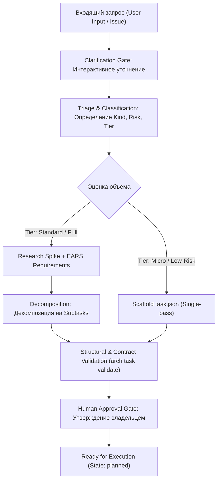

# Комплексный аудит Agent-oriented Software Factory

**Дата:** 2026-11-23  
**Аудитор:** Antigravity (Claude Opus 4.6)  
**Снимок:** текущее рабочее дерево, 33 задачи (UI-0001…UI-0033), 44 подзадачи, 9 скиллов, 13 типов задач, 25 конфигурационных файлов, 8 аудитов сессий Kilo Code  

---

## 1. Общее состояние системы

### 1.1 Статистика задач

| Метрика | Значение |
|---|---|
| Всего задач | 33 |
| Завершено (`done`) | 6 (UI-0001…UI-0006) |
| На ревью (`review`) | 2 (UI-0014, UI-0015 — `phase: verification`) |
| Открыто (`open` / `intake`) | 8+ (UI-0017…UI-0033) |
| Подзадач | 44 |
| Аудитов Kilo-сессий | 8 |

### 1.2 Виды задач

| Kind | Количество |
|---|---|
| `feature` | 9 |
| `planning` | 2 |
| `audit` | 2 |
| `scaffold` | 1 |
| `analysis` | 1 |
| `docs` | 1 |

> [!IMPORTANT]
> 17 задач не содержат полного `task.json` (обрезаны при чтении или невалидный JSON). Это означает, что почти половина корпуса может иметь структурные проблемы.

---

## 2. Аудит диалогов и сессий агентов

### 2.1 Проаудированные сессии Kilo Code

Аудиты проведены для 8 задач: UI-0011, UI-0012, UI-0013, UI-0014, UI-0015, UI-0016, UI-0017, UI-0032, UI-0033. Ниже — сводка ключевых проблем по каждой.

#### UI-0011 — «Готовность закрытия» (bugfix)
- **Оценка Kilo:** нашёл реальную ошибку и исправил основной сценарий
- **Проблемы:**
  - Агент объявил задачу завершённой преждевременно (`phase: verification`, не `completed`)
  - Скопировал CLI во временный каталог вместо использования `--root` — устаревшая копия давала ложные результаты
  - 95 вызовов инструментов, из них многие повторные
  - 8,16 млн токенов, из них 95,9% — cache read (раздутый контекст)
  - Не добавил регрессионный тест
  - JSON-отказ при `close --json` не реализован (текст вместо JSON)

#### UI-0012 — «Проектный YAML и рабочие корни» (feature)
- **Оценка:** реализация 4/10, процесс 5/10
- **Проблемы:**
  - Запись индекса в корень проекта вместо конфигурированного пути
  - Жёсткий путь к задачам
  - Обход только `doc/` при проверке путей
  - Оба AC целиком невыполнены
  - Сессия не вызывала `skill` и не читала `SKILL.md` / `AGENTS.md`

#### UI-0013 — «Устойчивые записи и модульность CLI» (refactor)
- **Оценка:** 6/10
- **Проблемы:**
  - CLI допускает закрытие поверх повреждённого журнала
  - Меняет дерево после конфликта
  - Не может возобновить прерванную запись
  - Три воспроизведённых дефекта

#### UI-0014 — «Воспроизводимая установка и локальный gate» (feature)
- **Проблемы:**
  - Файл `kilo.jsonc` переименован внешним процессом во время сессии
  - CI создавался, потом удалён владельцем (CI запрещён)
  - Задача осталась в `verification`

#### UI-0015 — «Каталог скиллов и исходный прогон» (docs)
- **Проблемы:**
  - Каталог скиллов закрыт, но учебный прогон и baseline недостоверны
  - Заявленный baseline `0cf2b028` не совпадает с HEAD
  - Только 15 минут на реализацию — слишком быстро для качественного результата

#### UI-0016 — «Версионированные записи и миграция» (feature)
- **Проблемы:**
  - Зависимость UI-0013 незавершённа — работа поверх неё
  - Evidence устарели после изменения `task_ops.py`
  - Задача в `verification`, подзадачи 0001/0002 и зависимость блокируют

#### UI-0017 — «Конфигурируемые flow-переходы» (feature)
- **Проблемы:**
  - 153 вызова инструментов (139 bash, 14 edit) за 46 минут
  - 23,4 млн токенов на одну задачу
  - Параллельный писатель изменял рабочее дерево во время аудита
  - Запись `doc/tasks/UI-0017/...` формально вне `scope.in`

#### UI-0032 — «Индивидуальные шаблоны задач по типам» (feature)
- **Оценка:** сильная карточка (11 AC, 14 CASE, 5 детей)
- **Проблемы:**
  - Открытые вопросы закрыты агентом без подтверждения владельцем
  - Оценка трудоёмкости (80 ч) принята агентом
  - Требования достраивались итеративно в чате

#### UI-0033 — «Стандартные статусы задачи» (audit → по факту feature)
- **Оценка:** постановка 4/10, реализация 3/10, выполнение 5/10
- **Критические дефекты:**
  - `task init` создаёт невалидную карточку (scaffold ставит `branch='unset'`, а validation отвергает `'unset'`)
  - Регрессия по всему корпусу — все 31 существующая карточка падает в `task validate`
  - Нет тестов на новое поведение
  - Архитектурные документы не обновлены
  - Карточка создана **после** начала реализации
  - Тип `audit`/`research-first` вместо `feature`

### 2.2 Общие паттерны сложностей агентов

| # | Паттерн | Частота | Задачи |
|---|---|---|---|
| 1 | **Преждевременное объявление завершения** — агент заявляет «done», но phase/status не совпадают | 5/8 | UI-0011, 0012, 0014, 0015, 0033 |
| 2 | **Раздувание контекста** — загрузка полных файлов вместо точечных срезов | 7/8 | Все кроме UI-0016 |
| 3 | **Копирование CLI вместо использования `--root`** — устаревшая копия даёт ложные результаты | 3/8 | UI-0011, 0012, 0013 |
| 4 | **Пропуск скиллов** — агент не читает SKILL.md и не следует маршрутизации AGENTS.md | 4/8 | UI-0011, 0012, 0015, 0033 |
| 5 | **Принятие решений без подтверждения владельцем** | 3/8 | UI-0032, 0033, 0012 |
| 6 | **Отсутствие регрессионных тестов** | 5/8 | UI-0011, 0012, 0014, 0015, 0033 |
| 7 | **Несовпадение type/kind** — task_type и kind расходятся | 6/33 | UI-0002, 0005, 0033 и др. |
| 8 | **Неправильное именование веток** — `bugfix/*` для non-bugfix задач | 16/33 | Все ранние задачи |
| 9 | **Невалидный gate-прогон** — запуск только части тестов, заявление «все проходят» | 4/8 | UI-0011, 0015, 0033, 0017 |
| 10 | **Отсутствие `git status` и baseline** перед началом реализации | 5/8 | UI-0011, 0012, 0014, 0015, 0033 |

---

## 3. Аудит системы задач (task.json)

### 3.1 Структурные проблемы корпуса

| Проблема | Количество | Задачи |
|---|---|---|
| `owner = "unset"` | Все 16 прочитанных | UI-0001…UI-0025 |
| `priority = "unset"` | Все 16 прочитанных | UI-0001…UI-0025 |
| `branch = "bugfix/*"` при kind ≠ bugfix | 16 | UI-0001…UI-0025 |
| `task_type = "docs"` при `kind = "feature"` | 2+ | UI-0002, UI-0005 |
| `status = "done"` но `changed_files` пуст | 2 | UI-0002, UI-0005 |
| `acceptance_criteria` со слабым текстом верификации | 1+ | UI-0008 |
| Невалидный JSON (обрезан при чтении) | 17 | UI-0004, 0007…0013, 0017, 0026…0033 |

### 3.2 Проблемы жизненного цикла

1. **Нет единого owner и priority.** Все задачи имеют `"unset"` — система не отслеживает ответственного.
2. **Ветки не соответствуют типу.** Шаблон `bugfix/UI-NNNN` применяется ко всем задачам, включая `scaffold`, `feature`, `planning`, `docs`.
3. **Scaffold противоречит validation.** `schema.py` создаёт `branch='unset'`, а `validation.py` отвергает это значение. Результат: `task init` создаёт сразу невалидную карточку (критический дефект UI-0033).
4. **Регрессия по корпусу.** После UI-0033 все существующие карточки падают в `task validate`/`diagnose`/`close`.
5. **Незавершённые зависимости.** UI-0016 зависит от UI-0013 (незавершена), UI-0014 — от UI-0012.
6. **Несогласованность phase и status.** Есть задачи с `phase: completed` и `status: review`.

### 3.3 Проблемы формата task.json

- Дублирование `task_type` и `kind` без чёткого разграничения семантики
- `implementation_plan` может быть строкой или массивом — нет единого формата
- `acceptance_criteria` — иногда массив объектов с `id/statement/verification`, иногда массив строк
- Поле `task_id` появилось с UI-0004, но не во всех задачах
- Поля `evidence`, `contracts_and_invariants`, `current_behavior` пусты в большинстве задач

---

## 4. Аудит скиллов

### 4.1 Каталог скиллов (9 штук)

| Скилл | Назначение | Статус |
|---|---|---|
| `arch-cli` | Справочник CLI-команд | ✅ Действующий |
| `create-task` | Постановка задач | ✅ Действующий |
| `go-to-task` | Переход к задаче и выполнение | ✅ Действующий |
| `plan-task` | Планирование задачи с tier-шаблонами | ✅ Действующий |
| `document-session` | Фиксация результатов обсуждения | ✅ Действующий |
| `kilo-session-audit` | Аудит сессий Kilo Code | ✅ Действующий |
| `architecture-read` | Чтение архитектурных контрактов | ✅ Действующий |
| `architecture-docs` | Работа с архитектурной документацией | ✅ Действующий |
| `review-implementation` | Ревью реализации перед верификацией | ✅ Действующий |

### 4.2 Проблемы скиллов

1. **Агенты не загружают скиллы.** В 4 из 8 аудированных сессий агент не вызывал `skill` и не читал соответствующий SKILL.md.
2. **Нет проверок выбора скилла.** Отсутствуют must-trigger / must-not-trigger тесты.
3. **Скиллы — инструкции, не протоколы.** Нет машиночитаемых входов/выходов, условий загрузки, проверяемых результатов.
4. **Пересечение обязанностей.** `go-to-task` и `create-task` содержат пересекающиеся инструкции по работе с карточкой.
5. **Нет скилла для багфикс-регрессии.** Выявлено по аудиту UI-0011: нет стандартного протокола «воспроизведи дефект → исправь → докажи регрессию».
6. **`plan-task`** — хороший скилл с 3 уровнями шаблонов (micro/standard/full), но нет автоматической привязки к tier по complexity.
7. **`kilo-session-audit`** — зависит от доступности SQLite базы Kilo, нет fallback для других агентных сред.

---

## 5. Аудит правил и конфигурации

### 5.1 Корневой AGENTS.md

- Запрещает читать реализацию CLI при обычной работе — правильный принцип
- Маршрутизация по запросу к нужному скиллу — реализована
- Ссылки на skills/README.md — каталог актуален

### 5.2 doc/AGENTS.md

- Подробный цикл выполнения с 5 шагами (проверить вход → сопоставить → сделать срез → проверить итог → закрыть)
- Инварианты чёткие и непротиворечивые
- **Проблема:** слишком длинный (60 строк) — агенты загружают его целиком, раздувая контекст

### 5.3 agent-policy.yaml

- Определяет политики агента (роли, разрешения)
- **Проблема:** не все агенты (особенно Kilo) используют его

### 5.4 paths.yaml

- Декларирует допустимые пути в `doc/`
- Команда `docs paths --check` работает
- **Проблема:** Windows-артефакты `*:Zone.Identifier` вызывали ложные ошибки (исправлено в UI-0010)

### 5.5 Типы задач (13 типов)

| Тип | config.yaml | prompt.md | flow-selection.yaml |
|---|---|---|---|
| bugfix | ✅ | ✅ | ✅ |
| feature | ✅ | ✅ | ✅ |
| audit | ✅ | ✅ | ❌ |
| scaffold | ✅ | ✅ | ❌ |
| docs | ✅ | ✅ | ✅ |
| planning | ✅ | ✅ | ✅ |
| subtask | ✅ | ✅ | ❌ |
| spike | ✅ | ✅ | ❌ |
| migration | ✅ | ✅ | ❌ |
| jira-incoming | ✅ | ✅ | ❌ |
| incident | ✅ | ✅ | ❌ |
| refactor | ✅ | ✅ | ✅ |
| research | ✅ | ✅ | ❌ |

**Проблема:** Только 5 из 13 типов имеют `flow-selection.yaml`. Остальные полагаются на дефолтный flow, что снижает точность маршрутизации.

---

## 6. Аудит CLI (arch)

### 6.1 Структура CLI

CLI реализован как Python-пакет `doc/tools/arch/` с модульной архитектурой:
- `cli/app.py` — точка входа
- `cli/commands/` — модули команд (builtin, task, session, task_key, registry)
- Основные модули: `validation.py`, `store.py`, `identity.py`, `task_record.py`, `task_ops.py`, `evidence.py`, `plan_policy.py`, `subtask.py`, `sections.py`, `flows.py`, `body_validation.py`, `schema.py`, `fs_atomic.py`, `project_config.py`

### 6.2 Выявленные проблемы CLI

| # | Проблема | Приоритет | Статус |
|---|---|---|---|
| 1 | **Scaffold создаёт невалидную карточку** — `branch/release_branch/target_release = "unset"` отвергается validation | P0 | Открыт (UI-0033) |
| 2 | **Регрессия по корпусу** — все 31 карточка падает в validate после UI-0033 | P0 | Открыт |
| 3 | **`close --json` при отказе печатает текст вместо JSON** | P1 | Открыт (UI-0011) |
| 4 | **`diagnose` и `close` — разные вычисления готовности** | P1 | Частично исправлен |
| 5 | **Запись не атомарна** — составная операция (`decompose`) может оставить частичный результат | P1 | Частично исправлен (UI-0013) |
| 6 | **`task workspace` read-only, но help не отражает** | P2 | Открыт |
| 7 | **`close_policy` из YAML не используется `close` командой** | P2 | Открыт |
| 8 | **Evidence устаревает** — `evidence_freshness` показывает `current: false` после правок | P2 | Открыт |

### 6.3 Тесты

- **Unit-тесты:** `doc/tools/tests/` — `test_arch.py`, `test_session_audit.py`, `test_sections.py`
- **Acceptance-тесты:** `doc/tests/` — `test_task_identity.py`, `test_doc_type_registry.py`, `test_doc_contracts.py`, `test_task_fields.py`, `test_plan_policy.py`
- **Скрипт:** `doc/tests/run.sh` — собирает индекс перед проверкой свежести (скрывает проблемы со свежестью)
- **Проблема:** `run.sh` пересобирает индекс до проверки → никогда не обнаружит устаревший индекс. Нужна отдельная проверка закоммиченного индекса.

---

## 7. Аудит архитектурной документации

### 7.1 Структура

- `doc/architecture/` — 5 доменов, system views, schemas, decisions
- Домены: `task-lifecycle`, `project-knowledge`, `model-routing`, `execution-verification`, `task-intake`
- Schemas: 15+ JSON Schema файлов для тел документов
- 1 ADR (ADR-0001)
- Generated `index.json`

### 7.2 Проблемы

1. **Малое число ADR.** За 33 задачи — только 1 ADR. Многие решения (форматы, enum'ы, политики) приняты неявно.
2. **`implemented` поле** добавлено, но не все документы его содержат.
3. **Расхождение specs и кода.** Документация описывает capabilities, которые только специфицированы, но отмечены как реализованные.
4. **Нет doc↔code links.** Трассируемость `requirement → design → task → code → test` неполная.

---

## 8. Аудит корневых документов

### 8.1 Файлы в корне проекта

| Файл | Назначение | Проблема |
|---|---|---|
| `README.md` | Инструкции и quickstart | Ссылается на устаревшие пути |
| `AGENTS.md` | Маршрутизация агентов | Дублирует `doc/AGENTS.md` с различиями |
| `nextplan.md` | Дорожная карта (841 строка) | Очень подробный, но агенты загружают целиком |
| `seesionaudit.md` | Аудит UI-0011 | Опечатка в имени файла (`seesion` вместо `session`) |
| `taskcontrol.md` | Контроль задач | Не интегрирован в `doc/` |
| `worktree.md` | Заметки о worktree | Не интегрирован в `doc/` |
| `Манифест агентной software factory.md` | Корневой манифест | Основной документ, не копировать в doc/ |
| `Исследование software factory — пробелы и готовые практики.md` | Исследование | Корневой документ, справочный |

### 8.2 Проблемы

1. **Файлы вне `doc/`.** `seesionaudit.md`, `taskcontrol.md`, `worktree.md` — документация, которая должна быть в `doc/tasks/` или `doc/research/`.
2. **Дублирование AGENTS.md.** Два файла с разным содержимым.
3. **`nextplan.md` — 841 строка.** Агенты загружают его целиком (54 169 байт), раздувая контекст.
4. **Опечатка в имени** `seesionaudit.md`.

---

## 9. Сводка дефектов и рекомендации

### 9.1 P0 — Критические (блокируют работу)

| # | Дефект | Где | Рекомендация |
|---|---|---|---|
| P0-1 | Scaffold создаёт невалидную карточку | `schema.py` / `validation.py` | Согласовать scaffold defaults с validation rules: scaffold должен ставить `branch="main"`, `release_branch="main"`, `target_release` из `project.release` |
| P0-2 | Регрессия по корпусу — все карточки падают в validate | Все task.json + validation | Мигрировать существующие карточки: добавить `branch`/`release_branch`/`target_release` или сделать их опциональными при `status: done` |
| P0-3 | `run.sh` маскирует проблемы со свежестью индекса | `doc/tests/run.sh` | Разделить: `index check` до `index build` для проверки закоммиченного индекса |

### 9.2 P1 — Высокие (ухудшают качество)

| # | Дефект | Где | Рекомендация |
|---|---|---|---|
| P1-1 | Агенты не загружают скиллы | Kilo Code / процесс | В `go-to-task` добавить обязательный чеклист: 1) `task diagnose` 2) прочитать SKILL.md по типу/flow 3) baseline |
| P1-2 | Преждевременное объявление завершения | Все агенты | Добавить guard в `close`: проверка `task validate` + `--gate` + совпадение phase/status + evidence freshness |
| P1-3 | Раздувание контекста (~8-23M токенов на задачу) | Агенты | Добавить `task diagnose --brief` со сжатым JSON (ключ, фаза, блокеры, следующий шаг). Запретить полное чтение `nextplan.md` для известного ключа |
| P1-4 | `owner` и `priority` = `"unset"` везде | Все task.json | Требовать owner/priority при создании или при переходе в `execution` |
| P1-5 | Ветки `bugfix/*` для non-bugfix задач | 16 задач | Шаблон ветки: `{kind}/UI-{number}` вместо фиксированного `bugfix/` |
| P1-6 | `close --json` при отказе печатает текст | `builtin.py` | Возвращать JSON envelope `{ok: false, errors: [...]}` |
| P1-7 | Несогласованность `task_type` / `kind` | task.json | Оставить одно поле `kind` (или `task_type`), убрать дублирование |

### 9.3 P2 — Средние (улучшают систему)

| # | Дефект | Где | Рекомендация |
|---|---|---|---|
| P2-1 | Нет must-trigger тестов для скиллов | Тесты | Добавить `test_skill_routing.py` с проверкой: для type=bugfix → go-to-task + arch-cli, для type=planning → plan-task |
| P2-2 | 5 из 13 типов без flow-selection | task-conf | Добавить `flow-selection.yaml` для audit, scaffold, spike, migration, incident, research |
| P2-3 | Единственный ADR за 33 задачи | Архитектура | Создать ADR для: формат task.json, branch naming, scaffold defaults, enum unification |
| P2-4 | Файлы вне `doc/` | Корень | Переместить `seesionaudit.md` → `doc/tasks/UI-0011/research/`, `taskcontrol.md` и `worktree.md` → `doc/research/` |
| P2-5 | `acceptance_criteria` — непоследовательный формат | task.json | Всегда использовать `[{id, statement, verification}]`, запретить строки |
| P2-6 | `implementation_plan` — строка или массив | task.json | Всегда массив шагов |
| P2-7 | Evidence устаревает без уведомления | CLI | При `task diagnose` выводить warning если evidence не current |

---

## 10. Аудит базы знаний (data/)

### 10.1 Энциклопедии

| Энциклопедия | Файлов | Назначение |
|---|---|---|
| `sdd-encyclopedia` | ~30 | SDD-сущности, процессы, стандарты, инструменты |
| `sdd-research` | 12 | Исследования по SDD |
| `subagents-encyclopedia` | ~15 | Паттерны субагентов, среды (Claude Code, Kilo, Codex) |
| `cli-skills-encyclopedia` | ~15 | Практики CLI для агентов, форматы, тестирование |
| `machinedocs-encyclopedia` | Не прочитан полностью | Практики агентной разработки |

### 10.2 Оценка

- **Сильная сторона:** богатая справочная база с MOC-навигацией
- **Проблема:** агенты почти не используют `data/` при выполнении задач (0 обращений в 6 из 8 аудитов)
- **Рекомендация:** в `go-to-task` добавить правило — для `research` и `planning` задач обязательно проверить MOC → нужную энциклопедию → конкретный раздел

---

## 11. Итоги и приоритеты действий

### 11.1 Немедленные действия (P0)

1. **Исправить scaffold/validation конфликт** — `task init` должен создавать валидную карточку
2. **Мигрировать корпус** — добавить `branch`/`release_branch`/`target_release` в существующие карточки
3. **Разделить `run.sh`** — проверка свежести закоммиченного индекса отдельно от пересборки

### 11.2 Следующий спринт (P1)

4. **Унифицировать task_type/kind** — одно поле
5. **Шаблон веток по kind** — `{kind}/UI-{number}`
6. **Guard на close** — не закрывать без полного gate
7. **Сжатый `diagnose --brief`** — контекст для агента в <500 токенов
8. **Обязательный чеклист в go-to-task** — baseline → skill → plan → execute → verify → close

### 11.3 Системные улучшения (P2)

9. Тесты маршрутизации скиллов
10. ADR для ключевых решений
11. Flow-selection для всех типов
12. Перемещение корневых документов в doc/
13. Единый формат acceptance_criteria

---

## 12. Метрики здоровья системы

| Метрика | Текущее | Целевое |
|---|---|---|
| Задач с валидным task.json | ~16/33 (48%) | 100% |
| Задач с `owner ≠ unset` | 0/33 (0%) | 100% |
| Задач с правильным branch naming | 0/33 (0%) | 100% |
| Скиллов с trigger-тестами | 0/9 (0%) | 100% |
| Типов с flow-selection | 5/13 (38%) | 100% |
| ADR на решение | 1/10+ (10%) | ≥80% |
| Агент загружает нужный скилл | 4/8 (50%) | 100% |
| Gate пройден перед close | 3/8 (37%) | 100% |
| Токены на задачу (медиана) | ~15M | <5M |
| Регрессионный тест на багфикс | 3/8 (37%) | 100% |

---

## 13. Заключение

Система Agent-oriented Software Factory представляет собой **амбициозный и хорошо продуманный проект** с сильной архитектурной документацией, детальным nextplan и богатой базой знаний. CLI ядро функционально и покрывает основной жизненный цикл задач.

**Главные риски:**
1. **Критическая регрессия** (P0-1/P0-2) блокирует создание и валидацию новых задач
2. **Агенты не следуют инструкциям** — скиллы не загружаются, baseline не снимается, gate не проходится
3. **Раздутый контекст** — агенты тратят 8-23M токенов на задачу, 95% — cache read
4. **Несогласованность схемы** — дублирование полей, непоследовательные форматы

**Главные сильные стороны:**
1. Строгий `nextplan.md` с dependency-ordered roadmap и threat model
2. Детальный цикл выполнения в `doc/AGENTS.md`
3. 13 типов задач с конфигурируемыми потоками
4. Аудиты Kilo-сессий — уникальная практика рефлексии
5. Богатая база знаний в `data/`

**Рекомендация:** начать с P0 (scaffold fix + корпус-миграция), затем P1 (guard на close + сжатый diagnose + обязательный скилл-чеклист). Это даст наибольший эффект при минимальных изменениях.
---

## 14. Детальный аудит типов задач, их конфигураций, промптов и потоков (Flows & Prompts)

Система поддерживает 13 типов задач в `doc/config/task-conf/types/`: `bugfix`, `feature`, `audit`, `scaffold`, `docs`, `planning`, `subtask`, `spike`, `migration`, `jira-incoming`, `incident`, `refactor`, `research`.

Ниже представлен поэлементный аудит конфигураций (`config.yaml`), промптов (`prompt.md`), селекторов потоков (`flow-selection.yaml`) и шагов исполнения.

### 14.1 Матрица покрытия типов и флоу

| Тип задачи | Config | Базовый Prompt | Flow Selection | Поддерживаемые Flows | Flow Prompts | Step Prompts |
|---|---|---|---|---|---|---|
| `bugfix` | ✅ | ✅ | ✅ | `minimal-scaffold`, `standard-implementation` | ✅ (2/2) | ❌ |
| `feature` | ✅ | ✅ | ✅ | `research-first`, `standard-implementation` | ✅ (2/2) | ✅ (2 шага) |
| `audit` | ✅ | ✅ | ❌ | `research-first` | ✅ (1/1) | ❌ |
| `scaffold` | ✅ | ✅ | ❌ | `minimal-scaffold` | ✅ (1/1) | ❌ |
| `docs` | ✅ | ✅ | ✅ | `docs-only` | ✅ (1/1) | ❌ |
| `planning` | ✅ | ✅ | ✅ | `research-first`, `standard-implementation` | ✅ (2/2) | ❌ |
| `subtask` | ✅ | ✅ | ❌ | (наследует родителя) | ❌ | ❌ |
| `spike` | ✅ | ✅ | ❌ | `spike-first` | ✅ (1/1) | ❌ |
| `migration` | ✅ | ✅ | ❌ | `migration-first` | ✅ (1/1) | ❌ |
| `jira-incoming` | ✅ | ✅ | ❌ | `jira-process` | ✅ (1/1) | ❌ |
| `incident` | ✅ | ✅ | ❌ | `incident-response` | ✅ (1/1) | ❌ |
| `refactor` | ✅ | ✅ | ✅ | `minimal-scaffold`, `standard-implementation` | ✅ (2/2) | ✅ (1 шаг) |
| `research` | ✅ | ✅ | ❌ | `research-first` | ✅ (1/1) | ❌ |

---

### 14.2 Анализ существующих типов задач и конкретные дефекты

#### 1. `bugfix`
- **Текущее состояние:** Два потока — `minimal-scaffold` (для тривиальных правок) и `standard-implementation`. В `prompt.md` прописано требование воспроизвести дефект до правки кодовой базы.
- **Выявленные дефекты:**
  - В потоке `minimal-scaffold` отсутствует обязательное требование автоматического регрессионного теста (тест на фиксацию дефекта). Как показал аудит UI-0011, агент заявляет «исправлено», проверив код вручную на временной фикстуре, но не добавляет тест в репозиторий.
  - Нет четкого разделения между локальным дефектом документации/CLI и продуктовым багом в целевом приложении.
- **Рекомендации:**
  - Ввести в `config.yaml` строгое правило `regression_test_required: true`. Без добавления теста в `test_*.py` или `tests/` команда `arch task close` должна блокировать закрытие багфикса.
  - Шаблон флоу должен содержать фазу: `Red Test (FAIL)` -> `Fix implementation` -> `Green Test (PASS)` -> `Snapshot & Evidence`.

#### 2. `feature`
- **Текущее состояние:** Доступны `research-first` и `standard-implementation`. В `standard-implementation` есть шаги `architecture-context.md` и `architecture-sync.md`.
- **Выявленные дефекты:**
  - `architecture-sync.md` требует ручного обновления документации, но не проверяет актуальность через CLI-валидаторы (`arch index check`, `arch docs paths --check`).
  - Нет контроля архитектурного дрифта: если добавляется новый публичный API/интерфейс, он не связывается автоматически с `DOM-` или `CAP-` контрактами.
- **Рекомендации:**
  - Добавить обязательный шаг `threat-modeling` в `standard-implementation` для задач со сложностью `high` и выше (см. threat model в nextplan §9).
  - Сделать `architecture-sync` машиночитаемым гейтом: проверка diff по публичным интерфейсам против графа документации.

#### 3. `audit`
- **Текущее состояние:** Поток `research-first`. Направлен на проверку соответствия системы заданным правилам.
- **Выявленные дефекты:**
  - Отсутствует `flow-selection.yaml`. CLI падает назад на дефолты при попытке динамического выбора потока.
  - Промпт требует «составить отчёт», но не формализует формат вывода. В результате аудит UI-0033 превратился в неполную реализацию прямо внутри аудиторской задачи.
- **Рекомендации:**
  - Запретить любые модификации рабочего кода (`scope.allowed_files_modules` должен содержать только `doc/tasks/<KEY>/research/` или `doc/architecture/`).
  - Форматировать результат аудита по схеме Findings: `{finding_id, severity, location, evidence, recommendation}`.

#### 4. `scaffold`
- **Текущее состояние:** Создание каркасов репозиториев, модулей, документации.
- **Выявленные дефекты:**
  - Промпт не содержит валидации готовности сгенерированного каркаса к сборке и тестированию.
  - Отсутствует проверка `init -> build -> test` в изоляции.
- **Рекомендации:**
  - Обязать scaffold создавать минимальный самодостаточный runnable smoke test.

#### 5. `docs`
- **Текущее состояние:** Поток `docs-only`. Только правка документации без изменения логики кода.
- **Выявленные дефекты:**
  - В задачах UI-0002 и UI-0005 тип был выставлен как `docs`, но `kind` оставался `feature`, а в `scope` правились исполняемые файлы CLI (`arch.py`). Валидатор пропустил это несоответствие.
- **Рекомендации:**
  - Строгая изоляция `scope.allowed_files_modules`: для `docs` разрешены только `.md`, `.yaml`, `.json` в `doc/`. Любая попытка изменить `.py`, `.sh`, `.ts` должна немедленно вызывать ошибку валидации `task validate`.

#### 6. `planning`
- **Текущее состояние:** Проработка дорожных карт, декомпозиция крупных эпиков, планирование релизов.
- **Выявленные дефекты:**
  - Результаты планирования часто сохраняются в корне (`cli.skill.plan.md`, `nextplan.md`), засоряя рабочее дерево и раздувая контекст последующих агентов.
- **Рекомендации:**
  - Выход планирования должен строго оформляться как: 1) набор дочерних задач `arch task decompose`, либо 2) артефакт в `doc/tasks/<KEY>/research/`, либо 3) обновление канонического `nextplan.md` через контролируемую дельту.

#### 7. `subtask`
- **Текущее состояние:** Наследует контекст родителя. Нумерация `0001`, `0002` локальна внутри родителя.
- **Выявленные дефекты:**
  - Отсутствует собственный `flow-selection.yaml` и prompt.
  - Сабтаски часто дублируют родительский scope и не имеют четких границ.
- **Рекомендации:**
  - Сабтаск должен автоматически наследовать родительский `target_release` и `branch`.
  - Запретить сабтаску изменять файлы вне родительского `allowed_files_modules`.

#### 8. `spike`
- **Текущее состояние:** Исследовательский прототип с ограничением по времени (timeboxed).
- **Выявленные дефекты:**
  - Нет механизма автоматического уничтожения (discard) прототипа. Код спайка может случайно протечь в продакшн-ветку.
- **Рекомендации:**
  - Код спайка должен создаваться в ветке `spike/<KEY>` и закрываться без права прямого слияния в `main`. Выходом спайка является `ADR` или `research-doc`, а не продакшн-код.

#### 9. `migration`
- **Текущее состояние:** Миграция схем, данных или форматов документации.
- **Выявленные дефекты:**
  - Нет обязательного требования `idempotency` (повторный прогон не должен ломать данные) и `rollback_plan`.
- **Рекомендации:**
  - Требовать наличие тестов миграции `forward -> backward -> forward` с побайтовым сравнением состояния.

#### 10. `jira-incoming`
- **Текущее состояние:** Адаптер внешних задач из Jira.
- **Выявленные дефекты:**
  - Промпт предполагает прямое чтение тикета, но нет защиты от prompt injection из текста пользовательских комментариев и описания тикета.
- **Рекомендации:**
  - Экранирование внешнего ввода (Treat External Data as Untrusted Data). Поля Jira должны помещаться в неизменяемый snapshot `attachments/source.json`.

#### 11. `incident`
- **Текущее состояние:** Реагирование на аварии, горячие исправления (hotfix).
- **Выявленные дефекты:**
  - Нет flow-selection, нет ускоренного гейта (fast-track), при этом нет обязательного требования `post-mortem`.
- **Рекомендации:**
  - Fast-track гейт для изоляции инцидента + обязательное создание follow-up задачи типа `bugfix`/`refactor` и отчета `post-mortem.md`.

#### 12. `refactor`
- **Текущее состояние:** Изменение внутренней структуры без изменения внешнего поведения.
- **Выявленные дефекты:**
  - Нет автоматической проверки эквивалентности поведения (golden master / snapshot tests).
- **Рекомендации:**
  - Обязательный baseline прогон существующих acceptance-тестов до изменений; запрет на добавление новых фич в рамках рефакторинга (`zero-behavioral-change guarantee`).

#### 13. `research`
- **Текущее состояние:** Исследование библиотек, архитектурных подходов, сбор требований.
- **Выявленные дефекты:**
  - Отсутствует связь с базой знаний `data/` и MOC-навигацией.
- **Рекомендации:**
  - Включить в промпт обязательный чеклист поиска аналогов в `data/` и фиксацию источников с цитатами.

---

### 14.3 Предложения по добавлению новых типов задач

Для превращения системы в промышленную агентную фабрику корпоративного уровня необходимо добавить 5 новых специализированных типов задач:

1. **`security-audit` (Аудит безопасности и анализ уязвимостей)**
   - *Назначение:* Проверка кодовой базы на SAST-паттерны, уязвимости зависимостей (CVE), секреты в репозитории, соответствие OWASP/threat model.
   - *Flow:* `security-scan-and-remediate`
   - *Инвариант:* Запрещено понижать пороги проверок и отключать правила линтеров безопасности.

2. **`performance-tuning` (Оптимизация производительности)**
   - *Назначение:* Профилирование, устранение боттлнеков, бенчмаркинг.
   - *Flow:* `benchmark-optimize-verify`
   - *Инвариант:* Обязательное доказательство прироста производительности: `Baseline Metric` vs `Candidate Metric` при фиксированном доверительном интервале.

3. **`dependency-upgrade` (Контролируемое обновление зависимостей)**
   - *Назначение:* Обновление библиотек, фреймворков и инструментов.
   - *Flow:* `upgrade-compat-gate`
   - *Инвариант:* Автоматическая проверка breaking changes по changelog, прогон сквозного локального гейта на совместимость.

4. **`ai-eval` (Оценка качества и бенчмаркинг агентов)**
   - *Назначение:* Оценка качества работы моделей, промптов и скиллов на фиксированном корпусе тестовых сценариев (golden dataset).
   - *Flow:* `eval-score-compare`
   - *Инвариант:* Изолированный запуск в чистой песочнице, фиксация метрик точности, токенов, времени и стоимости.

5. **`release-engineering` (Сборка и валидация релиза)**
   - *Назначение:* Формирование версионированных дистрибутивов, валидация changelog, проверка обратной совместимости, упаковка артефактов.
   - *Flow:* `release-verification-flow`
   - *Инвариант:* Детерминированная сборка, сверка хешей артефактов, отсутствие незакоммиченных изменений.

---

## 15. Глубокий аудит процесса постановки задач (Task Intake & Inception)

### 15.1 Анализ текущего процесса постановки
Текущий процесс регулируется:
- Скиллами `create-task` и `plan-task`
- Справочниками `plan-micro.md`, `plan-standard.md`, `plan-full.md`, `estimation.md`, `quality-checklist.md`
- CLI-командами `arch task init`, `arch task new`, `arch task decompose`

### 15.2 Главные узкие места и проблемы постановки

1. **«Ловушка белого листа» и ручной перекос:**
   - Пользователь дает краткий запрос в чате («сделай валидацию конфигов»). Агент пытается сразу создать карточку `task.json`, додумывая границы (`scope`), критерии приёмки и архитектурные связи, не задавая уточняющих вопросов.
   - Отсутствует этап предварительного прояснения требований (Clarification Phase / Elicitation), аналогичный `spec-kit clarify` или `openspec explore`.

2. **Слабые, непроверяемые Acceptance Criteria:**
   - В большинстве задач (например, UI-0008, UI-0002) критерии верификации сформулированы как: *«Проверено при приведении к новому формату»* или *«Запустить команду, код 0»*.
   - Отсутствует фиксация конкретного наблюдаемого состояния: входные данные, ожидаемый вывод, проверяемые побочные эффекты, структура ошибок.

3. **Разрыв между оценкой сложности (Complexity / Plan-Tier) и декомпозицией:**
   - Скилл `plan-task` декларирует 3 tier: `micro` (до 4 ч), `standard` (4–16 ч), `full` (16–80 ч).
   - Однако агент выбирает tier произвольно. Задачи с объемом в десятки часов создаются как единый монолитный `task.json` без автоматического принуждения к `decompose`.

4. **Отсутствие валидации непротиворечивости при инициализации:**
   - Как показал аудит UI-0033, команда `task init` может успешно создать карточку, которая в следующую секунду падает в `task validate`. Это фундаментальное нарушение принципа Fail-Fast.

### 15.3 Пошаговый регламент идеальной постановки задач



#### Стандарты формулирования Acceptance Criteria (EARS + BDD)
Все критерии приёмки в `task.json` обязаны переводиться на строгий формат EARS (Easy Approach to Requirements Syntax) и BDD:
- **Ubiquitous (Вездесущее):** «Система ДОЛЖНА всегда...»
- **Event-driven (По событию):** «КОГДА происходит [событие], система ДОЛЖНА [действие]»
- **State-driven (По состоянию):** «ПОКА система находится в [состоянии], система ДОЛЖНА...»
- **Unwanted behavior (Ошибочное поведение):** «ЕСЛИ возникает [ошибка], ТО система ДОЛЖНА вернуть [структурированный JSON] без падения процесса»

Каждый AC в `task.json` обязан содержать три поля:
```json
{
  "id": "AC-01",
  "statement": "WHEN 'task close' is executed with unfinished subtasks, THE CLI SHALL refuse with exit code 1",
  "verification": {
    "type": "cli_command",
    "command": "python3 -m unittest doc.tests.test_task_identity.TestClose.test_unclosed_subtasks_block",
    "expected_exit_code": 1,
    "expected_output_pattern": "Unfinished subtasks: 0001"
  }
}
```

---

## 16. Аудит механики выполнения, скиллов и правил (Execution Engine)

### 16.1 Анализ скиллов жизненного цикла

#### `go-to-task`
- **Проблема:** Скилл перегружен. Он пытается быть одновременно: навигатором, валидатором, тест-раннером, чекером рабочего дерева и писателем evidence.
- **Решение:** Разбить на четкие фазы с детерминированными CLI-хелперами:
  1. `arch task preflight <KEY>` — проверка готовности (чистый git status, валидный task.json, разрешение зависимостей).
  2. `arch task baseline <KEY>` — фиксация начального состояния тестов.
  3. `arch task snapshot <KEY>` — сборка evidence после реализации.

#### `review-implementation`
- **Проблема:** Сейчас это чисто описательный текст. Агент читает его, но не имеет формального чек-листа для ревью.
- **Решение:** Сделать ревью исполняемым скриптом: автоматическая проверка размера diff, отсутствия секретов, отсутствия ослабления тестов (test weakening detection).

#### `kilo-session-audit`
- **Проблема:** Жесткая привязка к локальной SQLite базе Kilo Code (`~/.local/share/kilo/kilo.db`). Не работает при запуске из других агентов (Antigravity, Claude Code, Cursor, Windsurf).
- **Решение:** Абстрагировать интерфейс сессий через `arch session provider`: адаптеры для SQLite Kilo, JSONL Claude Code / Antigravity, OpenCode logs.

### 16.2 Проблема Token-Efficiency и раздувания контекста

В аудитах зафиксированы катастрофические перерасходы токенов (до **23-29 млн токенов** на сессию при 95%+ Cache Read).
**Причины:**
1. Агенты читают целиком 800-строчный `nextplan.md` и 60-строчный `doc/AGENTS.md`.
2. Агенты читают полные файлы реализации CLI (`builtin.py` на 57 Кб, `validation.py` на 32 Кб).
3. При каждом запуске тестов агент получает полный нефильтрованный вывод терминала.

**Регламент снижения расхода токенов на 80%:**
- **Compact CLI Output:** Все команды CLI обязаны поддерживать флаг `--brief` и `--json`. Ошибки должны выдавать только затронутый узел и конкретный hint.
- **Addressable Slices:** Запретить чтение файлов более 150 строк без `offset/limit` или поиска конкретного символа через AST/код-граф.
- **Progressive Disclosure:** Контекст должен подаваться слоями:
  - Слой 0: `arch task diagnose <KEY> --brief` (до 40 строк JSON: статус, AC, ссылки).
  - Слой 1: Чтение конкретного контракта из `doc/architecture/`.
  - Слой 2: Чтение конкретного теста и функции реализации.

---

## 17. Архитектурный редизайн: Превзойти OpenSpec и Spec Kit

### 17.1 Сравнительный конкурентный анализ

| Критерий | GitHub Spec Kit | OpenSpec | Текущая фабрика (sf) | **Целевая архитектура sf v2.0** |
|---|---|---|---|---|
| **Управление требованиями** | Constitution, clarify, plan | Delta specs (ADDED/MODIFIED/REMOVED) | Монолитный `task.json`, 13 типов | **Living Specs + Event-Driven Delta** |
| **Управление контекстом** | Шаблоны в `.spec-kit/` | Плоские спецификации | Документация в `doc/architecture/` | **Codified 4-Tier Context Router + Graph** |
| **Изоляция исполнения** | Нет (работает в текущем каталоге) | Нет (работает в текущем каталоге) | Концептуальный worktree (ручной) | **Automated Worktree Sandbox + Deny-by-default Policy** |
| **Верификация и Oracle** | Чек-листы пользователя | Ручной `verify` | Ручной прогон `run.sh` | **Dual-Agent Verification (Author vs Verifier Oracle)** |
| **Воспроизводимость задач** | Зависит от агента | Зависит от агента | Частичная (verification.json) | **Immutable Digest Chain (Task -> Code -> Evidence -> Git)** |
| **Поддержка масштаба (1M+ LOC)** | Падает по контексту | Падает по контексту | Ограничена ручным поиском | **Graph-Augmented Indexing + AST Selective Slicing** |

---

### 17.2 Архитектурный манифест «Software Factory v2.0»

```text
┌────────────────────────────────────────────────────────────────────────┐
│                        INCOMING WORKLOAD INTAKE                        │
│   (Jira / GitHub Issues / UI Chat / Slack / Automated Security Alerts) │
└───────────────────────────────────┬────────────────────────────────────┘
                                    │
                                    ▼
┌────────────────────────────────────────────────────────────────────────┐
│                      L0: INTAKE & POLICY ENGINE                        │
│  - Immutable Snapshot creation (digest, provenance, author)            │
│  - Risk Tiering (Low / Medium / High / Critical)                       │
│  - EARS Requirement Normalization + Clarification Gate                │
└───────────────────────────────────┬────────────────────────────────────┘
                                    │
                                    ▼
┌────────────────────────────────────────────────────────────────────────┐
│                  L1: CODIFIED CONTEXT & KNOWLEDGE ROUTER               │
│  - Progressive Context Expansion (Index -> Contract -> Symbol)         │
│  - Codebase Knowledge Graph (AST, Call-Graph, Data-Flow)               │
│  - MOC Architecture Knowledge Base (data/ + doc/architecture/)         │
└───────────────────────────────────┬────────────────────────────────────┘
                                    │
                                    ▼
┌────────────────────────────────────────────────────────────────────────┐
│               L2: ISOLATED WORKTREE EXECUTION SANDBOX                  │
│  - Ephemeral Git Worktree isolation                                    │
│  - Deny-by-default Command, Path & Network Security Policy             │
│  - State Machine Event-Store (append-only events.jsonl)                │
└───────────────────────────────────┬────────────────────────────────────┘
                                    │
                                    ▼
┌────────────────────────────────────────────────────────────────────────┐
│            L3: INDEPENDENT DUAL-AGENT VERIFICATION ORACLE              │
│  - Untrusted Author Agent (produces candidate patch)                   │
│  - Isolated Verifier Agent (read-only, protected acceptance tests)     │
│  - Tamper-proof Evidence Signing (git commit + test outputs)           │
└───────────────────────────────────┬────────────────────────────────────┘
                                    │
                                    ▼
┌────────────────────────────────────────────────────────────────────────┐
│                 L4: LIVING ARCHITECTURE SYNCHRONIZATION                │
│  - Bidirectional Spec <-> Code Synchronization                        │
│  - Architecture Drift Detector (fails CI if code diverges from spec)   │
│  - Safe Merge & Fast-Forward Delivery Gate                             │
└────────────────────────────────────────────────────────────────────────┘
```

---

### 17.3 Ключевые архитектурные прорывы v2.0

#### 1. Двухагентный контур доверия (Dual-Agent Trust Zone)
В традиционных системах (включая OpenSpec и Spec Kit) один и тот же агент пишет код, пишет тесты, запускает их и сам заявляет, что всё работает. Это фундаментальная уязвимость («Студент сам проверяет свой экзамен»).
- **В нашей системе v2.0:**
  - **Author Agent:** Работает в изолированном worktree. Имеет права на запись только в разрешенные файлы модуля. Не имеет прав модифицировать эталонный тест-сьют и политику закрытия.
  - **Verifier Agent:** Полностью изолированный агент с доступом только для чтения к коду автора. Запускает эталонный тест-оракул в чистом контейнере/песочнице. Фиксирует криптографический digest результатов.

#### 2. Решение проблемы работы с огромной кодовой базой (1M+ строк кода)
Для масштабирования на огромные проекты внедряется **Четырехуровневый контекстный роутер (4-Tier Context Router)**:
1. **Ярус 0 (L0 Index):** Легковесный индекс всех доменов, возможностей и модулей (занимает < 2 Кб). Агент сразу определяет, какой домен затронут.
2. **Ярус 1 (L1 Contracts):** Спецификации интерфейсов, схемы данных и контракты затронутого домена.
3. **Ярус 2 (L2 Graph / Call-tree):** Извлечение только затронутых функций и их вызывающих цепочек через `codebase-memory-mcp` / AST-инструменты. Никаких загрузок целых директорий!
4. **Ярус 3 (L3 Source Slices):** Чтение только целевых диапазонов строк исходного кода (не более 100-200 строк за раз).

#### 3. Living Architecture и контроль дрифта (Drift Detection)
В отличие от мертвой проектной документации, архитектурные документы в `doc/architecture/` становятся исполняемыми спецификациями:
- Каждый API/компонент связывается с кодом аннотациями вида `@spec(id="CAP-task-lifecycle")`.
- Команда `arch docs drift-check` анализирует AST кодовой базы: если добавлен публичный метод или изменен маршрут, но в `doc/architecture/` нет соответствующей дельты — сборка блокируется.

#### 4. Безопасность и Worktree-песочница
- Каждая задача выполняется в одноразовом Git worktree: `git worktree add .worktrees/UI-XXXX branch/UI-XXXX`.
- Никаких коллизий между параллельными агентами.
- Невозможно сломать основное рабочее дерево до прохождения всех проверок.
- Автоматический откат (`git worktree remove --force`) при сбое или отказе.

---

## 18. Детализированная дорожная карта реализации реформ

### Фаза 1: Устранение критических дефектов ядра (Немедленно)
1. **P0-1 Fix:** Согласовать `doc/tools/arch/schema.py` и `doc/tools/arch/validation.py`. Значения `branch`, `release_branch` и `target_release` в скаффолде должны по умолчанию браться из `project_config.yaml` (`release.default_target_release`, `release.base_branch`).
2. **P0-2 Migration:** Скрипт миграции всех 33 карточек корпуса к валидному виду (автоматическое проставление корректных веток по шаблону `{kind}/{task_key}`).
3. **P0-3 Test Gate:** Разделение `run.sh` на `index check` (read-only проверка чистоты индекса) и `index build` (только при явной пересборке).

### Фаза 2: Нормализация типов, потоков и промптов (Спринт 1)
1. Добавить недостающие `flow-selection.yaml` для всех 8 типов (`audit`, `scaffold`, `subtask`, `spike`, `migration`, `jira-incoming`, `incident`, `research`).
2. Внедрить обязательное требование регрессионного теста в `bugfix` поток.
3. Унифицировать поля `kind` и `task_type` в `task.json`.
4. Внедрить строгий EARS-формат для всех Acceptance Criteria.

### Фаза 3: Контекстная оптимизация и токен-эффективность (Спринт 2)
1. Реализовать `arch task diagnose --brief` (< 500 токенов полезной нагрузки).
2. Обновить `doc/AGENTS.md` и корневой `AGENTS.md`: внедрить правило точечного чтения диапазонов строк.
3. Разработать `arch session` адаптеры для кросс-агентного аудита сессий (не только Kilo Code, но и Claude Code, Antigravity, OpenCode).

### Фаза 4: Внедрение Dual-Agent Sandbox и масштабирование (Спринт 3)
1. Реализация автоматического управления изолированными worktree: `arch task workspace isolate <KEY>`.
2. Реализация роли независимого валидатора: `arch task verify --isolated <KEY>`.
3. Внедрение проверки архитектурного дрифта `arch docs drift-check`.
4. Публикация открытого бенчмарка сравнения с OpenSpec и GitHub Spec Kit на сценариях brownfield/greenfield.
