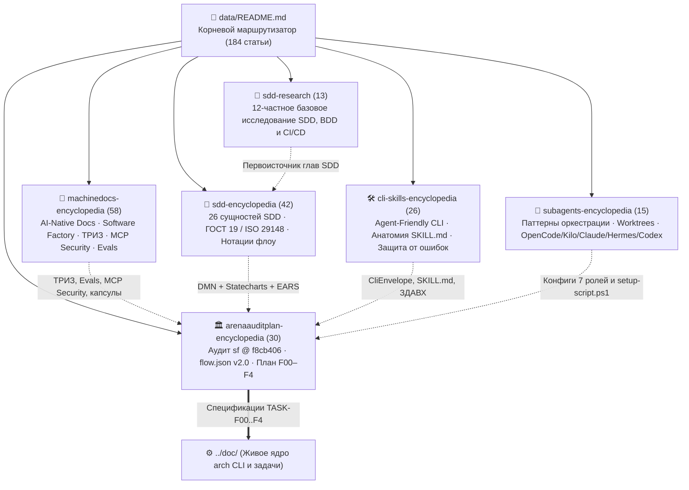

# 🧭 База знаний `data/` — руководство для ИИ-агента и полное оглавление

Каталог `data/` (зарегистрированный в [`../doc/config/paths.yaml`](../doc/config/paths.yaml) как справочный корень `roots.reference: "data"`) — это **долгоживущая инженерная библиотека и архитектурный консилиум** репозитория `sf`. Он объединяет **6 взаимосвязанных баз знаний (`184` профильных `.md`-файла + `4` скрипта самопроверки, `~1.5 МБ`)**: от прикладного аудита, спецификации `*.flow.json` и пошагового плана `sf v3.0` (`F00–F4`) до фундаментальных энциклопедий по машиночитаемой документации, SDD, проектированию CLI/скиллов и субагентным средам.

> [!important] Разграничение контуров `data/` и `doc/`
> - **`doc/`** ([`../doc/AGENTS.md`](../doc/AGENTS.md), [`../doc/architecture/README.md`](../doc/architecture/README.md), [`../doc/architecture/index.json`](../doc/architecture/index.json), [`../doc/tools/arch/`](../doc/tools/arch/__main__.py)) — **операционный контур живой системы**, управляемый CLI `arch`. Исторический прототип `data/simple/` упразднён и заменён боевым контуром `../doc/`.
> - **`data/`** (этот каталог) — **справочно-методологический и проектно-плановый контур**. Правки в `data/` не ломают инварианты `arch validate`, но служат прямым источником схем, контрактов, ролевых конфигов и спецификаций задач `TASK-F00..F4` при развитии `sf` и подключении целевых продуктовых репозиториев.

---

## 1. Карта экосистемы `data/` (6 разделов)



| № | Папка в `data/` | Статей | Объём | Авто-линтер | Главная точка входа | Роль в экосистеме |
|---:|---|---:|---:|---|---|---|
| **1** | [`arenaauditplan-encyclopedia/`](arenaauditplan-encyclopedia/Главная.md) | **30** | `~387 КБ` | `scripts/lint_wiki.py` + `build_index.py` | [`Индекс.md`](arenaauditplan-encyclopedia/Индекс.md) · [`Главная.md`](arenaauditplan-encyclopedia/Главная.md) · [`AGENTS.md`](arenaauditplan-encyclopedia/AGENTS.md) | **Прикладной канон `sf v3.0`:** рентген репо, аудит схем, спецификация `*.flow.json`, конфиги субагентов и графов без самописного MCP, реестр `PROB-01..38`, консилиум `CONF-01..12` и 6 этапов `F00–F4` (`31` задача) |
| **2** | [`machinedocs-encyclopedia/`](machinedocs-encyclopedia/Главная.md) | **58** | `~694 КБ` | `scripts/lint_wiki.py` + `build_index.py` | [`Индекс.md`](machinedocs-encyclopedia/Индекс.md) · [`Главная.md`](machinedocs-encyclopedia/Главная.md) · [`AGENTS.md`](machinedocs-encyclopedia/AGENTS.md) | **Методологический фундамент:** 3-ярусный контекст, форматы машиночитаемых доков, ТРИЗ, архитектура software factory, безопасность MCP, аудит кода, большие репо и Evals/DORA |
| **3** | [`sdd-encyclopedia/`](sdd-encyclopedia/Главная.md) | **42** | `~125 КБ` | Ссылочный контроль из корня | [`Главная.md`](sdd-encyclopedia/Главная.md) · [`Справочник сущностей.md`](<sdd-encyclopedia/Справочник сущностей.md>) | **Справочник Spec-Driven Development:** 26 типов артефактов, 5 стандартов (`ГОСТ 19`, `ISO 29148`, `IEEE 830`, `INCOSE`, `RFC 2119`), 4 фреймворка и стандарты описания флоу |
| **4** | [`sdd-research/`](sdd-research/README.md) | **13** | `~144 КБ` | Ссылочный контроль из корня | [`README.md`](sdd-research/README.md) | **Глубокий аналитический отчёт из 12 глав:** первоисточник сравнений, шаблонов, BDD-контуров, истории SDD и безопасности в спеках |
| **5** | [`cli-skills-encyclopedia/`](cli-skills-encyclopedia/Главная.md) | **26** | `~86 КБ` | Ссылочный контроль из корня | [`Главная.md`](cli-skills-encyclopedia/Главная.md) · [`Справочник форматов.md`](<cli-skills-encyclopedia/Справочник форматов.md>) | **Стандарты инструментов и скиллов:** проектирование Agent-Friendly CLI, анатомия `SKILL.md`, Progressive Disclosure, токен-эффективность и предотвращение ошибок моделей |
| **6** | [`subagents-encyclopedia/`](subagents-encyclopedia/Главная.md) | **15** | `~58 КБ` | Ссылочный контроль из корня | [`Главная.md`](subagents-encyclopedia/Главная.md) · [`Справочник сред.md`](<subagents-encyclopedia/Справочник сред.md>) | **Оркестрация субагентов:** паттерны делегирования, `git worktree`, handoff-контракты, экономика моделей и специфика 5 сред (`Claude Code`, `Codex`, `Hermes`, `Kilo Code`, `OpenCode`) |

---

## 2. Подробная инструкция для ИИ-агента по самостоятельной работе с `data/`

### 2.1. Иерархия источников истины (`SSOT Precedence`) при расхождениях

Если агент обнаруживает противоречие между документами, он обязан применять следующий порядок старшинства (сверху вниз):
1. **Фактический код и автотесты в `HEAD`** ([`../doc/tools/arch/`](../doc/tools/arch/__main__.py), [`../doc/tests/`](../doc/tests/run.sh)) — единственное доказательство того, что *уже работает прямо сейчас*.
2. **Операционные контракты и журнал задач в `../doc/`** (`implemented: true` в `../doc/architecture/` и `../doc/tasks/<KEY>/{task.json, state.json, events.jsonl}`) — действующий контракт текущей ревизии.
3. **Канонические заметки [`arenaauditplan-encyclopedia/`](arenaauditplan-encyclopedia/Главная.md) (`status: canonical`)** — утверждённая целевая архитектура `sf v3.0`, спецификация `*.flow.json` и план `F00–F4`. При расхождении с архивными дампами обзоров (`status: review-ingest` в `06-Консилиум-и-конфликты/`) всегда действует решение из [`Реестр-конфликтов-и-решений.md`](arenaauditplan-encyclopedia/06-Консилиум-и-конфликты/Реестр-конфликтов-и-решений.md) (`CONF-01..CONF-12`).
4. **Профильные энциклопедии `machinedocs`, `subagents`, `cli-skills`, `sdd`, `sdd-research`** — универсальные инженерные паттерны, стандарты и исследования; при переносе в `sf` они адаптируются под жёсткие инварианты из [`Антирекомендации-и-архитектурные-запреты.md`](arenaauditplan-encyclopedia/03-Архитектура-и-контракты/Антирекомендации-и-архитектурные-запреты.md) (например: *никакого самописного MCP-сервера* и *никаких игрушечных демо-репозиториев*).

### 2.2. Пятишаговый протокол навигации `Index-First` и бюджет токенов

> [!warning] Запрет на веерное чтение
> Суммарный объём `data/` превышает **`1.5 МБ` (`~400 000+` токенов)**. Агенту **категорически запрещено** читать целые папки подряд или загружать больше `4–5` заметок за один поисковый цикл. Целевой бюджет одного обращения к `data/` — **`≤ 3 000 – 6 000` токенов**.

1. **Шаг 1 — Маршрутизация по задаче:** определите целевую энциклопедию и входной файл по **Матрице маршрутизации (раздел 2.3)** или по полному оглавлению (раздел 3).
2. **Шаг 2 — Чтение индекса или справочника (`~500–1 200` ток.):**
   - В `arenaauditplan-encyclopedia` и `machinedocs-encyclopedia` **всегда начинайте с `Индекс.md`** — в нём у каждой заметки есть триггерное поле `description` (*«Загружайте, когда...»*).
   - В `sdd-encyclopedia`, `cli-skills-encyclopedia` и `subagents-encyclopedia` начинайте с `Главная.md` или быстрого табличного `Справочник *.md`.
3. **Шаг 3 — Точечное чтение 1–3 целевых статей:** открывайте только выбранные заметки. Если файл крупный (`>15 КБ`), читайте оглавление заголовков или нужный диапазон строк (`offset` / `limit`).
4. **Шаг 4 — Контролируемый переход по связям (`≤ 2` хопов):** переходите по `[[wikilinks]]` или относительным ссылкам только за конкретной схемой, таблицей или определением из `Глоссарий.md`.
5. **Шаг 5 — Выгрузка результата в рабочий артефакт (`Artifact-First`):** не копируйте длинные куски энциклопедий в диалог — сразу материализуйте извлечённое знание в файл задачи (`workpack.json`, `flow-delta.json`, `.opencode/agents/*.md`, `kilo.jsonc`, `SKILL.md` или патч кода).

### 2.3. Матрица маршрутизации задач агента («Что нужно сделать → какой файл открыть первым»)

| Задача или вопрос, стоящий перед ИИ-агентом | Первая точка входа (точные файлы) | Вспомогательный справочник в `data/` |
|---|---|---|
| Понять текущие баги `sf @ f8cb406`, почему `body_validation.py` — no-op или почему не работает Windows | [`arenaauditplan-encyclopedia/01-Аудит-текущей-системы/Рентген-репозитория-и-ядра-CLI.md`](arenaauditplan-encyclopedia/01-Аудит-текущей-системы/Рентген-репозитория-и-ядра-CLI.md) и [`Аудит-архитектурной-документации-и-схем.md`](arenaauditplan-encyclopedia/01-Аудит-текущей-системы/Аудит-архитектурной-документации-и-схем.md) | [`Мастер-реестр-проблем-PROB-01-PROB-38.md`](arenaauditplan-encyclopedia/04-Реестр-проблем-и-требований/Мастер-реестр-проблем-PROB-01-PROB-38.md) |
| Развернуть 7 ролевых субагентов и готовые графы кода (`codegraph`, `cbmemory`, `Graphify`, `Headroom`) **без правки CLI** | [`arenaauditplan-encyclopedia/02-Исследования-и-инструменты/Субагенты-и-оркестрация-в-средах-OpenCode-Kilo-Claude.md`](arenaauditplan-encyclopedia/02-Исследования-и-инструменты/Субагенты-и-оркестрация-в-средах-OpenCode-Kilo-Claude.md) и [`F00-Среда-и-субагенты-без-правки-CLI.md`](arenaauditplan-encyclopedia/05-Этапы-внедрения/F00-Среда-и-субагенты-без-правки-CLI.md) | [`subagents-encyclopedia/Справочник сред.md`](<subagents-encyclopedia/Справочник сред.md>) и [`Подключаемые-графы-кода-аудит-и-компрессоры.md`](arenaauditplan-encyclopedia/02-Исследования-и-инструменты/Подключаемые-графы-кода-аудит-и-компрессоры.md) |
| Спроектировать или проверить архитектурный флоу `*.flow.json`, `flows.index.json` или скилл `flow-audit` | [`arenaauditplan-encyclopedia/03-Архитектура-и-контракты/Спецификация-архитектурных-флоу-flow-json.md`](arenaauditplan-encyclopedia/03-Архитектура-и-контракты/Спецификация-архитектурных-флоу-flow-json.md) и [`Схемы-индекс-и-скилл-flow-audit.md`](arenaauditplan-encyclopedia/03-Архитектура-и-контракты/Схемы-индекс-и-скилл-flow-audit.md) | [`sdd-encyclopedia/Флоу/Стандарты описания флоу.md`](<sdd-encyclopedia/Флоу/Стандарты описания флоу.md>) и [`machinedocs-encyclopedia/Документация/Флоу.md`](machinedocs-encyclopedia/Документация/Флоу.md) |
| Взять в работу очередной этап модернизации `sf` и выпустить карточку `task.json` | Нужный этап [`F00`](arenaauditplan-encyclopedia/05-Этапы-внедрения/F00-Среда-и-субагенты-без-правки-CLI.md) / [`F0`](arenaauditplan-encyclopedia/05-Этапы-внедрения/F0-Разблокировка-ядра-CLI-и-Windows.md) / [`F1`](arenaauditplan-encyclopedia/05-Этапы-внедрения/F1-Контекст-оракулы-и-первый-продуктовый-срез.md) / [`F2`](arenaauditplan-encyclopedia/05-Этапы-внедрения/F2-Флоу-контракты-Validity-L1-и-Verifier.md) / [`F3`](arenaauditplan-encyclopedia/05-Этапы-внедрения/F3-Песочница-волны-роутинг-и-Cold-Resume.md) / [`F4`](arenaauditplan-encyclopedia/05-Этапы-внедрения/F4-Мутации-сходимость-метрики-и-пилот.md) | [`Справочник артефактов, команд и схем.md`](<arenaauditplan-encyclopedia/Справочник артефактов, команд и схем.md>) и [`Контракт задачи для агента.md`](<machinedocs-encyclopedia/Практики/Контракт задачи для агента.md>) |
| Настроить `Oracle-First`, `Infection PHP --git-diff-lines`, защиту MCP или песочницу `Ralph loop` | [`arenaauditplan-encyclopedia/03-Архитектура-и-контракты/Конвейер-верификации-оракулы-и-песочница.md`](arenaauditplan-encyclopedia/03-Архитектура-и-контракты/Конвейер-верификации-оракулы-и-песочница.md) | [`Безопасность MCP и инструментов.md`](<machinedocs-encyclopedia/Практики/Безопасность MCP и инструментов.md>) и [`Evals и метрики агентной разработки.md`](<machinedocs-encyclopedia/Практики/Evals и метрики агентной разработки.md>) |
| Спроектировать новую CLI-команду, JSON-ответ с ошибкой или файл `SKILL.md` без галлюцинаций у слабых моделей | [`cli-skills-encyclopedia/Практики/Agent-Friendly CLI Design.md`](<cli-skills-encyclopedia/Практики/Agent-Friendly CLI Design.md>) и [`Форматы/Agent Skills (SKILL.md).md`](<cli-skills-encyclopedia/Форматы/Agent Skills (SKILL.md).md>) | [`Предотвращение ошибок.md`](<cli-skills-encyclopedia/Практики/Предотвращение ошибок.md>) и [`Токен-эффективность.md`](<cli-skills-encyclopedia/Практики/Токен-эффективность.md>) |
| Разобраться с изоляцией `git worktree`, передачей контекста (`handoff`) или выбором между `OpenCode`, `Kilo`, `Claude`, `Hermes`, `Codex` | [`subagents-encyclopedia/Паттерны/Изоляция и worktrees.md`](<subagents-encyclopedia/Паттерны/Изоляция и worktrees.md>) и [`Контекст и handoff.md`](<subagents-encyclopedia/Паттерны/Контекст и handoff.md>) | Профиль среды в [`subagents-encyclopedia/Среды/`](subagents-encyclopedia/Главная.md) |
| Выбрать стандарт оформления требований (`EARS`, `ГОСТ 19`, `ISO 29148`, `ADR`, `SRS`, `BDD Feature Files`) | [`sdd-encyclopedia/Справочник сущностей.md`](<sdd-encyclopedia/Справочник сущностей.md>) | Подробный разбор и шаблоны в [`sdd-research/02-стандарты-и-форматы-требований.md`](sdd-research/02-стандарты-и-форматы-требований.md) и [`05-шаблоны.md`](sdd-research/05-шаблоны.md) |
| Применить системную методологию разрешения архитектурных противоречий (ТРИЗ, TOC, Design by Contract, STAMP/STPA) | [`machinedocs-encyclopedia/Практики/ТРИЗ и аналоги_ карта методов для агентной разработки.md`](<machinedocs-encyclopedia/Практики/ТРИЗ и аналоги_ карта методов для агентной разработки.md>) | Прикладное применение к `sf v3.0`: [`Двухтрековая-архитектура-sf-v3-и-граница-ядра.md`](arenaauditplan-encyclopedia/03-Архитектура-и-контракты/Двухтрековая-архитектура-sf-v3-и-граница-ядра.md) |
| Проверить, не предлагается ли уже отвергнутое на консилиуме решение | [`arenaauditplan-encyclopedia/03-Архитектура-и-контракты/Антирекомендации-и-архитектурные-запреты.md`](arenaauditplan-encyclopedia/03-Архитектура-и-контракты/Антирекомендации-и-архитектурные-запреты.md) | [`Реестр-конфликтов-и-решений.md`](arenaauditplan-encyclopedia/06-Консилиум-и-конфликты/Реестр-конфликтов-и-решений.md) |

### 2.4. Правила редактирования, пополнения (`Ingest`) и автопроверки энциклопедий

Когда пользователь поручает агенту дополнить базу знаний в `data/` новым исследованием, экспертным обзором или архитектурным решением, агент обязан выполнить 5 правил:
1. **Запрет на дублирование (`SSOT`):** не создавайте параллельную заметку про уже существующую сущность. Дополняйте каноническую статью, а если поступил внешний экспертный обзор — сохраните его паспорт в `arenaauditplan-encyclopedia/06-Консилиум-и-конфликты/Обзор-Эксперта-NN-*.md` (`status: review-ingest`), разберите расхождения в `Реестр-конфликтов-и-решений.md` и влейте принятые факты в профильные канонические статьи `01..05`.
2. **Эпистемическая маркировка цифр:** любая количественная оценка помечается своей природой (*подтверждённый замер на репо*, *рецензируемая статья / arXiv*, *заявка автора/вендора инструмента*, *проектный ориентир SLO*).
3. **Правила ссылок (Obsidian + CommonMark):**
   - *Внутри одной энциклопедии* используйте `[[Папка/Имя-заметки]]` или `[[Имя-заметки]]`; **внутри ячеек Markdown-таблиц обязательно экранируйте вертикальную черту алиаса: `[[Заметка\|Текст]]`**, иначе парсер таблицы разрежет ячейку.
   - *Между разными энциклопедиями `data/` и при ссылках на файлы репозитория `../doc/`* используйте стандартные относительные Markdown-ссылки, оборачивая пути с пробелами в угловые скобки (пример из этого файла: `[Аудит кода](<machinedocs-encyclopedia/Практики/Аудит кода.md>)`, а из вложенной энциклопедии — с префиксом `../`).
4. **Журналирование и пересборка индексов:** после правок в `arenaauditplan-encyclopedia` или `machinedocs-encyclopedia` добавьте запись в соответствующий `Журнал.md` и пересоберите `Индекс.md`.
5. **Обязательный прогон автопроверок перед завершением ответа** (запускать из корня репозитория `/home/user/sf`):
   ```bash
   # 1. Пересборка и строгий линтинг энциклопедии аудита и архитектуры sf v3.0:
   python3 data/arenaauditplan-encyclopedia/scripts/build_index.py
   python3 data/arenaauditplan-encyclopedia/scripts/lint_wiki.py
   python3 data/arenaauditplan-encyclopedia/scripts/build_index.py --check

   # 2. Пересборка и строгий линтинг энциклопедии машиночитаемой документации:
   python3 data/machinedocs-encyclopedia/scripts/build_index.py
   python3 data/machinedocs-encyclopedia/scripts/lint_wiki.py
   python3 data/machinedocs-encyclopedia/scripts/build_index.py --check
   ```

---

## 3. Полное детальное оглавление всех 6 разделов `data/` (`184` статьи)

### 3.1. 🏛️ `arenaauditplan-encyclopedia/` — Полный аудит `sf`, спецификация `*.flow.json` и дорожная карта `sf v3.0` (`30` статей)

- **Вход, регламент и сквозные справочники (6):**
  - [`Главная.md`](arenaauditplan-encyclopedia/Главная.md) — карта хранилища, сводная диаграмма контуров, мнемоника **ДВОК** и главные цифры аудита.
  - [`Индекс.md`](arenaauditplan-encyclopedia/Индекс.md) — автогенерируемый маршрутизатор ИИ-агента с триггерами `description` для всех 30 заметок.
  - [`AGENTS.md`](arenaauditplan-encyclopedia/AGENTS.md) — регламент ведения хранилища, приёма экспертных обзоров (`Ingest`) и выпуска `task.json`.
  - [`Справочник артефактов, команд и схем.md`](<arenaauditplan-encyclopedia/Справочник артефактов, команд и схем.md>) — сводная таблица всех файлов/JSON-схем `sf v3.0`, кодов выхода `CliEnvelope` (`0/1/2/5/10/20`) и шкалы `Validity L1`.
  - [`Глоссарий.md`](arenaauditplan-encyclopedia/Глоссарий.md) — канонический словарь терминов + таблица различения однофамильцев `CodePrizm / CodePrism / CodeGraph / Graphify / Headroom`.
  - [`Журнал.md`](arenaauditplan-encyclopedia/Журнал.md) — хронология ревизий, влитых обзоров и проверок целостности.
- **`01-Аудит-текущей-системы/` — Рентген репозитория `f8cb406`, схем и отказов (3):**
  - [`Рентген-репозитория-и-ядра-CLI.md`](arenaauditplan-encyclopedia/01-Аудит-текущей-системы/Рентген-репозитория-и-ядра-CLI.md) — замер объёмов репо, разбор всех подсистем `doc/tools/arch/` (`9 919 LOC`), дефекты `D-01..D-15`, аномалия `7.3M` кэш-токенов `UI-0011` и `fs_atomic.py` на Windows.
  - [`Аудит-архитектурной-документации-и-схем.md`](arenaauditplan-encyclopedia/01-Аудит-текущей-системы/Аудит-архитектурной-документации-и-схем.md) — no-op баг `body_validation.py`, `15/45` невалидных тел документов, `6` расхождений `document.schema.json`, раздвоение манифеста на `23 КБ` и блокировка `architecture-delta` в `paths.yaml`.
  - [`Моделирование-сценариев-и-режимы-отказа-F1-F14.md`](arenaauditplan-encyclopedia/01-Аудит-текущей-системы/Моделирование-сценариев-и-режимы-отказа-F1-F14.md) — сквозное моделирование сценариев `S1..S5`, реестр 14 режимов отказа `F1..F14` и 10 механизмов удержания слабых моделей `M1..M10`.
- **`02-Исследования-и-инструменты/` — Эмпирика контекста, внешние графы и субагентные среды (4):**
  - [`Эмпирические-законы-контекста-и-слабых-моделей.md`](arenaauditplan-encyclopedia/02-Исследования-и-инструменты/Эмпирические-законы-контекста-и-слабых-моделей.md) — доказательная база 2024–2026: Context Rot, пофункциональный ревьюер Winninger (`54.5% → 90.9%`), налог схем MCP (`9K–16K` ток.), мутации Meta ACH и сходимость без вечного цикла.
  - [`Сравнение-SDD-и-фабричных-аналогов.md`](arenaauditplan-encyclopedia/02-Исследования-и-инструменты/Сравнение-SDD-и-фабричных-аналогов.md) — сравнение `sf` с `Spec Kit`, `OpenSpec`, `Kiro`, `BMAD`, `Archgate`, `GSD-2`, `Factory Droids`, `Entire CLI`, `StrongDM Attractor` по 18 критериям.
  - [`Подключаемые-графы-кода-аудит-и-компрессоры.md`](arenaauditplan-encyclopedia/02-Исследования-и-инструменты/Подключаемые-графы-кода-аудит-и-компрессоры.md) — верифицированный стек `codebase-memory-mcp`, `colbymchenry/codegraph`, `Graphify` (`graphifyy`), `Green Olive CodePrizm`, `Serena`, `RTK`, `Headroom` (`CacheAligner` + `CCR`) и единая схема `Finding`.
  - [`Субагенты-и-оркестрация-в-средах-OpenCode-Kilo-Claude.md`](arenaauditplan-encyclopedia/02-Исследования-и-инструменты/Субагенты-и-оркестрация-в-средах-OpenCode-Kilo-Claude.md) — сравнение `OpenCode`, `Kilo Code`, `Claude Code`, `Hermes` и `Codex`, готовые конфиги 7 ролей (`shared_agent_board: false`), Windows `.kilo/setup-script.ps1`, приёмы `P1..P12` и плейбуки `A–D`.
- **`03-Архитектура-и-контракты/` — Двухтрековая архитектура `sf v3.0`, `*.flow.json` и конвейер приёмки (5):**
  - [`Двухтрековая-архитектура-sf-v3-и-граница-ядра.md`](arenaauditplan-encyclopedia/03-Архитектура-и-контракты/Двухтрековая-архитектура-sf-v3-и-граница-ядра.md) — 6 физических противоречий ТРИЗ, граница Трека А и Трека Б, SQL DDL `.sf/intent.sqlite`, 4 архетипа конвейеров, капсула `<3 200` ток., YAML `handoff` и `.sf/providers.yaml`.
  - [`Спецификация-архитектурных-флоу-flow-json.md`](arenaauditplan-encyclopedia/03-Архитектура-и-контракты/Спецификация-архитектурных-флоу-flow-json.md) — формальный контракт `*.flow.json` `v2.0` (`DMN + Statecharts`), 12 пробелов `UI-0029`, миграция 8 существующих `FLOW-*`, 6 правил декомпозиции и эталонный `FLOW-create-task`.
  - [`Схемы-индекс-и-скилл-flow-audit.md`](arenaauditplan-encyclopedia/03-Архитектура-и-контракты/Схемы-индекс-и-скилл-flow-audit.md) — полный JSON Schema Draft 2020-12 `arch-flow.schema.json`, матрица покрытия всех 32 модулей `doc/tools/arch/`, формат `flows.index.json`, 20 CLI-команд и шаблон `flow-audit/SKILL.md`.
  - [`Конвейер-верификации-оракулы-и-песочница.md`](arenaauditplan-encyclopedia/03-Архитектура-и-контракты/Конвейер-верификации-оракулы-и-песочница.md) — 6 барьеров приёмки, `Infection PHP --git-diff-lines` с `PCOV`, модель угроз OWASP MCP Security, 5 границ песочницы, `Cold Resume` и 3-контурная система `Evals / DORA`.
  - [`Антирекомендации-и-архитектурные-запреты.md`](arenaauditplan-encyclopedia/03-Архитектура-и-контракты/Антирекомендации-и-архитектурные-запреты.md) — 12 жёстких архитектурных запретов (что и почему никогда не делается в `sf v3.0`).
- **`04-Реестр-проблем-и-требований/` — Единая матрица дефектов и требований (2):**
  - [`Мастер-реестр-проблем-PROB-01-PROB-38.md`](arenaauditplan-encyclopedia/04-Реестр-проблем-и-требований/Мастер-реестр-проблем-PROB-01-PROB-38.md) — дедуплицированный реестр всех 38 проблем (`PROB-01..PROB-38`) с привязкой к файлам, трекам и этапам.
  - [`Рекомендации-R1-R23-и-открытые-вопросы-владельцу.md`](arenaauditplan-encyclopedia/04-Реестр-проблем-и-требований/Рекомендации-R1-R23-и-открытые-вопросы-владельцу.md) — сводка рекомендаций `R1..R23` и 10 открытых вопросов владельцу с безопасными дефолтами.
- **`05-Этапы-внедрения/` — Пошаговая дорожная карта `F00–F4` с `31` готовой спецификацией задач (6):**
  - [`F00-Среда-и-субагенты-без-правки-CLI.md`](arenaauditplan-encyclopedia/05-Этапы-внедрения/F00-Среда-и-субагенты-без-правки-CLI.md) — Трек А (`0` строк в `doc/tools/arch/`): `TASK-F00-01..06` (графы, `Graphify`, 7 субагентов, `.kilo/setup-script.ps1`, `RTK/Headroom`, замер до/после на Laravel).
  - [`F0-Разблокировка-ядра-CLI-и-Windows.md`](arenaauditplan-encyclopedia/05-Этапы-внедрения/F0-Разблокировка-ядра-CLI-и-Windows.md) — Трек Б: `TASK-F0-01..06` (починка `body_validation.py`, `document.schema.json`, `fs_atomic.py` на Windows, единый `CliEnvelope`, `paths.yaml`, удаление дубля манифеста).
  - [`F1-Контекст-оракулы-и-первый-продуктовый-срез.md`](arenaauditplan-encyclopedia/05-Этапы-внедрения/F1-Контекст-оракулы-и-первый-продуктовый-срез.md) — `TASK-F1-01..05` (`workpack.json` с `passes: false`, `Oracle-First`, `RO Trust Zone`, 4-слотовая капсула `<3.2k` ток.).
  - [`F2-Флоу-контракты-Validity-L1-и-Verifier.md`](arenaauditplan-encyclopedia/05-Этапы-внедрения/F2-Флоу-контракты-Validity-L1-и-Verifier.md) — `TASK-F2-01..05` (`*.flow.json`, `flow-delta.json`, `.sf/intent.sqlite`, `Validity L1`, независимый `Winninger Verifier`).
  - [`F3-Песочница-волны-роутинг-и-Cold-Resume.md`](arenaauditplan-encyclopedia/05-Этапы-внедрения/F3-Песочница-волны-роутинг-и-Cold-Resume.md) — `TASK-F3-01..04` (5-контурный sandbox + `egress allowlist`, `waves` в worktrees, адаптивный роутинг моделей, `Cold Resume`).
  - [`F4-Мутации-сходимость-метрики-и-пилот.md`](arenaauditplan-encyclopedia/05-Этапы-внедрения/F4-Мутации-сходимость-метрики-и-пилот.md) — `TASK-F4-01..05` (дифф-мутаторы `Infection/mutmut/Stryker`, инвариант сходимости, телеметрия DORA/Evals, коннектор `CodePrizm` и боевой пилот на 10 реальных задачах).
- **`06-Консилиум-и-конфликты/` — Реестр разрешённых противоречий, паспорта обзоров и библиография (4):**
  - [`Реестр-конфликтов-и-решений.md`](arenaauditplan-encyclopedia/06-Консилиум-и-конфликты/Реестр-конфликтов-и-решений.md) — нормативный журнал `CONF-01..CONF-12`.
  - [`Обзор-Эксперта-01-Полный-аудит-и-SF2.md`](arenaauditplan-encyclopedia/06-Консилиум-и-конфликты/Обзор-Эксперта-01-Полный-аудит-и-SF2.md) — паспорт и карта трассировки первого независимого обзора (`SF-2`).
  - [`Обзор-Эксперта-02-Субагенты-и-инструменты-без-CLI.md`](arenaauditplan-encyclopedia/06-Консилиум-и-конфликты/Обзор-Эксперта-02-Субагенты-и-инструменты-без-CLI.md) — паспорт и карта трассировки второго независимого обзора (`No-Custom-MCP`).
  - [`Библиография-и-источники-2024-2026.md`](arenaauditplan-encyclopedia/06-Консилиум-и-конфликты/Библиография-и-источники-2024-2026.md) — полный каталог проверенных первоисточников (`170+` URL).

---

### 3.2. 📘 `machinedocs-encyclopedia/` — Энциклопедия машиночитаемой документации и агентной Software Factory (`58` статей)

- **Вход, регламент и сквозные файлы (6):** [`Главная.md`](machinedocs-encyclopedia/Главная.md) · [`Индекс.md`](machinedocs-encyclopedia/Индекс.md) · [`AGENTS.md`](machinedocs-encyclopedia/AGENTS.md) · [`Справочник форматов.md`](<machinedocs-encyclopedia/Справочник форматов.md>) · [`Глоссарий.md`](machinedocs-encyclopedia/Глоссарий.md) · [`Журнал.md`](machinedocs-encyclopedia/Журнал.md)
- **`Архитектура/` — Устройство и хранение документации для ИИ (5):**
  - [`Index-First подход.md`](<machinedocs-encyclopedia/Архитектура/Index-First подход.md>) · [`Codified Context (3 яруса).md`](<machinedocs-encyclopedia/Архитектура/Codified Context (3 яруса).md>) · [`Иерархическая документация.md`](<machinedocs-encyclopedia/Архитектура/Иерархическая документация.md>) · [`Docs-as-Code и CI.md`](<machinedocs-encyclopedia/Архитектура/Docs-as-Code и CI.md>) · [`LLM Wiki и поддержка Obsidian.md`](<machinedocs-encyclopedia/Архитектура/LLM Wiki и поддержка Obsidian.md>)
- **`Форматы/` — Машиночитаемые форматы и схемы (7):**
  - [`AGENTS.md Index.md`](<machinedocs-encyclopedia/Форматы/AGENTS.md Index.md>) · [`Frontmatter-схемы.md`](machinedocs-encyclopedia/Форматы/Frontmatter-схемы.md) · [`Структурированный Markdown.md`](<machinedocs-encyclopedia/Форматы/Структурированный Markdown.md>) · [`OpenAPI и JSON Schema.md`](<machinedocs-encyclopedia/Форматы/OpenAPI и JSON Schema.md>) · [`Mermaid-диаграммы.md`](machinedocs-encyclopedia/Форматы/Mermaid-диаграммы.md) · [`OKF (Open Knowledge Format).md`](<machinedocs-encyclopedia/Форматы/OKF (Open Knowledge Format).md>) · [`llms.txt.md`](machinedocs-encyclopedia/Форматы/llms.txt.md)
- **`Документация/` — Как документировать разрезы самой системы (6):**
  - [`Сущности.md`](machinedocs-encyclopedia/Документация/Сущности.md) · [`Флоу.md`](machinedocs-encyclopedia/Документация/Флоу.md) · [`Следование архитектуре.md`](<machinedocs-encyclopedia/Документация/Следование архитектуре.md>) · [`Аудит архитектуры.md`](<machinedocs-encyclopedia/Документация/Аудит архитектуры.md>) · [`Тесты.md`](machinedocs-encyclopedia/Документация/Тесты.md) · [`Безопасность.md`](machinedocs-encyclopedia/Документация/Безопасность.md)
- **`Практики/` — Инженерные практики агентной фабрики, ТРИЗ, аудит, безопасность и метрики (31):**
  - *Архитектура и операционная модель фабрики (8):* [`Архитектура агентной software factory.md`](<machinedocs-encyclopedia/Практики/Архитектура агентной software factory.md>) · [`Готовые решения агентной software factory.md`](<machinedocs-encyclopedia/Практики/Готовые решения агентной software factory.md>) · [`Исследование software factory — пробелы и готовые практики.md`](<machinedocs-encyclopedia/Практики/Исследование software factory — пробелы и готовые практики.md>) · [`Сквозной цикл разработки.md`](<machinedocs-encyclopedia/Практики/Сквозной цикл разработки.md>) · [`Операционная модель агентных команд.md`](<machinedocs-encyclopedia/Практики/Операционная модель агентных команд.md>) · [`Уровни автономии.md`](<machinedocs-encyclopedia/Практики/Уровни автономии.md>) · [`Параллельная работа агентов.md`](<machinedocs-encyclopedia/Практики/Параллельная работа агентов.md>) · [`Harness-инжиниринг.md`](machinedocs-encyclopedia/Практики/Harness-инжиниринг.md)
  - *Контекст, задачи, навигация и большие кодовые базы (9):* [`AI-Native Documentation.md`](<machinedocs-encyclopedia/Практики/AI-Native Documentation.md>) · [`Исследование формата документации проекта и входящей задачи.md`](<machinedocs-encyclopedia/Практики/Исследование формата документации проекта и входящей задачи.md>) · [`Контракт задачи для агента.md`](<machinedocs-encyclopedia/Практики/Контракт задачи для агента.md>) · [`Код, контекст и минимальный harness.md`](<machinedocs-encyclopedia/Практики/Код, контекст и минимальный harness.md>) · [`Управление контекстом многоагентных систем.md`](<machinedocs-encyclopedia/Практики/Управление контекстом многоагентных систем.md>) · [`Большие кодовые базы.md`](<machinedocs-encyclopedia/Практики/Большие кодовые базы.md>) · [`Навигация по коду.md`](<machinedocs-encyclopedia/Практики/Навигация по коду.md>) · [`Семантический чанкинг.md`](<machinedocs-encyclopedia/Практики/Семантический чанкинг.md>) · [`Инструменты агентной среды.md`](<machinedocs-encyclopedia/Практики/Инструменты агентной среды.md>)
  - *Качество, свежесть, аудит, CI/CD, безопасность и Evals (9):* [`AI-Readiness scoring.md`](<machinedocs-encyclopedia/Практики/AI-Readiness scoring.md>) · [`Актуальность и staleness.md`](<machinedocs-encyclopedia/Практики/Актуальность и staleness.md>) · [`Аудит кода.md`](<machinedocs-encyclopedia/Практики/Аудит кода.md>) · [`Инструменты аудита для software factory.md`](<machinedocs-encyclopedia/Практики/Инструменты аудита для software factory.md>) · [`Агентский CI-CD.md`](<machinedocs-encyclopedia/Практики/Агентский CI-CD.md>) · [`Безопасный деплой агентами.md`](<machinedocs-encyclopedia/Практики/Безопасный деплой агентами.md>) · [`Threat model агентной разработки.md`](<machinedocs-encyclopedia/Практики/Threat model агентной разработки.md>) · [`Безопасность MCP и инструментов.md`](<machinedocs-encyclopedia/Практики/Безопасность MCP и инструментов.md>) · [`Evals и метрики агентной разработки.md`](<machinedocs-encyclopedia/Практики/Evals и метрики агентной разработки.md>)
  - *ТРИЗ и системные методологии разрешения противоречий (5):* [`ТРИЗ и аналоги_ карта методов для агентной разработки.md`](<machinedocs-encyclopedia/Практики/ТРИЗ и аналоги_ карта методов для агентной разработки.md>) · [`ТРиЗ и системные методологии для разработки ПО.md`](<machinedocs-encyclopedia/Практики/ТРиЗ и системные методологии для разработки ПО.md>) · [`Альтернативы ТРИЗ для агентной разработки ПО.md`](<machinedocs-encyclopedia/Практики/Альтернативы ТРИЗ для агентной разработки ПО.md>) · [`Ресёрч по теориям ТРИЗ и аналогам для агентных систем.md`](<machinedocs-encyclopedia/Практики/Ресёрч по теориям ТРИЗ и аналогам для агентных систем.md>) · [`Ресёрч альтернатив ТРИЗ для агентной разработки ПО.md`](<machinedocs-encyclopedia/Практики/Ресёрч альтернатив ТРИЗ для агентной разработки ПО.md>)
- **`Примеры/` — Шаблоны и контрольные списки (3):** [`Пример пакета документации фичи.md`](<machinedocs-encyclopedia/Примеры/Пример пакета документации фичи.md>) · [`Пример структуры docs.md`](<machinedocs-encyclopedia/Примеры/Пример структуры docs.md>) · [`Чек-листы.md`](machinedocs-encyclopedia/Примеры/Чек-листы.md)

---

### 3.3. 📐 `sdd-encyclopedia/` — Энциклопедия Spec-Driven Development: сущности, стандарты и нотации (`42` статьи)

- **Вход и сводные таблицы (3):** [`Главная.md`](sdd-encyclopedia/Главная.md) · [`Справочник сущностей.md`](<sdd-encyclopedia/Справочник сущностей.md>) · [`Глоссарий.md`](sdd-encyclopedia/Глоссарий.md)
- **`Стандарты/` — Классические и инженерные стандарты требований (5):** [`ISO 29148.md`](<sdd-encyclopedia/Стандарты/ISO 29148.md>) · [`IEEE 830.md`](<sdd-encyclopedia/Стандарты/IEEE 830.md>) · [`INCOSE Guide.md`](<sdd-encyclopedia/Стандарты/INCOSE Guide.md>) · [`RFC 2119.md`](<sdd-encyclopedia/Стандарты/RFC 2119.md>) · [`ГОСТ 19.md`](<sdd-encyclopedia/Стандарты/ГОСТ 19.md>)
- **`Инструменты/` — Разбор SDD-фреймворков (4):** [`GitHub Spec Kit.md`](<sdd-encyclopedia/Инструменты/GitHub Spec Kit.md>) · [`OpenSpec.md`](sdd-encyclopedia/Инструменты/OpenSpec.md) · [`Kiro.md`](sdd-encyclopedia/Инструменты/Kiro.md) · [`BMAD.md`](sdd-encyclopedia/Инструменты/BMAD.md)
- **`Процессы/` и `Флоу/` — Жизненный цикл и нотации флоу (4):** [`Workflow SDD.md`](<sdd-encyclopedia/Процессы/Workflow SDD.md>) · [`SDD в CI-CD.md`](<sdd-encyclopedia/Процессы/SDD в CI-CD.md>) · [`Внедрение SDD.md`](<sdd-encyclopedia/Процессы/Внедрение SDD.md>) · [`Стандарты описания флоу.md`](<sdd-encyclopedia/Флоу/Стандарты описания флоу.md>) *(сравнение BPMN, UML, Harel Statecharts, DMN, ГОСТ 19, EARS и Gherkin)*
- **`Сущности/` — Каталог всех 26 артефактов SDD (26):**
  - *Продуктовые и бизнес-документы:* [`BRD.md`](sdd-encyclopedia/Сущности/BRD.md) · [`PRD.md`](sdd-encyclopedia/Сущности/PRD.md) · [`FRD.md`](sdd-encyclopedia/Сущности/FRD.md) · [`SRS.md`](sdd-encyclopedia/Сущности/SRS.md) · [`ТЗ по ГОСТ 19.md`](<sdd-encyclopedia/Сущности/ТЗ по ГОСТ 19.md>) · [`Пользовательские истории.md`](<sdd-encyclopedia/Сущности/Пользовательские истории.md>) · [`Proposal.md`](sdd-encyclopedia/Сущности/Proposal.md)
  - *Требования, архитектура и модели:* [`Требования.md`](sdd-encyclopedia/Сущности/Требования.md) · [`EARS-требования.md`](sdd-encyclopedia/Сущности/EARS-требования.md) · [`Спецификация.md`](sdd-encyclopedia/Сущности/Спецификация.md) · [`Delta Specs.md`](<sdd-encyclopedia/Сущности/Delta Specs.md>) · [`ADR.md`](sdd-encyclopedia/Сущности/ADR.md) · [`RFC Design Doc.md`](<sdd-encyclopedia/Сущности/RFC Design Doc.md>) · [`Data Model.md`](<sdd-encyclopedia/Сущности/Data Model.md>) · [`Контракты.md`](sdd-encyclopedia/Сущности/Контракты.md) · [`Research.md`](sdd-encyclopedia/Сущности/Research.md)
  - *Управление агентом, исполнение и верификация:* [`Конституция.md`](sdd-encyclopedia/Сущности/Конституция.md) · [`Steering.md`](sdd-encyclopedia/Сущности/Steering.md) · [`Инструкционные файлы агентов.md`](<sdd-encyclopedia/Сущности/Инструкционные файлы агентов.md>) · [`План.md`](sdd-encyclopedia/Сущности/План.md) · [`Задачи.md`](sdd-encyclopedia/Сущности/Задачи.md) · [`Quickstart.md`](sdd-encyclopedia/Сущности/Quickstart.md) · [`Сценарии приёмки.md`](<sdd-encyclopedia/Сущности/Сценарии приёмки.md>) · [`Feature Files.md`](<sdd-encyclopedia/Сущности/Feature Files.md>) · [`Матрица трассируемости.md`](<sdd-encyclopedia/Сущности/Матрица трассируемости.md>) · [`Чек-листы.md`](sdd-encyclopedia/Сущности/Чек-листы.md)

---

### 3.4. 🔬 `sdd-research/` — Двенадцатичастное фундаментальное исследование SDD (`13` документов)

- [`README.md`](sdd-research/README.md) — сводное оглавление и резюме исследования
- [`01-сущности-sdd.md`](sdd-research/01-сущности-sdd.md) — полная таксономия артефактов SDD и их связей
- [`02-стандарты-и-форматы-требований.md`](sdd-research/02-стандарты-и-форматы-требований.md) — детальное сравнение стандартов формулирования требований
- [`03-инструменты-и-фреймворки.md`](sdd-research/03-инструменты-и-фреймворки.md) — архитектурный разбор SDD-инструментов 2025–2026
- [`04-хранение-docs-as-code.md`](sdd-research/04-хранение-docs-as-code.md) — паттерны хранения спецификаций в Git и версионирования дельт
- [`05-шаблоны.md`](sdd-research/05-шаблоны.md) — готовые шаблоны спецификаций, ADR, контрактов и планов
- [`06-качество-и-трассируемость.md`](sdd-research/06-качество-и-трассируемость.md) — метрики качества спек и двусторонняя трассируемость `Req ↔ Code ↔ Test`
- [`07-история-и-эволюция.md`](sdd-research/07-история-и-эволюция.md) — эволюция от классического Systems Engineering до агентного SDD
- [`08-контекст-инженерия-агентов.md`](sdd-research/08-контекст-инженерия-агентов.md) — подача спецификаций в контекстное окно кодинг-агентов
- [`09-bdd-исполняемые-спеки.md`](sdd-research/09-bdd-исполняемые-спеки.md) — превращение спецификаций в исполняемые BDD/контрактные оракулы
- [`10-внедрение-sdd-в-команду.md`](sdd-research/10-внедрение-sdd-в-команду.md) — поэтапное внедрение в существующие brownfield-проекты
- [`11-sdd-в-ci-cd.md`](sdd-research/11-sdd-в-ci-cd.md) — автоматические гейты валидации спек и дрейфа в CI/CD
- [`12-безопасность-в-спеках.md`](sdd-research/12-безопасность-в-спеках.md) — фиксация границ доверия, угроз и security-инвариантов на уровне спеки

---

### 3.5. 🛠️ `cli-skills-encyclopedia/` — Энциклопедия Agent-Friendly CLI и скиллов `SKILL.md` (`26` статей)

- **Вход и справочники (3):** [`Главная.md`](cli-skills-encyclopedia/Главная.md) · [`Справочник форматов.md`](<cli-skills-encyclopedia/Справочник форматов.md>) · [`Глоссарий.md`](cli-skills-encyclopedia/Глоссарий.md)
- **`Анатомия скилла/` — Внутреннее устройство модульного скилла (3):** [`Scripts.md`](<cli-skills-encyclopedia/Анатомия скилла/Scripts.md>) · [`References.md`](<cli-skills-encyclopedia/Анатомия скилла/References.md>) · [`Assets.md`](<cli-skills-encyclopedia/Анатомия скилла/Assets.md>)
- **`Форматы/` — Спецификации интерфейсов инструментов для ИИ (9):**
  - [`Agent Skills (SKILL.md).md`](<cli-skills-encyclopedia/Форматы/Agent Skills (SKILL.md).md>) · [`Frontmatter.md`](cli-skills-encyclopedia/Форматы/Frontmatter.md) · [`Progressive Disclosure.md`](<cli-skills-encyclopedia/Форматы/Progressive Disclosure.md>) · [`Инструкционные файлы.md`](<cli-skills-encyclopedia/Форматы/Инструкционные файлы.md>) · [`JSON Schema и Self-Description.md`](<cli-skills-encyclopedia/Форматы/JSON Schema и Self-Description.md>) · [`Help-текст CLI.md`](<cli-skills-encyclopedia/Форматы/Help-текст CLI.md>) · [`Man Pages.md`](<cli-skills-encyclopedia/Форматы/Man Pages.md>) · [`Shell Completions.md`](<cli-skills-encyclopedia/Форматы/Shell Completions.md>) · [`MCP Tools.md`](<cli-skills-encyclopedia/Форматы/MCP Tools.md>)
- **`Практики/` — Проектирование, экономия токенов, безопасность и надёжность (8):**
  - [`Agent-Friendly CLI Design.md`](<cli-skills-encyclopedia/Практики/Agent-Friendly CLI Design.md>) · [`Работа агентов с CLI.md`](<cli-skills-encyclopedia/Практики/Работа агентов с CLI.md>) · [`Rules vs Skills.md`](<cli-skills-encyclopedia/Практики/Rules vs Skills.md>) · [`Токен-эффективность.md`](<cli-skills-encyclopedia/Практики/Токен-эффективность.md>) · [`Предотвращение ошибок.md`](<cli-skills-encyclopedia/Практики/Предотвращение ошибок.md>) · [`Безопасность CLI для агентов.md`](<cli-skills-encyclopedia/Практики/Безопасность CLI для агентов.md>) · [`Тестирование CLI.md`](<cli-skills-encyclopedia/Практики/Тестирование CLI.md>) · [`Тестирование скиллов.md`](<cli-skills-encyclopedia/Практики/Тестирование скиллов.md>)
- **`Примеры/` — Эталонные образцы и чек-листы (3):** [`Пример agent-friendly CLI.md`](<cli-skills-encyclopedia/Примеры/Пример agent-friendly CLI.md>) · [`Пример скилла.md`](<cli-skills-encyclopedia/Примеры/Пример скилла.md>) · [`Чек-листы.md`](cli-skills-encyclopedia/Примеры/Чек-листы.md)

---

### 3.6. 🤖 `subagents-encyclopedia/` — Энциклопедия субагентов, оркестрации и сред исполнения (`15` статей)

- **Вход и сравнительная матрица сред (3):** [`Главная.md`](subagents-encyclopedia/Главная.md) · [`Справочник сред.md`](<subagents-encyclopedia/Справочник сред.md>) · [`Глоссарий.md`](subagents-encyclopedia/Глоссарий.md)
- **`Паттерны/` — Архитектура делегирования и изоляции (5):**
  - [`Паттерны оркестрации.md`](<subagents-encyclopedia/Паттерны/Паттерны оркестрации.md>) · [`Контекст и handoff.md`](<subagents-encyclopedia/Паттерны/Контекст и handoff.md>) · [`Изоляция и worktrees.md`](<subagents-encyclopedia/Паттерны/Изоляция и worktrees.md>) · [`Назначение скиллов субагентам.md`](<subagents-encyclopedia/Паттерны/Назначение скиллов субагентам.md>) · [`Модели и стоимость.md`](<subagents-encyclopedia/Паттерны/Модели и стоимость.md>)
- **`Среды/` — Детальные профили 5 агентных платформ (5):**
  - [`OpenCode.md`](subagents-encyclopedia/Среды/OpenCode.md) · [`Kilo Code.md`](<subagents-encyclopedia/Среды/Kilo Code.md>) · [`Claude Code.md`](<subagents-encyclopedia/Среды/Claude Code.md>) · [`Hermes.md`](subagents-encyclopedia/Среды/Hermes.md) · [`Codex.md`](subagents-encyclopedia/Среды/Codex.md)
- **`Примеры/` — Шаблон оркестратора и приёмочные чек-листы (2):** [`Пример оркестратора.md`](<subagents-encyclopedia/Примеры/Пример оркестратора.md>) · [`Чек-листы.md`](subagents-encyclopedia/Примеры/Чек-листы.md)

---

## 4. Смежные корневые материалы репозитория (вне `data/`)

- **Действующий операционный контур `sf`:** [`../README.md`](../README.md) · [`../doc/AGENTS.md`](../doc/AGENTS.md) · [`../doc/architecture/README.md`](../doc/architecture/README.md) · [`../doc/architecture/index.json`](../doc/architecture/index.json) · [`../doc/config/paths.yaml`](../doc/config/paths.yaml)
- **Исходные монолитные отчёты этого чата (полностью влитые без потерь в `arenaauditplan-encyclopedia/`):** [`../arenaplanaudit.md`](../arenaplanaudit.md) (`v2.2`) · [`../flowjson.md`](../flowjson.md) · [`../audirarena.md`](../audirarena.md)
- **Ранние исследовательские заметки в корне репозитория:** [`../seesionaudit.md`](../seesionaudit.md) · [`../nextplan.md`](../nextplan.md) · [`../taskcontrol.md`](../taskcontrol.md) · [`../worktree.md`](../worktree.md)
