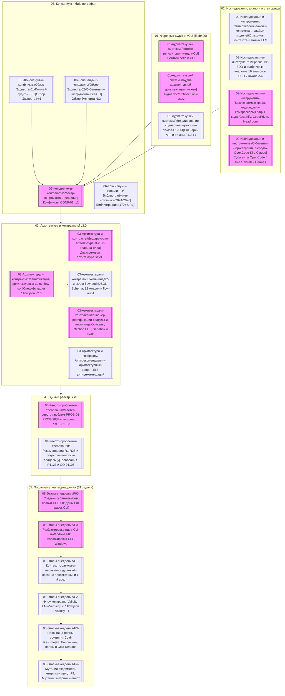

# 🏠 Энциклопедия аудита, консилиума и целевой архитектуры `sf v3.0` (`arenaauditplan`)

Самодостаточное перелинкованное Obsidian-хранилище (`data/arenaauditplan-encyclopedia/`), объединяющее **без потери ни одной детали и без дублирования (`SSOT`)** форензик-аудит репозитория `sf` (`f8cb406`, `arch 0.2.0`), полный аудит схем `doc/architecture/`, спецификацию формальных архитектурных флоу `*.flow.json` `v2.0`, консилиум независимых экспертов, синтез всех 5 соседних энциклопедий `data/` и пошаговую дорожную карту внедрения `F00 → F4` (31 готовая спецификация задач `TASK-F*`).

> [!tip] Для человека и ИИ-агента (`Index-First`)
> - [[Индекс]] — полный машинный каталог всех заметок с точными триггерами загрузки;
> - [[Справочник артефактов, команд и схем]] — быстрый справочник всех JSON-артефактов, кодов `CliEnvelope` и `Validity L1`;
> - [[Глоссарий]] — термины и таблица дезамбигуации одноимённых инструментов (`CodePrizm / CodePrism / CodeGraph / GitNexus`);
> - [[06-Консилиум-и-конфликты/Реестр-конфликтов-и-решений|Реестр конфликтов CONF-01..12]] — проверка непротиворечивости решений;
> - [[AGENTS.md]] — регламент ведения базы и приёма новых обзоров; [[Журнал]] — хронология обновлений.

---

## Карта экосистемы энциклопедии

---

## Мнемоника целевой архитектуры `sf v3.0` — **«ДВОК»** (поверх **«СИМА»**)

| Буква | Опорный принцип | Канонический механизм |
|---|---|---|
| **Д** | **Двухтрековое разделение труда** | **Трек А (Среда):** готовые MIT-графы + субагенты (`0` кода в `arch` CLI). **Трек Б (Ядро):** контракты намерений, `Validity L1`, `*.flow.json`, приёмка (`0` кастомных MCP и `0` серверных БД) |
| **В** | **Верификация независимым оракулом** | `Red` оракул до кода → `RO Trust Zone` на `tests/**` → `Winninger Verifier` на другой модели (`54.5% → 90.9%`) → `DMN ⋈ Diff-Mutation` (`Infection / mutmut / Stryker`) |
| **О** | **Ограниченный субстрат под слабые LLM** | `0` графовых MCP-схем у `implementer`, `envelope ≤2k` + капсула `<3.2k` ток., гибрид *граф + точные строки функции* (`83% → 92%`), сжатие логов `RTK / Headroom` |
| **К** | **Контракты и дельты в Git** | `task.json` (`intent_digest`) + `state.json` + `events.jsonl` + `workpack.json` (`passes: false`) + `*.flow.json` (DMN `0 gaps / 0 overlaps`) + `verification.json v1.0` |

---

## Разделы энциклопедии

### `01-Аудит-текущей-системы` — Доказательная форензика `sf v0.2.0` (`f8cb406`)
- [[01-Аудит-текущей-системы/Рентген-репозитория-и-ядра-CLI|Рентген репозитория и ядра CLI]] — точные цифры по `640` файлам, 9 сильных сторон, 8 форензик-улик (`0/77 state`, `23/29` без `approvals`, `fcntl` на Windows), 10 принципов Манифеста и команды воспроизводимости.
- [[01-Аудит-текущей-системы/Аудит-архитектурной-документации-и-схем|Аудит архитектурной документации и схем]] — 6 противоречий `document.schema.json` с `ARCH-contract`, тройной no-op баг `body_validation.py`, таблица всех `15/45` невалидных доков, 2 манифеста (`23 КБ` разницы) и блокировка `architecture-delta`.
- [[01-Аудит-текущей-системы/Моделирование-сценариев-и-режимы-отказа-F1-F14|Моделирование сценариев А–Г и режимы отказа F1–F14]] — пошаговое сравнение `sf v0.2` vs `OpenSpec` vs `sf v3.0` (включая `PHP / Laravel B2B CRM ~3 500` файлов на Windows и ночной `Cold Resume`) + матрица `F1..F14`.

### `02-Исследования-и-инструменты` — Эмпирическая наука, SDD-аналоги, графы и субагенты
- [[02-Исследования-и-инструменты/Эмпирические-законы-контекста-и-слабых-моделей|Эмпирические законы контекста и слабых моделей]] — 6 законов 2024–2026 (METR `+19%`, ETH Zurich `+20..23%`, Green Olive `−36%`, Winninger `Gemma 4 e4b` `54.5%→90.9%`, CBM `83% vs 92%`).
- [[02-Исследования-и-инструменты/Сравнение-SDD-и-фабричных-аналогов|Сравнение SDD и фабричных аналогов]] — 16 систем + 18-критериальная шкала `0..3` (`sf v0.2 = 14/54` → `sf v3.0 = 54/54`).
- [[02-Исследования-и-инструменты/Подключаемые-графы-кода-аудит-и-компрессоры|Подключаемые графы кода, аудит и компрессоры]] — `colbymchenry/codegraph`, `codebase-memory-mcp`, `Graphify` (`graphifyy`), `Green Olive CodePrizm`, `Serena`, `RTK`, `Headroom` (`CCR + CacheAligner`), нормализованная схема `Finding` и стек аудита.
- [[02-Исследования-и-инструменты/Субагенты-и-оркестрация-в-средах-OpenCode-Kilo-Claude|Субагенты и оркестрация в средах OpenCode, Kilo, Claude, Hermes и Codex]] — матрица сред, 7 ролей, полные конфиги `opencode.jsonc`, `kilo.jsonc` (`shared_agent_board: false`), `.kilo/setup-script.ps1`, `.claude/agents/*.md`, `P1..P12`, плейбуки `A–D` и 10 граблей.

### `03-Архитектура-и-контракты` — Целевое устройство `sf v3.0`
- [[03-Архитектура-и-контракты/Двухтрековая-архитектура-sf-v3-и-граница-ядра|Двухтрековая архитектура sf v3.0 и граница ядра]] — ортогональное разделение Трека А и Трека Б, SQLite DDL (`.sf/intent.sqlite`), капсула `<3 200` ток., 10-слойная модель контекста, ТРИЗ-разделение противоречий, `Ceremony Scaling`, `workpack.json` и `.sf/providers.yaml`.
- [[03-Архитектура-и-контракты/Спецификация-архитектурных-флоу-flow-json|Спецификация архитектурных флоу *.flow.json (v2.0)]] — концепция `Spec-Anchored` флоу, ревизия 8 текущих `FLOW-*`, 12 критериев полноты `UI-0029`, 4 уровня `Anti-Drift` и 6 правил нарезки флоу на примере `task_ops.py`.
- [[03-Архитектура-и-контракты/Схемы-индекс-и-скилл-flow-audit|JSON Schema arch-flow, матрица 32 модулей CLI, справочник команд и скилл flow-audit]] — полный Draft 2020-12 `arch-flow.schema.json`, покрытие всех 32 модулей `doc/tools/arch/`, контракт `flows.index.json`, 20 CLI-команд и готовый шаблон `doc/skills/flow-audit/SKILL.md`.
- [[03-Архитектура-и-контракты/Конвейер-верификации-оракулы-и-песочница|Конвейер верификации, оракулы, песочница и система Evals]] — 6 барьеров приёмки, `Infection PHP --git-diff-lines` с `PCOV`, схема `verification.json v1.0`, 8 угроз безопасности MCP, 5 границ песочницы и 3 контура `Evals` / DORA / OpenTelemetry.
- [[03-Архитектура-и-контракты/Антирекомендации-и-архитектурные-запреты|12 антирекомендаций и архитектурных запретов]].

### `04-Реестр-проблем-и-требований` — Единый нормативный SSOT
- [[04-Реестр-проблем-и-требований/Мастер-реестр-проблем-PROB-01-PROB-38|Мастер-реестр проблем PROB-01..PROB-38]] · [[04-Реестр-проблем-и-требований/Рекомендации-R1-R23-и-открытые-вопросы-владельцу|Рекомендации R1–R23 и открытые вопросы владельцу (OQ-01..OQ-06)]].

### `05-Этапы-внедрения` — Пошаговая дорожная карта (`31` карточка `TASK-F*`)
- [[05-Этапы-внедрения/F00-Среда-и-субагенты-без-правки-CLI|F00 — День 1: Среда и субагенты без правки CLI (TASK-F00-01..04)]]
- [[05-Этапы-внедрения/F0-Разблокировка-ядра-CLI-и-Windows|F0 — Неделя 1: Разблокировка ядра CLI, Windows и схем (TASK-F0-01..07)]]
- [[05-Этапы-внедрения/F1-Контекст-оракулы-и-первый-продуктовый-срез|F1 — Контекст ≤6k, Quick Spec, Oracle-First и 1-й срез (TASK-F1-01..05)]]
- [[05-Этапы-внедрения/F2-Флоу-контракты-Validity-L1-и-Verifier|F2 — Формальные *.flow.json, Validity L1 и Verifier (TASK-F2-01..05)]]
- [[05-Этапы-внедрения/F3-Песочница-волны-роутинг-и-Cold-Resume|F3 — 5-контурная песочница, волны, роутинг и Cold Resume (TASK-F3-01..05)]]
- [[05-Этапы-внедрения/F4-Мутации-сходимость-метрики-и-пилот|F4 — Дифф-мутации, сходимость, CodePrizm и пилот (TASK-F4-01..05)]]

### `06-Консилиум-и-конфликты` — Разрешение противоречий и источники
- [[06-Консилиум-и-конфликты/Реестр-конфликтов-и-решений|Реестр конфликтов и решений CONF-01..CONF-12]] · [[06-Консилиум-и-конфликты/Обзор-Эксперта-01-Полный-аудит-и-SF2|Обзор Эксперта №1]] · [[06-Консилиум-и-конфликты/Обзор-Эксперта-02-Субагенты-и-инструменты-без-CLI|Обзор Эксперта №2]] · [[06-Консилиум-и-конфликты/Библиография-и-источники-2024-2026|Библиография и источники (2024–2026)]].

---

## Связи с корневым оглавлением и соседними энциклопедиями `data/`

- Корневой маршрутизатор `data/`: [data/README.md](<../README.md>)
- Соседние энциклопедии: [machinedocs-encyclopedia](<../machinedocs-encyclopedia/Главная.md>) · [subagents-encyclopedia](<../subagents-encyclopedia/Главная.md>) · [cli-skills-encyclopedia](<../cli-skills-encyclopedia/Главная.md>) · [sdd-encyclopedia](<../sdd-encyclopedia/Главная.md>) · [sdd-research](<../sdd-research/README.md>)
- Внутренние опорные страницы: [[Индекс]] · [[Справочник артефактов, команд и схем]] · [[Глоссарий]] · [[Журнал]] · [[AGENTS.md]]
