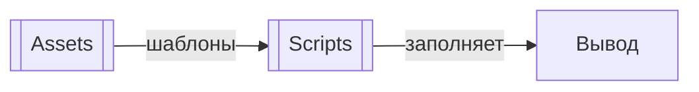

# Assets

> [!info] Определение
> Файлы, используемые в выводе скилла: шаблоны, иконки, шрифты, схемы.
> Не загружаются в контекст; копируются/используются скриптами.
> См. [[Agent Skills (SKILL.md)]], [[Scripts]].

## Стандарт / источник

- Спецификация Agent Skills: `assets/` — уровень 3.

## Формат

```
skill-name/
├── SKILL.md
└── assets/
    └── template/          # шаблоны, из которых скаффолдится вывод
```

| Аспект | Значение |
|---|---|
| Загрузка | Не загружается в контекст |
| Использование | Скрипты копируют/заполняют шаблоны |

## Примеры использования

- Шаблон документа, который скилл заполняет
- Иконки/шрифты для генерации PDF/PPTX
- JSON-схемы для валидации вывода

## Диаграмма



## Мнемоника

**«Шаблоны, Ресурсы, Вывод»** — ШРВ.

## Связи

- [[Agent Skills (SKILL.md)]] · [[Scripts]] · [[References]]

## Типичные ошибки

> [!warning]
> Шаблон в assets, но скилл его не упоминает: агент не узнает о нём.
> Упоминайте assets в SKILL.md с указанием, когда использовать.
