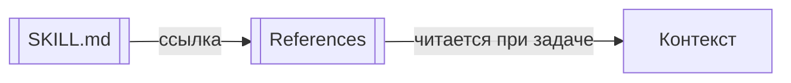

# References

> [!info] Определение
> Документация скилла, загружаемая по требованию: API-референсы, политики, примеры.
> Уровень 3 progressive disclosure. См. [[Agent Skills (SKILL.md)]], [[Progressive Disclosure]].

## Стандарт / источник

- Спецификация Agent Skills: `references/` — уровень 3.
- Guideline G7 (исследование 138K): примеры >8 блоков — во внешние файлы.

## Формат

```
skill-name/
├── SKILL.md
└── references/
    ├── api-reference.md
    ├── forms.md
    └── examples.md
```

| Аспект | Значение |
|---|---|
| Загрузка | По требованию (0 токенов до доступа) |
| Ссылки | Один уровень от SKILL.md |
| Структура | Длинные файлы (>100 строк) — с оглавлением |

## Паттерны организации

**По доменам:**
```
bigquery-skill/
├── SKILL.md
└── reference/
    ├── finance.md
    ├── sales.md
    └── product.md
```

**По вариантам:**
```
cloud-deploy/
├── SKILL.md (выбор провайдера)
└── references/
    ├── aws.md
    ├── gcp.md
    └── azure.md
```

## Пример

```markdown
## Advanced features

**Form filling**: See [FORMS.md](FORMS.md) for complete guide
**API reference**: See [REFERENCE.md](REFERENCE.md) for all methods
**Examples**: See [EXAMPLES.md](EXAMPLES.md) for common patterns
```

## Диаграмма



## Мнемоника

**«Один уровень, Оглавление, Без дублей»** — ООД.

## Связи

- [[Agent Skills (SKILL.md)]] · [[Scripts]] · [[Assets]] · [[Progressive Disclosure]]

## Типичные ошибки

> [!warning]
> Глубокие ссылки (SKILL.md → advanced.md → reference.md): агент читает частично.
> Дублирование информации между SKILL.md и references.
