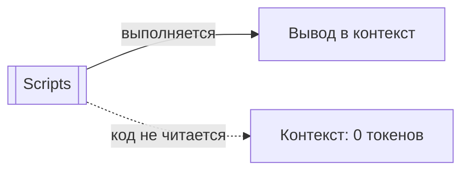

# Scripts

> [!info] Определение
> Исполняемый код скилла (Python/Bash): выполняется, а не загружается в контекст.
> Шаги, которые должны выполняться одинаково каждый раз, — код, а не текст.
> См. [[Agent Skills (SKILL.md)]], [[Progressive Disclosure]].

## Стандарт / источник

- Спецификация Agent Skills: `scripts/` — уровень 3 progressive disclosure.
- «Scripts produce outputs without loading their code, saving tokens and time».

## Формат

```
skill-name/
├── SKILL.md
└── scripts/
    ├── analyze_form.py
    ├── fill_form.py
    └── validate.py
```

| Аспект | Значение |
|---|---|
| Загрузка | Не загружается; выполняется через bash |
| В контекст | Только вывод скрипта |
| Языки | Python, Bash, Node и др. |

## Когда выносить в скрипт

- Шаг должен выполняться детерминированно (low freedom).
- Код >60% объёма скилла (guideline G7 из исследования 138K скиллов).
- Хрупкие, error-prone операции (миграции, парсинг).

## Пример

```markdown
## Database migration

Run exactly this script:

```bash
python scripts/migrate.py --verify --backup
```

Do not modify the command or add additional flags.
```

## Диаграмма



## Мнемоника

**«Детерминизм, Экономия, Надёжность»** — ДЭН.

## Связи

- [[Agent Skills (SKILL.md)]] · [[References]] · [[Assets]] · [[Progressive Disclosure]]

## Типичные ошибки

> [!warning]
> Процедура в тексте вместо скрипта: модель перечитывает и может отклониться.
> Скрипт без --verify/--backup для деструктивных операций.
