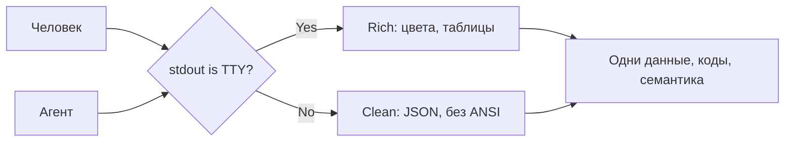

# Agent-Friendly CLI Design

> [!info] Определение
> Правила проектирования CLI, которыми пользуются AI-агенты: структурированный вывод,
> exit-коды, stdout/stderr, самодокументирование. См. [[Help-текст CLI]],
> [[JSON Schema и Self-Description]], [[Работа агентов с CLI]].

## Стандарт / источник

- **8 правил** (uenyioha, 2026); **9 принципов** (nibzard); **7 принципов** (Trevin Chow).
- **Agent-Friendly CLI Spec**: 98 правил, 3 уровня сертификации (Friendly/Ready/Native).
- **better-cli** skill: правила P0/P1/P2.

## 8 правил (ядро)

1. **Структурированный вывод обязателен**: `--json`; JSON в stdout, всё остальное в stderr.
   Flat over nested; консистентные типы; JSON Lines для стриминга.
2. **Exit-коды — control flow агента**: документированные, семантические (не только 0/1).
3. **stdout — данные, stderr — всё остальное** (прогресс, предупреждения, спиннеры).
4. **Самодокументирование**: полный --help с примерами.
5. **Компонуемость**: фильтрация встроенная + пайпы; `--quiet` для голых значений.
6. **Dry-run и обход подтверждений**: `--dry-run` со структурированным diff; `--yes/--force`.
7. **Ошибки actionable**: код/тип, failing input, suggestion с точной командой фикса.
8. **Чек-лист**: идемпотентность, batch-операции, TTY-детект, NO_COLOR.

## Принципы (nibzard)

1. Интерфейсы как контракты (help — контракт, версионируется).
2. Структурированный вывод по умолчанию (единый envelope).
3. Детерминированные exit-коды + retryable-поле.
4. Split validate/run; doctor/replay.
5. Явная session policy, идемпотентность, таймауты.
6. Минимизация загрязнения контекста (без спиннеров в machine mode).

## Сертификация Agent-Friendly CLI Spec

| Уровень | Слои | Ключевое |
|---|---|---|
| Agent-Friendly | core (20 правил) | JSON по умолчанию, exit-коды, stdout/stderr |
| Agent-Ready | + recommended (59) | --help JSON, --brief, --human |
| Agent-Native | + ecosystem | agent/, skills, issue, inline context |

Зарезервированные флаги: `--agent`, `--human`, `--brief`, `--help`, `--version`,
`--yes`, `--dry-run`, `--quiet`, `--fields`.

## Диаграмма

## Мнемоника

**«JSON, Коды, Потоки, Help, Цепочки, Сухой прогон, Ошибки»** — ЖКПХЦСО.

## Связи

- [[Help-текст CLI]] · [[JSON Schema и Self-Description]] · [[Работа агентов с CLI]] · [[Безопасность CLI для агентов]] · [[Пример agent-friendly CLI]]

## Типичные ошибки

> [!warning]
> JSON только в --json, но логи в stdout: парсинг ломается. Exit 0 с ошибкой в stdout.
> Интерактивный промпт без --yes: агент зависает. Секреты через флаги (используйте env).
