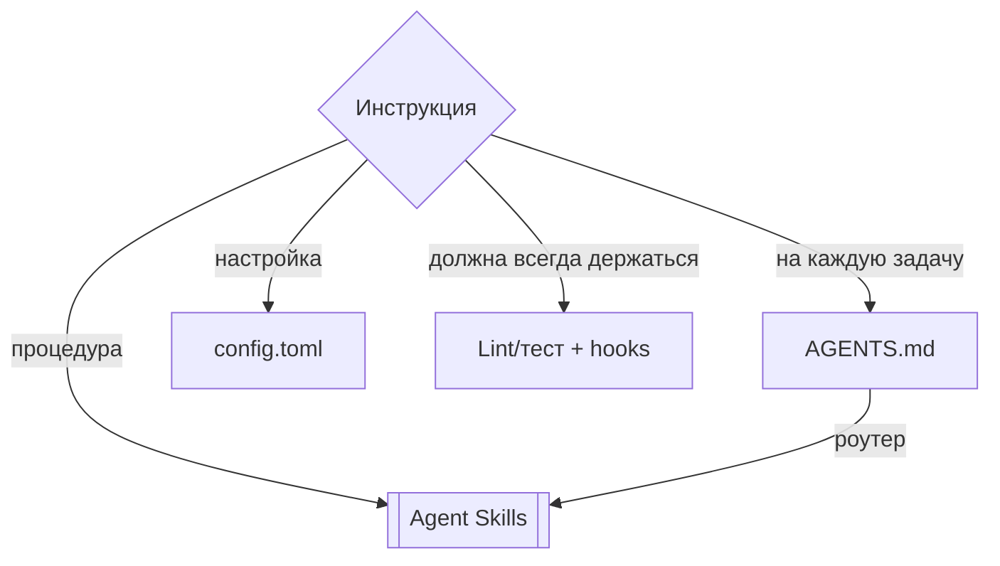

# Rules vs Skills: куда класть инструкции

> [!info] Определение
> Карта размещения инструкций: AGENTS.md (всегда), скиллы (по требованию),
> конфиг (применяется, не интерпретируется), линтеры/тесты (детерминированно).
> Это решение о стоимости, а не о стиле. См. [[Инструкционные файлы]],
> [[Токен-эффективность]].

## Стандарт / источник

- Vercel evals: AGENTS.md — 100% pass rate; скиллы — 53% без явных указаний, 79% с ними.
- Claude Code steering guide; Cursor rules docs; Codex AGENTS.md optimization.

## Таблица решений

| Инструкция… | Куда | Почему |
|---|---|---|
| Короткая конвенция на почти каждую задачу | AGENTS.md | Дешёво, если коротко |
| Мультишаговая процедура для части задач | Скилл | Тело грузится только при использовании |
| Настройка (модель, sandbox, MCP) | config.toml | Применяется, а не интерпретируется |
| Команда, которую нельзя запускать без sandbox | Rules (.rules) | Исполняется вне модели |
| Правило, которое должно всегда держаться | Lint/тест + 1 строка в AGENTS.md | Сборка падает, когда агент забыл |
| «Никогда» (секреты, force push) | Hooks | Детерминированно, вне markdown |

## Ключевой инсайт Vercel

> Скиллы без явных указаний в AGENTS.md игнорируются в 56% случаев.
> Выигрышная связка: **AGENTS.md — роутер**, скиллы — глубина по требованию.

```markdown
# AGENTS.md (роутер)
- Build: pnpm build
- Test: pnpm test
- Release: use the $release skill (.agents/skills/release/)
```

## Аудит AGENTS.md: KEEP / CUT / MOVE

Для каждой строки спросить:

- **KEEP** — удаление изменит поведение в этом репозитории?
- **CUT** — модель и так делает, или это читается из кода (карты директорий, generic style)?
- **MOVE** — это процедура для части задач? → в скилл, в AGENTS.md одна строка-указатель.

## Диаграмма



## Мнемоника

**«Всегда — в AGENTS, Иногда — в скилл, Настройка — в конфиг, Никогда — в хуки»** — ВИНХ.

## Связи

- [[Инструкционные файлы]] · [[Agent Skills (SKILL.md)]] · [[Токен-эффективность]] · [[Предотвращение ошибок]] · [[Чек-листы]]

## Типичные ошибки

> [!warning]
> Процедура на 30 строк в AGENTS.md: налог на каждый чат. Одно правило в трёх местах:
> противоречия и двойная оплата. Инструкции в MCP: тихий налог каждый ход.
