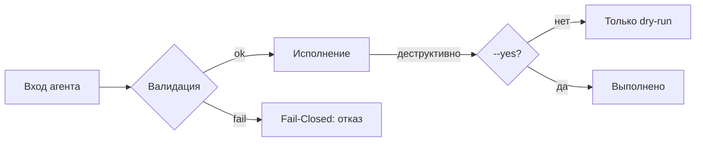

# Безопасность CLI для агентов

> [!info] Определение
> Валидация входа, секреты, права и guardrails для CLI, которыми пользуются агенты.
> Агент — недоверенный пользователь: валидируйте вход как публичный API.
> См. [[Agent-Friendly CLI Design]], [[Scripts]].

## Стандарт / источник

- Agent-Friendly CLI Spec: «Agent is untrusted», Fail-Closed.
- Исследование 138K скиллов: guideline G9 (секреты, пути, --no-verify), G10 (подтверждения).
- gws CLI: валидация всех входов, отказ от control characters и path traversal.

## Правила

1. **Валидация входа** на уровне публичного API: control characters, path traversal,
   embedded query params, shell metacharacters.
2. **Fail-Closed**: при ошибке валидации — deny by default.
3. **Секреты**: только env vars или файлы; никогда через флаги; не в SKILL.md.
4. **Подтверждения**: деструктивные операции — `--yes` guard; dry-run обязателен.
5. **Права**: least privilege; scoped permissions.
6. **Prompt injection**: ревьюить AGENTS.md/SKILL.md в зависимостях как код;
   изменения инструкций — через PR с human approval.
7. **Hooks вместо инструкций**: «должно всегда происходить» — детерминированно.

## Пример: структурированная ошибка

```bash
$ myctl create thing --name duplicate-name
# stderr: Error: resource "duplicate-name" already exists
# stdout (--json): {"error": "conflict", "message": "resource 'duplicate-name' already exists", "existing_id": "abc123"}
# exit code: 5
```

## Диаграмма



## Мнемоника

**«Валидация, Секреты, Подтверждения, Права, Инъекции»** — ВСППИ.

## Связи

- [[Agent-Friendly CLI Design]] · [[Scripts]] · [[Инструкционные файлы]] · [[Тестирование CLI]]

## Типичные ошибки

> [!warning]
> Секреты в SKILL.md или флагах CLI. --no-verify в скриптах. Деструктивная команда
> без --yes guard. Доверие к входу агента без валидации.
