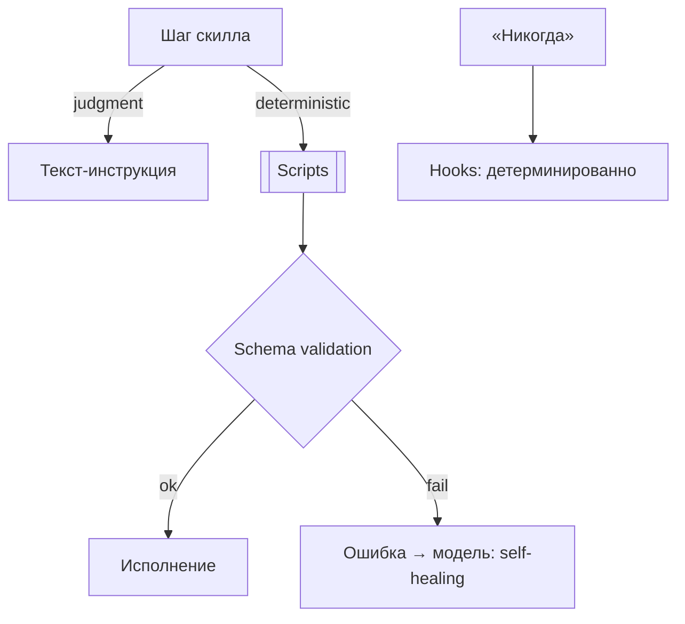

# Предотвращение ошибок моделей

> [!info] Определение
> Техники, при которых модель не ошибается: детерминированные скрипты вместо
> текста, guardrails с альтернативами, валидация на входе, hooks вместо инструкций.
> См. [[Scripts]], [[Безопасность CLI для агентов]], [[Токен-эффективность]].

## Стандарт / источник

- «Make No Mistakes» (June Kim); «Dark Arts of Skill Engineering»; agent-guardrails.
- Исследование 138K скиллов: guideline G10 (подтверждения), G9 (секреты).

## Таксономия ошибок модели

| Ошибка | Пример | Лечение |
|---|---|---|
| Галлюцинация флагов/путей | Несуществующий `--force-push` | Скрипты с жёсткими именованными аргументами |
| «Почти валидный» JSON | Поле не то, лишняя проза вокруг | Schema validation gateway, fail-closed |
| Ложные аттестации | «Тест пройден», хотя не запускался | Artifact-first: решение — в файле, не в stdout |
| Уверенно неверный ответ | Выдуманное решение без сигнала отказа | Rejection как третий исход (decided \| errored \| rejected) |
| Tool hallucination drift | Гибкий скрипт с 30 флагами — модель выдумывает | Single-purpose скрипты + usage внутри SKILL.md |

## Градиент автоматизации

```
Prompt → Command → Skill → Skill + scripts → Skill + hooks → Skill + CI gates
```

| Уровень | Когда |
|---|---|
| Prompt | Разовое, исследовательское |
| Command | Точка входа, маленький workflow |
| Skill | Переиспользуемый workflow с routing |
| Skill + scripts | Хрупкие/повторяющиеся операции — в код |
| Skill + hooks | «Никогда» — детерминированно, вне markdown |
| Skill + CI gates | Ошибка не должна попасть в main |

## Правила guardrails

1. **Каждый запрет — с альтернативой.** «Не используй X» → «используй Y».
2. **always/never, а не prefer/should** — вежливый скилл = опциональный скилл.
3. **Negative triggers** в description: «Do NOT trigger on…» против ложных срабатываний.
4. **Classify each step:** judgment → текст; deterministic → скрипт/инструмент.
5. **Deterministic scripts that talk back:** скрипт возвращает структурированный фидбэк в контекст.
6. **Schema validation gateway:** вывод модели — недоверенный вход; fail-closed; ошибка возвращается модели для self-healing.
7. **Artifact-first:** решение скилла — в записанном артефакте, не в stdout (парафраз и преамбулы ломают парсинг).
8. **Hooks вместо инструкций:** «должно всегда происходить» — в hooks, а не в тексте.
9. **Blind adversarial checks:** независимый проверяющий (sub-agent или линтер), а не сам автор.
10. **Graceful degradation:** если sub-agents запрещены (Codex) — явный fallback-режим.

## Пример: guardrail в скилле

```markdown
## Guardrails

- Do not rename public APIs unless the user asked for that.
- Do not move files across module boundaries without calling it out first.
- Treat generated files as outputs, not source.
- Stop if the first test failure is unrelated and explain the blocker.
```

## Диаграмма



## Мнемоника

**«Запрет с альтернативой, Детерминизм в код, Валидация на входе, Хуки вместо текста»** — ЗДАВХ.

## Связи

- [[Scripts]] · [[Безопасность CLI для агентов]] · [[Токен-эффективность]] · [[Тестирование скиллов]] · [[Чек-листы]]

## Типичные ошибки

> [!warning]
> 200 строк «не делай» без альтернатив: модель всё равно делает. Гибкие скрипты с десятками
> флагов: модель галлюцинирует имена. Инструкция «будь осторожен с секретами» вместо pre-commit hook.
