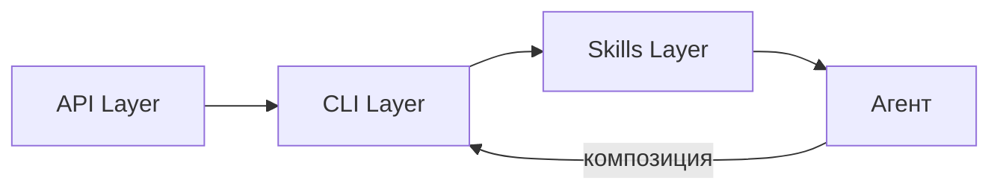

# Работа агентов с CLI

> [!info] Определение
> Паттерны использования CLI агентами: композиция команд, цепочки, API+CLI+Skills
> архитектура. См. [[Agent-Friendly CLI Design]], [[Agent Skills (SKILL.md)]].

## Стандарт / источник

- Архитектура API + CLI + Skills (Google Workspace CLI, gws).
- Сравнение интерфейсов: JSON tool calls, MCP, Skills, CLI, code execution.

## Паттерны композиции

```bash
# Агент естественно компонует:
myctl list pods --json | jq '.[] | select(.status == "Failed") | .name'

# Лучше: встроенная фильтрация
myctl list pods --status failed --json --field name

# Лучшее: оба подхода
myctl list pods --status failed --json        # фильтрованный JSON
myctl list pods --status failed --quiet       # только имена
```

**Цепочка с идентификатором:**
```bash
mycli create --json | jq -r '.data.id' | xargs mycli deploy --id
```

## Архитектура API + CLI + Skills

```
API Layer (Discovery Service) → CLI Layer (команды, --json, dry-run) → Skills Layer (процедуры)
```

- **API**: динамическое чтение через Discovery Service.
- **CLI**: автодополнение, dry-run, пагинация, JSON для jq.
- **Skills**: переиспользуемый метод вокруг CLI (какую команду, как структурировать
  аргументы, как детектить failure, как восстанавливаться).

## Выбор интерфейса

| Нужно | Интерфейс |
|---|---|
| Малый набор типизированных операций | JSON tool calls |
| Существующая команда со стабильным выводом | CLI wrapper |
| Много зависимых операций / локальная обработка | Code execution |
| Переиспользуемые процедуры | Skills |
| Общие сервисы для многих клиентов | MCP |

## Диаграмма



## Мнемоника

**«API, CLI, Skills»** — АКС: три слоя архитектуры.

## Связи

- [[Agent-Friendly CLI Design]] · [[Agent Skills (SKILL.md)]] · [[MCP Tools]] · [[Scripts]]

## Типичные ошибки

> [!warning]
> Агент получает произвольный shell вместо аргументного списка: разрешённое действие
> невидимо. Передавайте аргументы списком (subprocess.run), а не строкой.
> Один model turn на каждый вызов при длинных цепочках: используйте code execution.
