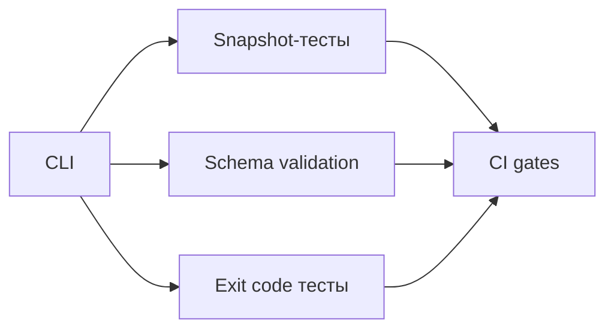

# Тестирование CLI

> [!info] Определение
> Тестирование CLI как контракта: output contracts, snapshot-тесты, валидация схем в CI.
> См. [[Agent-Friendly CLI Design]], [[JSON Schema и Self-Description]].

## Стандарт / источник

- better-cli references/testing.md: output contract testing, CLI integration tests,
  snapshot testing, schema validation in CI.

## Формат: что тестировать

| Слой | Что | Как |
|---|---|---|
| Output contract | JSON envelope стабилен | Snapshot-тесты на stdout |
| Exit codes | Семантика кодов | Таблица кодов → тесты |
| Schema | JSON валиден | JSON Schema validation в CI |
| Help | Полнота и примеры | Тест на наличие секций |
| Composability | Пайпы работают | Integration-тесты с jq |
| Errors | Структурированные ошибки | Тесты на error JSON |

## Пример

```bash
# Snapshot-тест: JSON не меняется внутри версии
myctl list --json > snapshot.json
# CI: diff со snapshot; изменение = breaking change

# Schema-тест
myctl list --json | ajv validate -s schema.json

# Exit code тест
myctl create thing --name dup; test $? -eq 5
```

## Диаграмма



## Мнемоника

**«Снапшоты, Схемы, Коды, Пайпы, Ошибки»** — ССКПО.

## Связи

- [[Agent-Friendly CLI Design]] · [[JSON Schema и Self-Description]] · [[Безопасность CLI для агентов]]

## Типичные ошибки

> [!warning]
> Снапшоты без версионирования: изменение схемы внутри версии не ловится.
> Тесты только на happy path: ошибки и exit-коды не покрыты.
