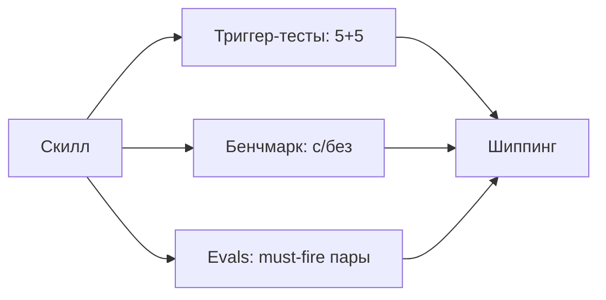

# Тестирование скиллов

> [!info] Определение
> Проверка скилла до шиппинга: триггер-тесты, бенчмарки с/без скилла, evals.
> «Test before shipping: can you write 5 queries that should trigger it and 5 that shouldn't?»
> См. [[Предотвращение ошибок]], [[Чек-листы]].

## Стандарт / источник

- Anthropic skill-creator; исследование 138K скиллов; бенчмарки сообщества.

## Триггер-тесты

| Набор | Пример | Цель |
|---|---|---|
| 5 запросов — должны триггерить | «сделай release notes», «changelog entry» | Description ловит формулировки команды |
| 5 запросов — не должны | «расскажи про релизы», «что такое changelog» | Negative triggers против ложных срабатываний |

## Бенчмарки

- С скиллом vs без: измеренные результаты — **−50–70% токенов** и заметно выше точность.
- Vercel evals: AGENTS.md 100% pass; скиллы 53% → 79% при явных указаниях в AGENTS.md.
- Прогон на 5 разных темах; удалить шаги, чей вывод не читается (test and trim).

## Evals и регрессии

- Набор «must-fire / must-not-fire» пар запросов (как у agent-guardrails: 1785 тестов).
- Счётчики compliance: clean_fast / normalized / fallback — дрейф скилла виден в цифрах.
- Регрессионный прогон при каждом изменении description (триггер — самая хрупкая часть).

## Диаграмма

## Мнемоника

**«Пять да, Пять нет, Бенчмарк, Регрессия»** — ПДПБ.

## Связи

- [[Предотвращение ошибок]] · [[Токен-эффективность]] · [[Чек-листы]] · [[Тестирование CLI]]

## Типичные ошибки

> [!warning]
> Шиппинг без триггер-тестов: скилл не срабатывает или срабатывает везде.
> Description правится без регрессионного прогона: триггер молча ломается.
