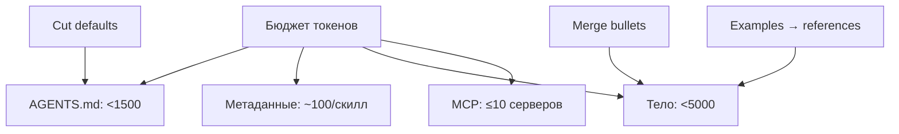

# Токен-эффективность скиллов и рулесов

> [!info] Определение
> Правила написания инструкций, которые минимизируют расход токенов без потери
> качества: бюджеты по слоям, консисность, аудит. Оптимизация — **tokens-per-task**,
> а не tokens-per-request. См. [[Progressive Disclosure]], [[Rules vs Skills]].

## Стандарт / источник

- Anthropic best practices; исследование 138K скиллов (guidelines G1–G12).
- Практики token-optimization скиллов; Vercel evals; бенчмарки (скиллы дают −50–70% токенов).

## Бюджеты по слоям

| Слой | Бюджет | Почему |
|---|---|---|
| AGENTS.md / CLAUDE.md | <1500 токенов | Платится каждую сессию, каждый ход |
| Метаданные скилла (name+description) | ~100 токенов/скилл | Всегда в system prompt |
| Тело SKILL.md | <3000–5000 токенов, <500 строк | Платится при каждом триггере |
| Каталог скиллов (Codex) | 2% контекста, cap 10000 токенов | Слишком много скиллов вытесняют друг друга |
| MCP-серверы | ~10 включено на проект | Каждый сервер — tool defs в каждый ход (10 серверов = 5000+ токенов) |

## Правила консисности

1. **Cut defaults.** «You are a helpful assistant», «write clean code» — модель и так делает.
2. **Merge overlapping bullets.** «Be concise» + «don't be verbose» + «keep it short» → один пункт.
3. **Bullets, not paragraphs.** Короче и надёжнее парсится.
4. **Examples → references.** Примеры раздувают всегда-загружаемый payload; детали — в `references/`.
5. **Challenge every paragraph:** «Does this justify its token cost?»
6. **Test and trim:** прогнать скилл на 5 темах; удалить шаги, чей вывод никто не читает.
7. **Don't over-optimize rare skills:** усилие — по частоте использования.
8. **Prefer CLI over MCP:** `gh` вместо GitHub MCP-сервера — меньше tool defs в контекст.
9. **Most important first:** критичные инструкции — в начало файла (середина игнорируется).
10. **always/never vs prefer/should:** жёсткость формулировки меняет поведение сильнее объёма.

## Пример: было / стало

```markdown
# Было (раздуто)
You are a helpful coding assistant. Please write clean, well-structured code
following best practices. Be concise and avoid being verbose. Keep responses
short and to the point. Use meaningful variable names...

# Стало (экономно)
- Errors: Result-паттерн (src/utils/result.ts)
- Tests: pnpm test
- No console.log in prod code
```

## Диаграмма



## Мнемоника

**«Режь дефолты, Сливай дубли, Примеры — в ссылки, Проверяй прогоном»** — РСПП.

## Связи

- [[Progressive Disclosure]] · [[Rules vs Skills]] · [[Предотвращение ошибок]] · [[Тестирование скиллов]] · [[Чек-листы]]

## Типичные ошибки

> [!warning]
> Празднование «−30% на запрос», которое утраивает число ходов: цель — tokens-per-task.
> 20 больших скиллов: каталог вытесняет сам себя. Инструкции в MCP-серверах: тихий налог каждый ход.
