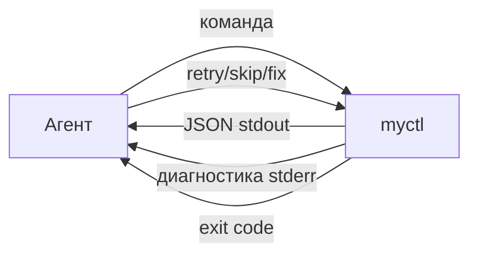

# Пример agent-friendly CLI: myctl

> [!info] Определение
> Эталонный CLI для агентов: --json, exit-коды, --dry-run, --yes, структурированные
> ошибки. См. [[Agent-Friendly CLI Design]].

## Команды и контракты

```bash
# Список с JSON (flat, stdout только данные)
myctl list pods --json
# {"pods": [{"name": "web-1", "status": "Running"}]}

# Фильтрация + поля (экономия токенов)
myctl list pods --status failed --json --field name
# ["web-1"]

# Деплой с dry-run (структурированный diff)
myctl deploy web-api --env prod --dry-run --json
# {"plan": [{"action": "update", "service": "web-api", "from": "v2.0", "to": "v2.1"}]}

# Деструктивная операция с --yes
myctl delete pod web-1 --yes --json
# {"deleted": "web-1"}

# Ошибка: код, сообщение, suggestion, exit 5
myctl create thing --name duplicate-name --json
# {"error": "conflict", "message": "resource 'duplicate-name' already exists",
#  "existing_id": "abc123", "suggestion": "use --if-not-exists"}
# exit code: 5
```

## Exit-коды

| Код | Смысл | Действие агента |
|---|---|---|
| 0 | Успех | Продолжить |
| 1 | Общая ошибка | Посмотреть stderr |
| 2 | Ошибка аргументов | Исправить вызов |
| 5 | Конфликт | Пропустить/--if-not-exists |
| 10 | Auth error | Обновить креды |
| 20 | Not found | Проверить имя |
| 75 | Transient | Retry |

## Help (полный)

```text
Deploy a service to the target environment.

Usage:
  myctl deploy <service-name> --env <environment> [flags]

Arguments:
  service-name    Name of the service to deploy (required)

Flags:
  --env string       Target environment: dev, staging, prod (required)
  --image string     Container image override (default: from config)
  --dry-run          Preview changes without applying
  --wait             Wait for deployment to complete (default: true)
  --timeout duration Maximum wait time (default: 5m)
  --json             Output result as JSON

Examples:
  myctl deploy web-api --env staging
  myctl deploy web-api --env prod --image myregistry/web:v2.1.0 --json
```

## Диаграмма



## Мнемоника

**«JSON, Коды, Dry-run, Yes, Ошибки»** — ЖКДYO.

## Связи

- [[Agent-Friendly CLI Design]] · [[Help-текст CLI]] · [[JSON Schema и Self-Description]] · [[Работа агентов с CLI]]

## Типичные ошибки

> [!warning]
> Логи в stdout ломают парсинг. Exit 0 с ошибкой в stdout. Промпт без --yes.
