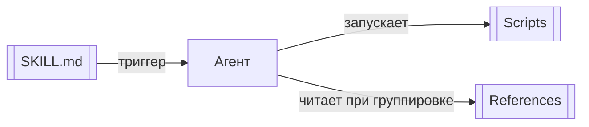

# Пример скилла: release-notes

> [!info] Определение
> Полный пример скилла по стандарту Agent Skills: frontmatter-триггер, тело,
> ресурсы. См. [[Agent Skills (SKILL.md)]], [[Frontmatter]].

## Структура

```
release-notes/
├── SKILL.md
├── references/
│   └── grouping.md      # правила группировки PR по лейблам
└── scripts/
    └── list_merged.py   # детерминированный список PR
```

## SKILL.md

```markdown
---
name: release-notes
description: Drafts release notes from merged pull requests. Use when the user asks for release notes or a changelog entry.
license: MIT
compatibility: Requires git and gh CLI
---

When drafting release notes:

1. List PRs merged since the last tag:
   ```bash
   python scripts/list_merged.py --since $(git describe --tags --abbrev=0)
   ```
2. Group them by label: features, fixes, internal.
   See [references/grouping.md](references/grouping.md) for grouping rules.
3. Write one line per PR in the past tense and link the PR.
4. Do not include internal PRs in the public notes.
```

## references/grouping.md

```markdown
# Grouping rules

- `feat` → Features
- `fix` → Fixes
- `chore`, `docs`, `refactor` → Internal (exclude from public notes)
- Breaking changes → mark with ⚠️
```

## scripts/list_merged.py

```python
#!/usr/bin/env python3
"""List merged PRs since a tag as JSON (deterministic, no LLM re-reading)."""
import argparse, json, subprocess

def main():
    p = argparse.ArgumentParser()
    p.add_argument("--since", required=True)
    args = p.parse_args()
    out = subprocess.run(
        ["gh", "pr", "list", "--state", "merged", "--json", "number,title,labels"],
        capture_output=True, text=True, check=True,
    )
    print(out.stdout)

if __name__ == "__main__":
    main()
```

## Почему так устроено

| Решение | Причина |
|---|---|
| Description с триггером | Скилл триггерится на «release notes» |
| Скрипт вместо текста | Детерминированный список PR |
| Группировка в references | Тело <500 строк; детали по требованию |
| Ссылка один уровень | SKILL.md → grouping.md напрямую |

## Диаграмма



## Мнемоника

**«Триггер, Скрипт, Ссылка, Группировка»** — ТССТ.

## Связи

- [[Agent Skills (SKILL.md)]] · [[Frontmatter]] · [[Scripts]] · [[References]] · [[Чек-листы]]
