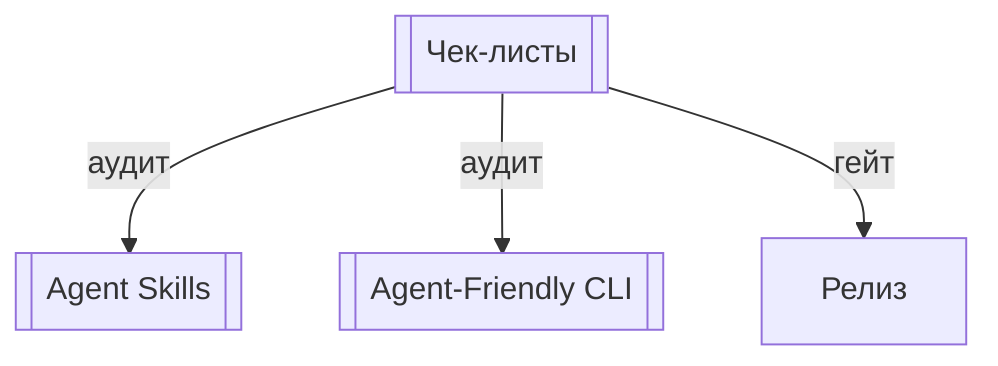

# Чек-листы: аудит скилла и CLI

> [!info] Определение
> Контрольные списки качества скилла (по Anthropic best practices и исследованию
> 138K скиллов) и agent-friendly CLI (conformance checklist). См. [[Agent Skills (SKILL.md)]],
> [[Agent-Friendly CLI Design]].

## Чек-лист скилла

### Core quality
- [ ] Description специфично, включает ключевые термины
- [ ] Description: что делает + когда использовать
- [ ] Тело SKILL.md <500 строк
- [ ] Детали — в отдельных файлах
- [ ] Нет time-sensitive информации (или в «old patterns»)
- [ ] Терминология консистентна
- [ ] Примеры конкретные, не абстрактные
- [ ] Ссылки один уровень от SKILL.md
- [ ] Progressive disclosure применён
- [ ] Workflows с чёткими шагами

### Evidence-based guidelines (138K скиллов)

| # | Guideline | Дефекты |
|---|---|---|
| G1 | ≥30 символов: «[Глагол] [что]. Используй когда [триггер].» | 52.3% |
| G2 | Routing-информация в description, не в теле | 5.2% |
| G3 | <250 символов; use case в начале | 14.3% |
| G4 | Не повторять name как H1 | 44.3% |
| G5 | Императивные директивы, не проза | 3.2% |
| G6 | Тело <500 строк | 10.4% |
| G7 | Код (>60%) и примеры (>8 блоков) — во внешние файлы | 37.0% |
| G8 | Без install-инструкций, changelog, лицензий, TODO | 16.8% |
| G9 | Без кредов, user paths, --no-verify | 5.8% |
| G10 | Подтверждение для деструктивных действий | 4.7% |
| G11 | Без хардкода моделей, путей, OS-команд | 5.8% |
| G12 | Не переопределять персону агента | 6.8% |

## Чек-лист agent-friendly CLI

### Critical (conformance)
- [ ] MO-1: --json/--output json на каждой команде с данными
- [ ] MO-2: JSON валиден и чист на stdout (без лог-шума)

### Important
- [ ] DI-2: --describe/--help --json (дерево команд как JSON)
- [ ] DI-3: --version (semver)

### Recommended
- [ ] UX-2: Help ≤ ~1500 токенов

### Полный аудит (better-cli)
- [ ] stdout только данные; stderr — всё остальное
- [ ] Exit-коды семантические (не только 0/1)
- [ ] Каждый промпт имеет --yes/--force обход
- [ ] Ошибки: code + message + fix + transient
- [ ] --dry-run для всех мутирующих команд
- [ ] Прогресс/спиннеры — в stderr
- [ ] NO_COLOR и TTY-детект
- [ ] --fields ограничивает колонки
- [ ] Create возвращает идентификатор
- [ ] Идемпотентность или --if-not-exists
- [ ] --help с примерами
- [ ] Секреты не через флаги
- [ ] В пайпах ноль ANSI-кодов
- [ ] Success: «next steps» с точными командами
- [ ] Существующие флаги/коды/поля не удаляются (только additive)

## Диаграмма

## Мнемоника

**«Описание, Тело, Ресурсы, Контент, Безопасность, Портативность»** — ОТРКБП (фазы G1–G12).

## Связи

- [[Agent Skills (SKILL.md)]] · [[Frontmatter]] · [[Agent-Friendly CLI Design]] · [[Пример скилла]] · [[Пример agent-friendly CLI]] · [[Токен-эффективность]] · [[Предотвращение ошибок]] · [[Rules vs Skills]] · [[Тестирование скиллов]]
