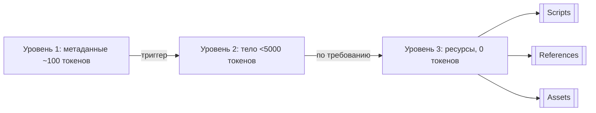

# Agent Skills (SKILL.md)

> [!info] Определение
> Открытый стандарт упаковки процедурных знаний для AI-агентов: папка со SKILL.md
> (frontmatter + инструкции) и опциональными scripts/, references/, assets/.
> Опубликован Anthropic в декабре 2025 (agentskills.io); управление — Agentic AI Foundation
> (октябрь 2026). Поддерживают 70+ платформ: Claude Code, Codex, Cursor, Copilot и др.
> См. [[Frontmatter]], [[Progressive Disclosure]], [[Scripts]].

## Стандарт / источник

- Спецификация: agentskills.io; валидация: `skills-ref validate ./my-skill`.
- Экосистема: ~1 млн скиллов, ~280 млн установок (Anthropic, октябрь 2026).
- Каталог: skills.sh (Vercel).
- Исследование 138K скиллов (arXiv, 2026): >99% содержат «authoring smell».

## Формат

```
skill-name/
├── SKILL.md       # обязательный: метаданные + инструкции
├── scripts/       # опционально: исполняемый код
├── references/    # опционально: документация по требованию
└── assets/        # опционально: шаблоны, ресурсы
```

| Аспект | Значение |
|---|---|
| Обязательные поля | `name`, `description` |
| Тело | Markdown, <500 строк, <5000 токенов |
| Загрузка | [[Progressive Disclosure]]: метаданные → тело → ресурсы |
| Пути обнаружения | Claude Code: `.claude/skills/`; Codex: `.agents/skills/`; Cursor: `.cursor/skills/`, `.agents/skills/`, `.claude/skills/` |

## Содержание

1. **Frontmatter** ([[Frontmatter]]): name + description (триггер!)
2. **Тело**: пошаговые инструкции, примеры, edge cases
3. **Ресурсы**: [[Scripts]], [[References]], [[Assets]]

## Пример

```markdown
---
name: release-notes
description: Drafts release notes from merged pull requests. Use when the user asks for release notes or a changelog entry.
---

When drafting release notes:

1. List PRs merged since the last tag with `gh pr list --state merged`.
2. Group them by label: features, fixes, internal.
3. Write one line per PR in the past tense and link the PR.
```

## Диаграмма



## Мнемоника

**«Имя, Описание, Тело, Ресурсы»** — ИОТР: четыре слоя скилла.

## Связи

- [[Frontmatter]] · [[Progressive Disclosure]] · [[Scripts]] · [[References]] · [[Assets]] · [[Инструкционные файлы]] · [[Пример скилла]]

## Типичные ошибки

> [!warning]
> Расплывчатое описание («Helps with PDFs») — скилл не триггерится. Описание — это
> механизм триггера (Philipp Schmid). Тело >500 строк — выносите в references/.
> Ссылки глубже одного уровня от SKILL.md — агент читает частично.
