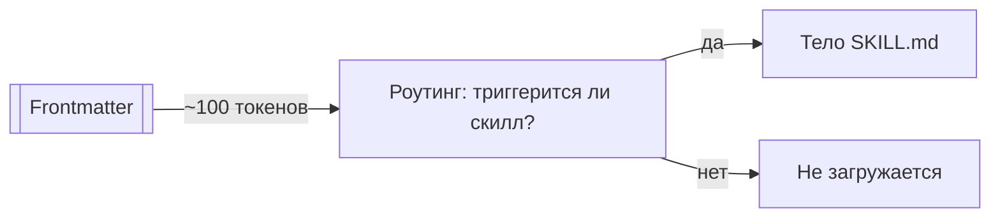

# Frontmatter

> [!info] Определение
> YAML-шапка SKILL.md между `---`: метаданные скилла. Единственное, что агент видит
> до триггера (~100 токенов). См. [[Agent Skills (SKILL.md)]], [[Progressive Disclosure]].

## Стандарт / источник

- Спецификация agentskills.io: 2 обязательных + 4 опциональных поля.

## Формат

| Поле | Обязательно | Правила |
|---|---|---|
| `name` | Да | ≤64 символов; lowercase, цифры, дефисы; без ведущих/замыкающих/двойных дефисов; совпадает с именем папки; нельзя «anthropic»/«claude» |
| `description` | Да | 1–1024 символов; что делает + когда использовать |
| `license` | Нет | Имя лицензии или файл |
| `compatibility` | Нет | ≤500 символов; требования окружения |
| `metadata` | Нет | Произвольные key-value |
| `allowed-tools` | Нет | Экспериментально; предодобренные инструменты |

## Содержание: формула описания

**«[Глагол] [что]. Используй когда [триггер].»**

- ≥30 символов; routing-информация — в description, а не в теле.
- <250 символов; use case — в начале (front-load).
- Ключевые слова, которые скажет пользователь (verbs, artifacts, scope).
- Не дублировать name как H1 в теле.

## Пример

```yaml
---
name: release-notes
description: Drafts release notes from merged pull requests. Use when the user asks for release notes or a changelog entry.
license: MIT
compatibility: Requires git and gh CLI
metadata:
  author: team
  version: "1.0"
---
```

## Диаграмма



## Мнемоника

**«Имя, Описание, Лицензия, Совместимость, Метаданные, Инструменты»** — ИОЛСМИ.

## Связи

- [[Agent Skills (SKILL.md)]] · [[Progressive Disclosure]] · [[Пример скилла]] · [[Чек-листы]]

## Типичные ошибки

> [!warning]
> «When to Use This Skill» в теле бесполезен: тело загружается после триггера.
> Вся routing-информация — в description. Исследование 138K скиллов: 52.3% дефектов
> связаны с описанием (R1.2–R1.4).
