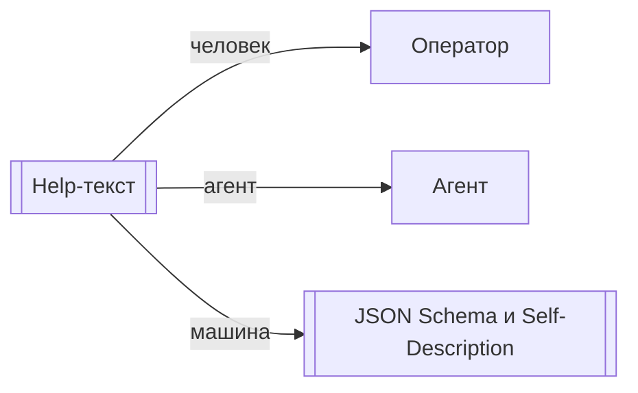

# Help-текст CLI

> [!info] Определение
> Самодокументирующийся `--help`: контракт CLI для человека и агента. Агент учится
> инструменту из help-текста, а не из внешних документов. См. [[Agent-Friendly CLI Design]],
> [[JSON Schema и Self-Description]].

## Стандарт / источник

- Unix-конвенция; принципы agent-friendly CLI (nibzard, uenyioha, better-cli).
- «Your --help text is a contract, not documentation» (nibzard).

## Формат

Полный help включает: usage, аргументы, флаги, примеры, режимы вывода, exit-коды.
Версионируется и держится стабильным.

## Содержание (хороший help)

```text
Deploy a service to the target environment.

Usage:
  myctl deploy <service-name> --env <environment> [flags]

Arguments:
  service-name    Name of the service to deploy (required)

Flags:
  --env string       Target environment: dev, staging, prod (required)
  --image string     Container image override (default: from config)
  --dry-run          Preview changes without applying
  --wait             Wait for deployment to complete (default: true)
  --timeout duration Maximum wait time (default: 5m)
  --json             Output result as JSON

Examples:
  myctl deploy web-api --env staging
  myctl deploy web-api --env prod --image myregistry/web:v2.1.0 --json
  myctl deploy web-api --env dev --dry-run
```

## Правила

- Примеры обязательны (не только описания флагов).
- Help ≤ ~1500 токенов (не раздувать контекст агента).
- Help на stdout; ошибки — на stderr.
- Exit-коды документируются в help.

## Диаграмма



## Мнемоника

**«Использование, Аргументы, Флаги, Примеры, Коды»** — УАФПК.

## Связи

- [[Agent-Friendly CLI Design]] · [[JSON Schema и Self-Description]] · [[Man Pages]] · [[Инструкционные файлы]]

## Типичные ошибки

> [!warning]
> Минимальный help («Usage: myctl deploy [flags]») — агент не может научиться.
> Help без примеров — флаги без контекста использования.
