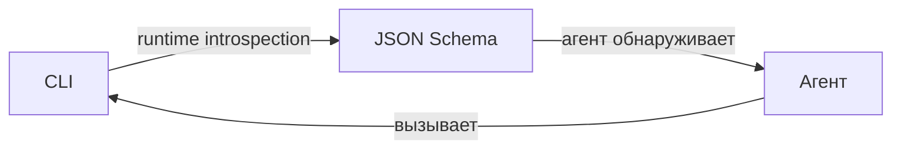

# JSON Schema и Self-Description

> [!info] Определение
> Машиночитаемое описание CLI в рантайме: `--describe`, `--help --json`, schema-команды.
> Агент обнаруживает возможности без документации. «Single highest-leverage feature
> for discoverability» (Ezequiel Aceto). См. [[Agent-Friendly CLI Design]].

## Стандарт / источник

- Agent-Friendly CLI Spec: уровни Agent-Ready/Agent-Native (D1–D16).
- gws CLI (Google): `gws schema` дампит сигнатуры методов как JSON.
- Google Workspace CLI: Discovery Service → автогенерация команд.

## Формат

```bash
$ myctl --help --json
{
  "help": "Deploy services",
  "commands": [
    {
      "name": "deploy",
      "description": "Deploy a service",
      "parameters": [
        {"name": "env", "type": "string", "required": true, "enum": ["dev","staging","prod"]},
        {"name": "dry-run", "type": "boolean", "required": false}
      ]
    }
  ],
  "rules": [...],
  "skills": [...],
  "version": "1.2.0"
}
```

## Правила

- `--help` возвращает JSON: help, commands[], rules[], skills[].
- Все параметры с типами и required/optional.
- `--version` — semver (агент пинит поведение к версии).
- `--brief` — однопараграфная идентичность для синхронизации в конфиг агента.
- JSON envelope единый для всех команд: `{result, error, code, ...}`.

## Диаграмма



## Мнемоника

**«Команды, Параметры, Типы, Правила, Версия»** — КПТПВ.

## Связи

- [[Agent-Friendly CLI Design]] · [[Help-текст CLI]] · [[MCP Tools]] · [[Пример agent-friendly CLI]]

## Типичные ошибки

> [!warning]
> Схема без типов и required-флагов: агент гадает. Схема, меняющаяся внутри версии:
> нарушает контракт.
