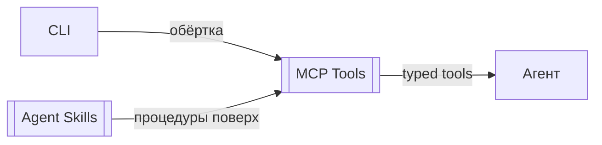

# MCP Tools

> [!info] Определение
> Model Context Protocol: CLI/сервис, экспонируемый как JSON-RPC инструменты
> с типизированными схемами. Агент вызывает инструменты без shell-эскейпинга.
> См. [[Agent Skills (SKILL.md)]], [[JSON Schema и Self-Description]].

## Стандарт / источник

- Model Context Protocol (Anthropic): JSON-RPC over stdio.
- Пример: `gws mcp --services drive,gmail` — все команды как tools.
- Google Workspace CLI: API → Discovery → CLI + MCP.

## Формат

| Аспект | Значение |
|---|---|
| Протокол | JSON-RPC over stdio |
| Схемы | Типизированные параметры и результаты |
| Вызов | Без shell-эскейпинга |

## Когда MCP, когда CLI, когда Skills

| Вопрос | Интерфейс |
|---|---|
| Малый набор типизированных операций | JSON tool calls |
| Существующая команда со стабильным выводом | CLI wrapper |
| Много зависимых операций / локальная обработка | Code execution |
| Переиспользуемые процедуры | Skills |
| Общие сервисы для многих клиентов | MCP |

## Пример

```bash
# CLI как MCP-сервер
gws mcp --services drive,gmail
# Агент получает typed tools: drive.list, drive.read, gmail.send...
```

## Диаграмма



## Мнемоника

**«Команды, Инструменты, Процедуры»** — КИП: CLI, MCP, Skills.

## Связи

- [[Agent Skills (SKILL.md)]] · [[JSON Schema и Self-Description]] · [[Работа агентов с CLI]]

## Типичные ошибки

> [!warning]
> MCP без схем: инструменты без типов — тот же shell, только дороже.
> MCP для одной локальной команды: CLI проще и дешевле по контексту.
