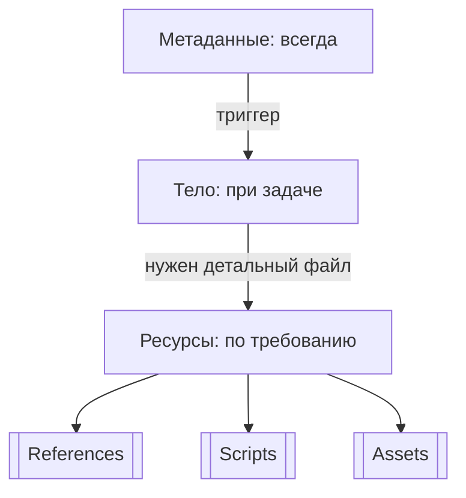

# Progressive Disclosure

> [!info] Определение
> Трёхуровневая загрузка скилла: метаданные всегда, тело при триггере, ресурсы
> по требованию. Ядро дизайна Agent Skills: «Progressive disclosure is the core design
> principle that makes Agent Skills flexible and scalable» (Anthropic Engineering).
> См. [[Agent Skills (SKILL.md)]], [[Frontmatter]].

## Стандарт / источник

- Anthropic Engineering (Barry Zhang, Keith Lazuka, Mahesh Murag).
- Медиана тела скилла в экосистеме: 1414 токенов (исследование, февраль 2026).

## Формат: три уровня

| Уровень | Что | Когда загружается | Стоимость |
|---|---|---|---|
| 1. Метаданные | name + description | Всегда (system prompt) | ~100 токенов |
| 2. Тело | SKILL.md | При триггере | <5000 токенов |
| 3. Ресурсы | references/, scripts/, assets/ | По требованию | 0 до доступа |

## Паттерны

**Pattern 1: High-level guide with references** — SKILL.md с обзором + ссылки на файлы.

**Pattern 2: Domain-specific organization** — по доменам/вариантам:

```
bigquery-skill/
├── SKILL.md (обзор и навигация)
└── reference/
    ├── finance.md
    ├── sales.md
    └── product.md
```

При вопросе о продажах читается только sales.md.

## Правила

- Ссылки — **один уровень** от SKILL.md (глубокие ссылки читаются частично).
- Длинные файлы (>100 строк) — с оглавлением в начале.
- Дублирования нет: информация либо в SKILL.md, либо в references.
- Критичные safety-правила — в SKILL.md, а не только в references.

## Диаграмма



## Мнемоника

**«Метаданные, Тело, Ресурсы»** — МТР.

## Связи

- [[Agent Skills (SKILL.md)]] · [[Frontmatter]] · [[References]] · [[Scripts]] · [[Assets]]

## Типичные ошибки

> [!warning]
> 2000 строк политики в SKILL.md — антипаттерн. Правильно: 200 строк + references/policy.md.
> Вложенные ссылки (SKILL.md → advanced.md → reference.md) — агент прочитает частично.
