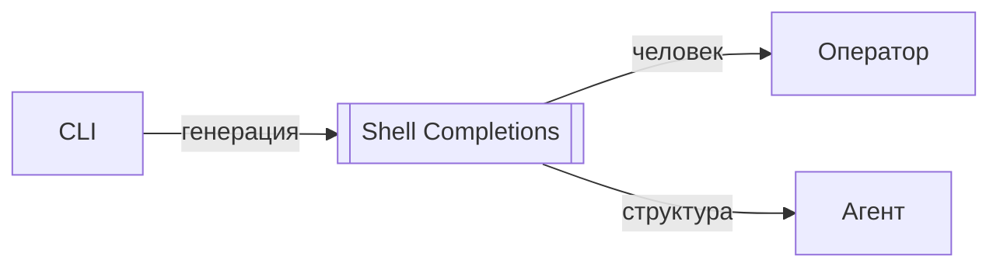

# Shell Completions

> [!info] Определение
> Скрипты автодополнения (Bash/Zsh/Fish): команды, флаги, значения.
> Для агента — подсказка структуры CLI; для человека — UX. См. [[Help-текст CLI]].

## Стандарт / источник

- Генераторы: Cobra (Go), Clap (Rust), Click/Typer (Python), Commander (Node).
- Конвенция: `complete -F _myctl myctl`, файлы в completions/.

## Формат

| Аспект | Значение |
|---|---|
| Bash | `complete -F _func cmd` |
| Zsh | `#compdef cmd` |
| Fish | `complete -c cmd -f` |

## Пример (Cobra, Go)

```go
var rootCmd = &cobra.Command{Use: "myctl"}
rootCmd.CompletionOptions.DisableDefaultCmd = false
// Cobra генерирует bash/zsh/fish/powershell completions автоматически
```

## Диаграмма



## Мнемоника

**«Команды, Флаги, Значения»** — КФЗ.

## Связи

- [[Help-текст CLI]] · [[Man Pages]] · [[Agent-Friendly CLI Design]]

## Типичные ошибки

> [!warning]
> Completions вручную без генерации: расходятся с реальными флагами.
> Используйте генераторы фреймворков.
