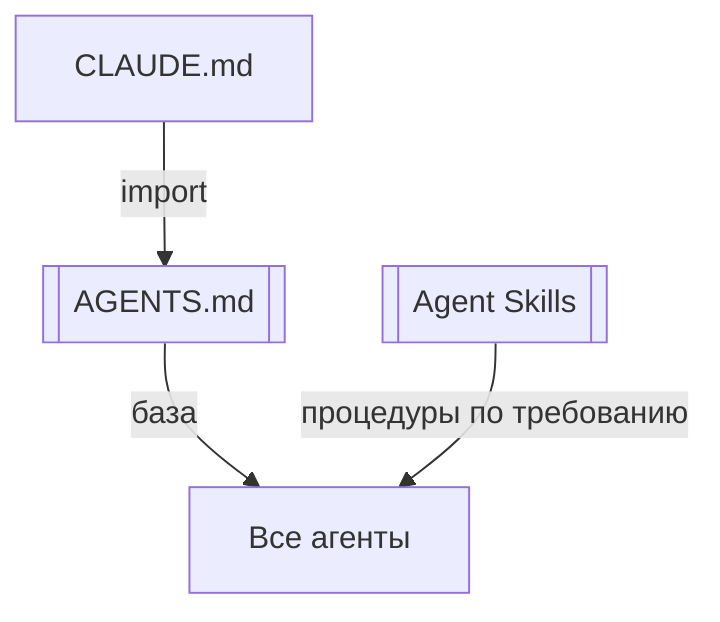

# Инструкционные файлы (AGENTS.md / CLAUDE.md)

> [!info] Определение
> Постоянные инструкции проекта для AI-агентов: команды, конвенции, границы.
> В отличие от скиллов (процедуры по требованию), грузятся каждую сессию полностью.
> См. [[Agent Skills (SKILL.md)]], [[Progressive Disclosure]].

## Стандарт / источник

- **AGENTS.md** — стандарт 2026: Claude Code, Codex CLI, Cursor, Aider, Devin,
  Copilot, Gemini CLI, Windsurf, Amazon Q.
- **CLAUDE.md** — нативный формат Claude Code; `@AGENTS.md` import или symlink.
- **.cursor/rules/*.mdc**, **.github/copilot-instructions.md** — инструмент-специфичные.

## Формат

| Аспект | Значение |
|---|---|
| Расположение | Корень репозитория (+ вложенные для monorepo) |
| Синтаксис | Markdown |
| Размер | <150–200 строк (иначе падает adherence) |
| Лимит Codex | 32 KiB на цепочку инструкций |

## Содержание

**Включать:** точные команды сборки/тестов; карта архитектуры; конвенции, отклоняющиеся
от дефолтов; ограничения; правила тестирования; антипаттерны.

**Не включать:** конвенции языка (работа линтера); «чистый код»; листинги файлов;
секреты; копии документов (только ссылки).

## Пример

```markdown
# AGENTS.md

## Команды
- Install: pnpm install
- Test: pnpm test
- Lint: pnpm lint

## Конвенции
- Ошибки — Result-паттерн (см. src/utils/result.ts)
- Не модифицировать миграции без approval

## Указатели
- Скиллы проекта: .claude/skills/
```

## Диаграмма



## Мнемоника

**«Команды, Карта, Конвенции, Границы, Указатели»** — КККГУ.

## Связи

- [[Agent Skills (SKILL.md)]] · [[Progressive Disclosure]] · [[Help-текст CLI]]

## Типичные ошибки

> [!warning]
> Файл >200 строк: агент игнорирует середину. LLM-сгенерированные инструкции снижают
> успех агентов (исследование 2026, 138 репозиториев). «Должно всегда происходить» —
> в hooks, а не в инструкциях.
