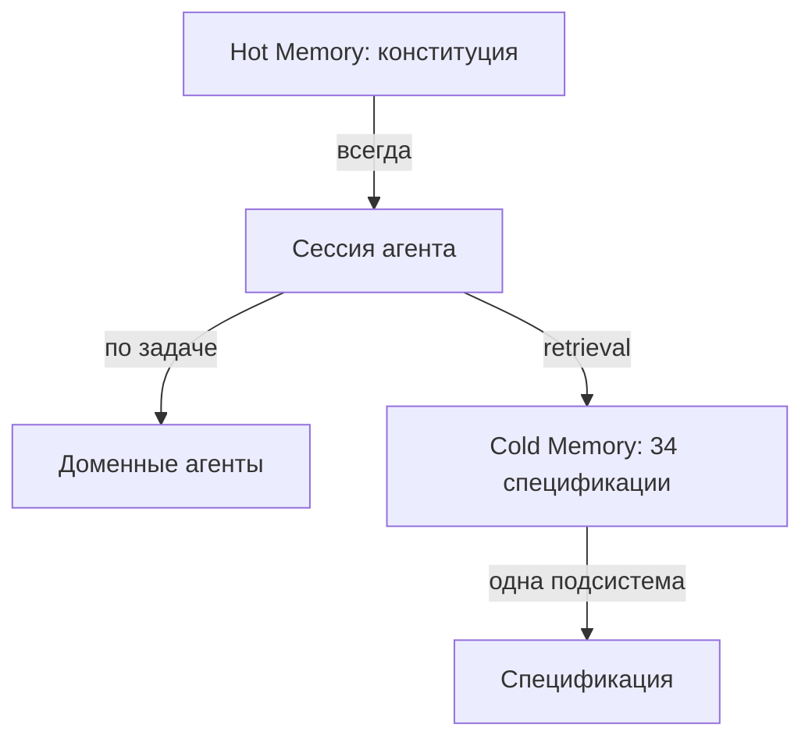

# Codified Context (3 яруса)

> [!info] Определение
> Инфраструктура контекста для больших кодовых баз (arXiv, проект 108K строк C#):
> hot memory (конституция) + доменные агенты + cold memory (спецификации).
> Документация как инфраструктура, а не артефакт. См. [[Иерархическая документация]],
> [[Index-First подход]].

## Стандарт / источник

- «Codified Context: Infrastructure for AI Agents in a Complex Codebase» (arXiv, 2026).
- 108,000 строк C# distributed system; 19 доменных агентов; 34 спецификации (~16,250 строк).

## Три яруса

| Ярус | Что | Загрузка | Частота обновления |
|---|---|---|---|
| 1. Hot memory | Конституция (~660 строк): конвенции, архитектура, retrieval hooks, протоколы | Всегда, каждая сессия | Редко (стабильна) |
| 2. Domain specialists | 19 агентов-экспертов по доменам | По задаче | По домену |
| 3. Cold memory | 34 спецификации подсистем (~16,250 строк) | По требованию (retrieval) | По подсистеме |

## Принципы

1. **Документы для AI-потребления**: явные паттерны кода с путями файлов, именами
   параметров, ожидаемым поведением.
2. **Living documents**: спецификации генерируются и обновляются AI по направлению разработчика.
3. **Один документ — одна подсистема**: точечный retrieval.
4. **Конституция маленькая и стабильна**: конвенции, границы, правила, чек-листы,
   известные failure modes, протоколы маршрутизации задач.

## Результаты

- 74 сессии консистентного persistence-поведения (спецификации как координация).
- Захваченный опыт предотвращает повторный trial-and-error в 10+ сессиях.
- Знание компаундится: каждая документированная подсистема ускоряет соседние фичи.

## Диаграмма

## Мнемоника

**«Горячая память, Агенты, Холодная память»** — ГАХ.

## Связи

- [[Иерархическая документация]] · [[Index-First подход]] · [[AGENTS.md Index]] · [[AI-Native Documentation]] · [[Пример структуры docs]]

## Типичные ошибки

> [!warning]
> Всё в один AGENTS.md: не масштабируется. Спецификации для человека (нарратив):
> агент не может действовать. Конституция раздутая: платится каждую сессию.
