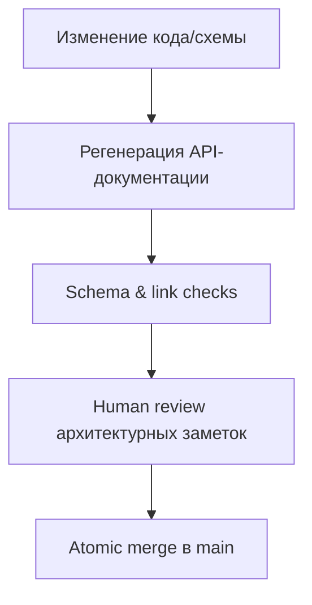
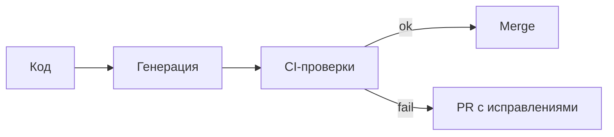

# Docs-as-Code и CI

> [!info] Определение
> Документация как программное обеспечение: версионирование, ревью, CI-проверки
> актуальности. Устаревшая документация — баг, деградирующий работу AI.
> Минимальный project docs pack и разделение project docs/task intake рассматриваются в [[Исследование формата документации проекта и входящей задачи]].
> См. [[Актуальность и staleness]], [[OpenAPI и JSON Schema]].

## Стандарт / источник

- Docs-as-code движение; Living Docs (5 no-drift invariants, deterministic CLI).
- code-docs: docs-sync и docs-staleness GitHub Actions.
- agent-docs: smart refresh по frontmatter (upstream_commit, last_verified).

## CI-проверки

| Проверка | Что ловит |
|---|---|
| Schema validation | Примеры против JSON Schema; frontmatter по схеме |
| Link checks | Битые ссылки и перемещения страниц |
| Staleness | Документы старше maxAgeDays |
| Index rebuild | AGENTS.md индекс перегенерирован |
| Mermaid check | Синтаксис диаграмм валиден |
| Drift | Документация против сгенерированных схем |

## Пайплайн

## Автоматизация (code-docs)

- **docs-sync**: при изменении docs/ — LLM генерирует/валидирует frontmatter,
  перегенерирует AGENTS.md индекс; изменения — PR, человек видит до merge.
- **docs-staleness**: помечает документы старше порога (.agentsrc.yaml).

## Диаграмма

## Мнемоника

**«Генерация, Проверка, Ревью, Merge»** — ГПРМ.

## Связи

- [[Актуальность и staleness]] · [[OpenAPI и JSON Schema]] · [[AGENTS.md Index]] · [[Frontmatter-схемы]] · [[Mermaid-диаграммы]]

## Типичные ошибки

> [!warning]
> Документация вручную без CI: дрейф гарантирован. Автоматика без human review:
> LLM-генерация frontmatter может ошибиться. Staleness без порога: никто не замечает.
