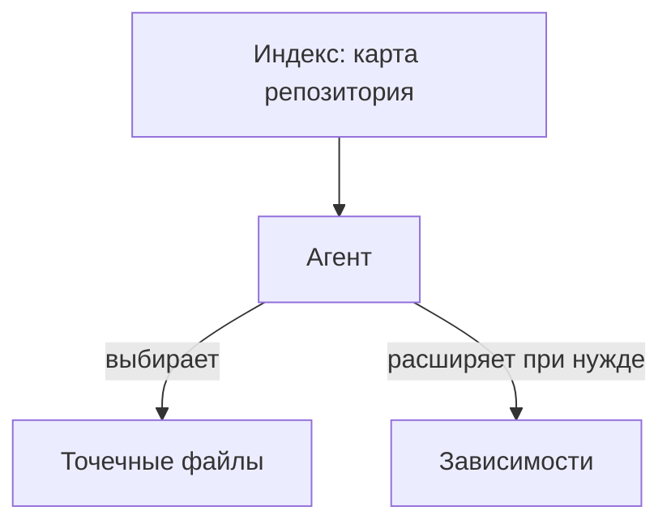

# Index-First подход

> [!info] Определение
> Сначала индекс, потом точечная загрузка: агент получает карту репозитория
> и читает только релевантные файлы. Дамп всего репозитория в контекст — антипаттерн.
> См. [[llms.txt]], [[AGENTS.md Index]], [[Codified Context (3 яруса)]].

## Стандарт / источник

- Context engineering (Anthropic): high-signal context — самый эффективный способ
  повысить автономность и точность агента.
- Lost in the Middle: факты в начале/конце контекста извлекаются лучше, чем в середине.

## Почему не дамп всего

| Проблема | Следствие |
|---|---|
| Разбавление внимания | Агент теряет релевантные факты |
| Конфликтующие конвенции | Агент усредняет противоречия |
| Latency и стоимость | Длинный контекст = медленнее и дороже |
| Lost in the Middle | Середина контекста фактически не читается |

## Целевой рабочий набор

1. **Behavior owner**: точный файл для модификации + рабочий reference implementation.
2. **Authoritative contracts**: версионированные OpenAPI/JSON Schema/protobuf.
3. **Repository instructions**: локальный AGENTS.md (команды, правила).
4. **Observable evidence**: падающий тест, stack trace, acceptance criterion.
5. Расширять набор только при обнаружении неинспектированной зависимости.

## Диаграмма

## Мнемоника

**«Индекс, Точечно, Без дампа»** — ИТД.

## Связи

- [[llms.txt]] · [[AGENTS.md Index]] · [[Codified Context (3 яруса)]] · [[Семантический чанкинг]]

## Типичные ошибки

> [!warning]
> Дамп репозитория «на всякий случай»: разбавление и стоимость. Индекс без путей:
> агент не может точечно загрузить. Расширение набора без анализа зависимостей:
> шум в контексте.
