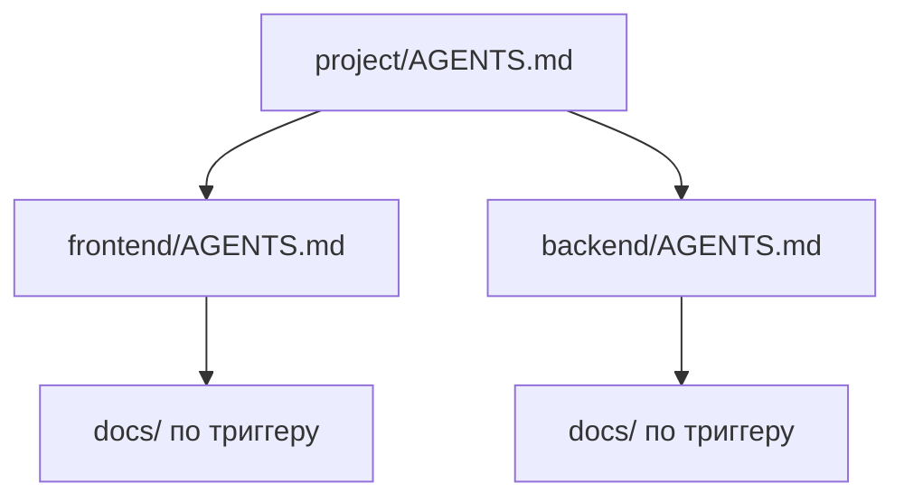

# Иерархическая документация

> [!info] Определение
> Документация по уровням директорий: агент читает ближайший файл к месту работы.
> Один AGENTS.md не масштабируется на большие проекты. См. [[Codified Context (3 яруса)]],
> [[AGENTS.md Index]].

## Стандарт / источник

- Паттерн hierarchical documentation (multiple AGENTS.md at directory levels).
- AGENTS.md v1.1: positional context, индекс доступных файлов.

## Структура

```
project/
├── AGENTS.md                    ← project-wide: env, команды, структура
├── frontend/
│   └── AGENTS.md                ← React conventions, component patterns
├── backend/
│   └── AGENTS.md                ← REST conventions, API patterns
└── docs/
    ├── auth.md                  ← детальная спецификация
    └── billing.md
```

## Правила загрузки

1. Агент читает **ближайший** AGENTS.md к месту работы.
2. Родительские файлы — фон; дочерние — специфика (могут переопределять).
3. Детали — в docs/ по триггеру из индекса, а не в AGENTS.md.
4. Каждый уровень <150–200 строк.

## Диаграмма



## Мнемоника

**«Корень, Уровень, Ближайший, Детали»** — КЛБД.

## Связи

- [[Codified Context (3 яруса)]] · [[AGENTS.md Index]] · [[Index-First подход]] · [[Frontmatter-схемы]]

## Типичные ошибки

> [!warning]
> Противоречия между уровнями: дочерний переопределяет родителя неявно.
> Детали в AGENTS.md вместо docs/: налог каждую сессию. Слишком глубокая вложенность:
> агент не находит ближайший файл.
