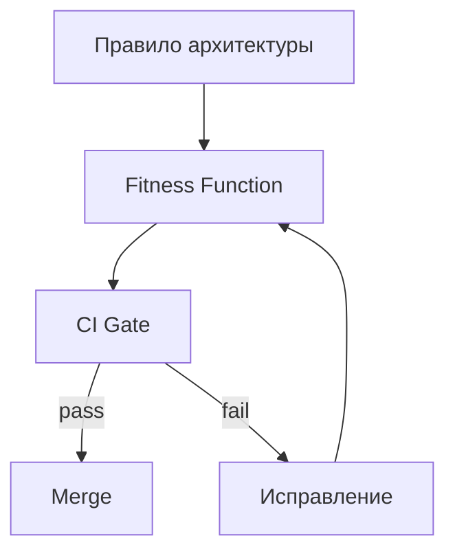

# Аудит архитектуры

> [!info] Определение
> Проверка соответствия кода архитектуре: fitness functions, conformance tests,
> drift detection. Детерминированные гейты вместо надежды на ревью.
> См. [[Следование архитектуре]], [[Безопасность]].

## Стандарт / источник

- Architecture fitness functions (ArchUnit, dependency-cruiser, import-linter, depguard).
- Codesai: guidelines vs guardrails; Birgitta Boeckeler: objective rules → deterministic format.
- Architecture-fitness-functions skill: rule shape, cadence, rollout.

## Форма правила (rule shape)

| Поле | Назначение |
|---|---|
| Intent | Что защищает правило |
| Scope | Где применяется |
| Owner | Кто отвечает |
| Signal | Измеримый сигнал |
| Mechanism | Инструмент проверки |
| Pass condition | Порог pass/fail |
| Cadence | local / pre-commit / ci / release |
| Failure action | Block / warn |
| Exception path | Как получить waiver |
| Related ADR | Связь с решением |

## Распространённые guardrails

| Правило | Пример |
|---|---|
| Dependency direction | Domain не импортирует infrastructure |
| Cycle prevention | Нет циклов пакетов/модулей |
| Boundary API | Импорты только через public entry points |
| Data ownership | Один bounded context владеет записью |
| Observability | Критичные флоу: logs/metrics/traces |
| Deployment safety | Порядок миграций, feature flags, rollback |
| Documentation drift | Архитектурные изменения ссылаются на ADR |

## Rollout

```
measure → warn → enforce
```

Для legacy: сначала измерять, потом предупреждать, потом блокировать.
Не создавать brittle gates без migration path.

## Инструменты по экосистемам

| Экосистема | Инструмент |
|---|---|
| Java | ArchUnit |
| .NET | NetArchTest |
| JavaScript | dependency-cruiser, eslint-plugin-import |
| Python | import-linter |
| Go | depguard |

## Диаграмма



## Мнемоника

**«Правило, Сигнал, Гейт, Исключение»** — РСГИ.

## Связи

- [[Следование архитектуре]] · [[Безопасность]] · [[Docs-as-Code и CI]] · [[Тесты]]

## Типичные ошибки

> [!warning]
> Правила без exception path: brittle gates блокируют доставку. Enforcement без
> measure→warn→enforce: legacy ломается. Fitness functions без ADR: ревьюер удалит
> «непонятный» тест.
