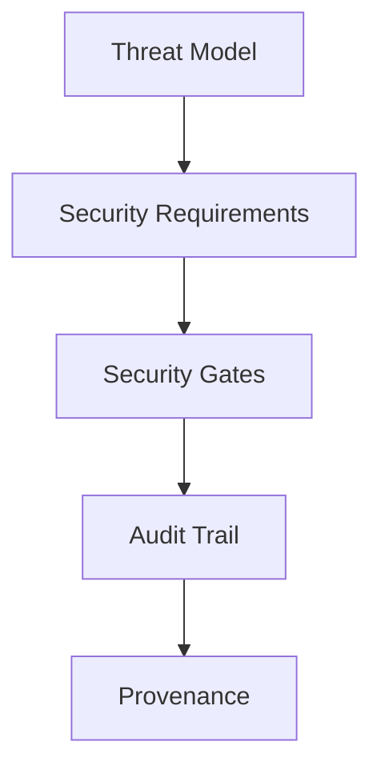

# Документация безопасности

> [!info] Определение
> Безопасность как машиночитаемые документы: threat models, security requirements,
> trust boundaries, audit trails. Аудит-готовность для агентного кода.
> См. [[Аудит архитектуры]], [[Следование архитектуре]].

## Стандарт / источник

- OWASP AISVS Appendix C: AI-assisted secure coding workflow, CI/CD hardening.
- OWASP Secure Coding with AI Cheat Sheet: trust boundaries, human accountability.
- Provenance: attested execution + signed action artifacts.

## Threat model для агентного кода

| Угроза | Механизм | Митигация |
|---|---|---|
| Indirect prompt injection | Вредоносный текст в issues/PRs | Treat repo content as untrusted; sanitize |
| Supply-chain poisoning | Галлюцинированная библиотека | Pinning, SBoM, allowlists |
| Self-approval | Агент апрувит свою работу | Role separation, human gate |
| Test tampering | Правка тестов под green | File freezing, spec commit before run |
| Secret exfiltration | Секреты в контексте/логах | Env/vault only; scrub CI runners |
| Confused deputy | CI-агент с лишними правами | Least privilege, approval gates |

## Trust boundaries

```
[DEVELOPER] ──permissions── [AGENT] ──reads── [EXTERNAL: repo content]
     │                          │                  [MCP SERVERS]
     │                     [MODEL PROVIDER]        [CI/CD: secrets]
```

## Документация безопасности: что фиксировать

| Элемент | Содержание |
|---|---|
| Security requirements | Что должно быть защищено, уровни |
| Threat scenarios | Adversarial-AI: injection, supply chain, self-approval |
| Gates | Какие проверки mandatory независимо от AI |
| Audit trail | Кто апрувил, какой инструмент и модель |
| Provenance | Подписанные артефакты действий агента |
| Metrics | Vulnerability density, AI-attributable defect rate |

## Human accountability

- У каждого AI-изменения — human owner.
- Explicit approval перед merge.
- Audit trail: developer + AI tool + model version.
- «The AI wrote it» не снимает ответственность.

## Диаграмма



## Мнемоника

**«Угрозы, Границы, Гейты, Аудит, Происхождение»** — УГГАП.

## Связи

- [[Аудит архитектуры]] · [[Следование архитектуре]] · [[Тесты]] · [[Docs-as-Code и CI]]

## Типичные ошибки

> [!warning]
> Секреты в файлах проекта: агент читает. CI-агент с org-level secrets: confused deputy.
> Нет audit trail: нельзя доказать, что произошло. AI без human owner: ответственность размыта.
