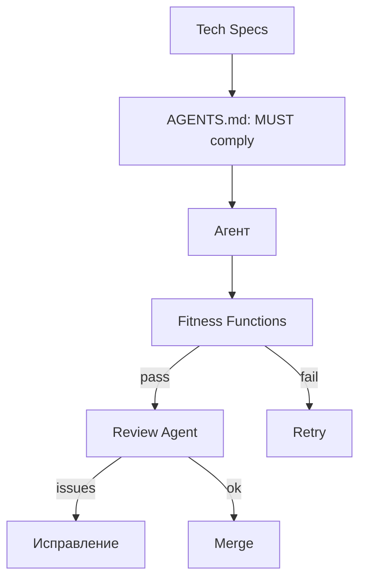

# Следование архитектуре

> [!info] Определение
> Как добиться, чтобы агент следовал архитектуре и не изобретал велосипеды:
> guidelines vs guardrails, каталоги переиспользования, risk maps, review agents.
> См. [[Аудит архитектуры]], [[Безопасность]], [[Тесты]].

## Guidelines vs Guardrails

| Подход | Природа | Adherence |
|---|---|---|
| Guidelines (доки, скиллы) | Вероятностные, context-heavy | Зависит от контекста |
| Guardrails (fitness functions) | Детерминированные, binary gates | 100% в CI |

> «LLMs are great for exploratory and fuzzy rules, but once you have a rule that is
> objective, converting it to a formal, unambiguous, deterministic format gives more
> assurance» — Birgitta Boeckeler.

**Вывод:** объективные правила — в fitness functions; fuzzy — в доки и скиллы.

## Анти-велосипеды: каталог переиспользования

| Механизм | Сила |
|---|---|
| Каталог, который агент может query (MCP) | Выбор дешевле, чем написание |
| Team registry (свои компоненты) | Агент ставит ваш компонент |
| Одна строка: «Check for existing component before writing one» | Слабее, но бесплатно |
| Conventions file с именами и путями | Даёт поиску шанс |

**Reuse decision rule:**
```
REUSE_OR_PROMOTE when:
  same semantic concern in multiple real consumers
  AND boundary stable AND ownership coherent
  AND coupling cost acceptable

KEEP_LOCAL when:
  reuse speculative OR semantics only look similar
  OR shared change → disproportionate blast radius
```

**Правила тремя путями** (компонент не переписывается):
1. CLI output после install (docs field) — без суммаризации.
2. Комментарий в начале файла.
3. Инструкция как команда, а не описание («install it», а не «a hero with gradient»).

## Risk map at input

Не «check your work after», а «know what to prove before»: агент знает, какие
поведения несут риск (fan-out на 4 сервиса, прошлый инцидент) — и пишет иначе.
Standards enforcement at the input дешевле review at the output.

## Architectural review agent

Отдельный агент с fresh eyes: читает tech specs + MR, поднимает issues, если specs
не соблюдены. Архитектор подписывает только то, что не может проверить check:
«does this fit».

## Phases с verification bar

Каждая фаза — чистый commit boundary; все тесты зелёные, регрессий нет.
Регрессия на фазе 7 при зелёных 1–6: причина в последнем инкременте.
Каждый пропущенный дефект → regression test (durable record).

## Диаграмма



## Мнемоника

**«Гейты, Каталог, Риски, Ревью, Фазы»** — ГКРРФ.

## Связи

- [[Аудит архитектуры]] · [[Безопасность]] · [[Тесты]] · [[Docs-as-Code и CI]] · [[Пример пакета документации фичи]]

## Типичные ошибки

> [!warning]
> Стандарты как документ для чтения: агент не обязан соблюдать. Каталог без query:
> агент не найдёт компонент. Review тем же агентом: grading itself. Фазы без bar:
> регрессии накапливаются.
