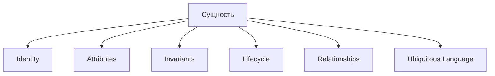

# Документация сущностей

> [!info] Определение
> Сущности домена как машиночитаемые документы: identity, attributes, invariants,
> lifecycle, relationships, ubiquitous language. Агент видит first-class граждан
> и не выдумывает модель. См. [[Флоу]], [[Пример пакета документации фичи]].

## Стандарт / источник

- DDD (Eric Evans): entity, value object, aggregate, ubiquitous language.
- EventCatalog: ubiquitous-language.txt для агентов (llms.txt-паттерн).
- Domain-knowledge skill: NO ASSUMPTIONS policy, entity template.

## Шаблон сущности

```markdown
# [Entity Name]

Description: [Что представляет в домене]

## Attributes

| Attribute | Type | Required | Description |
|---|---|---|---|
| id | string | Yes | Unique identifier |
| name | string | Yes | ... |

## Relationships

- has-many [Other Entity] — описание
- belongs-to [Other Entity] — описание

## Lifecycle

- Created when: [триггер/событие]
- Status transitions: [изменения состояний]
- Deleted when: [условие]

## Business Rules

- [Правило 1]
- [Правило 2]

## Example

{ "id": "123", "name": "Example" }
```

## Ключевые элементы

| Элемент | Назначение |
|---|---|
| Identity | Чем сущность отличается (не атрибутами) |
| Invariants | Правила, которые сущность защищает сама |
| Lifecycle | Состояния и переходы |
| Relationships | Cardinality и направление связей |
| Ubiquitous Language | Термин на языке домена + техническое отображение |

## Ubiquitous language для агентов

- Глоссарий терминов: определение, контекст, синонимы, примеры.
- Техническое отображение: Database table.column, Code ClassName.
- EventCatalog: ubiquitous-language.txt — все термины организации, значения не сливаются
  между доменами (одно слово может значить разное в разных доменах).
- MCP tool: explainUbiquitousLanguageTerms — термин по домену или по всем доменам.

## NO ASSUMPTIONS policy

> Никогда не выдумывай: атрибуты, связи, шаги процессов, типы данных, терминологию.
> Вместо этого: ASK → WAIT → DOCUMENT gaps (# TODO / # QUESTION) → VERIFY → STOP при неопределённости.

## Диаграмма



## Мнемоника

**«Имя, Атрибуты, Связи, Жизненный цикл, Правила, Пример»** — НАСЖРП.

## Связи

- [[Флоу]] · [[Тесты]] · [[Пример пакета документации фичи]] · [[Структурированный Markdown]]

## Типичные ошибки

> [!warning]
> Anemic domain model: сущность без поведения и инвариантов. Выдуманные атрибуты:
> нарушение NO ASSUMPTIONS. Термины без технического отображения: агент не связывает
> глоссарий с кодом.
