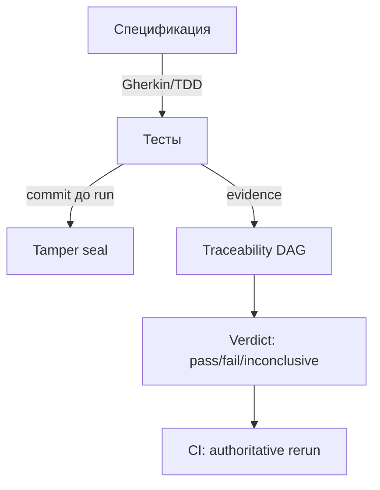

# Документация тестов

> [!info] Определение
> Тесты как машиночитаемая документация: executable specs, acceptance criteria,
> test plans, fixtures. Тест — это спецификация, которую машина может проверить.
> См. [[Следование архитектуре]], [[Docs-as-Code и CI]].

## Стандарт / источник

- Executable specs (Gherkin/BDD, TDD, Spec Kit); Anthropic: «give the agent a check it can run».
- VNVSpec (arXiv): machine-readable V&V specs, traceability DAG, audit-ready verdicts.
- AI spec template: acceptance criteria + test plan + I/O contracts.

## Три формы executable spec

| Форма | Что фиксирует | Кто читает |
|---|---|---|
| BDD scenarios (Gherkin) | Поведение на доменном языке | Все: product, QA, агент |
| Test-first suites (TDD) | Одно поведение на тест | Инженеры и агент |
| Spec files (Spec Kit) | Scope, constraints, verification step | Все; агент выводит задачи |

## Acceptance criteria: observable, atomic, bounded

**Практическое правило:** если два компетентных разработчика прочитают критерий
и отгрузят разное поведение — критерий не готов для агента.

| Свойство | Хорошо | Плохо |
|---|---|---|
| Observable | API returns 404; retry button enabled | flow feels smooth; code is clean |
| Atomic | Один проверяемый результат | Несколько результатов в одном критерии |
| Bounded | Конкретные входы/выходы/пороги | «работает хорошо» |

**Given/When/Then с якорями:**
- Repository anchor: путь файла, route, таблица, фикстура, компонент.
- Assertion anchor: точный вывод, статус-код, DOM-изменение, лог-строка, diff.

## Документация тестов: что фиксировать

| Элемент | Содержание |
|---|---|
| Test plan | Команды запуска, coverage targets, порядок |
| Fixtures | Именованные фикстуры, seed, setup/teardown |
| Traceability | Requirement ID → тест (VNVSpec DAG) |
| Evidence | Вывод тестов как evidence для требований |
| Verdict logic | Нет evidence = inconclusive, а не pass |

## Защита от gaming тестов

1. **Spec commit before run**: закоммиченный падающий тест — tamper seal.
2. **Forbid test edits**: «Do not modify or delete existing tests» в промпте и AGENTS.md.
3. **Authoritative rerun outside the loop**: CI/hook вне контроля агента.
4. **Split roles**: одна сессия пишет тесты, другая — код (агент не grading itself).

## Диаграмма

## Мнемоника

**«Наблюдаемо, Атомарно, Ограничено, Прослеживаемо»** — НАОП.

## Связи

- [[Следование архитектуре]] · [[Аудит архитектуры]] · [[Docs-as-Code и CI]] · [[Пример пакета документации фичи]]

## Типичные ошибки

> [!warning]
> «Работает хорошо» как критерий: агент угадывает. Тесты без traceability: evidence
> не связано с требованиями. Агент правит тесты вместо кода: gaming без запрета.
