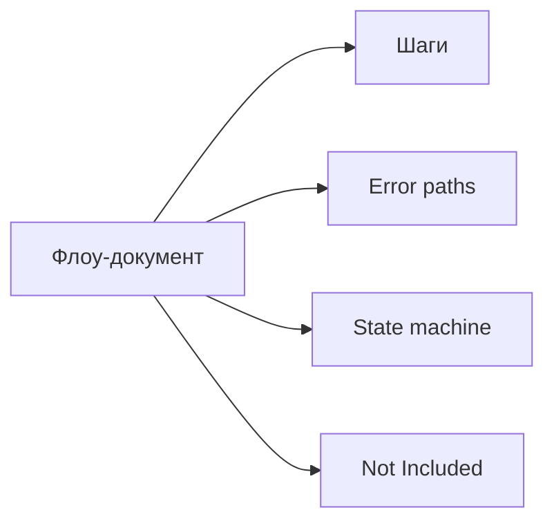

# Документация флоу

> [!info] Определение
> Флоу как машиночитаемые документы: sequence, state machines, workflows с
> явными шагами, ветвлениями и error paths. Агент выполняет флоу, а не угадывает.
> См. [[Сущности]], [[Mermaid-диаграммы]].

## Стандарт / источник

- Mermaid: flowchart, sequenceDiagram, stateDiagram.
- C4/arc42: flow/sequence/state/data-model/deployment views.
- AI spec template: dependency-ordered phases, «Not Included» scope.

## Формат флоу-документа

```markdown
# Flow: Order checkout

## Actors
- Customer, Payment Gateway, Inventory Service

## Steps
1. Customer submits cart → POST /orders
2. Gateway validates payment → 200/402
3. Inventory reserves stock → 200/409
4. Order confirmed → 201 + confirmation email

## Error paths
- 402 → show payment error, cart preserved
- 409 → show out-of-stock, suggest alternatives

## State machine
cart → payment_pending → confirmed | failed
```

## Типы флоу

| Тип | Диаграмма | Когда |
|---|---|---|
| Process flow | flowchart | Шаги и ветвления |
| Interaction | sequenceDiagram | Взаимодействие сервисов |
| State machine | stateDiagram | Жизненный цикл сущности |
| Deployment | flowchart | Инфраструктура и окружения |

## Правила

1. **Dependency-ordered phases**: сначала основания, потом надстройка.
2. **Error paths обязательны**: не только happy path.
3. **«Not Included»**: явная граница scope — агент не строит лишнее.
4. **Имена шагов — реальные**: эндпоинты, сервисы, события.
5. **Один уровень абстракции** на диаграмму.

## Диаграмма



## Мнемоника

**«Акторы, Шаги, Ошибки, Состояния, Границы»** — АШОСС.

## Связи

- [[Сущности]] · [[Mermaid-диаграммы]] · [[Тесты]] · [[Пример пакета документации фичи]]

## Типичные ошибки

> [!warning]
> Только happy path: агент не знает error handling. Флоу без «Not Included»: агент
> строит соседние фичи. Шаги без реальных имён: агент угадывает эндпоинты.
