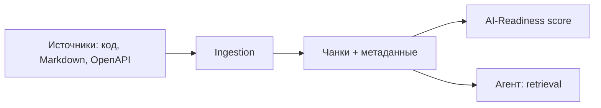

# AI-Native Documentation

> [!info] Определение
> Документация, написанная для AI-агентов: structured-first, machine-readable schemas,
> explicit metadata, semantic chunking, action-oriented. OpenAPI встречает Notion,
> с CI/CD. См. [[Структурированный Markdown]], [[Семантический чанкинг]].

## Стандарт / источник

- Docgrity, DocsAlot (ранние инструменты); OpenAI/Anthropic/Google — de facto стандарты.
- Stripe — эталон AI-readable API документации.
- IBM: +47% точности ответов при структурированной документации.

## Принципы

| Принцип | Традиционные доки | AI-native доки |
|---|---|---|
| Структура | Prose-first, нарратив | Structured-first, схемы |
| Метаданные | Неявные (из структуры) | Explicit, машиночитаемые |
| Единицы | Страницы | Атомарные факты, чанки |
| Связи | Имплицитные | Явные |
| Тестирование | Ручное чтение | AI-readiness scoring, evals |

## Почему AI нужно больше, чем человеку

- Человек интерполирует недостающее; агент — нет.
- Человек замечает противоречия; агент усредняет.
- Человек извлекает выгоду из контекста; агент — из атомарных фактов.

## MVP-архитектура инструмента

1. **Ingestion**: парсинг Markdown, OpenAPI, комментариев кода (tree-sitter) →
   структурированный JSON с чанками, метаданными, связями.
2. **AI-readiness scoring**: оценка 0–100, насколько легко агент извлекает ответы.
3. **Maintenance**: синхронизация с изменениями кода (DocsAlot-паттерн).

## Диаграмма

## Мнемоника

**«Структура, Метаданные, Чанкинг, Актуальность»** — СМЧА.

## Связи

- [[Структурированный Markdown]] · [[Семантический чанкинг]] · [[AI-Readiness scoring]] · [[Codified Context (3 яруса)]]

## Типичные ошибки

> [!warning]
> Prose-first документация с AI-ярлыком: структура не изменилась. Метаданные без схемы:
> не парсятся. Документация без evals: никто не знает, читается ли она агентом.
