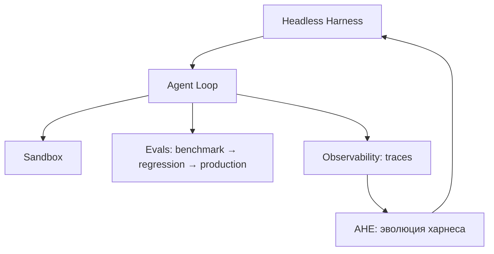

# Harness-инжиниринг

> [!info] Определение
> Инструменты и архитектура агентских сред: headless harness, evals, sandboxes,
> observability. HARNESS-DB: 1,256 харнесов на 38 измерениях.
> См. [[Сквозной цикл разработки]], [[Агентский CI-CD]].

## Headless harness: 6 модулей

| Модуль | Роль |
|---|---|
| LLM Providers | Модели и роутинг |
| Memory | Контекст, compaction, sessions |
| Skills | Процедурные знания |
| Sandbox | Изолированное исполнение (Docker/Modal) |
| Permissions | Что агент может выполнять |
| LSP Server | Символы, references, типы |

Agent loop: LLM → action (tool call) → tool в sandbox → observation → context window.

## Evals: 3 стадии

| Стадия | Вопрос | Механизм |
|---|---|---|
| Internal benchmark | Does it work? | Task + fresh sandbox + hidden oracle |
| Regression tests | Does it still work? | Перед ship; trace replay |
| Production evals | Does it keep working? | Live scoring на sampled traces |

Инструменты: OpenAI agent evals, Inspect AI (UK AISI), Harbor (Terminal-Bench),
Opik (observability + regressions), trace grading.

## Sandboxes

| Инструмент | Назначение |
|---|---|
| E2B | Изолированные runtimes для агентов |
| SWE-ReX | Sandboxed code execution |
| Docker/Modal | Локально/remote исполнение |

## Observability

| Инструмент | Что даёт |
|---|---|
| traceAI | OpenTelemetry для 50+ фреймворков |
| agenttrace | TUI/CLI аудит сессий, cost spikes |
| Langfuse | Self-hosted LLMOps, evals |
| Opik | Traces, threads, regression tests |

## AHE: автоматическая эволюция харнеса

Общий паттерн улучшения среды: Evaluate → Analyze → Improve для prompts, tools,
permissions и feedback. Benchmark gains в отдельных проектах зависят от task set,
версии модели, scaffold и бюджета; переносить их только после собственного воспроизводимого eval.

## Фреймворки

| Фреймворк | Сила |
|---|---|
| LangChain deepagents | Long-horizon tasks |
| Mastra | TypeScript-first, observational memory |
| AutoGen / AG2 | Code sandboxing, multi-agent |
| Semantic Kernel | Enterprise .NET, Azure |
| Strands | Harness + sandbox + evals |

## Диаграмма

## Мнемоника

**«Модули, Evals, Песочницы, Наблюдаемость, Эволюция»** — МЭПНЭ.

## Связи

- [[Сквозной цикл разработки]] · [[Агентский CI-CD]] · [[Уровни автономии]] · [[Аудит кода]] · [[Архитектура агентной software factory]] · [[Инструменты аудита для software factory]]

## Минимальный harness и контекст

Не загружайте большой handbook автоматически. Начните с agentic search, краткой карты
репозитория и команд тестирования; добавляйте rules only when code/tools cannot communicate
важную границу. Объективные инварианты закрепляйте deterministic checks, а не длинной прозой.
См. [[Код, контекст и минимальный harness]].

## Типичные ошибки

> [!warning]
> Нет evals: регрессии не ловятся. Агент без sandbox: ломает хост. Нет observability:
> нечего улучшать. Harness без версионирования: эволюция неаудируема.
