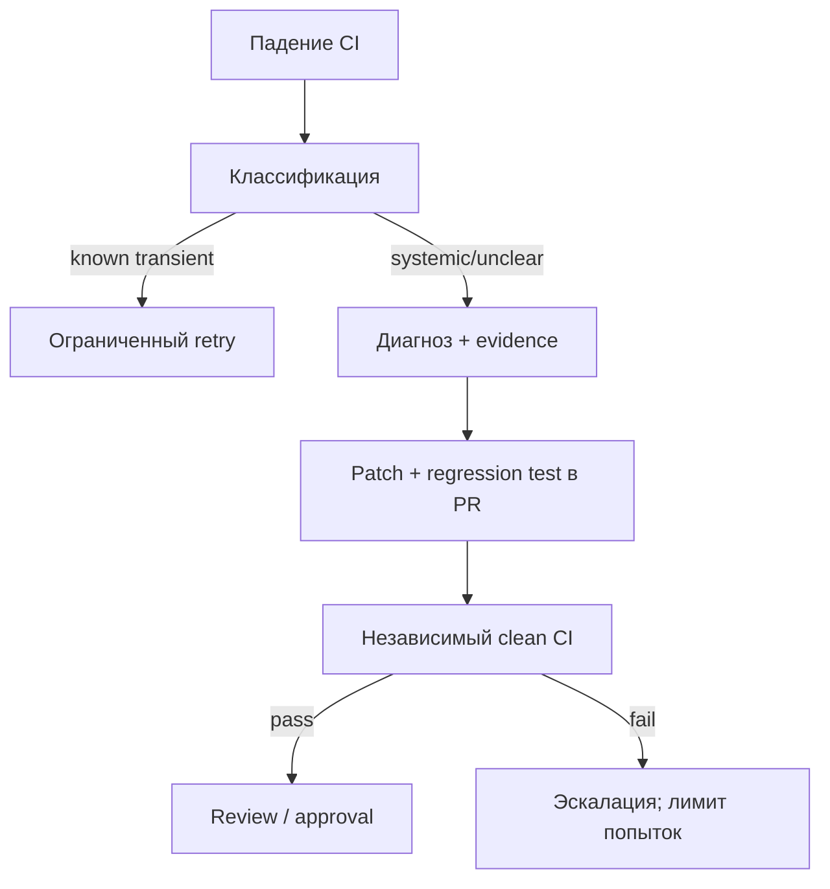

# Агентский CI/CD

> [!info] Определение
> Агентная автоматизация в CI/CD: агенты классифицируют сбои, готовят ограниченные
> исправления и evidence; независимые CI/policy gates принимают решение о продвижении.
> Заявления о процентах auto-resolution не универсальны: результат зависит от состава CI,
> таксономии и метода измерения. См. [[Уровни автономии]], [[Аудит кода]],
> [[Безопасный деплой агентами]].

## Где агент помогает

| Шаг | Безопасный паттерн |
|---|---|
| Failure classification | Отличать flaky test, runner timeout, dependency/install failure |
| Transient vs systemic | Retry-with-backoff только для классифицированных transient ошибок |
| Fix proposal | Сгенерировать минимальный patch + regression test в отдельной ветке/PR |
| Verification | Повторно запустить affected checks и полный required CI на чистом runner |
| Evidence | Зафиксировать trace, diff, команды, результаты и причину решения в PR |

Не разрешать агенту ослаблять тесты/гейты, скрывать findings или auto-merge собственный фикс.

## Tiered autonomy

| Tier | Действие | Контроль |
|---|---|---|
| Low-risk | Ограниченный retry transient ошибки | Автономно с лимитом и audit log |
| Medium | Patch proposal, regression test, PR | Human approval |
| High-risk | Security finding, architecture/IAM/deploy change | Только анализ/предложение, обязательная эскалация |

## Self-healing loop (8 стадий)

```
detect → triage → diagnose → plan → approve → act → verify → learn
```

- Deterministic policy engine — для известных, ограниченных случаев.
- Агент — для неоднозначных диагнозов и объяснения доказательств.
- Allowlist действий, лимит попыток/стоимости/времени, timeout и circuit breaker.
- Проверка результата на независимом runner; не доверять собственному summary.
- Incident memory хранит проверенную причину и исход, не неподтверждённые догадки.

## Governance с начала

- Least-privilege identity; агент не получает production secrets.
- Audit trail связывает task → session → tool calls → patch → CI → deploy.
- Отключение/retry не должны маскировать authentication/security failures.
- Все изменения агента проходят те же branch protections и required checks, что человеческие.
- Human checkpoint при низкой уверенности, policy violation, повторных неудачах или high blast radius.

## Метрики пилота

Мерить на собственных задачах и фиксировать baseline: доля классификаций, подтверждённых человеком;
доля предложенных патчей, прошедших независимый CI; false retry rate; escaped regressions;
время до triage/fix; стоимость и число tool calls; security/policy violations; доля эскалаций.
Не оптимизировать только «зелёный CI» или auto-fix rate: это поощряет отключение проверок.

## Диаграмма



## Связи

- [[Уровни автономии]] · [[Сквозной цикл разработки]] · [[Аудит кода]] · [[Harness-инжиниринг]] · [[Безопасный деплой агентами]] · [[Инструменты агентной среды]]
