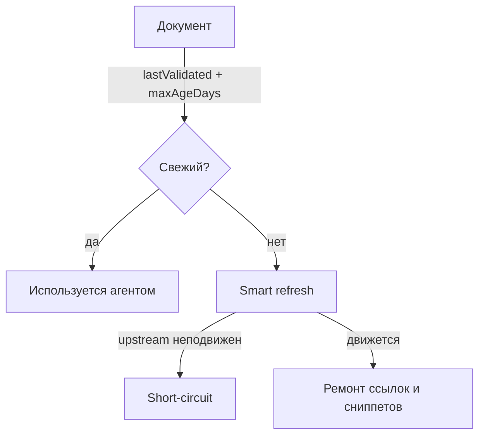

# Актуальность и staleness

> [!info] Определение
> Устаревшая документация — баг, деградирующий работу AI. Механизмы свежести:
> lastValidated, maxAgeDays, smart refresh, CI-гейты. См. [[Docs-as-Code и CI]],
> [[Frontmatter-схемы]].

## Стандарт / источник

- code-docs: maxAgeDays per doc + .agentsrc.yaml default; docs-staleness workflow.
- agent-docs: smart refresh — short-circuit при неподвижном upstream.
- Living Docs: 5 no-drift invariants, deterministic checker в CI.

## Механизмы свежести

| Механизм | Как работает |
|---|---|
| lastValidated | Дата проверки человеком (не автоматикой) |
| maxAgeDays | Порог устаревания per doc; быстроменяющиеся — ниже |
| upstream_commit | Пин коммита: refresh только при движении upstream |
| Changelog scan | Проверка changelog'ов новее last_verified |
| Link-rot scan | Ремонт перемещённых/переименованных страниц |
| INDEX propagation | Старейшая дата темы видна в индексе сразу |

## Smart refresh (agent-docs)

```
refresh-agent-docs gemini-cli
  → cheap path: upstream_commit match / changelog scan
  → fallthrough: link-rot scan документации map
  → re-verify сниппетов против источников
```

## Диаграмма



## Мнемоника

**«Дата, Порог, Пин, Скан»** — ДППС.

## Связи

- [[Docs-as-Code и CI]] · [[Frontmatter-схемы]] · [[AGENTS.md Index]] · [[AI-Readiness scoring]]

## Типичные ошибки

> [!warning]
> lastValidated пишет автоматика: дата бессмысленна. Нет порога: устаревание незаметно.
> Refresh без short-circuit: трата ресурсов на неподвижный upstream.
