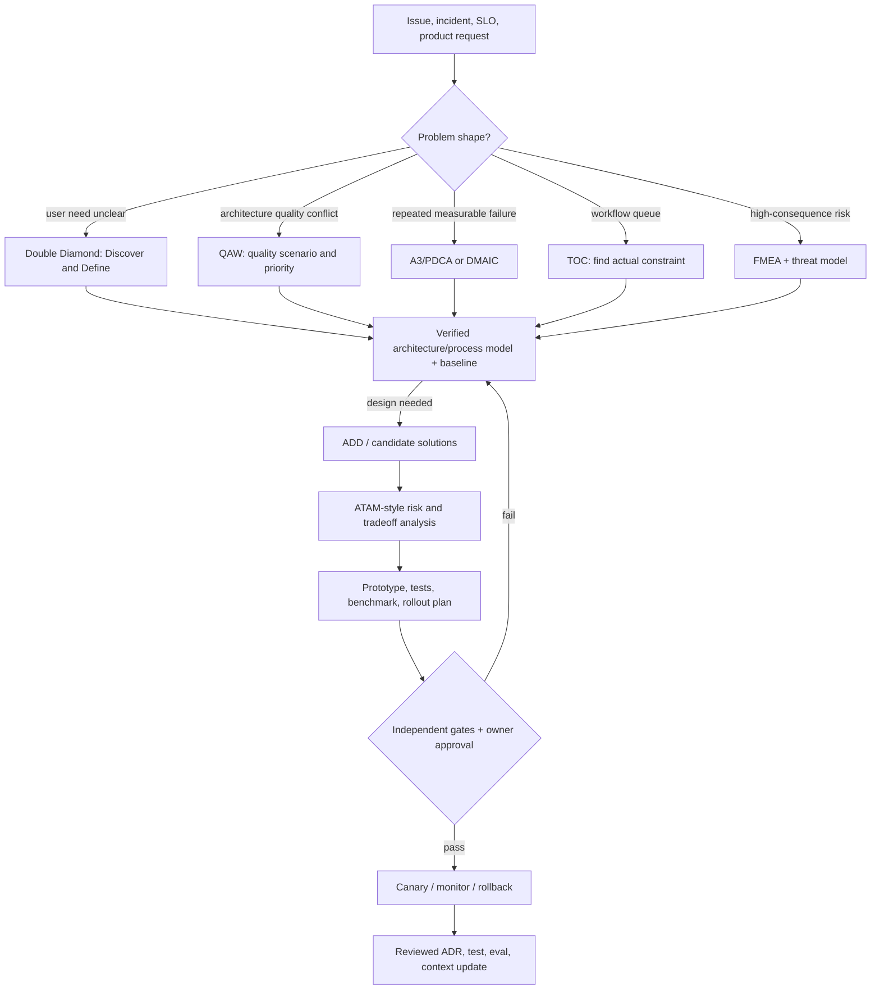

# Альтернативы ТРИЗ для агентной разработки ПО

> [!abstract] Фокус
> Подбор альтернатив и дополняющих методов под задачи: понять продукт и его архитектуру, выявить
> дефекты и bottleneck-и, оптимизировать security/performance/correctness, улучшать контекст и
> workflow многоагентной software factory. Это не рейтинг «самого креативного фреймворка», а
> decision guide: определить тип неопределённости, выбрать подходящий метод, сохранить результат
> в Git и проверить детерминированными тестами/измерениями.

## Главное

Для подробного разбора отдельных инструментов ТРИЗ, их software-аналогов и поэтапной агентной адаптации см. [[ТРИЗ и аналоги: карта методов для агентной разработки]]; оценки первичных источников и ограничений доказательств — в [[Ресёрч по теориям ТРИЗ и аналогам для агентных систем]]. Этот документ оставлен как практический decision guide, без дублирования полного исследования.

Для software architecture наиболее прямой альтернативный стек — **QAW → ADD → ATAM**:

- QAW переводит business/user drivers в приоритизированные quality-attribute scenarios;
- ADD итеративно превращает высокоприоритетные scenarios в архитектурные решения/tactics;
- ATAM анализирует, какие риски, sensitivity points и tradeoffs возникают у этих решений.

Для существующей системы с повторными инцидентами или метриками используйте **A3/PDCA или DMAIC**;
для ограниченной пропускной способности factory — **Theory of Constraints (TOC)**; для high-impact
failure modes — **FMEA + threat modeling**. Для неопределённого пользовательского запроса — **Double
Diamond**. Для вариативного solution space — **morphological analysis** или **SIT**. Ни один из этих
методов не заменяет кодовую модель, runtime evidence, эксперименты, тесты или human approval.

## Быстрый выбор метода

| Ситуация | Начать с | Зачем | Deliverable |
|---|---|---|---|
| Пользовательская проблема неясна, решение уже навязывается | Double Diamond: Discover → Define | Развести problem-space и solution-space; проверить, чья это потребность | Evidence-backed problem brief + нужные исходы |
| Architecture/quality goals не измеримы или конфликтуют | QAW → ADD → ATAM | Требования-сценарии → проектирование → анализ последствий architecture decisions | Quality tree, architecture views/ADRs, risks/tradeoffs |
| Дефект повторяется, данных много и есть вариативность | DMAIC; легковесно — A3/PDCA | Verify baseline/cause; pilot fix; sustain/control | A3/DMAIC record + control plan |
| Вся software factory тормозит, хотя агентов больше | TOC | Найти ограничение общего throughput и не наращивать WIP вслепую | Bottleneck, queue/lead-time baseline, intervention |
| Возможен серьёзный системный вред/отказ | FMEA/FMECA + threat model | Разобрать failure modes, propagation, prevention/detection | Risk register linked to controls/tests/owners |
| Цели ясны, но нужен выборочный набор архитектурных вариантов | Morphological analysis + consistency assessment | Структурно комбинировать независимые design dimensions | Небольшой shortlist консистентных designs |
| Нужны новые идеи в рамках текущих ресурсов/ограничений | SIT (TRIZ-derived) / design-by-analogy | Взломать fixedness систематическими изменениями components/attributes | Candidate ideas, filtered for value/feasibility |
| Нужен доказательный code change | TDD/property tests + fitness functions + experiment | Превратить гипотезу в наблюдаемое, воспроизводимое условие | Regression tests, CI evidence, rollout result |

Методы могут соединяться. Например, для «агенты пишут быстрее, но падает качество PR» сначала проверить
пользовательский/бизнес gap, далее QAW/ATAM для quality goals, TOC для queue/review bottleneck,
DMAIC для распределения дефектов и затем pilot с независимыми gates.

## 1. QAW, ADD и ATAM — software-specific архитектурные методы

Это наиболее целевое семейство методов для выбора среди architecture решений с конфликтующими
quality attributes. В отличие от generic ideation methods, оно прямо работает с software quality
scenarios, architecture decisions и их рисками.

### QAW: согласовать, что значит «хорошая архитектура»

Quality Attribute Workshop не требует полностью готовой архитектуры. Стейкхолдеры формулируют,
уточняют и приоритизируют сценарии производительности, modifiability, availability, security,
interoperability, testability и иных важнейших качеств. Quality scenario удобно записывать по шести
полям: **source of stimulus, stimulus, environment, affected artifact, response, response measure**.

Пример для agentic software factory:

```yaml
id: QA-CTX-07
attribute: correctness / modifiability
source: repository-level coding agent
stimulus: a task touches shared auth and billing contracts across two repositories
environment: normal PR workflow, model/tool versions pinned
artifact: context builder + subagent routing
response: load authorized callers/contracts and isolate unrelated repository/user memory
response_measure: correct impacted-service/test coverage; zero unauthorized retrieval;
  bounded context budget; no unreviewed cross-repo write
priority: high
owner: platform-architecture
```

Сценарий может стать acceptance criteria, test plan, observability query и experiment metric.
Это намного точнее, чем «нужна гибкая и безопасная архитектура».

### ADD: итеративно спроектировать из драйверов

Attribute-Driven Design использует prioritized quality scenarios вместе с функциями и constraints,
чтобы итеративно декомпозировать систему и выбирать подходящие architecture patterns/tactics.
Повторять на уровне модулей/компонентов: определить design objective → выбрать drivers → выбрать
structure/tactics → allocate responsibilities/interfaces → зафиксировать views и decisions → проверить
сценарием. Для agentic systems это может дать архитектуру памяти/контекстного retrieval, orchestration,
identity/permissions, sandbox и verifier boundary.

### ATAM: понять последствия принятых архитектурных подходов

ATAM подходит, когда есть начальная архитектура и нужно оценить её относительно quality scenarios.
Исследовать high-priority scenarios, выявлять:

- **Risk:** решение может не выполнить quality goal.
- **Sensitivity point:** небольшое изменение параметра существенно меняет качество.
- **Tradeoff point:** один design choice влияет на несколько атрибутов.
- **Non-risk:** подход plausibly supports priority scenario, при указанных условиях.

ATAM — не точный benchmark и не сертификат «архитектура хорошая». Его цель — осветить последствия
решений, направить анализ/prototyping и сделать риски видимыми до необратимой реализации. Связывать
выводы с измерениями, прототипами, SLO/perf, security verification и design owners.

### Практический проход QAW → ADD → ATAM для существующего продукта

1. Подготовить component/dependency map, API/data contracts, runtime traces, incident history, owners.
2. Звать людей, которые знают пользователей, operations, security и доменный intent; агентам поручать
   извлечение evidence, а не изобретать stakeholder priorities.
3. Преобразовать fuzzy goals в конкретные scenarios и приоритеты.
4. Зафиксировать существующие architectural approaches и decisions из code/ADRs/production evidence.
5. Выбрать один high-risk scenario и design decision; сформулировать альтернативы и ожидаемый эффект.
6. Применить ADD тактику/структуру; записать в ADR, какие scenarios закрываются, что отложено.
7. Пройти ATAM-like review: sensitivity, tradeoff, failure modes, missing evidence; создать прототип/test.
8. Ввести проверяемые outcomes: fitness test, contract test, load/security test, telemetry, owner.
9. После canary обновить risks/ADR, а не менять задним числом критерии успеха.

## 2. Double Diamond — когда сначала нужно найти правильную проблему

Design Council описывает Double Diamond как Discover → Define → Develop → Deliver. Первый diamond
помогает исследовать проблему вместо assumptions; второй — генерировать разные ответы, тестировать их
в малом масштабе и улучшать. Это полезно, когда stakeholder request сразу диктует решение («добавить
vector database», «запустить ещё 10 агентов», «увеличить context window»), а нужда и причинность неясны.

Пример для контекстной системы:

- **Discover:** какие задачи агенты проваливают; где это видно в traces/review/telemetry; какие документы,
  owners или cross-repo links они не находят; опрос инженеров и ревьюеров.
- **Define:** зафиксировать проверяемую задачу и impacted segment, например retrieval misses по auth
  contracts; отделить source freshness, ranking, ACL, compaction и workflow design как возможные причины.
- **Develop:** прототипировать incremental repo map, lexical+graph search, per-task index, context artifact,
  или новую workflow decomposition; не выбрать tooling до сформулированной гипотезы.
- **Deliver:** сравнить на eval suite и пользователях, pilot, отпустить/откатить, сохранить result.

Подход не root-cause tool и не architecture assurance: наблюдения и интервью могут быть selection-biased;
выводы конвертировать в сценарии/измерения и проверять на representative tasks.

## 3. A3/PDCA и DMAIC — чинить повторяющуюся проблему доказательно

### A3/PDCA

Хорошо для конкретного дефекта, повторного инцидента или технического долга, где важны логика причины,
ответственный владелец и короткая контрмера. A3 — сжатая story/evidence trail (не обязательный один лист и
не compliance form): background/current state → gap → cause hypotheses → countermeasure → owner/date →
result and follow-up. PDCA итеративен: Plan → Do → Check/Study → Act. Начинать с проверки ситуации,
не с выбора fix.

Для software issue добавить artifacts: issue/incident ID, repro & commit, affected path, trace/test, observed
frequency/severity, causal graph, acceptance test, change hash, CI/run links, rollout/rollback, recurrence check.
Для agent: A3 summary может быть machine-readable, но source evidence остаётся в logs/tests/monitoring.

### DMAIC

Define → Measure → Analyze → Improve → Control — уместен для **existing process/service с recurring
performance variation, quality failures и достаточными данными**. Сильнее, чем свободное обсуждение,
настаивает на trustworthy baseline, проверке measurement, root-cause evidence, pilot and ongoing control.
Примеры: flaky-test rate; latency p95 under representative load; повторные security findings; CI rerun rate;
PR review lead time.

Не запускать полный DMAIC для одиночного воспроизводимого бага; не делать причинные выводы из одной
корреляции; учитывать недостаток данных, сезонность, production mix, изменение модели/инструмента.
Контроль после улучшения — dashboards + deterministic thresholds + owner, а не только финальный отчёт.

## 4. Theory of Constraints — повышать system throughput, а не локальную активность

TOC подходит к вопросу «что сейчас реально ограничивает поставку качественного software?». Для
agentic factory возможные constraints: code-owner reviews, integration/CI capacity, тестовые данные,
sandbox fleet, build cache, security approvals, release windows или product decision latency.

Пять focusing steps: **identify → exploit → subordinate → elevate → repeat**.

- Измерить очереди/lead time/blocked time/throughput и WIP до спора об узком месте.
- Эксплуатировать constraint: снять его избегаемую работу, обеспечить ясный вход, не кормить junk PRs.
- Подчинить остальной поток: dispatch/concurrency, review readiness, batch size, CI priority.
- Только затем наращивать ёмкость (more compute, reviewers, tests, parallelism).
- Пересмотреть после изменения: constraint переместится.

Agent count, tokens, lines of code, opened PRs или percent green CI — локальные output, не глобальная
цель. Параллельное ускорение реализации при фиксированном review capacity может просто накопить WIP.

## 5. FMEA/FMECA, threat modeling и fault-tree — для отказов и риска

Использовать для функций/интерфейсов, где сбой может иметь значимый impact: authz, tenant data,
payments, migrations, secrets, autonomous remediation/deploy, shared agent memory. Определить function,
failure mode, cause, effect/propagation, existing detection/prevention, recommended action, owner.
Программные failure modes включают отсутствующее/частичное/неверное/повторное/запоздалое выполнение,
stale context, cross-tenant data retrieval и tool misuse.

Многоагентная factory может разделить домены: FMEA analyst строит failure inventory, threat-model reviewer
ищет attacker-controlled input/trust boundaries, verifier превращает controls в tests/policy gates. Не
считать risk score математической истиной: low-probability catastrophic risks требуют отдельного handling;
FMEA не доказывает полноту. Для конкретных threat controls опираться на утверждённую организационную
модель угроз и проверяемые policy.

## 6. Morphological analysis — систематически комбинировать design choices

General Morphological Analysis (Zwicky) полезен, когда проблема многомерна и вариантов много, но их трудно
обсуждать системно. Определить независимые dimensions, перечислить варианты, затем оценить cross-
consistency пар и выбрать небольшой set coherent scenarios. Это не поиск вероятного оптимума и не
причинная модель: оценка совместимости judgmental, а число комбинаций растёт быстро.

**Пример: архитектура контекстного слоя**

| Dimension | A | B | C |
|---|---|---|---|
| Source | repo Markdown/ADRs | code graph/contracts | runtime traces/issues |
| Retrieval | lexical/code search | vector/hybrid | exact owner/path query |
| State | per task artifact | shared project memory | per-user memory |
| Update control | CI-generated | agent-proposed PR | owner-maintained |
| Exposure | orchestrator-only | per role/task | shared to workers |
| Verification | offline eval | CI check | shadow/canary |

Варианты нельзя комбинаторно принять без cross-consistency: per-user private memory нельзя открыть всем
workers; code graph не знает business rationale; runtime traces имеют privacy/retention controls; vector
index snapshot должен соответствовать commit/ACL. Сначала сжать design space жёсткими requirements,
затем сделать shortlist и испытать. Для такой таблицы spreadsheet/Git Markdown обычно достаточно; tool
для морфологического поля нужен при большом фасилитируемом проекте, не для каждой фичи.

## 7. SIT — лёгкая, но TRIZ-derived альтернатива

Systematic Inventive Thinking (SIT) — **не независимая от TRIZ теоретическая школа**, а производная,
более компактная toolkit-методология. Её пять инструментов (в формулировках SIT) включают subtraction,
division, multiplication, task unification и attribute dependency; официальный сайт также описывает
qualitative change и принципы Closed World/Function Follows Form.

В software factory это может помочь при brainstorming constrained options:

- **Subtraction:** убрать этап/компонент/инструкцию и спросить, как сохранить требуемый результат.
- **Division:** разделить контекст, ответственность, trust tier или release stages.
- **Multiplication:** параллельная независимая verification path / shadow copy; оценить стоимость и divergence.
- **Task unification:** использовать уже имеющийся test harness/index/telemetry для другого полезного контроля.
- **Attribute dependency:** связывать глубину анализа/approval/context budget с risk tier, а не фиксировать одно
  значение для всех задач.

SIT чаще удобен в короткой facilitator-led ideation с имеющейся системой; он не заменяет архитектурную
оценку, root cause или security analysis. Его «Closed World» — ограничение поиска, не разрешение игнорировать
необходимые внешние dependencies/экспертизу или procurement.

## 8. Сравнение методов по требованиям к агентной автоматизации

| Метод | Input readiness | Что AI хорошо автоматизирует | Что требует человека / expert | Объективная проверка |
|---|---|---|---|---|
| QAW | Business goals + stakeholders | Сбор draft scenarios из issue/docs, дедупликация, traceability | Приоритеты, истинность need, risk appetite | Six-part scenario lint + owner signoff |
| ADD | Scenarios + system map | Развернуть alternatives, trace decisions, generate diagrams/docs | Выбор tactics/architecture, maintainability tradeoffs | Architecture tests/prototype/benchmark |
| ATAM | Existing architecture + quality scenarios | Pre-read evidence, question prompts, risk register, sensitivity summary | Facilitation, challenge assumptions, decide priorities | Prototypes, models, experiments; ATAM itself qualitative |
| Double Diamond | User/problem access | Theme clustering, interview synthesis, prototype test ideas | User meaning, reframing, ethical/product judgment | Usability/task experiment and outcomes |
| A3/PDCA | Concrete gap + owner | Draft fact timeline, causal hypotheses to test, action/evidence log | Validate gemba/current condition/root cause | Repro, test, compare result/follow-up |
| DMAIC | Recurrent measurable process issue | Dataset prep, charts, candidate factors, report | Measurement validity, causal/statistical interpretation | Statistical analysis/control limits/pilot |
| TOC | Workflow/queue metrics | Find queues, model flow, compare intervention hypotheses | Decide global goal and socially feasible subordination | Throughput/lead time/WIP before-after |
| FMEA / threat | Function/asset/trust model | Failure-mode enumeration, link affected code/tests, draft mitigations | Severity, threat feasibility, exception approval | Test coverage, security review, monitoring controls |
| Morphological analysis | Defined dimensions/alternatives | Create combinations, check explicit pair rules, organize shortlist | Define dimensions/compatibility where expertise is tacit | Prototype each selected design; fit to scenarios |
| SIT | Defined product/process and existing resources | Generate transformations, produce diverse idea seeds | Contextualize, select, avoid forced principle mapping | User value, feasibility, experiment |

**Interpretation:** methods don't autonomously validate their own findings. Agents can increase analysis
breadth, but risk of fabricated user context, root cause, architecture, plausible-sounding alternatives and
wrong metric persists. Prefer evidence-carrying tasks with scoped tools and schemas.

## 9. Reference workflow for your software factory



### Agent work graph and governance

1. **Intake/router:** classify problem and choose method based on evidence/risk; don't default every task to one
   ideology. It may offer 2 method candidates with why/requirements.
2. **Architecture/context builder:** generate code/dependency map, contract list, owner map, test map, trace/incident
   snapshot tied to commit. Human validates intent gaps.
3. **Read-only analysts:** separate agents gather architecture quality scenarios, recent history/root-cause evidence,
   failure modes, performance baseline and stakeholder feedback. Enforce ACL and scoped tools.
4. **Problem framing review:** one owner validates which facts are measured, what is hypothesis, what is in scope,
   business/quality goal, uncertainty, safety tier.
5. **Method stage:** use chosen method artifacts (e.g., QAW utility tree, A3, TOC constraint, FMEA record) rather
   than letting free-form agent debate replace an explicit process.
6. **Candidate generator:** may use ADD patterns, SIT/morphological prompts, relevant past ADRs. Require several
   distinct mechanisms only if problem warrants; citations are evidence, not evidence of efficacy.
7. **Adversarial critic:** independently search for counterexamples, side effects, compatibility/security risks,
   hidden dependency on changed assumption, missing test oracle.
8. **Experiment designer + owner:** preregister success, non-regression, workload, analysis, budget and rollback.
9. **Bounded implementer:** only approved candidate, isolated worktree, allowed paths, one hypothesis/patch at a time.
10. **Independent verifier:** clean CI, contract/property/regression/architecture/security checks, realistic performance
    harness; inspect tests/gates changes separately.
11. **Policy promotion:** owner gates PR/merge/release; after outcomes, update Git context/ADR/evals with evidence.

### Artifact contract for a method-driven task

```yaml
method: "QAW -> ADD -> ATAM"
problem_id: "ARCH-212"
commit: "full-git-sha"
system_boundary: ["agent-router", "context-builder", "worker-sandbox"]
problem_statement: "Workers miss cross-repo callers in some migration tasks"
observations:
  - claim: "Code search doesn't include private dependency repo"
    evidence: "repro://eval/ctx-41, trace://run/771"
    status: verified
hypotheses:
  - "Repository access policy excludes one linked project"
  - "Task router passes only local module map"
quality_scenario: "source/stimulus/environment/artifact/response/measure"
constraints: ["tenant ACL", "no broad token access", "PR-only writes"]
risks: ["cross-repo retrieval leak", "stale references", "added retrieval latency"]
candidates:
  - id: "A"
    mechanism: "permission-filtered code search through org index"
    evidence_needed: "access audit + held-out recall@k"
experiment: "eval dataset v3, fixed repo snapshot, 3 trials per case"
acceptance: ["recover all required authorized references", "zero cross-tenant results", "p95 < budget"]
stop_if: ["unverified ACL", "benchmark noise exceeds expected effect"]
owner_approval: ["platform architecture", "security"]
```

Use machine-readable artifacts as aids to review, not as bureaucratic gates for trivial work. Expose raw
sources/commits; agent-generated classifications remain subject to verification.

## 10. Testing, experiments, and metrics

### Offline first

- Curate representative cases from past PRs/incidents/tasks; include hard negatives, expected file/service
  impact, required constraints and risk category.
- Compare baseline process vs chosen method, and where sensible a simpler alternative. Keep the same
  model/tool/repo snapshot; multiple trials for nondeterministic agents, randomized order, blinded reviewers.
- Score task completion/correctness, evidence precision, root-cause localization, scenario coverage, architecture
  rule compliance, quality side effects, reviewer effort, token/compute/time cost.
- Agent method grader must not be self-authored/modified by implementing agent. Use tests/ground truth, human
  calibration and independent review for ambiguous judgment.
- Add confirmed misses/regressions to dataset with privacy/security review; don't tune only to seen eval examples.

### Performance / quality experiment

Before rollout specify workload, environment, baseline, primary metric, guardrails, duration/power where applicable,
unit of randomization, stopping rule. Change one meaningful factor at a time when possible. For architecture
options, combine benchmark data with scenario/risk analysis: a mean latency gain does not capture auth leakage,
maintainability or rare failure modes. A/B is appropriate only for safe-to-compare options, sufficient traffic and
predefined guardrails; unsafe policy variants must not be deployed to real users merely to learn.

### Agent factory scorecard

| Dimension | Metric examples |
|---|---|
| Outcome | Defect recurrence, scenario pass rate, service quality/SLO, task completion |
| Diagnosis | Confirmed root-cause precision, false positives, evidence coverage, owner re-triage time |
| Architecture | Rules violated/new cycles, scenario risk closure, contract breakage |
| Process | Lead time, WIP, bottleneck utilization/queue, CI flakiness/retries |
| Safety | Unauthorized retrieval/actions, escaped security defects, rollback incidents |
| Economics | Compute/tokens, CI minutes, reviewer/owner time, maintenance cost |
| Adaptation | Eval improvement, regressions/reversals, stale context rate, learned failure recurrence |

A local process improvement is worthwhile only if the wider system outcome improves or a deliberate safety/
quality goal is achieved. Report uncertainty and segment impacts; don't declare general superiority from one case.

## 11. Version into Git and maintain method knowledge

- Canonical artifacts: `architecture/quality-scenarios/`, `architecture/decisions/`, `architecture/risks/`,
  `improvement/a3/` or equivalent, `evals/datasets/`, and test/benchmark sources. Adapt layout to repo conventions.
- Keep a short root agent map pointing to methods/docs; avoid pasting every method into global instructions.
- Store approved architecture decision and experiment findings in an ADR/task-linked record with owner/date/scope.
- Keep facts, hypotheses, and alternatives as separate fields; make status and supersession explicit.
- Gate high-risk policy/architecture/context updates via CODEOWNERS and CI; generate a proposal PR, not direct
  autonomous edits to the policy, verifier or experiment acceptance thresholds.
- Context gardening job can flag stale/redundant entries, but deletion/merge of high-value knowledge is reviewable.

## Ограничения и выбор без догматизма

- **QAW/ATAM/ADD** требуют доступ к stakeholders, архитектурной компетенции и фасилитации; хороший fit для
  consequential architecture decision, зачастую слишком тяжело для маленького patch.
- **Double Diamond** помогает исследовать user problem, но не заменяет root-cause analysis или technical proof.
- **DMAIC** полезен при процессной variability и baseline; сбор неподходящей метрики создает ложную точность.
- **TOC** полезен при системной очереди/throughput, но bottleneck меняется и локальная статистика недостаточна.
- **FMEA** структурирует известные failure modes; не является exhaustive threat analysis и не устраняет unknowns.
- **Morphological analysis** дает auditable combinations, но чувствительна к выбору dimensions и может породить
  combinatorial explosion/false completeness.
- **SIT** — TRIZ-derived и разделяет часть предпосылок; это облегчённая альтернатива, но не независимое
  эмпирическое опровержение/подтверждение ТРИЗ.
- Ни одна методология не делает AI agents автоматически изобретательными, точными или безопасными.
  Эффект оценивается на локальных задачах, включая качество, cost, failure modes и time-to-review.

## Связи

- [[ТРиЗ и системные методологии для разработки ПО]] · [[Архитектура агентной software factory]] · [[Управление контекстом многоагентных систем]] · [[Аудит архитектуры]] · [[Аудит кода]] · [[Evals и метрики агентной разработки]] · [[Тесты]] · [[Параллельная работа агентов]] · [[Операционная модель агентных команд]] · [[Безопасный деплой агентами]]

## Источники

### Software architecture (SEI/CMU)

- Barbacci et al., *SEI Architecture Analysis Techniques and When to Use Them*, CMU/SEI-2002-TN-005: QAW prior to settled architecture; ATAM when architecture and quality goals are available: https://www.sei.cmu.edu/library/sei-architecture-analysis-techniques-and-when-to-use-them/
- Kazman, Klein, Clements, *ATAM: Method for Architecture Evaluation*, CMU/SEI-2000-TR-004: risks, sensitivity/tradeoff points and stakeholder scenarios; explicitly not precise architecture measurement: https://www.sei.cmu.edu/documents/629/2000_005_001_13706.pdf
- Kazman & colleagues, *Attribute-Driven Design (ADD) 3.0: Rethinking Drivers and Decisions in the Design Process*: https://www.sei.cmu.edu/documents/5832/ADD.3.0.Final_ki9IsLf.pdf

### Discovery, process improvement and risk

- Design Council, Double Diamond (primary source and caveat that the diagram is not an instruction manual): https://www.designcouncil.org.uk/resources/the-double-diamond/
- ASQ, DMAIC process: https://asq.org/quality-resources/dmaic
- Lean Enterprise Institute, A3 report: https://www.lean.org/lexicon-terms/a3-report/
- Lean Enterprise Institute, PDCA and technical debt in IT: https://www.lean.org/the-lean-post/articles/how-to-wipe-out-its-technical-debt-with-pdca/
- Lean Six Sigma Groep, practitioner overview of TOC five focusing steps: https://leansixsigmagroep.nl/en/lean-agile-and-six-sigma/theory-of-constraints-uk/
- NASA Goddard, FMECA guidance: https://standards.nasa.gov/sites/default/files/standards/GSFC/Baseline/0/GSFC-HDBK-8004_Approved_0.pdf
- Systems Thinker, causal-loop/system dynamics tools: https://thesystemsthinker.com/wp-content/uploads/2016/03/Systems-Thinking-Tools-TRST01E.pdf

### Idea generation and solution-space exploration

- Systematic Inventive Thinking, official method toolkit: https://www.sitsite.com/method/
- Tom Ritchey, *General Morphological Analysis: A general method for non-quantified modeling*: https://www.swemorph.com/ma.html

### Software architecture examples and methods on GitHub

- `rtym/sei-architecture-methodology` (community implementation, prompts/artifacts for QAW, ADD, ATAM): https://github.com/rtym/sei-architecture-methodology
- `openai/symphony` (prototype/evaluation orchestration spec for per-issue isolated software-agent runs): https://github.com/openai/symphony
- `langchain-ai/context_engineering` (agent-context patterns, write/select/compress/isolate): https://github.com/langchain-ai/context_engineering

> [!warning] Применимость и доказательства
> SEI methods provide a software-specific architecture-analysis foundation; DMAIC/TOC/FMEA support
> diagnosis/flow/risk; ideation methods expand candidate generation. They answer different questions.
> Vendor/framework examples and case studies demonstrate approaches, not causal proof that a method will
> improve this team’s outcomes. Use a local pilot and versioned evals before scaling.
