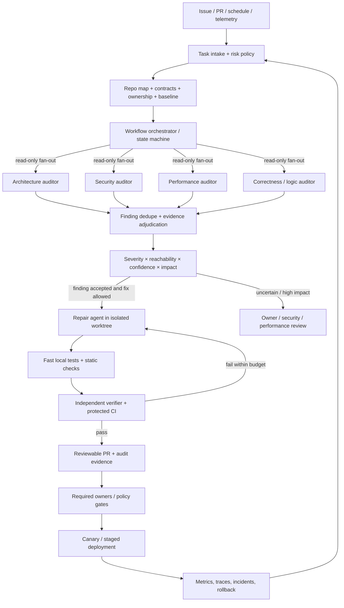

# Архитектура агентной software factory

> [!abstract] Цель
> Построить систему, которая, зная карту модулей, contracts, архитектурные invariants и
> runtime evidence, умеет находить/объяснять дефекты, предлагать ограниченные fixes, проверять
> изменения в независимом CI и выпускать только при policy pass. Это pipeline с агентными
> шагами и детерминированными gates, не «рой ботов с доступом к production».

## Неподвижные правила

1. **Архитектура — контекст и проверяемые правила**, не догадки агента по нескольким файлам.
2. **Audit-first, repair-second**: независимый read-only поиск → triage/дедупликация → bounded fix.
3. **Каждое finding — доказуемый объект** с воспроизведением/локацией и проверкой, не AI opinion.
4. **Тесты и gates — отдельная trust zone**: repair agent не может незаметно ослабить собственный oracle.
5. **Agent outputs — proposals**; CI, policy engine и полномочный человек владеют accept/release.
6. **Автономность по риску и обратимости**: low-risk локальная правка != auth, crypto, schema, IAM, payment.
7. **Ограничить работу**: один finding/одна bounded remediation на branch; лимит попыток, времени и инструментов.

## Reference architecture: control plane + isolated workers



### Control plane

Orchestrator должен вести state, not improvise unrestricted shell logic:
`queued → scoped → audited → triaged → repairing → verifying → review → merged/deployed`
или terminal states `rejected`, `needs-human`, `failed`, `timed-out`, `rolled-back`.
На каждый переход записывать actor, input artifact/version, permissions, decision, evidence и timestamp.

- Durable workflow: GitHub Actions для коротких PR workflows; Temporal/Inngest или platform workflow
  engine, если нужны resumability, timers, retries, human approvals, long-running state.
- Task state хранить в issue/PR и workflow artifacts; не делать chat transcript единственным журналом.
- Idempotency keys для действий, которые пишут комментарии/создают PR/запускают дорогие job.
- Retries — только на классифицированные transient errors; не повторять слепо write/deploy actions.
- Circuit breaker при цикле одного finding, повторных неудачах, подозрительном tool use или бюджете.

## Архитектурная модель продукта — подготовка до агентов

Фабрика должна собрать из реального репозитория и командных источников **слоёную карту**, а не
попросить агентов «сами разберитесь с архитектурой» каждый раз.

| Артефакт | Содержание | Режим |
|---|---|---|
| Repo/module map | Модули, owners, purpose, локальные entry points | Генерировать структуру + human-validated краткие descriptions |
| Dependency graph | Imports/calls/services/events, cycles, forbidden edges | Generated per commit / incrementally refreshed |
| Contracts | OpenAPI, schemas, events, DB migrations, CLI interfaces | Version-controlled; compatibility checks |
| Architecture decisions | Только rationale, trade-offs, exceptions, intended direction | Короткие reviewed ADRs |
| Runtime map | Critical journeys, SLOs, dashboards, service dependencies | Ссылки к инструментам; scoped credentials/read-only |
| Risk map | Data classes, trust boundaries, critical paths, blast radius | Security/service owners approve |
| Test map | test suites, owners, commands, dependency/impact mapping | Generated/indexed; verify test selection |
| Debt/baseline | Existing findings, accepted exceptions, expiration/owners | Versioned; new-vs-existing gate |

Принцип: code/AST/LSP/observability — source для выводимых фактов; prose — intent, rationale,
ownership и неочевидные invariants. Не запускать auditor до успешного build/index/import graph,
иначе отсутствие coverage легко принять за «нет проблем».

## Роли агентов и полномочия

| Роль | Читает | Пишет | Что выдаёт |
|---|---|---|---|
| Intake/Planner | Issue, architecture index, ownership, recent changes | Task plan/state only | Scope, risk tier, test/owner map, stop conditions |
| Architecture Auditor | Repo graph, contracts, ADRs, diff | Findings only | Layer/cycle/contract drift with paths and rule IDs |
| Security Auditor | Diff, taint paths, threat model, config/deps | Findings only | CWE/rule, source→sink evidence, exploit preconditions |
| Correctness Auditor | Diff, behavior contract, tests, logs | Findings only | Reproducible logic/edge-case hypotheses |
| Performance Auditor | Profiles/benchmarks/SLO baseline, hot paths | Findings only | Measured hotspot, workload, before/after metric definition |
| Finding Adjudicator | All reports + code evidence, not implementation write access | Triage record | Confirmed / duplicate / false positive / needs human |
| Repair Agent | One accepted finding + minimal required context | One branch/worktree patch | Minimal fix + regression test suggestion + exact commands run |
| Independent Verifier | Original contract, diff, protected tests/scans; may not alter patch | Pass/fail evidence | Tests, security, architecture and perf result |
| Human owners | Risk/intent/domain changes | Approval or requested changes | Decisions for high-impact or ambiguous changes |

**Независимость:** роли — не синоним assurance. Два LLM review одного diff не заменяют тесты,
security expertise и code owner. Если используете reviewers, по возможности уменьшайте anchoring:
reviewer получает контракт + diff + архитектурные правила, а не только summary implementing agent.

## Граф finding → исправление

Минимальная схема finding:

```json
{
  "id": "SEC-2026-0042",
  "category": "security | architecture | correctness | performance | reliability",
  "rule_id": "AUTHZ.TENANT_SCOPE",
  "severity": "critical | high | medium | low | info",
  "confidence": "high | medium | low",
  "location": {"path": "src/orders/handler.ts", "symbol": "getOrder", "lines": [42, 57]},
  "evidence": "tenant_id from request is not compared with the authenticated principal",
  "preconditions": ["caller is authenticated", "order ID belongs to another tenant"],
  "impact": "cross-tenant data disclosure",
  "reproduction": "test or queryable trace reference",
  "architecture_edges": ["API -> OrderService -> OrderRepository"],
  "fix_scope": ["src/orders/handler.ts", "tests/orders/tenant-scope.test.ts"],
  "verification": ["test:tenant-scope", "CodeQL", "full CI"],
  "needs_human": true
}
```

Не принимать finding по severity label одной модели. Adjudication проверяет: source/location exists,
reachability, trust assumptions, duplicate/accepted risk, actual exposure, reproduction/test oracle,
и applicable rule. Для security при отсутствии evidence — inconclusive, не «clean».

### Приоритизация

Использовать risk rubric, не умножать вымышленные точные числа:

- Impact: data exposure, privilege escalation, availability, money/business correctness.
- Exploitability/reachability: attacker-controlled input, auth boundary, runtime path.
- Confidence: static evidence, repro, dynamic confirmation, scanner-only hint.
- Blast radius: module/service/users/tenant, reversible or not.
- Novelty: introduced by this diff vs known baseline.

Критические/высокие и destructive changes → owner/security review; низкоуверенные сигналы →
уточнить/исследовать, не auto-fix массово. На brownfield gate «не ухудшать baseline» плюс отдельный
remediation backlog часто реалистичнее, чем блокировать всю работу старыми findings.

## Аудит-проходы

### 0. Baseline and change impact

- Build/test current base; фиксировать commit, scanner versions/rules, environment.
- Определить changed symbols/files и reverse dependencies/callers/contracts.
- Вычислить impacted modules, owners, tests, architecture rules, security boundaries.
- Сравнить с baseline: новые findings отдельно от старых.

### 1. Read-only parallel discovery

Пускать независимые auditors параллельно только если они read-only и имеют scoped tasks:
`security scan changed auth/data paths`, `dependency/injection graph`, `critical path profiling`.
Каждый возвращает findings schema; orchestrator дедуплицирует и ограничивает число top findings.
Не просить каждый audit agent сканировать всё репо и делать fixes — дорого и с высоким overlap.

### 2. Triage and human routing

Автоматически закрывать только deterministic duplicates/known suppressions. Требовать human disposition
для new critical/high, unclear product semantics, auth/payment/crypto, schema destructive, architecture
exception, benchmark threshold changes, scanner suppression or false-positive waivers.

### 3. Bounded repair

- One finding per patch or tightly coupled set; declare allowed paths and protected paths.
- Do not edit the test/gate/policy that rejects the patch. Test additions reviewed for assertion strength.
- Minimize unrelated cleanup; no unrequested refactor.
- Try capped repair loop; if verifier sees same failure twice, stop/escalate rather than churn.
- No merge/deploy permission in repair session.

### 4. Independent verification

At minimum rerun: regression test(s), affected module tests, static/type/lint, architecture gates,
security scans, and full required CI before merge. Verifier checks test diff for weakened/deleted assertions,
skips, altered thresholds, changed workflow permissions, or suppressed findings.

### 5. Performance/correctness verification

- Compare same workload, data shape, machine/runtime, warmup and sampling method against known base.
- Prefer profile→hypothesis→targeted benchmark→patch→repeat; do not optimize on intuition alone.
- Check correctness and resource use together: latency, throughput, errors, memory/CPU, tail percentiles.
- Repeat noisy benchmarks; use effect/variance/confidence interval or team-defined noise floor.
- Agent cannot approve its own new benchmark thresholds/baseline; baseline update is a code-owner decision.

## Multi-agent topology: parallel audit, serial mutation

```text
                    ┌─ Architecture audit (read-only) ─┐
Task → impact map ──┼─ Security audit (read-only) ─────┼→ dedupe/triage
                    ├─ Logic audit (read-only) ───────┤       ↓
                    └─ Perf audit (read-only) ────────┘  1 repair agent / isolated branch
                                                              ↓
                                                   independent verifier + CI
                                                              ↓
                                                    owner approval → release
```

Parallelism is strongest for **independent discovery**. Serialize changes that overlap same files,
interfaces, DB migration order, dependency manifests, test fixtures or architectural decisions.
One writer per file/contract at a time; final combined tree must be verified after merge.

## Degrees of automation

| Tier | Workflow | Conditions |
|---|---|---|
| A — Observe | Nightly audit, create evidence-rich backlog items | Read-only tokens; human triages |
| B — Propose | Audit + draft patch/PR, no merge | Isolated sandbox; CI; human review |
| C — Bounded repair | Auto-fix low-risk lint/dependency/test defect within allowlist | Golden regression oracle; capped retries; separate verifier |
| D — Auto-merge low risk | Only narrow, reversible, high-confidence classes | Stable eval history; mandatory protected gates; rollback; sampling |
| E — Production action | Canary/promotion or rollback by policy | Separate deploy identity; explicit risk policy; owner visibility and tested kill switch |

Start at A/B. Promote one task class and one autonomy step at a time; high-impact/security decisions
remain human-authorized unless formal governance explicitly permits otherwise.

## Failure modes and safeguards

| Failure | Safeguard |
|---|---|
| Agent fixes false positive with broad rewrite | Evidence/reachability triage; allowed paths; small diff; human approval |
| Agent makes tests pass by deleting/weakening tests | Protected tests/CI paths, diff-aware review, mutation testing, hidden/approved oracle |
| Agents duplicate/contradict findings | Stable rule IDs, canonical finding schema, dedupe by location/root cause |
| Agent-authored reviewer rubber-stamps | Independent deterministic checks; reviewers see raw diff + contract; human gates by risk |
| AI audit hallucinates architecture violation | Generated dependency graph + executable architecture tests; require edge evidence |
| Perf agent overfits synthetic benchmark | Representative workloads, repeated baseline comparisons, staged load tests |
| Existing debt blocks all PRs | Baseline snapshot, new/changed-only gate, explicit owner+expiry for exceptions |
| Tool error/partial scan looks clean | Scan coverage/status is itself a required signal; failed/incomplete = inconclusive |
| Fix loop endless | Max attempts/time/cost; identical failure circuit breaker; escalate with artifacts |
| Tool/model update changes quality | Pin versions/configs; replay eval suite; canary model/tool changes |

## Implementation roadmap

1. **Map product**: module graph, contracts, owners, critical flows, threat boundaries, existing test/telemetry coverage.
2. **Instrument**: tie commit/task/agent/tool/scanner/test/profile/deployment IDs together; redact secrets/PII.
3. **Read-only auditors**: run per domain; calibrate precision/recall on human-triaged findings, create baseline.
4. **Executable architecture rules**: encode top few objective dependency/data-boundary invariants in CI; write remediation-friendly output.
5. **Repair pilot**: low-risk bug classes only; each accepted finding needs regression test and human-reviewable PR.
6. **Independent verifier**: test generated tests, protected gates, run clean CI, compare runtime/perf evidence.
7. **Measure and promote**: cost per confirmed fix, false-positive rate, escaped defects, regression recurrences, review time, safety events.
8. **Scheduled maintenance**: dependency drift, dead code, architecture drift, stale baselines; agents propose small PRs.

## Связи

- [[Инструменты аудита для software factory]] · [[Threat model агентной разработки]] · [[Аудит архитектуры]] · [[Аудит кода]] · [[Тесты]] · [[Evals и метрики агентной разработки]] · [[Безопасный деплой агентами]] · [[Код, контекст и минимальный harness]] · [[Параллельная работа агентов]]

## Источники и применимость

- OpenAI Harness Engineering (first-party case, greenfield; transferable methods, not guaranteed ROI): https://openai.com/index/harness-engineering/
- Stripe Minions Part 1 and Part 2 (first-party, mature high-stakes environment; isolated devboxes + agent/deterministic blueprint nodes + bounded CI retries + human PR review): https://stripe.dev/blog/minions-stripes-one-shot-end-to-end-coding-agents and https://stripe.dev/blog/minions-stripes-one-shot-end-to-end-coding-agents-part-2
- Anthropic multi-agent research system (breadth-first research; source explicitly says most coding tasks have fewer independent subtasks and multi-agent adds cost): https://www.anthropic.com/research/multi-agent-research-system
- CodeQL CLI and custom queries: https://docs.github.com/en/code-security/concepts/code-scanning/codeql/codeql-cli and https://docs.github.com/en/code-security/concepts/code-scanning/codeql/custom-queries
- Semgrep CLI / Supply Chain: https://semgrep.dev/docs/cli-reference/ and https://docs.semgrep.dev/semgrep-supply-chain/overview
- ArchUnit: https://www.archunit.org/userguide/html/000_Index.html
- k6 thresholds: https://grafana.com/docs/k6/latest/using-k6/thresholds/
- Google Benchmark repeated runs/statistics: https://github.com/google/benchmark/blob/main/docs/user_guide.md
