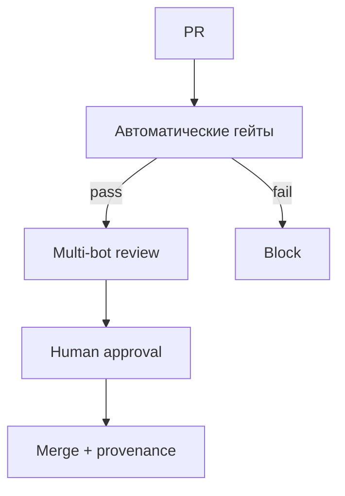

# Аудит кода

> [!info] Определение
> Аудит AI-сгенерированного кода: автоматические гейты перед человеком,
> глубина ревью по риску, multi-agent review и provenance. Доля дефектов сильно
> зависит от задачи, модели, тестов и методики; не считать один общий процент
> достоверной базовой частотой. См. [[Безопасность]], [[Аудит архитектуры]].

## Стандарт / источник

- GitHub Actions security hardening; OWASP Secure Coding with AI; SLSA provenance guidance.
- Industry playbooks предлагают layered gates, risk-tiered reviews и attribution.
- Проценты у коммерческих обзоров (уязвимость кода, accuracy гибридного ревью) —
  vendor-/sample-specific; не использовать как гарантию или универсальный SLO.
- OWASP Secure Coding with AI: https://cheatsheetseries.owasp.org/cheatsheets/Secure_Coding_with_AI_Cheat_Sheet.html
- GitHub Actions security hardening: https://docs.github.com/en/actions/security-guides/security-hardening-for-github-actions
- SLSA provenance: https://slsa.dev/spec/v1.2/build-provenance

## Гейты перед human review

| Гейт | Что ловит | Blocking |
|---|---|---|
| Secret scanning + push protection | Ключи в примерах/фикстурах | Yes |
| Dependency existence/reputation | Галлюцинированные/typosquat пакеты | Yes |
| SCA | Уязвимые версии из stale training data | Yes above severity |
| SAST + taint analysis | Injection, path, deserialisation | Yes high/critical |
| IaC scanning | Открытые SG, wildcard IAM | Yes |
| Test/coverage delta | Ослабленные assertions | Warn → block |
| Hidden Unicode check | Невидимые инструкции в rules | Yes |
| Changed-path policy | Правки workflows/CODEOWNERS | Code owner review |

**Принцип:** machines in front of humans — гейты как required checks, а не advice.

## Глубина ревью по риску

| Тип изменения | Ревью |
|---|---|
| Boilerplate, тесты, доки | Гейты + 1 human review |
| Business logic, API, data access | Гейты + flaw checklist; authorisation явно |
| Auth, crypto, payments | Гейты + security champion/AppSec |
| CI/CD, infra, instruction files | Code owner mandatory, no self-approval |
| Agent PR без human author | Два approvals, включая owning team |

## Multi-bot review chains

```
Agent A (implements) → PR
  → [Agent B (reviews) | Agent C (adversarial tests)]
  → Both post findings → Agent A addresses → Human approves
```

## Provenance и attribution

- Mark AI-assisted commits/PRs (label, commit trailer).
- Агенты — собственные identities; commit signing (GPG/SSH).
- Неатрибутированный agent PR не мержится по одному approval.
- Sample merged AI PRs monthly для security-focused second review.

## Audit checklist

- [ ] TruffleHog по всей Git-истории; ротация exposed credentials
- [ ] Semgrep OWASP Top 10: zero critical перед релизом
- [ ] Snyk/npm audit: zero critical CVE; high — с планом
- [ ] OWASP ZAP DAST на staging: high/critical исправлены
- [ ] Error handling: нет stack traces/internal paths в ответах
- [ ] Deserialization: schema validation на весь parsed input
- [ ] CI gates активны и не bypassable; bypass logs за 30 дней
- [ ] AI coding policy задокументирована (SOC 2/GDPR evidence)

## Диаграмма



## Мнемоника

**«Гейты, Риск, Цепочки, Происхождение»** — ГРЦП.

## Связи

- [[Безопасность]] · [[Аудит архитектуры]] · [[Следование архитектуре]] · [[Тесты]] · [[Большие кодовые базы]] · [[Архитектура агентной software factory]] · [[Инструменты аудита для software factory]]

## Типичные ошибки

> [!warning]
> AI review как approval: никогда. Гейты как advice: не блокируют. Нет provenance:
> нельзя расследовать. Один approval на agent PR: никто не читал код.
