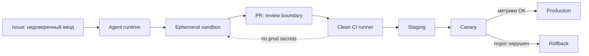

# Безопасный деплой агентами

> [!info] Определение
> Агент помогает подготовить релиз, но promotion выполняется независимыми policy gates,
> отдельными identity и наблюдаемыми rollback условиями. Production — не продолжение sandbox.
> См. [[Инструменты агентной среды]], [[Агентский CI-CD]], [[Безопасность]].

## Trust boundaries



## Обязательные границы

1. **Agent runtime** не получает production credentials.
2. **Sandbox** изолирован per task, недоверенный код не запускается на долгоживущем self-hosted runner.
3. **PR** — артефакт передачи ответственности: diff + тестовые результаты + сканы + provenance.
4. **CI** запускает проверки независимо на чистой среде, не доверяя self-reported выводам агента.
5. **Deployment identity** — отдельная от агента; short-lived OIDC credential, минимальный scope.
6. **Production environment** требует reviewer approval; запрет self-review.
7. **Canary** имеет заранее определённые метрики и пороги rollback.

## GitHub Actions: pattern

```yaml
permissions:
  contents: read

jobs:
  verify:
    permissions:
      contents: read
      checks: write
    # clean runner; no deployment secrets

  deploy-production:
    needs: verify
    environment: production # environment has required reviewers + branch rules
    permissions:
      contents: read
      id-token: write # OIDC, short-lived cloud identity
    # cloud role restricted to this repo, workflow, environment, and target
```

Пример иллюстративный: проверьте permissions для используемых actions, pin-ите их на SHA,
а OIDC trust policy ограничьте repository/ref/environment. Не выдавайте `write-all`.

## Progressive delivery

| Шаг | Gate |
|---|---|
| Build | Reproducible artifact, dependency/SBOM scan, signature/provenance |
| Staging | Smoke + integration + migrations compatibility |
| Canary 1 | Малый трафик; error rate, latency, saturation, business KPI |
| Canary N | Увеличение exposure только после окна стабильности |
| Promote | Явная policy и approval по risk tier |
| Rollback | Автоматический при порогах; проверенный ручной override |

С помощью Argo Rollouts можно задать canary weights, pauses, metric analysis и автоматический
abort. Проверить отдельно: что делает rollback с внешними side effects, миграциями, сообщениями;
предпочитать backward-compatible expand/contract миграции.

## Policy tiers

| Изменение | Автоматизация | Approval |
|---|---|---|
| Preview/test environment, disposable | Авто после CI | Без production данных/секретов |
| Staging deployment | Авто при полном CI | Владелец сервиса — по необходимости |
| Canary production, низкий риск | Автоматический старт только по policy | Release owner доступен для остановки |
| Production promotion | Только по доказательствам и явным правилам | Назначенный human reviewer |
| IAM, network policy, secrets, schema destructive | Предложение PR, не автономное исполнение | Security/platform owner обязателен |

Уровень autonomy всегда ограничить наименьшим из: риск изменения, доверие к тестам,
blast radius, обратимость, уверенность в наблюдаемости.

## Чек-лист готовности к автоматическому promotion

- [ ] Дифф и build artifact привязаны к commit SHA; артефакт неизменяемый после CI
- [ ] CI на чистом runner; test result не подделывается agent-процессом
- [ ] SBOM и provenance сохранены; image/dependency scan пройден
- [ ] Deployment role short-lived и scoped; agent не видит credential
- [ ] Branch protection + required checks + owners на чувствительные файлы
- [ ] Production approval вне агентской сессии; запрещён self-review
- [ ] Canary метрики отделимы от baseline, пороги и окна заданы до релиза
- [ ] Rollback проверен на traffic, schema, queue, external side effects
- [ ] Кто-то on-call может остановить promotion; есть kill switch
- [ ] События связаны trace ID → task → PR → commit → artifact → deployment
- [ ] Rollback/approval/bypass записываются в immutable audit log

## Важные ограничения

- Canary не спасает от необратимых side effects (списания, email, миграции) без idempotency/compensation.
- Rollback к старой версии не отменяет данные, уже записанные новой версией.
- Green tests не доказывают корректность или безопасность; проверки дополняют друг друга.
- Не разрешать агенту изменять собственные branch protections, secrets policy и required checks.
- Retry разрешён только для классифицированной transient ошибки; не ретраить auth/security failures вслепую.

## Источники

- GitHub: hardening Actions — least privilege, OIDC, runner risks: https://docs.github.com/en/actions/security-guides/security-hardening-for-github-actions
- GitHub: environments, required reviewers, prevent self-review: https://docs.github.com/en/actions/deployment/targeting-different-environments/using-environments-for-deployment
- Argo Rollouts: canary/progressive delivery: https://argo-rollouts.readthedocs.io/en/stable/concepts/
- Argo Rollouts: rollback behavior and smoke-test analysis: https://argo-rollouts.readthedocs.io/en/stable/FAQ/
- SLSA Build Provenance v1.2: https://slsa.dev/spec/v1.2/build-provenance
- SLSA artifact verification: https://slsa.dev/spec/v1.0-rc2/verifying-artifacts

## Мнемоника

**«Чистый CI, Scoped identity, Approval, Canary, Rollback, Trace»** — ЧСАКРТ.

## Связи

- [[Инструменты агентной среды]] · [[Агентский CI-CD]] · [[Уровни автономии]] · [[Безопасность]] · [[Аудит кода]] · [[Следование архитектуре]]
