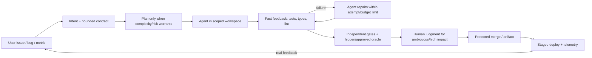

# Код, контекст и минимальный harness

> [!abstract] Тезис
> Модель может писать и исследовать код без большого набора инструкций; код, тесты,
> схемы и инструменты действительно являются самой сильной документацией о наблюдаемом
> текущем поведении. Но базовые знания модели не равны знаниям о текущем приватном репозитории,
> целям продукта, локальным рискам и полномочиям. Лучший factory-подход — не «документировать
> всё» и не «не давать модели рамок», а сделать исходники первичным источником для выводимых
> фактов, хранить только недостающий intent/decision/policy, загружать контекст по требованию
> и проверять результат независимыми feedback sensors.

## Вопрос, который нужно поставить честно

**Может ли harness мешать? Да.** Большие always-on инструкции конкурируют с задачей за контекст,
устаревшие правила фиксируют случайные паттерны, противоречивые требования побуждают модель
угождать тексту вместо поведения, а избыточная оркестрация добавляет latency и failure modes.

**Может ли модель «сама всё знать»? В общем случае нет.** Предобучение даёт вероятностные знания
об общих языках, библиотеках и привычных решениях, но не сообщает актуальные private APIs,
текущую ветку, production-конфигурацию, организационные договорённости, требуемое поведение
и цену ошибки. Она может искать текущую истину в репозитории — если ей доступны подходящие
инструменты и безопасный доступ. Знание модели и доказательство из текущего кода — разные вещи.

## Три разные истины

| Вопрос | Лучший источник истины | Что может добавить документация |
|---|---|---|
| Что система **сейчас делает**? | Исполняемый код, runtime config, schema, observed telemetry | Навигация, объяснение границ и неочевидных последствий |
| Что система **должна делать**? | Product intent, acceptance contract, approved requirements | Чёткие критерии, сценарии, отрицательные ограничения |
| Почему **решили так** и что нельзя нарушить? | ADR, security policy, owners, regulatory obligations | Причины, trade-offs, responsibility, expiry/review trigger |

Код является первичным доказательством только для поведения, реально представленного в нём.
Код не может сообщить, что реализация неверно поняла продуктовый intent. Тесты тоже не абсолютный
oracle: они показывают только закодированные assertions, а тесты, написанные тем же агентом,
могут разделять слепые зоны implementation.

## «Код — документация»: где это работает

- API contracts, типы, схемы, CLI help и валидируемые конфигурации — часто точнее prose-дубликата.
- Tests/property tests/fixtures — исполняемые примеры поведения; полезны для regression и discovery.
- Имена, модульные границы, явные зависимости и small functions помогают вывести архитектуру.
- Logs/traces/metrics и живой executable environment отвечают на вопрос о фактическом runtime.
- Generated reference docs лучше поддерживать генерацией из source-of-truth, чем вручную копировать.

### Где утверждение ломается

- **Intent не выводится из implementation**: реализованное поведение может быть багом.
- **Отсутствие требования в коде не значит разрешение**: ограничения, privacy policy и threat model часто не имеют единственного source file.
- **Rationale не выводится из diff**: непонятны rejected alternatives, migration risk и исторические constraints.
- **Репозиторий неполон**: договорённости могут быть во внешних системах; если они определяют поведение, их надо перенести/ссылочно закрепить в доступном source of truth.
- **Кодовая археология стоит времени**: неочевидный domain invariant может быть дешевле один раз задокументировать, чем каждый раз переоткрывать.

**Правило:** не писать prose, которая механически выводится из кода и быстро расходится; писать
то, чего код сам не сообщает (intent, rationale, границы доверия, ownership, запуск, recovery).

## Harness как регулятор, а не клетка

Harness — широкое понятие. Для практического проектирования разделяйте:

- **Builder/runtime harness** — цикл агента, инструменты, права, context management, sandbox.
- **Outer/task harness** — локальные правила проекта, contracts, скрипты, CI, review и deployment gates.

По модели Martin Fowler / Thoughtworks harness имеет два направления и два типа механизмов:

| Направление | Computational (детерминированное) | Inferential (вероятностное) |
|---|---|---|
| Feedforward — до действия | Types, schema, CLI, formatter, scoped tools, code templates | Краткие правила, пример паттерна, task contract |
| Feedback — после действия | Tests, lint, typecheck, SAST, architectural fitness, runtime probes | AI reviewer, semantic review, LLM judge |

Не превращайте каждый стиль предпочтения в hard gate. **Hard gate** оправдан для объективного,
важного и машинно-проверяемого инварианта. **Мягкая подсказка** — для контекстного предпочтения,
которое должно уступать обоснованному решению. **Нет артефакта** — если правило очевидно из
локального кода и легко проверяется при поиске.

## Минимально достаточный контекст

Anthropic рекомендует думать о context как о конечном ресурсе и загружать нужные данные по мере
необходимости: path/query/tool reference вместо preload всего корпуса. При этом «minimal» не
означает автоматически короткий: context должен быть достаточным именно для ожидаемого поведения.

Практический порядок:

1. **Ноль дублирующей справки**: разрешить агенту искать код, symbols, tests и схемы.
2. **Короткий индекс**: способы запустить проект, test command, карта модулей, где лежат решения.
3. **On-demand knowledge**: подгружать ADR/domain/security/API детали по пути и триггеру.
4. **Только неоднозначное и load-bearing**: явно описать правила, которые нельзя надёжно вывести.
5. **Проверять полезность артефакта**: если правило редко нужно, неверно, противоречит коду или увеличивает ошибки — исправить/удалить.

### Диагностика «инструкция помогает или мешает?»

Сравнить на репрезентативных задачах с фиксированной версией модели/runtime:

- baseline: agentic search + обычные build/test tools;
- treatment: тот же путь + конкретный context artifact/rule;
- измерить acceptance/hidden tests, violations, rework, time/cost, token/context use;
- отдельно проверить ошибки, которые это правило предотвращать и должно;
- оставить правило, если выигрыш воспроизводим и превышает стоимость/побочные эффекты.

Не делать вывод из одной удачной сессии. Не удалять security/правовые ограничения только потому,
что небольшой eval set не увидел редкий high-impact сценарий.

## Factory-паттерн: smallest closed loop



### Что должно быть в каждом звене

| Этап | Минимальный артефакт/контроль | Не надо добавлять без нужды |
|---|---|---|
| Intake | Issue с outcome, scope, acceptance, risk/stop condition | Полную PRD для тривиального change |
| Context | Search, LSP, runtime docs, ссылки на intent | Загрузку всего монорепо в prompt |
| Execution | Рабочая ветка/worktree; sandbox по уровню угрозы | Multi-agent choreography на один файл |
| Feedback | Самый быстрый точный test/lint цикл | LLM review вместо детерминированного test |
| Independent verification | Проверки вне контроля агента; защищённые oracle/CI config | Дублирование десятка одинаковых AI reviewers |
| Human attention | Новая архитектура, продуктовая неоднозначность, high-risk approval | Ручное чтение каждой машинно-проверяемой мелочи |
| Release | Provenance, controlled promotion, rollback/monitoring | Прямые production credentials в agent session |

**Planning — условный этап, а не догма:** для понятного локального исправления план может быть
пустой затратой; для cross-module/security/schema изменений сначала согласовать дизайн и зависимости.
**Subagents — условный инструмент:** хорошо для независимого breadth-first поиска или свежего review;
плохо для tightly coupled edits и случаев, где coordination overhead превышает выигрыш.

## Invariants вместо микроменеджмента

OpenAI описывает agent-first greenfield-проект: сначала repo был пуст, затем команда внедряла
инструменты и структуру, а architecture invariants закрепляла линтерами и structural tests.
Их опубликованные показатели — внутренний self-reported case, а не независимый benchmark и не
прогноз для legacy-кода. Переносимая идея не «копировать 1M LOC фабрику», а:

- фиксировать архитектурные **границы и инварианты**, оставляя свободу внутри них;
- превращать повторяющуюся ошибку агента в улучшение feedback/tool/context;
- делать context доступным из репозитория, но не превращать корневой файл в энциклопедию;
- дать агенту возможность увидеть runtime (tests, browser, logs/metrics) в безопасном scope;
- строить автоматизированную уборку drift/obsolete artifacts.

Пример: «parse/validate data at boundary» может быть invariant; требование всегда использовать
конкретную библиотеку без причины — потенциально хрупкая implementation prescription.

## Измерять не идеологию, а полезность

METR RCT (2025) обнаружил замедление в своём конкретном раннем эксперименте с опытными
open-source разработчиками и зрелыми репозиториями. Сам METR в 2026 отметил, что новые данные
стали ненадёжным сигналом из-за selection effects и параллельного использования нескольких
агентов; исходный результат не универсален и не описывает все современные workflows. DORA 2025
характеризует AI как amplifier организационных возможностей/слабостей, а не как гарантию
продуктивности. Вывод: проводить локальные сравнения и измерять outcome system-level.

Минимальный набор пилота:

- **Effectiveness**: accepted changes / task eval pass rate / user outcome.
- **Quality & stability**: escaped defects, change failure, rework/churn.
- **Flow**: time to accepted/merged change, review queue, blocked time.
- **Cost**: cost и human review effort per accepted outcome.
- **Safety**: policy violations, unauthorized actions, secret/exfiltration incidents.
- **Experience**: когда агент снял toil и когда добавил review/debugging toil.

Не сравнивать голые PR count, LOC, token use или субъективное «кажется быстрее». Зафиксировать
baseline, период и task mix; отдельно маркировать assisted/agent-authored работы с ясными правилами.

## Дерево решений: нужен ли артефакт?

```text
Нужно ли это агенту, чтобы отличить желаемое поведение от похожего неверного?
├─ Нет → не добавлять контекст.
└─ Да
   ├─ Факт выводится из актуального source/code/test/tool? → дать хороший поиск/команду.
   ├─ Факт повторяется, имеет owner и может быть generated? → генерировать/проверять в CI.
   ├─ Это intent, rationale, exception, threat, workflow или policy? → короткий reviewed artifact.
   └─ Это hard safety invariant? → enforce в permission/policy/CI, prose только объясняет.
```

## Рекомендуемая позиция

- «Model knows everything» — полезная рабочая гипотеза для поиска/исследования, но не авторитет
  о приватном и текущем состоянии; попросить evidence из конкретного repo/runtime.
- «Code is the documentation» — применять к текущему исполняемому поведению и генерируемым фактам.
- «Harness gets in the way» — реально для избыточных, stale и конфликтующих инструкций; проверить
  экспериментом и удалить ненужное.
- «No harness» — тоже выбор с ценой: слабее воспроизводимость, права, feedback и accountability.
- **Цель software factory** — не максимум autonomy и не максимум docs, а наименьший set of guides,
  tools и sensors, который даёт приемлемую безопасность и воспроизводимое качество для данного risk tier.

## Источники и границы доказательств

- OpenAI, *Harness engineering: leveraging Codex in an agent-first world* (2026-02-11): case study; данные и throughput — self-reported, greenfield, конкретный runtime: https://openai.com/index/harness-engineering/
- Martin Fowler / Thoughtworks, *Harness engineering for coding agent users* (2026-04-02): guides vs sensors, computational vs inferential, limitations of behavior harness and human judgment: https://martinfowler.com/articles/harness-engineering.html
- Anthropic, *Effective context engineering for AI agents* (2025-09-29): context as finite resource, just-in-time retrieval, minimal sufficient context: https://www.anthropic.com/research/effective-context-engineering-for-ai-agents
- Anthropic, *Building agents with the Claude Agent SDK*: gather context → act → verify; filesystem/bash search: https://www.anthropic.com/engineering/building-agents-with-the-claude-agent-sdk
- METR, early-2025 RCT: https://metr.org/blog/2025-07-10-early-2025-ai-experienced-os-dev-study/
- METR, 2026 study update: current early-2026 estimate has selection/measurement limitations and is not a clean universal uplift: https://metr.org/blog/2026-02-24-uplift-update/
- DORA 2025, AI as amplifier and organizational capabilities: https://dora.dev/research/2025/dora-report/

## Связи

- [[Harness-инжиниринг]] · [[Большие кодовые базы]] · [[Навигация по коду]] · [[Контракт задачи для агента]] · [[Тесты]] · [[Аудит кода]] · [[Evals и метрики агентной разработки]] · [[Операционная модель агентных команд]] · [[Безопасность MCP и инструментов]]
