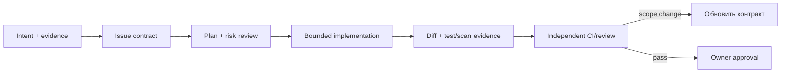

# Контракт задачи для агента

> [!info] Определение
> Issue/story — версионируемый контракт выполнения, не свободная подсказка.
> Он описывает intent, границы, observable acceptance criteria, invariants,
> проверку и условия эскалации. Сравнение вариантов task.json/task.md и project context см. в [[Исследование формата документации проекта и входящей задачи]]. См. [[Тесты]], [[Флоу]], [[Сквозной цикл разработки]].

## Почему issue-first

Переход от «сделай X» к Issue → Plan → Implement → Review делает задачу проверяемой,
помогает ограничить файлы/интерфейсы и удерживает непредусмотренную работу вне scope.
GitHub рекомендует хорошо описанные issues с acceptance criteria и точным scope;
Microsoft Agentic Agile предлагает оформлять acceptance criteria и negative constraints
как контракт до запуска агента. Это process guidance, не гарантия правильного результата.

## Шаблон контракта

```markdown
# [Verb + object] — краткий результат

## Intent / user outcome
Кто получает какую наблюдаемую пользу и почему сейчас?

## Current behavior / evidence
- Reproduction: ...
- Current result: ...
- Evidence: route, log, test, issue, source paths

## Scope
- In: ...
- Out / negative constraints: ...
- Allowed files/modules: ...

## Contracts and invariants
- Inputs/outputs, API/schema/event contracts
- Invariants that must remain true
- Existing implementation/pattern to reuse: `path/to/file`

## Acceptance criteria
- [ ] Given ... when ... then ... (observable assertion + location)
- [ ] Regression/negative cases ...

## Validation
- Commands: `...`
- Required CI checks: ...
- Evidence to attach: test output, scan result, screenshot/trace

## Risk and authority
- Risk tier: low / medium / high / critical
- Agent may: inspect / edit / run tests / open PR
- Agent may not: ...
- Human owner / approval required: ...
- Rollback or stop condition: ...

## Open questions
- [ ] Question; owner; blocking? yes/no
```

## Правила хорошей задачи

1. **Одно ядро изменения**: одна цель/граница изменения; крупную эпопею разбить на issues.
2. **Критерии проверяемы**: путь/эндпоинт + наблюдаемое утверждение + команда/тест.
3. **Отрицательные ограничения явны**: что не менять, не мигрировать, не публиковать.
4. **Ссылки на существующее**: путь, символ, API contract, ADR — не «используй обычный паттерн».
5. **Не выдумывать неизвестное**: блокирующие вопросы — запросить до изменений; остальные записать как assumptions.
6. **План до широких изменений**: затронутые модули, последовательность, тесты, риск; человек проверяет план по порогу риска.
7. **Смена scope — через issue/approval**, не тихо в процессе исполнения.
8. **Выход — evidence, не уверенное резюме**: перечислить команды и их exit status; непроверенное обозначить.

## Handoff между агентами

| Handoff | Обязательная передача |
|---|---|
| Planner → Implementer | Одобренный план, scope, интерфейсы, open questions, stop conditions |
| Implementer → Reviewer | Diff/commit, intent, тесты и результаты, известные ограничения |
| Reviewer → Implementer | Приоритет findings + file/line + доказательство + требуемое исправление |
| Agent → Human | Что изменено, что реально запускалось, failed/skipped checks, риски, approval needed |
| CI → Release | Commit/digest, provenance, scan/test results, environment и rollback plan |

Не передавать только свободный пересказ чата: он теряет ссылки, границы и доказательства.
Сохранять handoff как issue/PR comment или артефакт workflow.

## Разделение ролей и независимость

Для чувствительных задач разделить implementation и verification: другой агент или CI
проверяет acceptance criteria, security properties и test quality. Но два агента на одной
модели/одном контексте не являются независимым oracle. Решающий oracle — исполняемые тесты,
policy checks, владельцы кода и человек по risk tier.

## Пример короткого acceptance criterion

```text
Given an authenticated user without `orders:read`
When GET /v1/orders/123 is called
Then the API returns 403, emits no order fields, and records an authorization-denied event
```

Проверить: fixture определяет пользователя; test asserts status + response body + audit event;
endpoint и соответствующий integration test указаны ссылками.

## Диаграмма



## Мнемоника

**«Намерение, Границы, Критерии, Проверка, Полномочия, Доказательства»** — НГКППД.

## Связи

- [[Тесты]] · [[Флоу]] · [[Сквозной цикл разработки]] · [[Уровни автономии]] · [[Аудит кода]] · [[Пример пакета документации фичи]]

## Источники

- GitHub: From idea to PR, issue scope/acceptance criteria: https://github.blog/ai-and-ml/github-copilot/from-idea-to-pr-a-guide-to-github-copilots-agentic-workflows/
- Microsoft: Agentic Agile, specs/issues before execution: https://developer.microsoft.com/blog/agentic-agile-why-agent-development-needs-agile-not-just-prompts/
- OpenAI: Evals, define task/data/graders: https://platform.openai.com/docs/guides/evals
