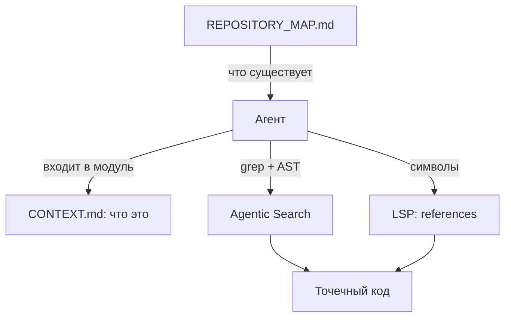

# Навигация по коду

> [!info] Определение
> Как агент находит код в большой базе: agentic search, LSP, semantic index,
> repo maps, per-module CONTEXT.md. Агент не должен делать археологию.
> См. [[Большие кодовые базы]], [[Index-First подход]].

## Стандарт / источник

- Anthropic: agentic search replaces RAG (grep + AST over stale vectors).
- SpecKeep: REPOSITORY_MAP.md + per-module CONTEXT.md.
- Code Index skill: two-layer map (structural tree-sitter + semantic AI summaries).

## Agentic search (вместо RAG)

Traditional embedding pipelines отстают от коммитов. Агент обходит локальную ФС
в реальном времени: grep + AST-парсеры → контекст из текущего состояния кода.
Без внешних vector DB и sync pipelines.

## LSP integration

- Поиск по символам, а не строкам: go to definition, find all references.
- Type information без чтения десятков файлов — экономия контекста.
- Критично для рефакторинга: rename function → все callers видны.

## Repo maps и CONTEXT.md

```
REPOSITORY_MAP.md          ← что существует (карта)
<module>/CONTEXT.md        ← что это такое (почему, кто зависит, что трогать)
```

| Module | Role | Context |
|---|---|---|
| src/checkout | payments domain | src/checkout/CONTEXT.md |
| ui/billing | customer dashboard | ui/billing/CONTEXT.md |

- CONTEXT.md ~60 строк, пишет агент (/spk-module-context).
- Карта говорит «что», CONTEXT.md — «что это и почему».
- Машинные факты (cycles, impact sets) — generated graph поверх.

## Two-layer code index

| Слой | Что | Как |
|---|---|---|
| Layer 1 (structural) | Символы, структура | tree-sitter, детерминированно |
| Layer 2 (semantic) | Что код значит, связи, абстракции | AI subagent summaries |

## Инструменты

| Инструмент | Подход |
|---|---|
| Sourcegraph | SCIP indexing, cross-repo, MCP |
| Augment Code | Context Engine, semantic search |
| Greptile | Semantic graph, review-focused |
| Copilot #codebase | Semantic search с workspace index |
| RepoCloud | Local knowledge graph, zero-config |

## Диаграмма



## Мнемоника

**«Карта, Контекст модуля, Поиск, Символы»** — ККПС.

## Связи

- [[Большие кодовые базы]] · [[Index-First подход]] · [[Codified Context (3 яруса)]] · [[Аудит кода]]

## Типичные ошибки

> [!warning]
> Vector RAG с устаревшим индексом: агент работает со stale кодом. Нет per-module
> CONTEXT.md: агент re-derives архитектуру grep'ом. Только generated graph без «почему»:
> машины хороши в edges, бесполезны в why.
