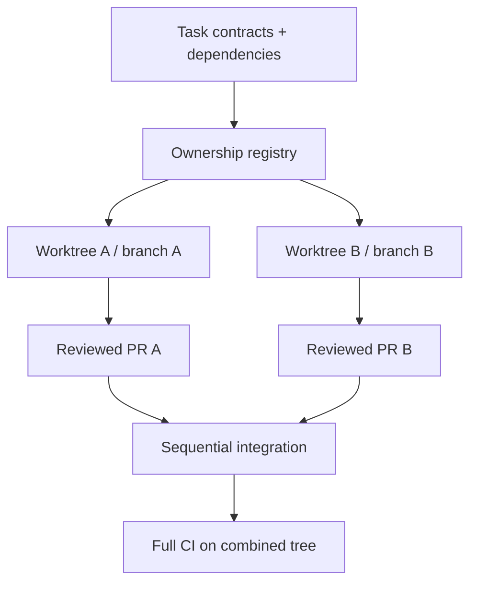

# Параллельная работа агентов

> [!info] Определение
> Безопасная параллельность — независимые, bounded задачи в отдельных рабочих деревьях,
> с единым task registry и последовательной интеграцией. Worktree изолирует рабочие файлы,
> но не гарантирует семантическую независимость. См. [[Контракт задачи для агента]],
> [[Большие кодовые базы]], [[Аудит кода]].

## Когда параллелить

Параллелить удобно **исследование** и реализацию с независимыми контрактами. Сначала
последовательно решить общую схему, если задачи меняют один API, схему БД, lockfile,
центральную конфигурацию или общий компонент. Количество агентов выбирается по доступной
ёмкости интеграции/ревью, а не по фиксированному правилу: рост конфликтов и очереди ревью
съедает выигрыш от параллелизма.

## Рабочие правила

1. Начинать все независимые worktrees с известного commit SHA и чистого состояния.
2. Одно outcome на task; для каждого — владелец, branch, path, allowed files, exclusions.
3. Зависимость или общий интерфейс сначала согласовать и зафиксировать в contract/commit.
4. Каждый агент работает в своём worktree и своей ветке; общие файлы заранее назначить одному владельцу.
5. Git-интеграцию и обновление общих refs выполнять координированно; не полагаться на одновременные операции.
6. Интегрировать по одному PR/branch, после каждого шага прогонять проверки на итоговом дереве.
7. Конфликт разрешать в integration branch после остановки параллельного редактирования, не в активном worktree.
8. Удалять устаревшие worktrees после принятия/отказа изменений; фиксировать неслитые остатки.

## Что worktree изолирует — и что нет

| Обособлено worktree | Всё ещё может быть общим |
|---|---|
| Рабочие файлы и index | Git common object database и часть refs/config |
| Текущий checkout / HEAD | Docker daemon, базы данных, caches, services |
| Незакоммиченные правки между директориями | Порты, внешние API, registry credentials, cloud resources |

Worktree — не sandbox безопасности: недоверенный код всё ещё может иметь доступ к общим
сервисам и сети процесса. Для разных trust zones (например, внешний PR) использовать
отдельную ephemeral среду, scoped credentials и сетевые ограничения.

## Task registry

| Task | Agent | Branch | Worktree | Allowed scope | Depends on | Status | Integration owner |
|---|---|---|---|---|---|---|---|
| API error response | Agent A | `agent/api-errors` | `../wt-api-errors` | `src/api/errors/**` | Contract C-14 | active | Platform |
| UI error display | Agent B | `agent/ui-errors` | `../wt-ui-errors` | `web/errors/**` | API error response | blocked | Web |

Реестр может быть issue board/PR list, не обязательно отдельная БД; важно исключить двойное
назначение и видимо фиксировать блокировки.

## Команды Git (иллюстрация)

```bash
git status --short
git rev-parse HEAD  # сохранить baseline SHA

git worktree add -b agent/task-a ../wt-task-a <base-sha>
git worktree list --porcelain

# После review — интеграция в отдельной рабочей копии/ветке
# Далее проверить combined result полным required CI.
git worktree remove ../wt-task-a
git worktree prune
```

Перед удалением убедиться, что нужные коммиты сохранены, а uncommitted changes не потеряны.
Не запускать бездумно `git clean -fdx`; команды, удаляющие данные, должны быть подтверждены.

## Признаки, что задачи не независимы

- обе меняют один файл, интерфейс, миграцию или lockfile;
- одна задача не может сформулировать acceptance criteria без решения другой;
- агенты генерируют несовместимые предположения о поведении;
- итоговое тестирование зависит от порядка merge;
- shared environment делает состояние одного агента видимым другому.

Решение: согласовать контракт, разделить ownership, интегрировать предпосылку первой или
перевести задачи в последовательный режим.

## Диаграмма



## Мнемоника

**«Контракт, Владелец, Worktree, Интеграция, Проверка, Очистка»** — КВВИПО.

## Связи

- [[Контракт задачи для агента]] · [[Инструменты агентной среды]] · [[Уровни автономии]] · [[Аудит кода]] · [[Безопасность]] · [[Evals и метрики агентной разработки]]

## Источники

- Git documentation: git-worktree shares repository while providing linked working trees: https://git-scm.com/docs/git-worktree
- VS Code: conversations using same folder/worktree can edit same files; choose New Worktree for isolation: https://code.visualstudio.com/docs/copilot/chat/chat-sessions
