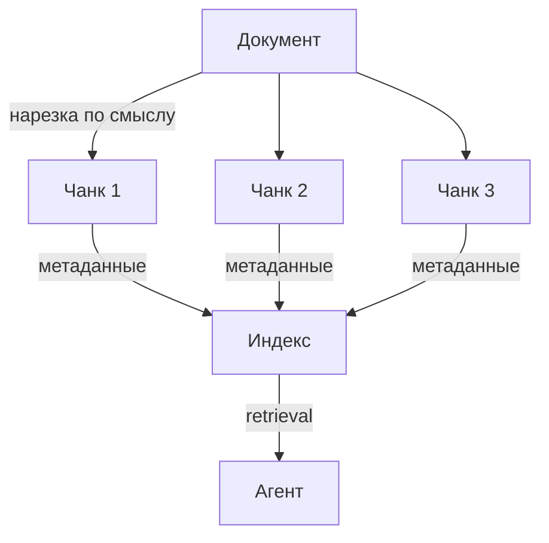

# Семантический чанкинг

> [!info] Определение
> Нарезка документации на семантические чанки с метаданными и связями —
> единица retrieval для агента. Чанк должен быть самодостаточен.
> См. [[AI-Native Documentation]], [[Структурированный Markdown]].

## Стандарт / источник

- AI-native documentation: ingestion → structured JSON (chunks, metadata, relationships).
- agent-docs: DOC.md ~100 строк, subtopic deep-dive ~150 строк.

## Правила чанкинга

| Правило | Значение |
|---|---|
| Размер | ~100 строк на DOC.md; ~150 для deep-dive |
| Самодостаточность | Чанк понятен без окружающего контекста |
| Метаданные | Каждый чанк: тема, пути, триггер, дата |
| Связи | Ссылки на соседние чанки и источники |
| Границы | По смыслу (раздел/концепт), а не по объёму |

## Пример структуры чанка

```markdown
---
title: Token refresh flow
paths: [src/auth/refresh.*]
tags: [auth]
---

## Token refresh flow

- Trigger: access token older than 15 minutes
- Flow: client → gateway → identity provider → Redis cache
- Failure: provider timeout → retry with backoff (max 3)
- Source: https://example.com/docs/auth.md
```

## Диаграмма



## Мнемоника

**«Смысл, Размер, Метаданные, Связи»** — СРМС.

## Связи

- [[AI-Native Documentation]] · [[Структурированный Markdown]] · [[Frontmatter-схемы]] · [[Index-First подход]]

## Типичные ошибки

> [!warning]
> Нарезка по объёму (N символов): чанки рвут смысл. Чанки без метаданных: retrieval
> вслепую. Слишком крупные чанки: шум в контексте.
