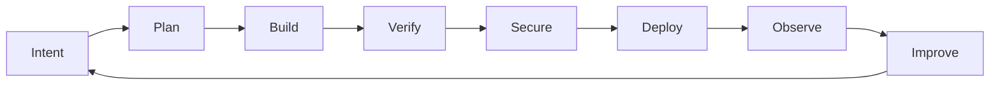

# Сквозной цикл разработки

> [!info] Определение
> Агентский SDLC: Intent → Plan → Build → Verify → Secure → Deploy → Observe →
> Improve. Каждый переход — за своим агентом; человек — на чекпоинтах.
> См. [[Уровни автономии]], [[Агентский CI-CD]], [[Аудит кода]].

## Цикл и агенты

| Стадия | Агент | Что делает |
|---|---|---|
| Intent | Requirements agent | Acceptance criteria, affected services, edge cases |
| Plan | Architecture agent | Опции с trade-offs, sequence diagrams |
| Build | Coding agent | Ветка, реализация scoped-задач |
| Verify | Test agent | Unit/integration/negative тесты, triage |
| Secure | Security agent | Token validation, secrets, policy |
| Deploy | Release agent | Подготовка и валидация promotion |
| Observe | Ops agent | Логи, traces, инциденты |
| Improve | Optimization agent | Предложения следующего изменения |

## 4 фазы внедрения

| Фаза | Режим | Человек |
|---|---|---|
| 1. Assisted | Генерация кода/тестов/доков | Ведёт каждый шаг |
| 2. Coordinated | Planning + review + test агенты в CI | Ревьюит результаты |
| 3. Governed automation | Auto PRs, policy enforcement | Approval gates |
| 4. Adaptive delivery | Production feedback loops | Мониторинг исключений |

## Стек среды

| Компонент | Роль |
|---|---|
| Orchestration layer | Роутинг работы к агентам |
| Sandbox | Изолированное исполнение кода |
| Context store | Кодовая база, контракты, решения |
| Policy engine | Может сказать «нет» |
| CI/CD | Вывод агента едет той же дорогой, что и человека |
| Observability | Замыкает loop от production к intent |
| Human approval | Workflow с реальными полномочиями |

## Пример: одна фича

1. Requirements agent: критерии, сервисы, edge cases.
2. Architecture agent: OIDC flow, sequence diagram, tenant isolation.
3. Coding agent: ветка, handlers, конфигурация.
4. Test agent: тесты, прогон, root cause hints.
5. Security agent: token validation, redirect URI, secrets.
6. Human reviewer: архитектура + diff + approval деплоя.

## Диаграмма

## Мнемоника

**«Намерение, План, Сборка, Проверка, Безопасность, Деплой, Наблюдение, Улучшение»** — НПСББДНУ.

## Связи

- [[Уровни автономии]] · [[Агентский CI-CD]] · [[Аудит кода]] · [[Harness-инжиниринг]] · [[Пример пакета документации фичи]]

## Типичные ошибки

> [!warning]
> Автономность без governance: сначала governance, потом autonomy. Старт с высокого
> риска: начинать с repetitive, measurable, low-risk workflow. Нет observability:
> loop не замыкается.
